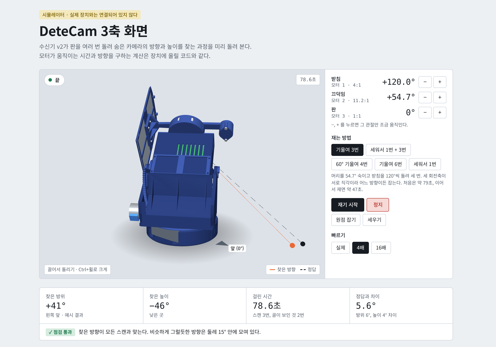

<div align="center">

# DeteCam 수신기

**숨은 Wi-Fi 카메라의 방향과 위치를 찾는 수신기**

### [▶ 시뮬레이터 바로 열기](https://detecam.github.io/receiver/) &nbsp;·&nbsp; [▶ 조립 영상](https://detecam.github.io/receiver/videos/) &nbsp;·&nbsp; [3D로 돌려 보기](docs/images/수신기_3D.stl) &nbsp;·&nbsp; [조립 안내](docs/조립%20안내.md) &nbsp;·&nbsp; [폴더와 파일](docs/폴더와%20파일.md)


</div>

## 어떻게 찾나

라즈베리파이의 Wi-Fi 안테나 둘레로 알루미늄 판(100 × 150mm)을 돌리면, 판이 카메라와 안테나 사이를 지날 때 카메라가 보내는 Wi-Fi 신호(CSI)가 꺼집니다. 꺼진 구간의 한가운데가 카메라 쪽입니다 (DiffLoc). 모터 세 개(받침 회전, 머리 끄덕임, 판 회전)로 머리를 54.7° 기울여 세 번 재면 방위와 높이가 나오고, 두세 자리에서 잰 결과를 합치면 카메라가 있을 만한 구간이 나옵니다. 노트북 없이 혼자 동작하고, 모든 동작을 폰 화면에서 조종합니다.


| 탐지 | 판별 | 위치 측정 | 표시 |
|---|---|---|---|
| 둘레 Wi-Fi 기기를 엿들어 영상을 올리는 기기를 추린다 (약 30초) | 걸으며 멈추면 전송량이 따라오는지 본다 (55초) | 판을 돌려 방향을 재고 2~4자리를 합친다 (한 자리 약 1분) | 폰에 추정 구간을 보여 준다 |

## 시뮬레이터

**[https://detecam.github.io/receiver/](https://detecam.github.io/receiver/)** 를 열면 브라우저에서 바로 돌아갑니다 (폰에서도 됩니다). 3D 모델을 끌어서 돌려 보고, 지도를 눌러 카메라를 숨긴 뒤 **재기 시작**을 누르면 장치가 실제 순서대로 움직이며 방향을 찾습니다. 계산은 장치에 올리는 코드와 같습니다. 인터넷 없이 보려면 [docs/simulator/index.html](docs/simulator/index.html) 을 내려받아 엽니다.



## 숫자로 보면 (계산과 시뮬레이션, 실물은 아직)

| 항목 | 값 |
|---|---|
| 방향 오차, 한 자리 (반사가 보통인 빈 방, 기울여 세 번 재기) | 가운데값 3.3~4.8° |
| 위치 오차 (같은 방, 세 자리를 합쳐) | 가운데값 9~13cm |
| 출력 | 여섯 판, 14시간 47분, 필라멘트 455g, 서포트 없음 (Bambu X1 Carbon, PLA) |
| 조립 | 테이프·풀 없이 나사 59개. 알루미늄 판(1T)은 구멍 없이 판 틀 홈에 넣고 누름쇠로 잡는다. [조립 시뮬레이션 영상](https://detecam.github.io/receiver/videos/) |
| 무게 | 머리와 판 469g. 끄덕임 모터 힘의 60% (재는 자세), 가장 깊이 숙여도 87% |
| 둘레 | 쓸 때 23cm 를 비운다 |

방 전체를 시간 영역 전파 계산(gprMax, 2차원)으로 풀어 수신기의 실제 계산 코드에 넣어 본 결과 (방 안의 카메라 후보 자리 전부):

| 방 | 지금 방법 (골 하나 찾기) | 곡선 전체 맞추기 (기준 곡선이 있을 때) |
|---|---|---|
| 보통 방 (벽돌, 옷장, 철제 서랍장) | 25.3°, 49% | 12.2°, 29% |
| 화장실 (타일, 거울) | 26.3°, 42% | 12.2°, 16% |

칸마다 방향 오차 가운데값과 30° 넘게 틀린 비율이다. 2차원 계산은 판·거울·벽이 위아래로 끝없이 긴 셈이라 실제보다 나쁘게 나오고, 세워서 한 번 잰 방위만 본 값이다 (장치는 기울여 세 번 재고 자리를 옮겨 합친다). 그래도 이 계산에서 **골 하나만 읽는 지금 방법은 방의 반사에 약했다** (크게 틀린 것의 상당수는 앞뒤를 뒤바꾼 것). 반사를 광선으로 어림한 위 표의 숫자는 그만큼 좋게 나온 값일 수 있다. 곡선 전체를 기준 곡선과 맞추면 크게 나아지는데, 기준 곡선은 실물로 재야 한다. 그래서 조립하고 맨 처음 탁 트인 곳에서 곡선을 재 본 뒤 정한다 ([설계 검토](docs/설계%20검토.md) 2절과 13절).

## 폴더

```
docs/       문서와 그림 (옵시디언 볼트의 DeteCam 폴더), simulator/ = 시뮬레이터
cad/        3D 모델 코드: model/ export/ checks/ analysis/ figures/ slicing/ results/
stl/        출력할 부품          print/      출력 파일 (G코드)          marker/     AR 마커
firmware/   수신기 코드: pi/ (장치) core/ (계산) host/ (개발용) tests/
sim/        시뮬레이션: direction/ location/ identify/ em/ (전파 계산)
console/    시뮬레이터 원본
```

파일 하나하나가 무엇인지는 **[폴더와 파일](docs/폴더와%20파일.md)** 에 있습니다.

## 처음이면 이 순서로

1. [조립 안내](docs/조립%20안내.md) — 살 것, 출력, 조립, 배선, 처음 켜기, 폰으로 재기. 부품을 미리 재지 않아도 됩니다
2. [설계 검토](docs/설계%20검토.md) — 왜 이렇게 만들었나: 오차, 판 모양, 넘어짐, 튼튼함, 검사, 실물에서 확인할 것
3. [네 단계 검토](docs/네%20단계%20검토.md) — 탐지 → 판별 → 위치 측정 → 표시, 곳별 결과
4. [혼자 동작](docs/혼자%20동작.md) — 파이에 설치하기, 폰 화면, 주소(API)

## 지금 상태 (2026-11-16)

- **출력 전**입니다. 계산과 시뮬레이션, 슬라이싱, 슬라이싱한 파일의 검증까지 했고 실물은 아직 없습니다.
- `print/gcode/0판_시험조각.gcode.3mf` 부터 뽑아 맞춤을 고릅니다.
- 2026-11-16: 응답 프레임(ACK)의 CSI 를 듣는 **ESP32(XIAO ESP32-C3)** 를 머리에 더했습니다 (안테나는 판 회전축 위, 보드는 뚜껑 안쪽). ESP32 가 ACK 의 CSI 를 내는지는 아직 재지 않았습니다. 조립 영상은 ESP32 를 더하기 전의 것입니다.

## 받기와 올리기

```
git clone https://github.com/DeteCam/receiver.git receiver
cd receiver
git pull                                   # 최신으로
git add -A && git commit -m "무엇을 바꿨나" && git push     # 올리기
```

옵시디언에서 고친 문서도 `docs/` 안의 파일이라 같은 명령으로 올라갑니다. 지난 판의 파일은 따로 두지 않습니다 (깃 기록에서 찾습니다).

## 바탕이 된 연구

- DiffLoc (USENIX Security 2025), DiffLoc+ (IEEE JSAC 2026): 전자기파 회절을 이용한 Wi-Fi 숨은 카메라 위치 추정
