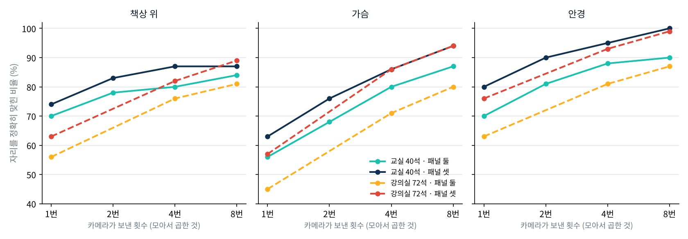
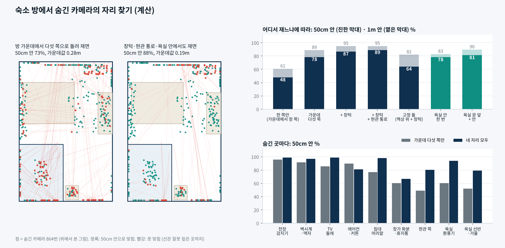
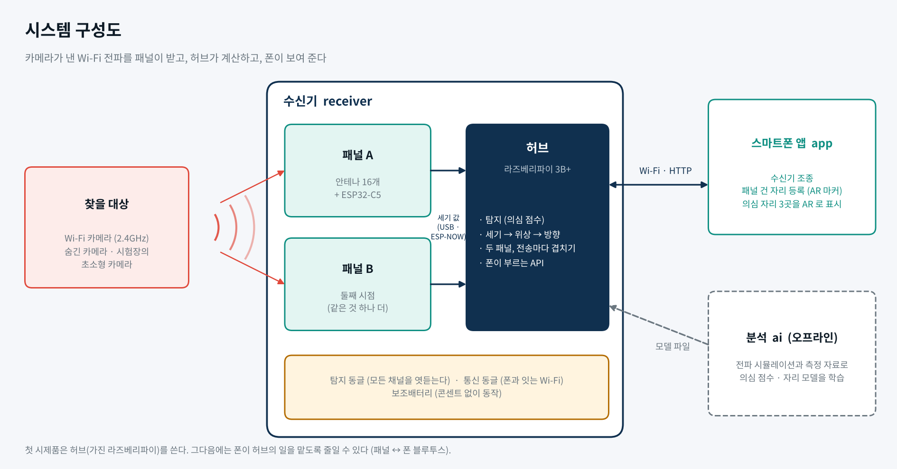

<div align="center">

# DeteCam 수신기

**숨은 Wi-Fi 카메라의 방향과 자리를 찾는 수신기. 안테나 16개 패널과 허브, 모터 없음**

### [▶ 동작 영상](https://detecam.github.io/receiver/videos/) &nbsp;·&nbsp; [설계도](docs/설계도.md) &nbsp;·&nbsp; [데모 환경](docs/데모%20환경.md) &nbsp;·&nbsp; [사전 검증](docs/사전%20검증.md) &nbsp;·&nbsp; [왜 이렇게 만들었나](docs/설계%20검토.md)


</div>

## 어떻게 찾나

패널에는 안테나 16개가 달린 15 cm 판이 있습니다. 전자 스위치로 안테나를 하나씩 골라 같은 전파를 16자리에서 받으면, 자리마다의 위상 차이에서 전파가 온 방향이 나옵니다. 한 번 재는 데 0.3초입니다. 돌아가는 것이 없어 소리가 나지 않습니다.

ESP32 는 수신 길이 하나라 안테나 사이의 위상을 직접 못 잽니다. 그래서 기준 안테나와 합친 세기를, 기준 길의 위상을 네 번 바꿔 가며 잽니다. 세기 네 개에서 위상이 나옵니다 (위상 배열 안테나를 보정할 때 쓰는 방법과 같은 셈입니다).

패널 둘을 마주 보는 두 벽의 2 m 높이에 걸어 둡니다. 두 방향이 만나는 곳이 카메라의 자리입니다. 걸어 둔 채 계속 재므로, 사람들이 자세를 바꾸는 사이 가려졌던 카메라가 보이는 순간을 모읍니다.


| 탐지 | 위치 측정 | 표시 |
|---|---|---|
| 허브가 둘레의 Wi-Fi 를 엿들어 의심 기기를 고른다 | 패널 둘이 그 기기가 보낼 때마다 방향을 잰다 (0.3초) | 허브가 자리 후보 셋을 폰에 보여 준다 |

## 숫자로 보면 (계산, 실물은 아직)

40명이 앉은 교실을 전파 경로 계산(Sionna RT)으로 풀었습니다 ([설계 검토](docs/설계%20검토.md), [패널 연구](sim/rt/패널%20연구.md)). 패널 둘을 창 유리와 복도 쪽 창턱의 2 m 높이에 걸고, 자리를 정확히 / 옆자리까지 맞힌 비율(%)입니다. 카메라 1,500대를 사람 자세가 다른 여덟 순간에 잰 것입니다.

| 카메라가 보낸 횟수 | 책상 위 | 가슴 | 안경 |
|---|---|---|---|
| 1번 | 69 / 89 | 52 / 79 | 62 / 91 |
| 4번 | 86 / 95 | 73 / 91 | 79 / 97 |
| 8번 | 90 / 96 | 79 / 93 | 84 / 98 |

자리마다 고르지는 않습니다. 창가 쪽 앞 두 줄이 가장 약하고(한 번 28~33%), 패널을 하나 더 걸면 없어집니다 ([사각지대](docs/사각지대.md)). 시험 문제를 한 장씩 찍어 16번 넘게 보내는 카메라라면, 창 쪽 패널을 칠판 쪽(2.5 m)으로 옮긴 두 곳만으로 평균 91%, 가장 약한 자리 70% 가 됩니다 (창 유리 가운데면 87%, 23%). 2.35 m 높이면 96%, 셋이면 97% 입니다 ([배치 계산](docs/배치%20계산.md)).



| 항목 | 값 |
|---|---|
| 방향 오차 (한 번, 직접 보일 때) | 가운데값 3.6도. 몸에 가리면 24도 |
| 한 번 재는 시간 | 0.3초 (패킷 64개) |
| 사진만 가끔 보내는 카메라 | 전송 한 번(0.5초)마다 한 번 잰다 |
| 강의실 72석 | 패널 둘, 여덟 번: 81 · 80 · 87%. 패널 셋: 89 · 94 · 99% (카메라가 적은 첫 계산) |
| 크기와 무게 | 패널 165 × 225 × 38 mm, 약 0.6 kg. 허브 165 × 87 × 59 mm |
| 출력 | 다섯 판(1·2판은 두 번), 약 22시간, 필라멘트 0.8 kg, 받침 없이 (Bambu X1 Carbon, PLA) |
| 부품 값 | 약 54만 원 (어림, 탐지용 동글과 필라멘트까지). 다섯 번에 나눠 산다: 3만 → 3.6만 → 5.3만 → 15.4만 → 26.7만 원 |

앞선 구조(판을 돌리는 수신기)는 같은 조건에서 책상 위 21~55% 였습니다. 여섯 곳을 2.4 m 스탠드로 옮겨 가며 재야 90% 가 나왔습니다. 그 설계와 계산, 코드는 모두 [receiver-legacy](https://github.com/DeteCam/receiver-legacy) 저장소로 옮겼습니다 (비공개 보관 저장소, 태그 `plate-v2`).


## 몰카를 찾을 때 (숙소 방)

같은 패널 하나로 방에 숨긴 카메라의 자리를 찾습니다. 모텔 크기의 방(3.6 × 5.4 m, 욕실 포함)에서 몰카가 흔히 나오는 아홉 곳에 864번 숨겨 계산했습니다 ([숙소 방 계산](docs/숙소%20방%20계산.md)).

| 재는 곳 | 고른 곳과 참 자리의 거리 (가운데값) | 50 cm 안 | 후보 셋 가운데 50 cm 안 |
|---|---|---|---|
| 방 가운데에서 다섯 쪽으로 돌려 | 0.26 m | 78% | 91% |
| 창턱과 현관 통로에서 한 번씩 더 | 0.21 m | 89% | 97% |
| 욕실은 욕실 안에서 한 번 | 0.20 m | 78% | 83% |



## 설계도와 데모 환경



패널 배선, 동작 순서, 소프트웨어 구조, 치수는 [설계도](docs/설계도.md)에, 강의실·숙소 방·탁상에서 무엇을 어떤 기준으로 보일지는 [데모 환경](docs/데모%20환경.md)에 있습니다.

## 사기 전에 확인한 것

비싼 부품을 사 놓고 안 되면 돈만 버립니다. 그래서 돈이 들지 않는 확인을 먼저 하고, 부품은 싼 것부터 다섯 번에 나눠 삽니다 ([사전 검증](docs/사전%20검증.md)).

다섯 관문이 애초에 통과될 수 있는지도 사기 전에 자료로 따졌습니다. 물리나 규격으로 막히는 관문은 없고, 가장 불확실한 것은 관문 2 의 숫자(ESP32-C5 의 CSI 세기가 얼마나 고른가)입니다 ([되는지 근거와 대안](docs/되는지%20근거와%20대안.md) 6절). 패널을 줄이거나 패널 없이 찾는 방법, 5 GHz 카메라는 [다른 방법 검토](docs/다른%20방법%20검토.md)에 있습니다.


## 폴더

```
docs/       문서와 그림 (옵시디언 볼트의 DeteCam/receiver 폴더)
cad/        3D 모델 코드: model/panel.py (치수와 부품), export/ checks/ figures/ slicing/ results/
stl/        출력할 부품 8가지      print/      출력 파일 (G코드 5판)      marker/     AR 마커
firmware/   수신기 코드: core/ (패널 계산 panel.py, 판별 identify.py, 의심 점수 score.py), pi/ (탐지 detect.py), tests/
sim/        시뮬레이션: rt/ (교실과 숙소 방의 전파 경로 계산), pre/ (사기 전 검증, 사각지대), identify/ (판별)
specs/      스펙: 기능마다 spec → plan → tasks (스펙 주도 개발)
```

돌판 수신기 때의 것(모델, 모터 조종, 허브 프로그램, 폰 웹 화면, 시뮬레이터, 전파 계산)은 [receiver-legacy](https://github.com/DeteCam/receiver-legacy) 에 있습니다.

파일마다의 설명은 **[폴더와 파일](docs/폴더와%20파일.md)** 에 있습니다.

## 처음이면 이 순서로

1. [설계도](docs/설계도.md) — 무엇을 만드나: 시스템 구성, 패널 배선, 동작 순서, 소프트웨어 구조, 치수
2. [데모 환경](docs/데모%20환경.md) — 어디서 무엇을 어떤 기준으로 보이나
3. [설계 검토](docs/설계%20검토.md) — 왜 돌판에서 패널로 바꿨나, 얼마나 맞나
4. [사각지대](docs/사각지대.md) — 어느 자리를 잘 못 맞히나, 어떻게 메우나
5. [사전 검증](docs/사전%20검증.md) — 사기 전에 확인한 것, 더 싼 구성, 싼 것부터 사는 순서
6. [숙소 방 계산](docs/숙소%20방%20계산.md) — 숨긴 카메라의 자리 찾기
7. [탐지와 판별](docs/탐지와%20판별.md) — 둘레에서 카메라 후보를 찾고 이 방을 찍는지 가리기
8. [체크리스트](docs/체크리스트.md) · [부품표](docs/부품표.md) · [부품 검토](docs/부품%20검토.md) · [조립 안내](docs/조립%20안내.md) — 할 일, 살 것, 조립

## 지금 상태 (2026-11-18)

- **출력 전**입니다. 계산, 슬라이싱, 슬라이싱한 파일의 검증까지 했고 실물은 없습니다.
- 패널 구조는 두 가지가 실물에서 되어야 섭니다: ESP32-C5 가 ACK 의 CSI 를 내는가, 세기만으로 위상이 되찾아지는가. 사기 전에 확인할 수 있는 것(공개된 시험 보고, 가진 기록의 분석, 흔들림을 넣은 계산)은 확인했고 걸리는 것이 없었습니다 ([사전 검증](docs/사전%20검증.md)). 부품은 싼 것부터 다섯 번에 나눠 삽니다. 안 되어도 돌판으로 돌아가지 않고 받는 쪽만 바꿉니다: 수신 체인이 둘인 Wi-Fi 카드(Intel AX210)에 기준 안테나와 패널을 잇고, 패널·스위치·선은 그대로 씁니다 ([되는지 근거와 대안](docs/되는지%20근거와%20대안.md)).
- 장치 코드는 패널의 계산(`firmware/core/panel.py`)과 검사까지 있습니다. ESP32 에 올릴 코드와 허브의 패널 연결은 아직 없습니다 ([스펙 006](specs/006-panel-receiver/tasks.md)). 허브는 탐지(`detect.py`)·판별(`identify.py`)·의심 점수(`score.py`)를 바탕으로 새로 씁니다. 돌판 때의 허브 프로그램과 모터 조종은 receiver-legacy 에 있습니다.
- 블루투스로만 보내는 기기(일부 AI 안경), LTE 로 직접 보내는 카메라, 5 GHz 로만 보내는 카메라의 방향은 재지 못합니다 (5 GHz 는 탐지는 되고, 판을 새로 만들면 방향도 잴 수 있습니다. 두 대역을 다 듣는 판은 사서 쓸 것이 없어 만들어야 합니다: [다른 방법 검토](docs/다른%20방법%20검토.md) 5.5절). 이것들을 '있다'는 것만이라도 알리는 방법은 [전파 넓히기 검토](https://github.com/DeteCam/docs/blob/main/research/전파%20넓히기%20검토.md)에 있습니다.
- 저장소는 넷입니다: receiver(여기) · [app](https://github.com/DeteCam/app) · [ai](https://github.com/DeteCam/ai) · [docs](https://github.com/DeteCam/docs). 돌판 때의 것은 [receiver-legacy](https://github.com/DeteCam/receiver-legacy)(보관). 규칙은 [CONTRIBUTING](https://github.com/DeteCam/.github/blob/main/CONTRIBUTING.md).

## 받기와 올리기

```
git clone https://github.com/DeteCam/receiver.git receiver
cd receiver
git pull                                   # 최신으로
git add -A && git commit -m "무엇을 바꿨나" && git push     # 올리기
```

옵시디언에서 고친 문서도 `docs/` 안의 파일이라 같은 명령으로 올라갑니다. 지난 판의 파일은 따로 두지 않습니다 (깃 기록에서 찾습니다).

## 바탕이 된 연구

- Mano, Katagi (1982), Takahashi 외 (IEEE TAP 2012): 세기만 재서 안테나마다의 위상을 구한다 (REV 법)
- Holl, Reinhard. *Holography of Wi-fi Radiation.* Phys. Rev. Lett. 118, 183901 (2017): 기준 안테나를 두고 Wi-Fi 전파의 모양을 찍는다
- Xie 외. *SWAN: Stitched Wi-Fi ANtennas.* MobiCom 2018: 스위치로 안테나를 늘린다
- Abedi, Vasisht. *Wi-Peep.* MobiCom 2022: 빈 프레임을 보내 응답(ACK)을 받는다
- DiffLoc (USENIX Security 2025), DiffLoc+ (IEEE JSAC 2026), CamLoPA (IEEE S&P 2025): Wi-Fi 숨은 카메라 위치 추정. 앞선 구조(돌판)의 바탕

모두 [설계 검토 15절](docs/설계%20검토.md#15-바탕-자료)에 링크와 함께 있습니다.
