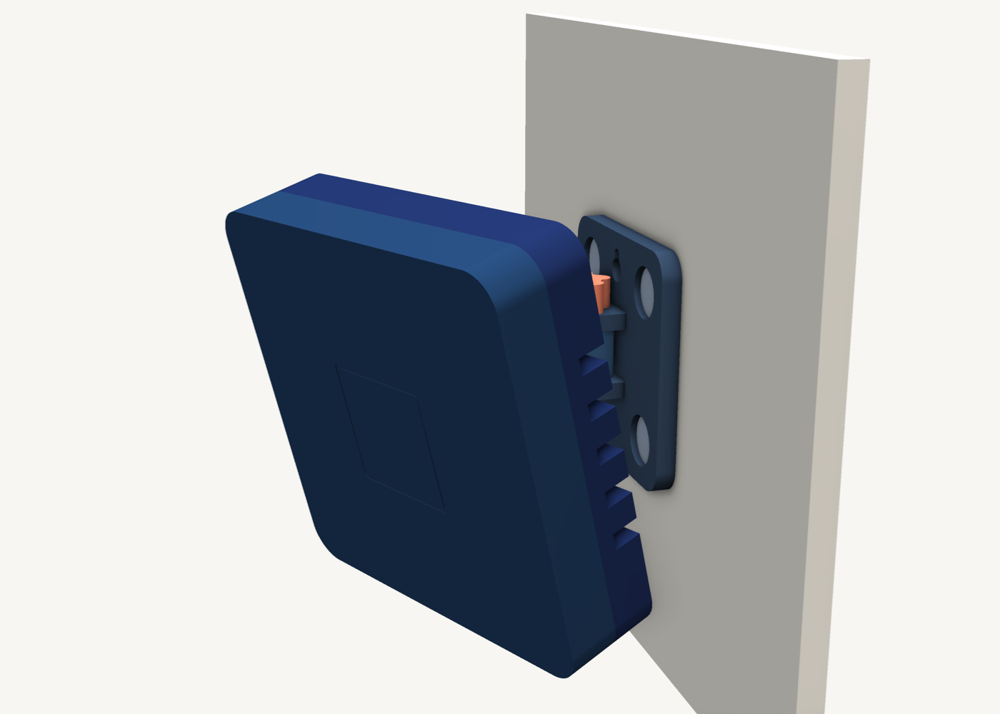

# DeteCam 5.0 — Palm-12 손바닥 크기 벽면 부착·각도 조절 12+1소자 수신기

> **한 줄 요약**: 기존 42 cm 대형 L자 팔과 2.5 m 조명 스탠드를 버리고, **손바닥 크기(`120 × 120 × 30.6 mm`)** 12+1소자 통합 RF 보드를 **자석·나노겔로 벽에 착 붙여 좌우 `±30°` · 상하 `0°/-15°/-25°` 딸깍 조절**하는 저가형 Wi-Fi 2.4/5 GHz (+ LTE/5G·BLE 확장) 몰래카메라 탐지·위치 추정 수신기입니다.



## 왜 Palm-12(v5.0)인가? (v4.0 대비 혁신 비교)

| 항목 | 기존 v4.0 (L-8 / 36cm 패널) | **DeteCam 5.0 (Palm-12)** | 개선 효과 |
|---|---:|---:|---|
| **수신기 외형** | `420 × 420 × 55 mm` (L자 팔) | **`120 × 120 × 30.6 mm` (손바닥 크기)** | 정면 면적 **-91%** |
| **설치 방식** | 2.5 m 대형 조명 스탠드 3대 | **벽면 자석·재사용 나노겔 + 직교 2축 스위블** | **스탠드 완전 제거** (무타공·손 닿는 높이) |
| **각도 조절** | 스탠드 전체 이동 | **좌우 Pan `±30°` · 상하 Tilt `-25°` 15° 클릭** | 화장실 P90 **-30%** · 탈의실 **-20%** 추가 개선 |
| **안테나·스위치** | Molex 39개 + HMC7992 9장 + 케이블 39개 | **112×112 mm 4층 통합 RF PCB 1장/기** (`PE42442×4` + `AANI-CH-0078×13` + `AD8317`) | 동축 케이블 **39개 제거**, 0.05 mm 정밀 배치 |
| **5.2 GHz 성능** *(시뮬레이션)* | 부엽 `PSL 0.998` (`57.7°` 붕괴) | **부엽 `PSL 0.472` · 중앙 오차 `0.57°`** | **5 GHz 그레이팅 로브 완전 해결** |
| **2.45 GHz 성능** *(시뮬레이션)* | 180° 위상반전 취약 | **CM-RCLPA + 상호결합 보정 `C⁻¹` -> `1.68°`** | 미보정(`4.70°`) 대비 **2.8배 정밀화** |
| **SBC & 무선 구동** | Radxa X4 (팬 소음, 12V) | **Radxa ROCK 3A** (`VesperCSI` ARM64, 팬리스 3 W, 5 V 배터리 10시간+, X4 호환) | 무소음·경량·14만 원 절감 |
| **3D 출력 (X1C 실측 슬라이싱)** | 11판 (~32시간) | **노드당 단 1판 (`4시간 52분`, `165.0 g`, 서포트 0%)** | 판 수 **-73%**, 3기 합계 PLA 495 g |
| **3기 전체 신품 재료비** *(추정)* | 약 84만 원 | **약 46.7만 원** (보조배터리 포함 ~50.3만 원) | **약 44% 절감** |

> [!NOTE]
> 모든 전파·위치 수치는 Python 전자기/몬테카를로 시뮬레이션 기준이며(`sim/`), 3D 출력 시간·무게·무결성은 공식 Bambu Studio 2.9.1 실측 슬라이싱 결과입니다(`print/`). 실물 제작 후 1회 턴테이블 보정(Pilot 1단계)을 거쳐 실측치를 별도 기록합니다.

## 핵심 문서·파일 안내

- 🛒 **[부품 목록 (100% 신품 BOM & 함정 부품 경고)](docs/부품_목록.md)**
- 🖨️ **[3D 출력(Bambu Studio X1C 1판) 및 조립 안내](docs/조립_및_출력_안내.md)**
- 📐 **[6대 실공간 현장 최적 배치 가이드 (AR-OPA & 교수님 핵심 질의 해답)](docs/현장_최적배치_가이드.md)**
- 🎬 **[조립·벽면 각도 조절 & 현장 동작 시뮬레이션 영상](docs/videos/index.html)** (`docs/videos/조립_시뮬레이션.mp4`, `배치_동작_시뮬레이션.mp4`)
- 📋 **[수신기 스펙](specs/001-palm-receiver/spec.md)**

## 저장소 구성 (최신 v5.0 단일화)

```text
receiver/
├── cad/        # manifold3d 파라메트릭 CAD (palm_node.py), 간섭검사(check_palm.py), Bambu 슬라이서 래퍼, 렌더·영상 생성기
├── stl/        # Bambu X1C 무서포트 6종 STL (노드당 7개, 닫힘=True, 처짐 0.0 mm²)
├── print/      # 공식 Bambu Studio 2.9.1 .3mf / .gcode.3mf / 미리보기 PNG / 층별 G코드 검사(문제 0개)
├── firmware/   # 핵심 엔진 (trif_v12.py, score.py, ar_opa.py) + pytest 자동 검증 (5/5 통과)
├── sim/        # 손바닥 12소자 EM·상호결합 최적화(opt_palm_array.py) & 6공간 벽면 AR-OPA(ar_opa_benchmark.py)
├── docs/       # 부품표, 출력·조립 안내, 현장 배치 가이드, 3D 그림, MP4 영상
└── specs/      # 001-palm-receiver 스펙
```

## 빠른 재현 (누구나 다시 검증 가능)

```bash
# 1. 12소자 손바닥 배열 전자기·상호결합 시뮬레이션 & 6공간 벽면 AR-OPA 검증
python3 sim/opt_palm_array.py
python3 sim/ar_opa_benchmark.py

# 2. STL 생성 + 9개 극한 Pan/Tilt 자세 기계 간섭·벽면 충돌 검사 (0.0 mm³)
python3 cad/export/export_stl.py
python3 cad/checks/check_palm.py

# 3. 핵심 펌웨어 자동 테스트 (TriF v12 + C⁻¹ + RAPS + 3단계 카메라 판별 + AR-OPA)
pytest -v firmware/tests/test_detecam_v5.py
```
