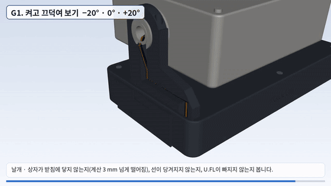

# DeteCam receiver — 수신기

숨은 Wi-Fi 카메라가 보내는 신호의 방향을 재는 수신기입니다. 지름 12 cm 원 위에 붙인 필름 안테나 16개를 전자 스위치로 번갈아 고르고, 가운데 기준 안테나와 함께 Intel AX210 한 장으로 받습니다. 수신기는 1기이며, 방 안 여러 자리에 차례로 옮겨 두고 잽니다. 자리마다 머리를 −20° · 0° · +20°로 끄덕이고, 재는 동안에는 모터를 끕니다. 쇼핑몰 부품을 커넥터 · 볼트 · 3D 프린트 틀로 조립합니다.

> 상태(2026-11-27): **명세 · 시뮬레이션 단계.** 실측한 성능 숫자는 없습니다. 작업 기준은 [docs/AGENTS.md](https://github.com/DeteCam/docs/blob/main/AGENTS.md), 지금 고른 설계와 근거는 [docs/현재_방향.md](https://github.com/DeteCam/docs/blob/main/현재_방향.md)입니다.

## 폴더

| 폴더 | 내용 |
|---|---|
| [`specs/`](specs/README.md) | 스펙. 지금은 [`002-switch-ring-receiver`](specs/002-switch-ring-receiver/spec.md) |
| [`sim/`](sim/README.md) | 시뮬레이션 기록: 계획서, 코드(Sionna RT 광선 추적 + NEC2 안테나 계산 + 추정기), 결과 요약, 다시 돌리는 법 |
| [`hw/`](hw/) | 조립 메모: [조립 순서와 조립 영상](hw/조립_순서.md)(설계값으로 그린 그림), SP16T 제어표와 도착 시험, 필름 안테나 부착과 케이블 배선 |

펌웨어 · 3D 출력 모델은 부품을 사서 벤치 시험(V2)을 한 뒤에 추가합니다.

위 그림은 설계값으로 그린 조립 순서입니다(실물 사진이 아님). 전체 영상은 [`hw/조립_시뮬레이션.mp4`](hw/조립_시뮬레이션.mp4)에 있습니다.

## 지금 설계

| 부분 | 내용 |
|---|---|
| 고리 | 지름 12 cm 원 위 필름 안테나(Molex 146153, 300 mm 케이블판) 16개 + 고리 면 가운데 기준 안테나 1개, 3D 프린트 틀. 케이블은 고리 면 안에서만 뒤쪽으로 비스듬히 모아(등뼈 배선) 고리 안쪽 뒤에서 한 묶음으로 상자에 내림([hw/안테나_부착과_배선.md](hw/안테나_부착과_배선.md)) |
| 스위치 | SP16T 모듈로 고리 소자를 번갈아 고름. Raspberry Pi Pico가 3.3 V 제어선 9개로 제어([hw/SP16T_제어표.md](hw/SP16T_제어표.md)). 17상태(소자 16 + 모두 끔)를 돌며 한 상태에서 패킷 5개를 모으면 넘어감 |
| 수신 | Intel AX210 두 단자. 체인 A는 기준 안테나, 체인 B는 스위치 공통 포트 + 앵커(기준 신호의 사본) |
| 앵커 | 윌킨슨 분배기 2개 + 스위치 공통 포트 뒤 6 dB 감쇠기. 두 체인 사이의 부호를 패킷마다 되찾음 |
| 체인 가르기 | 체인 B 입력에 6 dB 감쇠기 1개. CSI 두 행 가운데 센 쪽을 기준 체인으로 봄 |
| 호스트 | Raspberry Pi CM4 + Waveshare CM4-IO-BASE-A + M.2 변환 어댑터, FeitCSI-iwlwifi 드라이버 |
| 머리 | 고리 + 전자부 상자가 −20° · 0° · +20°로 끄덕임(웜기어 스텝 모터). 재는 동안 드라이버를 끔 |
| 연결 · 전원 | 폰과는 CM4 내장 BLE. 보조배터리로 동작 |
| 크기 · 놓는 곳 | 가로 · 세로 20 cm 내외. 벽 · 선반 · 사물함 위 · 교탁 등 어디에나 둠. 바닥에 세우는 큰 스탠드는 쓰지 않음 |

방향 · 위치 계산(자리마다의 지도를 합치기, 신뢰도 판정, 자리를 더 재라는 안내)은 [ai](https://github.com/DeteCam/ai), 조종과 AR 표시는 [app](https://github.com/DeteCam/app) 저장소에 있습니다.

## 시뮬레이션에서 본 것 (계산값, 실측 아님)

실제와 비슷하게 새로 만든 방 16개(Sionna RT + NEC2, 2.4 GHz, 설계 조건) 기준입니다. 전체 표는 [sim/실제-방-시뮬레이션-결과.md](sim/실제-방-시뮬레이션-결과.md)에 있습니다.

- 한 자리에서 한 번 잰 방향: 평균 13.8~16.3°, 중앙값 4.2~4.9°. 비교 기준선(평균 8.92° 이하)을 넘지 못했습니다. 카메라가 가구 · 칸막이에 가린 경우(36%)에 크게 틀립니다.
- 4자리를 합친 "융합 방향": 평균 4.4~5.4°, 95% 지점 12.5~16.8°.
- 위치 0.5 m 안: 자리를 5~7곳 재면 숙박 81~88%, 탈의실 68~79%, 금속 칸막이 화장실 45~49%.
- 시험실 의심 책상 3곳 안: 앞벽 두 자리 88~93%, 한 자리만 남으면 38~61%.
- 고리를 키우거나 모양을 바꾼 구조 후보 9개는 채택 기준을 넘지 못했습니다. 오차를 줄인 것은 측정 뒤 절차(소프트웨어)였습니다.
- 위 숫자는 안테나 케이블이 없는 모델입니다. 케이블 16가닥을 필름 바로 안쪽에서 곧장 내리면 한 번 잰 방향이 40~66% 나빠집니다. 지금 배선(고리 면 안에서만 모으는 등뼈 배선, 기준 안테나는 고리 면 가운데)은 케이블 없는 모델과 견줘 한 번 잰 방향이 2.4 GHz +0.5~1.8%, 5 GHz −3.7~+1.3%로 거의 같습니다(금속 칸막이 화장실 한 방의 5 GHz 위치만 6.7%p 낮아짐). 실제 크기의 상자를 넣은 계산은 +6.6%로 조금 나쁩니다. 자세히는 [sim/안테나-케이블-배선-결과.md](sim/안테나-케이블-배선-결과.md).
- 남은 위험(스위치와 패킷 짝짓기, 케이블 길이, 스위치의 꺼진 포트, 끄덕이는 축 자리)은 [sim/위험-점검-결과.md](sim/위험-점검-결과.md)에 계산해 두었습니다.

## 이전 설계

- 8소자 지름 약 10 cm 고리(2026-11-24 스펙): 16소자 12 cm로 바꿨습니다.
- v6(84 mm 칩 안테나 PCB 수신기 2기)의 CAD · 출력 파일 · 펌웨어 · 시뮬레이터는 브랜치 [`archive/v6-nano2`](https://github.com/DeteCam/receiver/tree/archive/v6-nano2)에 있습니다. 독립 검증에서 성능이 크게 떨어져 내렸고, 그 문서의 숫자(1 m 이내 96.4% 등)는 쓰지 않습니다. 이유는 [docs/기술검증_보고서.md](https://github.com/DeteCam/docs/blob/main/기술검증_보고서.md)에 있습니다.
- v6 독립 검증과 회전 수신기 계산에 쓴 예전 시뮬레이션 코드는 커밋 [`e66aed2`](https://github.com/DeteCam/receiver/tree/e66aed2/sim)에서 볼 수 있습니다.
- 더 이전 구조(돌판 등)는 [receiver-legacy](https://github.com/DeteCam/receiver-legacy)에 있습니다.

부품과 구매 순서는 [docs/구매_부품_목록.md](https://github.com/DeteCam/docs/blob/main/구매_부품_목록.md)를 봅니다.
