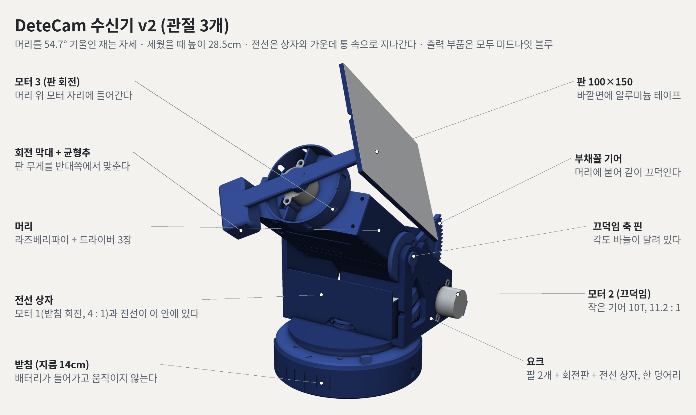

<div align="center">

# receiver-cad

**DeteCam 수신기의 3D 모델링**

판을 돌려 숨은 Wi-Fi 카메라의 방향을 찾는 수신기(관절 3개)의 CAD 소스, 출력 파일, 슬라이스 결과, 조립 문서입니다.

</div>



## 구성

| 폴더·파일 | 내용 |
|---|---|
| [`조립_안내.md`](조립_안내.md) | 살 것, 출력, 조립, 배선, 처음 켜기 |
| [`설계_검토.md`](설계_검토.md) | 검사 결과와 시뮬레이션, 실물에서 확인할 것 |
| [`네_단계_검토.md`](네_단계_검토.md) | 탐지 → 판별 → 위치 측정 → 표시. 곳별 결과, 튼튼함, 출력 파일 검증 |
| [`부품표.csv`](부품표.csv) | 출력 부품과 구매 부품 |
| `stl/` | 출력 파일 27개 (판에 놓는 방향 그대로) |
| `슬라이스/` | Bambu Studio 결과. `바로출력/` 은 프린터로 바로 보내는 파일, `프로젝트/` 는 고칠 수 있는 파일 |
| `그림/` | 조립 그림과 움직이는 그림 |
| `마커/` | 머리 등판에 붙이는 AR 마커 띠 (`AR_마커.pdf` 를 실제 크기로 인쇄), 마커 귀의 좌표 (`marker.json`) |
| `cad/` | 모델을 만드는 파이썬 코드와 검사 코드. 치수는 `cad/p2.py` 한 곳에 있습니다 |

## 출력

- 프린터: Bambu X1 Carbon, 0.4mm 노즐, PLA
- 다섯 판, 13시간 56분, 필라멘트 457g, 서포트 없음
- `슬라이스/바로출력/0판_시험조각.gcode.3mf` 부터 뽑아 맞춤을 고릅니다

## 모델 고치기

```
cd cad
pip install manifold3d trimesh numpy shapely
python3 export2.py      # stl/ 다시 만들기
python3 check2.py       # 겹침 검사
python3 audit_sweep.py  # 판을 돌리며 걸리는 곳이 없는지 촘촘히 (20분쯤)
python3 strength.py     # 힘이 걸리는 자리의 여유
python3 marker.py       # AR 마커 (opencv-python, pillow 필요)
python3 slicing/print_check.py ../stl ../슬라이스     # 슬라이싱한 파일을 다시 읽어 검사
```

그 밖의 검사와 슬라이싱은 [`조립_안내.md`](조립_안내.md) 11절에 있습니다.

## 바꾼 기록

모델을 바꿀 때는 이 저장소에 커밋으로 남깁니다. 지난 판의 파일은 따로 두지 않습니다 (깃 기록에서 찾습니다).

## 관련

- 수신기 코드: [receiver-firmware](https://github.com/DeteCam/receiver-firmware) · 시뮬레이션: [receiver-sim](https://github.com/DeteCam/receiver-sim) · 3축 화면: [receiver-console](https://github.com/DeteCam/receiver-console) · 문서: [docs](https://github.com/DeteCam/docs)
- `cad/marker.py` 가 만드는 `마커/marker.json` 은 receiver-firmware 의 `pi/marker.json` 과 같은 파일입니다. 등판이나 마커 자리를 바꾸면 그쪽에도 넣어 줍니다.
