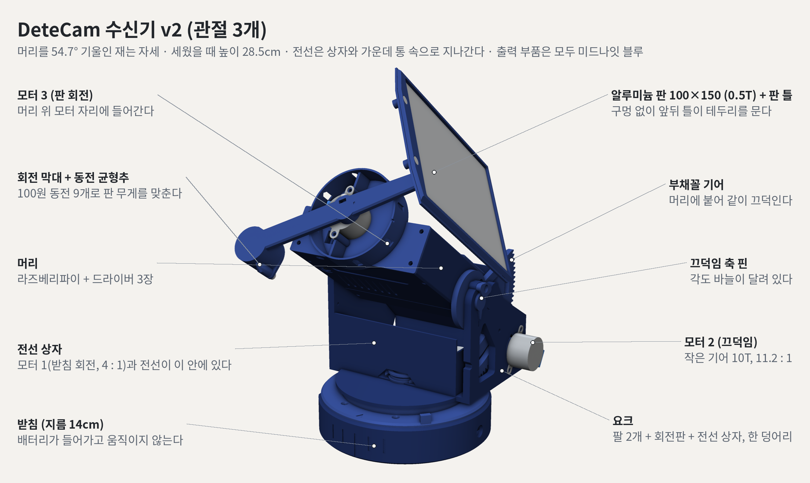

---
tags:
  - DeteCam
고친날: 2026-11-16
---

# DeteCam 수신기 문서

숨은 Wi-Fi 카메라의 방향과 위치를 찾는 수신기(관절 3개)의 문서 모음이다. 이 폴더는 저장소 `receiver` 의 `docs/` 이고, 옵시디언 볼트의 `DeteCam/receiver` 폴더이기도 하다 (같은 파일).

## 노트

| 노트 | 내용 |
|---|---|
| [조립 안내](조립%20안내.md) | 살 것, 출력, 조립(전부 나사로), 배선, 처음 켜기, 폰으로 재기. **만들 때는 이것부터** |
| [설계 검토](설계%20검토.md) | 왜 이렇게 만들었나: 오차를 더 줄일 수 있나, 자기 부품의 영향, 폰 조종, 볼트 고정과 실제 치수, 모터 하중, 넘어짐, 튼튼함, 실물에서 확인할 것 |
| [네 단계 검토](네%20단계%20검토.md) | 탐지 → 판별 → 위치 측정 → 표시. 곳별(변기 칸, 욕실, 모텔 방, 강의실) 결과 |
| [혼자 동작](혼자%20동작.md) | 수신기 코드: 설치, 폰 화면의 단추, 주소(API), 장치 없이 돌려 보기 |
| [부품표](부품표.md) | 모든 부품의 그림과 치수: 출력 부품, 사는 부품, 나사·너트, 연장 |
| [부품 검토](부품%20검토.md) | 더 필요한 부품, 겹치는 부품, 더 나은 부품을 따져 본 것 (2026-11-17) |
| [체크리스트](체크리스트.md) | 지금부터 할 일 |
| [시뮬레이션 화면](시뮬레이션%20화면.md) | 3D 모델을 돌려 보고 재는 과정을 미리 해 보는 화면, 결과 그림 |
| [교실 전파 계산](../sim/rt/README.md) | 40명 교실에서 카메라 자리 찾기: 전파 경로 계산, 재는 방법 고르기 (2026-11-17) |
| [스펙](../specs/README.md) | 기능마다의 스펙 → 방법 → 할 일 (스펙 주도 개발) |

다른 저장소로 옮긴 노트: [유용성 근거](https://github.com/DeteCam/docs/blob/main/research/유용성%20근거.md) · [비콘 검토](https://github.com/DeteCam/docs/blob/main/research/비콘%20검토.md) (docs) · [의심 점수](https://github.com/DeteCam/ai/blob/main/docs/의심%20점수.md) (ai)

## 무엇인가

숨은 Wi-Fi 카메라의 방향과 위치를 찾는 수신기다. 라즈베리파이 3B+ 의 안테나 둘레로 알루미늄 판을 돌리면, 판이 카메라와 안테나 사이를 지날 때 신호(CSI)가 꺼진다. 그 각도가 카메라 쪽이다 (DiffLoc). 관절 3개(받침 회전 4:1, 끄덕임 11.2:1, 판 회전)로 높이까지 잰다.

## 지금 상태 (2026-11-17)

- 출력 전이다. 모델 검사와 시뮬레이션, Bambu Studio 슬라이싱, 슬라이싱한 파일의 검증까지 끝냈다.
- **테이프 없이 전부 나사로 조인다.** 알루미늄 판 100 × 150 × 1T 는 구멍 없이 판 틀(한 장)의 홈에 들어가 아래 턱과 누름쇠가 잡고, 균형추는 100원 동전 12개다. 나사 59개, 너트 7개.
- **모든 동작을 폰 화면에서 조종한다** (탐지, 판별, 재기, 관절 움직이기, 맞추기, 멈춤, 끄기).
- **ESP32 를 더했다 (2026-11-16).** 파이 칩은 ACK 에서 CSI 를 내지 않아(실험 S4-1), ACK 의 CSI 를 들을 XIAO ESP32-C5 를 넣었다. 안테나는 판 회전축 위, 보드는 뚜껑 안쪽, 파이와 UART 점퍼선 4가닥. ESP32 가 ACK 의 CSI 를 내는지는 아직 확인 전이다. 조립 영상도 ESP32 를 넣어 다시 만들었다.
- 출력 파일 34개, 여섯 판, 14시간 51분, 필라멘트 456g, 서포트 없음 (Bambu X1 Carbon, PLA). 시험장용 스탠드 받이까지 뽑으면 일곱 판, 16시간 52분, 539g.
- **교실 전파 계산 (2026-11-17).** 골을 찾아 읽는 방법은 교실에서 맞지 않았다 (자리 맞힘 6%). 곡선 전체를 기준 곡선과 견주고, 높이 2.4m 에서 벽을 따라 여섯 곳을 골라 재면 90% (옆자리까지 98%) 다. 그래서 스탠드 받이를 더했고, 펌웨어의 읽는 방법을 바꾸는 것이 다음 일이다 ([sim/rt](../sim/rt/README.md)).
- 깃허브 조직 `DeteCam` 은 저장소 넷으로 나눈다: `receiver`(이 저장소: 수신기 설계·코드·시뮬레이션), [`app`](https://github.com/DeteCam/app)(폰 앱), [`ai`](https://github.com/DeteCam/ai)(의심 점수·곡선 읽기), [`docs`](https://github.com/DeteCam/docs)(원칙·시스템 명세·조사·검증).

## 숫자로 보면

| 항목 | 값 |
|---|---|
| 방향 오차, 한 자리에서 (세 번 재기): 반사가 보통인 빈 방 | 가운데값 3.3~4.8°, 5~12%는 30° 넘게 틀림 |
| 방향 오차, 곳별: 모텔 방 / 욕실 / 강의실 / 변기 칸(합성수지, 여섯 번) / 변기 칸(철판) | 6~8 / 7~13 / 8~12 / 6~13 / 33~39° |
| 위치 오차, 반사가 보통인 빈 방: 2자리 / 3자리 / 4자리 | 13~20 / 9~13 / 7~10cm |
| 위치 오차, 곳별 (끝났을 때): 모텔 방 / 욕실 / 강의실 / 변기 칸(합성수지, 여섯 번) / 변기 칸(철판) | 17~23 / 15~25 / 22~37 / 10~15 / 48~54cm |
| 판별 (걸으며 55초): 움직일 때 전송량이 1.5배가 되는 카메라를 잡는 비율 / 카메라가 아닌 기기를 잘못 잡는 비율 | 93% / 4~5% |
| 끄덕임 모터가 쓰는 힘 (재는 자세 / 85°) | 모터 힘의 60% / 87% |
| 넘어짐: 꼭대기를 밀어 넘어뜨리는 힘 (작은 받침 / 큰 받침) | 3.2N / 6.3N. 탁 트인 곳에서는 스스로 넘어지지 않는다 |
| 한 자리에서 세 번 → 여섯 번 재기 (전파 계산, 반사가 심한 방) | 크게 틀리는 비율 30% → 15% |

숫자 범위는 신호가 가려지는 모양을 좋게/나쁘게 가정한 두 경우다. 전부 시뮬레이션 값이라 실물에서는 더 나쁠 수 있다. '빈 방' 숫자는 가장 좋을 때고, '곳별' 숫자가 실제에 더 가깝다 (벽 재질, 가구에 숨긴 자리, 사람 몸, 폰이 수신기 자리를 재는 오차를 넣었다). 철판 칸막이 칸의 위치는 믿기 어렵다.

## 정한 것

1. **기울여 세 번 재기.** 머리를 54.7° 기울이고 받침을 120°씩 돌려 세 번 잰다. 세 회전축이 서로 직각이라 높이까지 나온다. 좁고 반사가 센 곳은 여섯 번.
2. **위치는 '가능성 부피'로.** 카메라가 벽에 있다고 가정하지 않는다. 자리마다의 측정을 방 안 10cm 칸에 곱해 추정 구간을 구한다. 둘째 자리는 앱이 정해 주고, 구간이 1m보다 길면 한 번 더 잰다 (보통 3자리).
3. **판은 폭 10cm, 팔 8cm, 평판 그대로.** 판을 넓히거나 길게 해도, 구멍을 뚫거나 휘어도 오차가 뚜렷이 줄지 않았다. V로 바깥으로 접은 판만 반사가 심한 방에서 나아졌지만 깊이 숙일 때 요크에 닿는다. 남은 오차는 방의 반사와 곡선을 읽는 법에서 온다. 판은 가지고 있는 1T 를 구멍 없이 판 틀(한 장)의 홈에 넣고 누름쇠로 잡는다. 균형추는 100원 동전 12개.
4. **수신기 혼자 동작, 폰으로 조종.** 파이가 캡처와 계산을 다 한다. 내장 Wi-Fi는 CSI 전용, 폰과는 USB 무선 동글(WNA3100M)로 통신한다. 랜선은 개발할 때만.
5. **탐지에는 동글을 하나 더.** 모니터 모드가 되는 USB 동글로 둘레 기기를 엿들어 카메라 후보를 추린다. 없어도 돌지만 덜 정확하다.
6. **판별은 55초.** 화면이 시키는 대로 8초씩 멈췄다 움직이기를 3번. 반응이 약하면 '의심 기기'로 두고 위치를 잰다.
7. **폰은 등판의 종이 마커로 수신기의 자리를 안다.** 마커는 틀로 덮어 나사로 조인다.
8. **쓸 때는 둘레 23cm 를 비운다.** 벽에 닿으면 머리를 숙이다 스스로 넘어갈 수 있다. 큰 받침(L)이 더 든든하다.
9. **전원 버튼 하나.** 2초 = 안전하게 끄기, 짧게 = 한 번 재기. 전선은 요크의 상자 속으로.

## 아직 모르는 것 (실물에서 확인)

- **실제 곡선의 모양과 읽는 법.** 수신기 자기 부품(모터, 동전, 기판)이 곡선을 바꾼다. 방 전체를 푼 2차원 전파 계산(gprMax)에서는 '가장 깊은 골'만 읽는 지금 방법이 보통 방에서도 크게 틀렸고 (30° 넘게 틀리는 비율 48~49%), 곡선 전체를 기준 곡선과 맞추면 크게 나았다 (29~34%). 기준 곡선은 실물로 재야 하므로, 조립하고 맨 처음 탁 트인 곳에서 곡선을 재서 두 방법을 같은 자리에서 견준다 (설계 검토 2절, 13절)
- **판 틀의 맞춤.** 1T 판이 판 틀 홈에 헐겁지 않게 들어가는지, 누름쇠를 조였을 때 판이 흔들리지 않는지 (출력 오차).
- 무선 동글이 '자기 Wi-Fi 만들기'를 하는지, 동글의 전파가 CSI 측정을 흐리는지
- 탐지 동글이 모니터 모드로 도는지, 실제 카메라가 움직임에 몇 배로 반응하는지, 폰이 마커를 읽는 거리와 오차
- 드라이버 보드의 구멍 간격, 버튼 모듈, 파이 안테나 자리 (0판과 자로 확인)
- 철판 칸막이 변기 칸에서는 위치를 믿기 어렵다 (시뮬레이션). 실제로도 그런지
- 출력물의 맞춤 (0판으로 고른다)

## 파일이 있는 곳

| 곳 | 내용 |
|---|---|
| 깃허브 `DeteCam/receiver` | 수신기의 모든 것. 아래 폴더들이 들어 있다 |
| 컴퓨터 `DeteCam_Poc/receiver/` | 그 저장소를 받은 폴더. 받기 `git pull`, 올리기 `git add -A && git commit -m "메모" && git push` |
| `docs/` (이 폴더) | 문서와 그림(`images/`), 조립 영상(`videos/`), 시뮬레이터(`simulator/`). 옵시디언 볼트의 `DeteCam` 폴더가 이 폴더를 가리킨다 |
| `cad/`, `stl/`, `print/`, `marker/` | 3D 모델을 만드는 코드와 검사, 출력 부품, 출력 파일(G코드), AR 마커 |
| `firmware/` | 수신기 코드: `pi/`(장치), `core/`(계산), `host/`(개발용), `tests/` |
| `sim/`, `console/` | 시뮬레이션(전파 계산은 `sim/em/`), 3축 시뮬레이션 화면 |

파일 하나하나가 무엇인지는 [폴더와 파일](폴더와%20파일.md)에 있다.
