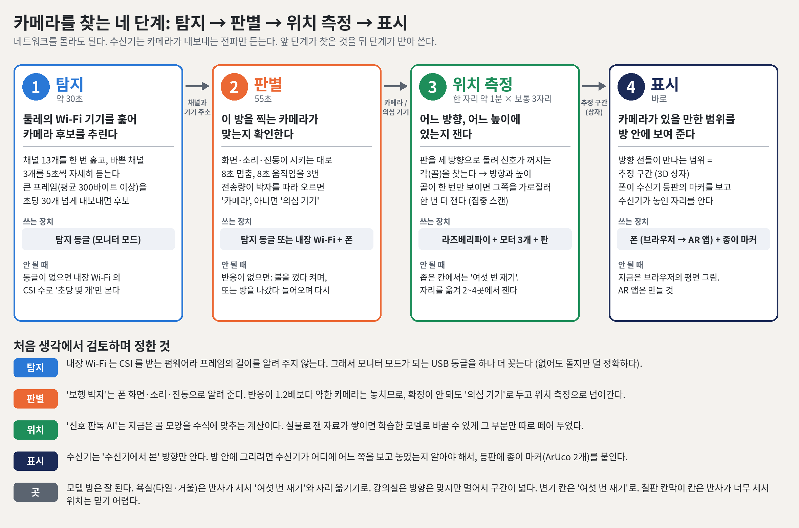
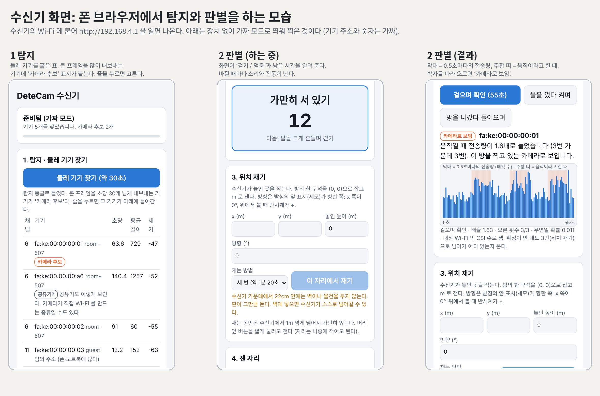
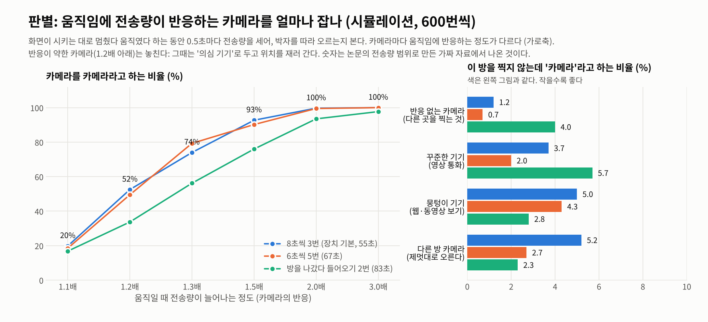
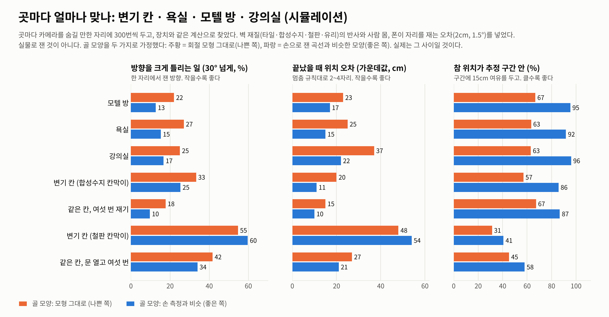
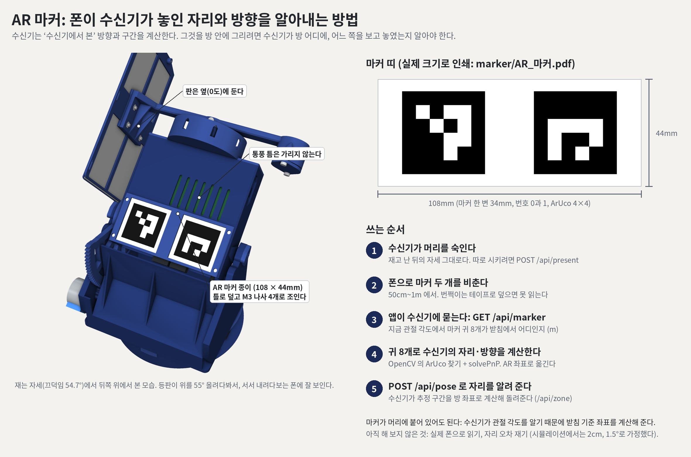

---
tags:
  - DeteCam
  - 검토
고친날: 2026-11-15
---

# 네 단계 검토: 탐지 → 판별 → 위치 측정 → 표시

2026-11-15 기준. 처음에 생각한 네 단계를 하나씩 따져 본 것이다. 전부 계산과 시뮬레이션, 장치 없이 돌리는 검사로 봤다. 실물로 확인할 것은 맨 아래에 모았다. 기계 쪽(나사, 모터 힘, 튼튼함, 넘어짐, 출력 검증)은 [설계 검토](설계%20검토.md)에 있다.

## 1. 한눈에

| 단계 | 처음 생각 | 검토 결과 | 더 필요한 것 |
|---|---|---|---|
| 탐지 | 모니터 모드 어댑터로 둘레 기기를 훑고, 업로드 특성으로 카메라 후보를 추린다 | 맞다. 내장 Wi-Fi는 CSI 전용이라 프레임 길이를 못 본다. 그래서 어댑터가 따로 있어야 한다. 없을 때의 길도 넣었다 (2절) | **탐지 동글 1개** (권함) |
| 판별 | 보행 박자에 전송량이 반응하는지 본다. 안 되면 '의심 기기'. 방 나가기는 대체 경로 | 맞다. 8초씩 3번(55초)으로 정했다. 움직일 때 전송량이 1.5배가 되는 카메라는 93%, 1.2배면 52% 잡는다. 반응이 약한 카메라는 놓친다 (3절) | 없음 (폰 화면이 안내) |
| 위치 측정 | 판을 돌려 방향과 높이를 잰다. 2단계 집중 스캔. 신호 판독 AI. 방향 선이 만나는 범위가 추정 구간 | 지금 설계 그대로다. 모텔 방은 잘 되고, 욕실(타일·거울)은 반사가 세서 '여섯 번 재기'와 자리 옮기기가 필요하고, 변기 칸은 '여섯 번 재기'가 필요하고, 철판 칸막이 칸은 어렵다 (4절, 설계 검토의 방 전체 전파 계산) | 없음 |
| 표시 | AR로 3D 의심 범위를 보여 준다 | 폰이 수신기가 놓인 자리를 알아야 한다. 등판에 종이 마커를 틀로 덮어 나사로 조이고, 수신기가 마커의 좌표를 알려 준다 (5절) | **종이 마커 1장** |

- 탐지 동글은 파이의 남는 USB 자리에 꽂히고 머리 치마 안에 숨는다. 마커는 등판에 대고 틀로 덮어 나사 4개로 조이는 종이다.
- 코드: 탐지(`firmware/pi/detect.py`), 판별(`firmware/core/identify.py`), 한 자리의 방향(`firmware/core/analyze3.py`), 추정 구간(`firmware/core/locate.py`), 마커 좌표(`GET /api/marker`). 폰 화면과 주소는 [혼자 동작](혼자%20동작.md)에 있다.

## 2. 탐지: 둘레에서 카메라 후보 찾기

**왜 동글이 하나 더 필요한가.** 내장 Wi-Fi에는 CSI를 뽑는 펌웨어(nexmon_csi)가 올라가 있다. 이 펌웨어는 프레임마다 CSI와 보낸 기기의 주소만 주고, 프레임이 얼마나 긴지는 주지 않는다. '영상을 내보내는 기기'를 가리려면 개수와 함께 길이를 알아야 한다. 가지고 있는 WNA3100M(드라이버 rtl8192cu)은 남의 프레임을 엿듣는 데 못 쓴다. 그래서 모니터 모드가 되는 동글을 하나 더 꽂는다. 이 동글은 듣기만 하고 아무것도 보내지 않아서 CSI 측정을 방해하지 않는다.

**어떻게 하나** (약 30초).

1. 채널 1~13을 0.6초씩 한 번 훑는다.
2. 데이터가 많은 채널 3개를 골라 5초씩 자세히 듣는다. 이웃 채널로 새어 들린 것은 공유기가 알리는 진짜 채널로 센다.
3. 기기마다 '초당 프레임 수'와 '평균 길이'를 낸다. **초당 30개 이상이고 평균 300바이트 이상**이면 카메라 후보다 (DiffLoc+ 논문의 기준).

| 기기 | 초당 | 평균 길이 | 판정 |
|---|---|---|---|
| 영상을 올려 보내는 카메라 | 30~110개 | 400~1,000바이트 | 후보 |
| 영상을 받아 보는 폰·노트북 (응답만 보냄) | 많음 | 60바이트쯤 | 빠짐 |
| 가끔 통신하는 기기 (플러그, 스피커) | 적음 | — | 빠짐 |
| 공유기 (내려보내는 쪽) | 많음 | 큼 | '공유기?' 표시. 카메라가 직접 Wi-Fi를 만드는 종류도 이렇게 보인다 |
| 신호가 약한 후보 (−75dBm 아래) | | | '후보 (약함)': 다른 방일 수 있다 |

**탐지 동글 고르기.** 모니터 모드가 되고 안테나가 몸통 안에 든 작은 것. **듀얼밴드(2.4·5GHz)를 권한다**: 5GHz 카메라와 5GHz 로 연 핫스팟도 듣는다. 칩이 아래 가운데 하나면 파이의 커널(5.4)에 드라이버가 들어 있어 따로 설치할 것이 없다.

| 칩 | 드라이버 | 듣는 대역 | 메모 |
|---|---|---|---|
| **MediaTek MT7610U** | mt76x0u | 2.4·5GHz | **권함.** 작은 제품: ASUS USB-AC51 (31 × 16 × 9mm, 안테나 내장). 모니터 모드가 된다고 알려져 있다 |
| MediaTek MT7612U | mt76x2u | 2.4·5GHz | 모니터 모드가 가장 잘 된다고 알려졌지만 작은 제품이 드물다 (ALFA AWUS036ACM 은 커서 USB 연장선으로 밖에 단다) |
| Ralink RT5370 | rt2800usb | 2.4GHz | 가장 흔하고 싸다. 5GHz 를 못 듣는다 |
| MediaTek MT7601U | mt7601u | 2.4GHz | 흔하다. 5GHz 를 못 듣는다 |
| Atheros AR9271 | ath9k_htc | 2.4GHz | 모니터 모드로 오래 쓰인 칩. 안테나가 밖에 달린 제품이 많으니 작은 것을 고른다 |

- 크기는 몸통이 **45 × 18 × 10mm 안쪽**이어야 한다. 가운데 USB의 위 칸에 꽂는다. ASUS USB-AC51(31 × 16 × 9mm)이면 옆의 무선 동글과 2.0mm, 요크와 10.8mm 떨어진다. 가장 큰 45 × 18 × 10mm면 1.0mm, 6.3mm다.
- 꽂은 뒤 `python3 detect.py --check` 가 '들을 수 있는 채널'에 36·149 같은 5GHz 채널을 보여 주면 된다. mt76 드라이버는 커널에 따라 모니터 모드가 안 되는 일이 있다고 알려져 있으니, 사기 전에 받을 수 있으면 먼저 꽂아 본다.
- 5GHz 까지 들으면 처음 한 바퀴가 약 20초 길어진다. 그 뒤로는 AP 가 들린 5GHz 채널만 돌아 몇 초만 늘어난다.
- 전류: 파이 + 모터 1개 + 동글 2개가 같이 쓰면 많아야 1.7A쯤이다. 보조배터리의 2A 넘는 단자에 꽂는다.

**동글이 없으면.** 수신기는 그대로 돈다. 내장 Wi-Fi를 채널마다 1.5초씩 돌려 CSI가 초당 몇 개 오는지만 보고, 30개 넘는 기기를 후보로 친다. 길이를 모르니 응답만 많이 보내는 기기도 후보로 뜬다.

**한계.**

- 5GHz를 쓰는 카메라는 못 듣는다. 안테나 두 개로 한꺼번에 보내는 프레임도 못 읽는다. 몰래카메라는 거의 2.4GHz, 안테나 하나다.
- 영상 통화나 화면 공유도 후보로 뜬다. 그것은 판별 단계가 가린다.
- 녹화만 하고 전파로 내보내지 않는 카메라는 이 방법 전체가 못 찾는다.

**검사.** 진짜와 같은 모양의 프레임 2,109개를 만들어 읽혔다. 읽은 값(주소, 종류, 길이, 세기, 주파수, 이름)이 다른 프로그램(scapy)이 읽은 값과 398개 모두 같았고, 후보도 맞게 골랐다. 동글과 드라이버가 실제로 그렇게 도는지는 실물에서 봐야 한다.

## 3. 판별: 이 방을 찍는 카메라가 맞나

카메라는 화면이 변하면 보내는 양이 늘어난다. 사람이 멈췄다 움직였다 하는 박자를 전송량이 따라오면 '이 방을 찍고 있는 카메라'다.

- **걸으며 확인 (기본, 55초).** 4초 기다린 뒤 '8초 멈춤, 8초 움직임'을 3번. 폰 화면에 할 일과 남은 초가 크게 뜨고, 바뀔 때마다 소리(움직임 = 높게 두 번, 멈춤 = 낮게 한 번)와 진동이 난다.
- **불을 껐다 켜며 (55초).** 카메라가 사람을 못 보는 자리에 있을 때. 움직임 구간에 불을 1초에 한 번씩 껐다 켠다.
- **방을 나갔다 들어오며 (83초).** 밖에서 20초, 안에서 15초 걷기를 2번. 걷는 것만으로는 반응이 약할 때.
- 전송량은 탐지 동글이 있으면 바이트로, 없으면 내장 Wi-Fi의 CSI 수(프레임 수)로 센다.
- 판정: 0.5초 칸으로 세고, 박자가 바뀐 직후 1.5초는 버린다. 움직임 구간의 평균이 멈춤 구간의 1.12배 이상이고, 박자를 엇갈리게 옮겼을 때보다 뚜렷하고(우연일 확률 3% 아래), 3번 가운데 2번 이상 올랐으면 '카메라'.

| 움직일 때 전송량이 늘어나는 정도 | 1.1배 | 1.2배 | 1.3배 | 1.5배 | 2배 | 3배 |
|---|---|---|---|---|---|---|
| 걸으며 8초씩 3번 (55초) | 20% | 52% | 74% | 93% | 100% | 100% |
| 6초씩 5번 (67초) | 18% | 50% | 79% | 90% | 100% | 100% |
| 방을 나갔다 들어오기 2번 (83초) | 17% | 34% | 56% | 76% | 94% | 98% |

카메라가 아닌 기기를 '카메라'라고 하는 비율 (걸으며 8초씩 3번): 꾸준히 보내는 기기 3.7%, 뭉텅이로 보내는 기기 5.0%, 다른 방의 카메라 5.2%, 반응 없는 카메라 1.2%.

- 가짜 자료 600번씩의 결과다. 카메라의 전송량 범위(초당 35~110개), 반응이 1초쯤 늦는 것, 2~4초마다 튀는 큰 프레임을 논문에서 가져와 넣었다. 실제 카메라가 몇 배로 반응하는지는 재 봐야 안다.
- **놓치는 것.** 전송량을 고정해 둔 카메라, 움직임이 화면에 작게 잡히는 카메라. 그래서 확정이 안 되면 '의심 기기'로 두고 위치를 재러 간다. 위치가 나오면 눈으로 확인할 수 있다.
- '6초씩 5번'이 잘못 잡는 일이 조금 적지만 12초 더 걸린다. 기본은 55초짜리로 두었다.

## 4. 위치 측정: 곳마다 얼마나 맞나

방법은 바뀌지 않았다. 머리를 54.7° 기울이고 받침을 120°씩 돌려 세 번 판을 돌린다. 신호가 꺼지는 각(골)에서 방향과 높이가 나온다. 자리를 옮겨 2~4곳에서 재고, 그 결과를 방 안 10cm 칸에 곱해 추정 구간을 낸다.

- **'2단계 집중 스캔'** 은 이미 들어 있다. 세 번 가운데 한 번만 골이 보이면, 그 방향을 가로지르는 각으로 한 번 더 잰다. 다 재지 않고 필요한 곳만 더 재는 방식이다.
- **'신호 판독 AI'** 는 지금은 골 모양을 수식에 맞추는 계산이다 (`firmware/core/fusion.py` 의 `trough`). 학습에 쓸 실측 자료가 아직 없어서다. 실물로 잰 곡선이 쌓이면 이 함수 하나만 학습한 모델로 바꾸면 된다.
- **아래 숫자가 기대는 가정 하나.** 이 시뮬레이션은 판이 가릴 때 골이 하나 생긴다고 본다. 수신기 자기 부품(모터, 동전, 기판)까지 넣은 전파 계산에서는 곡선이 더 복잡해서, 골만 읽는 방법이 실물에서 통하는지는 재 봐야 안다 ([설계 검토](설계%20검토.md) 5절). 안 통하면 곡선 전체를 실제 장치의 기준 곡선과 견주는 계산으로 바꾼다.

**곳별 시뮬레이션.** 곳마다 카메라를 숨길 만한 자리(가중치를 두고)에 300번씩 두고 장치와 같은 계산으로 찾았다. 벽 재질의 반사, 사람 몸, 폰이 수신기 자리를 재는 오차(2cm, 1.5°)를 넣었다.

| 곳 | 방향 오차 (가운데값) | 30° 넘게 틀림 | 끝났을 때 위치 오차 | 30cm 안 | 참 위치가 구간 안 | 좁혀졌는데 틀림 |
|---|---|---|---|---|---|---|
| 모텔 방 (사람은 나가 있음) | 6~8° | 13~22% | 17~23cm | 59~80% | 67~95% | 1~12% |
| 모텔 방 (사람이 방 안에) | 6~8° | 15~21% | 17~29cm | 51~81% | 69~94% | 1~13% |
| 욕실 | 7~13° | 15~27% | 15~25cm | 57~80% | 63~92% | 1~16% |
| 강의실 | 8~12° | 17~25% | 22~37cm | 40~69% | 63~96% | 0~8% |
| 변기 칸, 합성수지 칸막이 | 10~16° | 25~33% | 11~20cm | 62~77% | 57~86% | 4~12% |
| 변기 칸, 철판 칸막이 | 33~39° | 55~60% | 48~54cm | 37~40% | 31~41% | 21~26% |

숫자의 범위는 골 모양을 나쁘게(회절 모형 그대로) / 좋게(손으로 잰 곡선과 비슷하게) 가정한 두 경우다. '끝났을 때'는 멈춤 규칙(구간이 충분히 줄면 끝, 많아야 4자리)대로 했을 때다.

- **모텔 방, 욕실: 이 광선 모형에서는 쓸 만하다.** 방향 오차 6~13°, 위치 오차 15~25cm. 사람이 방 안에 있으면(수신기에서 1m 넘게 떨어져서) 방향은 그대로고, 위치 오차는 좋은 쪽 가정에서 그대로, 나쁜 쪽 가정에서 23 → 29cm로 조금 는다. 다만 욕실은 방 전체를 전파 방정식으로 푼 계산(gprMax, 2차원)에서 훨씬 나쁘게 나왔다 ([설계 검토](설계%20검토.md) 2절): 거울·타일 욕실에서는 여섯 번 재기와 자리 옮기기를 쓴다.
- **강의실: 방향은 맞지만 구간이 넓다.** 카메라까지 4m쯤이라 같은 각도 오차가 더 큰 거리 오차가 된다. 위치 오차 22~37cm, 4자리로도 구간이 1m 아래로 안 줄어드는 일이 65~75%다. '어느 쪽 벽, 어느 책상 근처'까지는 되고, 정확히 짚으려면 그쪽으로 다가가 다시 잰다.
- **변기 칸 (합성수지 칸막이): '여섯 번 재기'로.** 세 번으로는 30° 넘게 틀리는 일이 25~33%인데, 여섯 번이면 10~18%로 준다. 위치 오차 10~15cm. 천장의 카메라는 여전히 어렵다 (판이 위쪽을 잘 못 가린다).
- **변기 칸 (철판 칸막이): 위치는 믿기 어렵다.** 철판이 전파를 거의 다 튕겨서 벽에서 튄 신호가 곧장 온 신호보다 세다. 방향 오차 33~39°, 30° 넘게 틀리는 일이 55~60%다. 문을 열고 여섯 번 재면 17~25°, 34~42%로 나아지지만, 여전히 세 번에 한 번 넘게 크게 틀리고 '좁혀졌는데 틀림'이 15~20%다. 이런 곳에서는 탐지·판별로 '카메라가 있다'까지만 알리고, 칸 안을 눈으로 찾는 수밖에 없다.

**숨긴 자리에 따라 다르다.** 같은 곳이라도 가깝고 낮은 자리는 잘 찾고, 천장과 먼 벽은 어렵다. 판이 위쪽을 잘 못 가리고, 멀수록 같은 각도 오차가 큰 거리 오차가 되기 때문이다.

| 곳 | 잘 찾는 자리 (위치 오차 25cm 아래) | 어려운 자리 (40cm 넘음) |
|---|---|---|
| 모텔 방 | TV·셋톱박스 14~17cm, 거울 둘레 16~17cm, 콘센트·스위치 17~19cm, 협탁 위 (시계·등) 13~20cm, 침대 머리판 17~21cm, 화장대 위 물건 12~24cm | 에어컨 37~40cm, 천장 감지기 35~65cm |
| 욕실 | 거울 둘레 9~17cm, 세면대 아래 12~19cm, 샤워기 18~19cm, 변기 위 선반 13~23cm | 수건걸이 20~42cm, 천장 41~54cm |
| 강의실 | 책상 아래 15~25cm | 벽시계 (앞) 30~47cm, 교탁 23~63cm, 뒤 선반 19~68cm |
| 변기 칸, 합성수지 (여섯 번) | 휴지걸이 6~9cm, 휴지통 6~9cm, 변기 뒤·옆 9~13cm, 물탱크 위 10~20cm, 뒷벽 13~23cm, 칸막이·문 13~24cm | 천장 71~141cm |
| 변기 칸, 철판 | 휴지걸이 17~18cm, 휴지통 14~19cm | 칸막이·문 54~58cm, 뒷벽 80~88cm, 물탱크 위 96~121cm, 천장 156~186cm |

자리마다 14~75번씩이라 대강의 숫자다. 철판 칸에서도 손 닿는 가까운 자리(휴지통, 휴지걸이)는 찾는다.

**나아지는지 해 본 것들.**

| 해 본 것 | 방향 오차 | 30° 넘게 틀림 | 위치 오차 | 30cm 안 | 구간 안 | 좁혀졌는데 틀림 |
|---|---|---|---|---|---|---|
| 변기 칸(합성수지): 그대로 (세 번) | 10~16° | 25~33% | 11~20cm | 62~77% | 57~86% | 4~12% |
| → **여섯 번 재기** | 6~13° | 10~18% | 10~15cm | 70~83% | 67~87% | 1~6% |
| → 여섯 번 (스캔을 따로따로 믿었을 때) | 6~13° | 10~18% | 10~15cm | 67~84% | 58~87% | 1~11% |
| → 문을 열고 | 9~14° | 21~30% | 10~18cm | 68~82% | 61~89% | 2~12% |
| → 경고 뜬 자리는 덜 믿기 | 10~16° | 25~33% | 11~19cm | 63~79% | 59~86% | 2~10% |
| → 사람이 칸 안에 서서 | 9~20° | 28~34% | 11~19cm | 62~78% | 56~86% | 4~12% |
| 변기 칸(철판): 그대로 (세 번) | 33~39° | 55~60% | 48~54cm | 37~40% | 31~41% | 21~26% |
| → 여섯 번 재기 | 25~30° | 44~50% | 36~41cm | 43~46% | 34~46% | 18~22% |
| → 문을 열고 | 29~34° | 48~55% | 27~35cm | 47~51% | 40~56% | 15~18% |
| → 문을 열고 여섯 번 | 17~25° | 34~42% | 21~27cm | 52~57% | 45~58% | 15~20% |
| 욕실: 그대로 (세 번) | 7~13° | 15~27% | 15~25cm | 57~80% | 63~92% | 1~16% |
| → 여섯 번 재기 | 4~13° | 10~14% | 14~26cm | 56~85% | 63~93% | 2~17% |
| → 여섯 번 (스캔을 따로따로 믿었을 때) | 4~13° | 10~14% | 13~28cm | 51~87% | 54~93% | 2~27% |
| → 경고 뜬 자리는 덜 믿기 | 7~13° | 15~27% | 14~25cm | 60~79% | 68~92% | 1~10% |
| 모텔 방: 그대로 (세 번) | 6~8° | 13~22% | 17~23cm | 59~80% | 67~95% | 1~12% |
| → 여섯 번 재기 | 4~8° | 5~13% | 15~27cm | 59~84% | 71~96% | 1~11% |
| → 여섯 번 (스캔을 따로따로 믿었을 때) | 4~8° | 5~13% | 15~28cm | 54~89% | 61~97% | 1~21% |

- **여섯 번 재기**가 좁은 곳에서 가장 잘 듣는다. 한 자리에 31~32초 더 걸린다 (머리를 세운 데서 시작하면 세 번 79초 → 여섯 번 111초, 숙인 채 이어서 재면 47 → 78초). 화면은 방이 좁으면(가로나 세로가 2m 아래) '여섯 번'을 쓰라고 알려 준다.
- **여섯 번 재면 처음에는 위치가 오히려 나빠지는 곳이 있었다.** 방향은 좋아지는데, 욕실에서 '좁혀졌는데 틀림'이 16 → 27%, 모텔 방에서 12 → 21%로 늘었다 (나쁜 쪽 가정). 한 자리에서 잰 여섯 스캔은 같은 벽 반사를 겪어 함께 틀리는데, 계산이 그것들을 따로따로 믿어서 구간을 너무 빨리 줄였기 때문이다. 그래서 여섯 번 넘게 잰 자리는 흔들림을 √2배 넓게 보도록 고쳤다 (`firmware/core/locate.py` 의 `SIG_MANY`). 그 뒤로는 17%와 11%로 세 번 잴 때와 같아졌고, 방향이 좋아진 것과 구간이 안 줄어 헤매는 일이 준 것(34 → 20%, 37 → 22%)은 남았다.
- 문을 여는 것은 조금 낫다.
- '스캔끼리 안 맞는다'는 경고가 뜬 자리를 덜 믿게 하면 '좁혀졌는데 틀림'이 조금 줄고(욕실 16 → 10%) 구간이 안 줄어드는 일이 조금 는다(34 → 39%). 차이가 작아 이번에는 넣지 않았다. 실물로 잰 뒤에 다시 본다.
- **넓은 방의 기본은 세 번이다.** 여섯 번으로 재면 크게 틀리는 방향이 줄어 자리를 덜 옮기지만(욕실 평균 3.2 → 2.9자리, 모텔 방 3.4 → 3.2자리), 한 자리가 오래 걸려 전체 재는 시간은 더 길다 (욕실 약 3.0 → 4.3분, 옮기는 시간은 빼고). 위치 오차는 나쁜 쪽 가정에서 비슷하고 좋은 쪽 가정에서 조금 낫다. 구간이 잘 안 줄어들 때만 여섯 번으로 바꿔 본다.

**좁은 곳을 위해 계산을 손본 것.** 자리 사이 거리, 벽에서 띄우는 거리, '충분히 줄었다'고 보는 구간 길이를 방 크기에 맞춰 줄였다 (변기 칸에서는 0.6m). 전에는 방 크기와 상관없이 1m 기준이라, 좁은 칸에서는 권할 자리가 없거나 처음부터 '다 줄었다'고 나왔다.

## 5. 표시: 폰이 수신기의 자리를 아는 방법

수신기는 '수신기에서 본' 방향과 구간만 안다. 그것을 방 안에 그리려면 수신기가 방 어디에, 어느 쪽을 보고 놓였는지 폰이 알아야 한다.

- **마커.** 머리 등판 아래쪽에 종이 띠(108 × 44mm, ArUco 4×4 마커 2개, 한 변 34mm)를 대고, 출력한 마커 틀로 덮어 M3 나사 4개로 조인다. 재는 자세에서는 등판이 위를 55° 올려다봐서 서 있는 사람의 폰에 잘 보인다. 통풍 틈은 가리지 않는다. 인쇄할 파일은 `marker/AR_마커.pdf`.
- **수신기가 주는 것.** `GET /api/marker` 는 지금 관절 각도에서 마커 귀 8개가 받침 기준으로 어디에 있는지(m) 알려 준다. 마커가 움직이는 머리에 달려 있어도 되는 까닭이다. `POST /api/present` 는 등판이 위를 보게 머리를 숙인다.
- **앱이 하는 일.** 카메라 영상에서 마커를 찾고(OpenCV ArUco), 귀 8개로 수신기의 자리와 방향을 계산해(solvePnP) AR 좌표로 옮긴 뒤 `POST /api/pose` 로 알려 준다. 그러면 `GET /api/zone` 이 추정 구간(가운데, 상자, 칸 목록, 다음에 놓을 자리)을 같은 좌표로 준다. 앱은 그리기만 하면 된다.
- ARCore의 '이미지 인식'을 쓰지 않는 까닭: 그 기능은 그림이 화면의 4분의 1을 넘게 차지해야 처음 잡히고, 바코드 같은 무늬는 권하지 않는다. 손바닥만 한 마커에는 OpenCV가 맞다.
- 검사: 만든 마커 그림을 틀로 덮은 모습으로 정면, 멀리서, 55° 비스듬히 다시 읽어 두 개가 다 잡히는 것을 확인했다. 수신기가 주는 좌표가 모델에서 계산한 좌표와 같은 것도 확인했다 (`firmware/tests/test_marker.py`). **실제 폰으로 읽는 것과 자리 오차는 아직 재 보지 못했다.**
- 지금은 폰의 브라우저 화면이 구간을 위에서 본 평면 그림으로 보여 준다. AR 앱(안드로이드)은 아직 만들지 않았다.

## 6. 실물에서 확인할 것 (이 네 단계에 대해)

1. 탐지 동글: `sudo ./link_setup.sh mon` 이 모니터 모드로 바꾸고 프레임을 듣는지. 수신기 화면의 '장치' 줄에 `탐지 동글: wmon0` 이 보이는지.
2. 탐지: 실제 카메라가 후보로 뜨는지, 기준(초당 30개, 300바이트)이 맞는지.
3. 판별: 실제 카메라가 걸을 때 몇 배로 반응하는지. 1.2배 아래면 '불을 껐다 켜며'나 '나갔다 들어오며'로.
4. 위치 측정: 탁 트인 곳에서 방향을 아는 기기를 두고 재서, 잰 곡선이 모형과 닮았는지 본다. 가장 먼저 할 일이다 ([설계 검토](설계%20검토.md) 13절).
5. 마커: 폰으로 읽히는 거리와 각도, 자리 오차.
6. 철판 칸막이 칸에서 정말 안 되는지 (시뮬레이션이 맞는지).

## 7. 바탕 자료

- 프로젝트에 올려 둔 논문: DiffLoc, DiffLoc+ (회절로 방향 찾기, 탐지 기준), DeWiCam (움직임에 반응하는 전송량), LocCams (패킷 수 비율), CSI:DeSpy (큰 프레임이 튀는 것 걸러 내기)
- [nexmon_csi](https://github.com/seemoo-lab/nexmon_csi): CSI 펌웨어가 프레임마다 주는 것 (길이는 없다)
- [라즈베리파이 커널 rpi-5.4.y](https://github.com/raspberrypi/linux): `bcm2709_defconfig` 에 rt2800usb, mt7601u, ath9k_htc 가 모듈로 들어 있다
- [ARCore Augmented Images](https://developers.google.com/ar/develop/augmented-images/): 그림이 화면의 25% 이상이어야 처음 잡힌다
