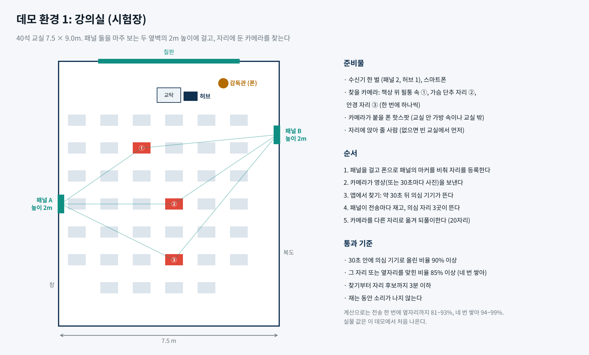
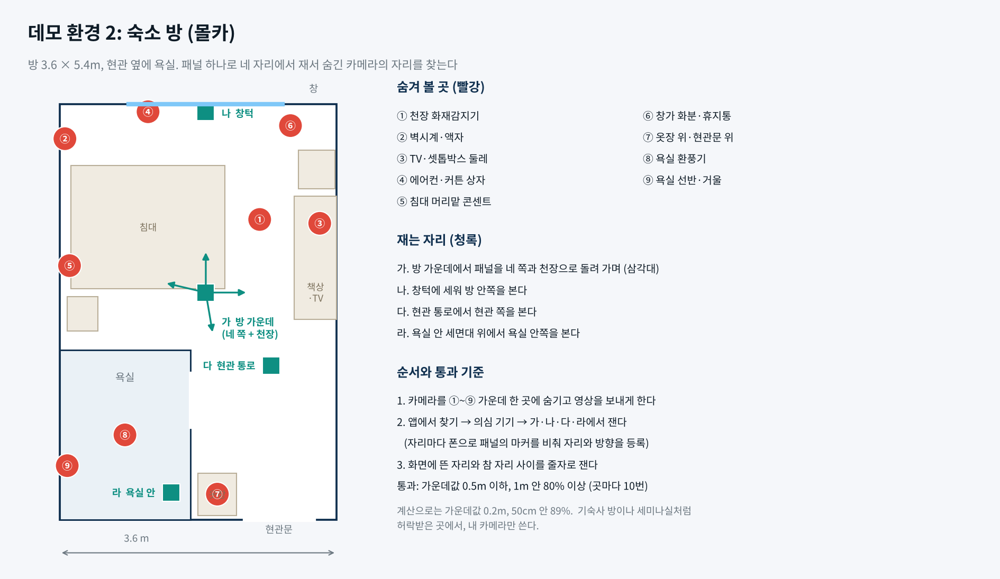

---
tags:
  - DeteCam
  - 데모
고친날: 2026-11-18
---

# 데모 환경

만든 것이 되는지를 어디서, 무엇으로, 어떤 기준으로 보일지를 정한다. 세 가지다: **강의실(시험장)**, **숙소 방(몰카)**, **탁상(발표 자리)**. 같은 수신기와 같은 앱을 쓴다. 숫자의 근거는 [설계 검토](설계%20검토.md)와 [숙소 방 계산](숙소%20방%20계산.md)이다.

| 데모 | 보이려는 것 | 수신기 | 통과 기준 |
|---|---|---|---|
| 1. 강의실 | 40석 교실에서 시험지를 찍어 보내는 카메라가 **어느 자리**인지 | 패널 둘 + 허브 | 그 자리나 옆자리를 85% 이상 (전송 네 번을 쌓아) |
| 2. 숙소 방 | 방에 숨긴 카메라가 **벽·천장의 어디**인지 | 패널 하나 + 허브 | 가운데값 0.5 m 이하, 1 m 안 80% 이상 |
| 3. 탁상 | 상자 셋 가운데 **어느 상자**에 카메라가 있는지 (발표 자리에서 2분) | 패널 하나 + 허브 | 열 번 가운데 아홉 번 |

## 1. 강의실 (시험장)

**곳.** 학교 강의실, 책상 40개 안팎 (계산한 교실은 7.5 × 9.0 m, 여섯 칸 × 일곱 줄). 창 쪽 벽과 복도 쪽 벽이 마주 보는 곳.

**놓는 것.**

| 것 | 어디에 |
|---|---|
| 패널 A | 창 유리 앞쪽 (칠판 쪽 벽에서 2.5 m), 2 m 높이 (흡착 걸이). 창 유리 가운데(4.85 m)와도 견준다 ([배치 계산](배치%20계산.md)) |
| 패널 B | 복도 쪽 창턱 앞쪽, 2 m 높이 (받침 발) |
| 허브 | 교탁 위 (보조배터리) |
| 찾을 카메라 | 내 카메라 한 대. 책상 위 필통 속, 가슴(단추 자리), 안경 자리에 차례로 |
| 카메라가 붙을 곳 | 폰 핫스팟 (2.4 GHz). 교실 안 가방 속이나 교실 밖 |
| 사람 | 감독관 노릇 한 명 (폰). 자리에 앉아 줄 사람이 있으면 좋다 |

**순서.**

1. 패널 둘을 걸고 허브를 켠다. 폰을 허브의 Wi-Fi 에 붙인다.
2. 폰으로 패널마다 마커를 비춘다. 앱에 교실의 줄과 칸을 넣는다 (자리표).
3. 카메라를 한 자리에 두고 실시간 보기를 켠다. 또는 30초마다 사진을 보내게 한다.
4. 앱에서 찾기를 누른다. 약 30초 뒤 의심 기기에 카메라가 뜨는지 본다.
5. 그 기기를 고르면 패널이 전송마다 잰다. 자리 후보 셋이 뜬다. 한 번 잰 것과 네 번 쌓은 것을 적는다.
6. 카메라를 다른 자리로 옮겨 3~5 를 되풀이한다. 스무 자리 (앞·가운데·뒤, 창 쪽·복도 쪽을 고루).

**적는 것.** 자리마다: 참 자리, 1등 자리, 후보 셋, 쌓은 횟수, 걸린 시간. 탐지에서는: 의심 기기로 오를 때까지 걸린 시간, 다른 기기가 잘못 오른 횟수.

**통과 기준.**

| 항목 | 기준 | 계산값 (위 자리, 2026-11-18) |
|---|---|---|
| 30초 안에 의심 기기로 오른다 | 90% 이상 | - |
| 그 자리나 옆자리 (전송 한 번) | 70% 이상 | 책상 위 85, 가슴 85, 안경 94 |
| 그 자리나 옆자리 (전송 네 번) | 85% 이상 | 93, 96, 99 |
| 후보 셋 안에 그 자리 (전송 네 번) | 90% 이상 | 91, 97, 99 |
| 후보 셋 안에 그 자리 (전송 16번) | 95% 이상 | 97, 99, 100 |
| 찾기부터 자리 후보까지 | 3분 이하 | 계속 보내면 1분, 30초마다 보내면 2분 30초 |
| 재는 동안의 소리 | 나지 않는다 | 움직이는 부품이 없다 |

기준을 계산값보다 낮게 잡았다. 계산의 사람은 단순한 덩어리이고 실물은 더 나쁠 것이다.

**줄여서 하기.** 패널이 하나뿐일 때(관문 4)는 창 유리 가운데에 하나만 걸고 같은 순서로 한다. 계산값은 옆자리까지 80 · 69 · 82% (전송 한 번), 93 · 86 · 86% (여덟 번)이다.

## 2. 숙소 방 (몰카)

**곳.** 내 방이나 기숙사 방, 빌린 세미나실처럼 허락받은 곳. 계산한 방은 3.6 × 5.4 m 에 욕실이 붙어 있다. 욕실이 없으면 방만 한다.

**놓는 것.**

| 것 | 어디에 |
|---|---|
| 패널 하나 | 삼각대에 올려 방 가운데, 1.3 m 높이. 받침 발의 밑에 삼각대 나사 자리가 있다 |
| 허브 | 방 안 아무 곳 |
| 찾을 카메라 | 내 카메라 한 대. 아래 아홉 곳에 차례로 숨긴다 |
| 숨길 곳 | 천장 화재감지기 옆, 벽시계 뒤, TV 옆, 커튼 상자, 침대 머리맡 콘센트, 창가 화분, 옷장 위, 욕실 환풍기, 욕실 선반 |
| 같이 켜 둘 것 | 영상을 보는 노트북이나 폰 한 대 (카메라가 아닌 기기가 잘못 오르는지 보려고) |

**순서.**

1. 카메라를 한 곳에 숨기고 실시간 보기를 켠다. 찾는 사람은 어디에 숨겼는지 모르게 한다.
2. 앱에서 찾기를 누른다. 의심 기기에 카메라가 뜨고, 노트북은 뜨지 않거나 아래에 뜨는지 본다. 헷갈리면 앱이 시키는 대로 방 안을 걸어 본다.
3. 폰으로 패널의 마커를 비추고, 패널을 네 벽과 천장 쪽으로 돌려 가며 잰다.
4. 화면의 후보 세 곳을 본다. 흐리면 창턱, 현관 통로, 욕실 안에서 한 번씩 더 잰다.
5. 화면이 짚은 곳과 참 자리 사이를 줄자로 잰다. 곳마다 열 번 (카메라의 방향을 조금씩 바꿔서).

**통과 기준.**

| 항목 | 기준 | 계산값 |
|---|---|---|
| 카메라가 의심 기기의 맨 위에 오른다 | 90% 이상 | - |
| 고른 곳과 참 자리의 거리 (가운데값) | 0.5 m 이하 | 0.26 m (가운데에서만), 0.20 m (네 자리) |
| 1 m 안 | 80% 이상 | 89%, 95% |
| 후보 셋 가운데 하나가 50 cm 안 | 80% 이상 | 91%, 97% |
| 들어와서 후보가 뜰 때까지 | 3분 이하 | 엿듣기 30초 + 다섯 쪽 재기 1분 |

## 3. 탁상 (발표 자리)

발표하는 곳에서 2분 안에 보이는 작은 데모다. 교실과 방은 영상으로 보이고, 이것은 그 자리에서 한다.

| 것 | 내용 |
|---|---|
| 놓는 것 | 책상 위에 패널(받침 발)과 허브. 3 m 앞에 종이 상자 셋을 1 m 간격으로. 그 가운데 하나에 카메라 |
| 순서 | 듣는 사람이 카메라를 넣을 상자를 고른다 → 찾기 → 앱 화면에서 어느 상자에 표시가 뜨는지 본다 |
| 통과 기준 | 열 번 가운데 아홉 번 (상자 사이가 패널에서 18도라, 방향 오차 5도면 넉넉하다) |
| 보이는 것 | 다른 폰과 노트북이 여럿 있는 곳에서 카메라만 골라낸다. 모터가 없고 소리가 나지 않는다. 1초 안에 짚는다 |

## 4. 지킬 것

- 내 카메라와 내 폰만 쓴다. 다른 사람의 기기에는 프레임을 보내지 않는다. 엿들을 때도 프레임의 머리(주소, 길이)만 보고 내용은 보지 않는다 (암호화돼 있어 볼 수도 없다).
- 강의실은 수업이 없는 때에, 쓰는 것을 알리고 한다. 다른 사람이 있는 숙소에서는 하지 않는다.
- 기록 파일에는 내 기기의 주소가 들어 있다. 저장소에 올리지 않는다.

## 5. 언제 할 수 있나

| 데모 | 필요한 것 | 관문 |
|---|---|---|
| 탁상 | 패널 하나 | 관문 4 뒤 |
| 숙소 방 | 패널 하나, 삼각대 | 관문 4 뒤 |
| 강의실 (패널 하나) | 패널 하나 | 관문 4 뒤 |
| 강의실 (패널 둘) | 패널 둘 | 관문 5 뒤 |

실물이 나오기 전까지는 같은 장면을 계산으로 보인다: [동작 영상](https://detecam.github.io/receiver/videos/)과 [숙소 방 계산](숙소%20방%20계산.md)의 그림.
