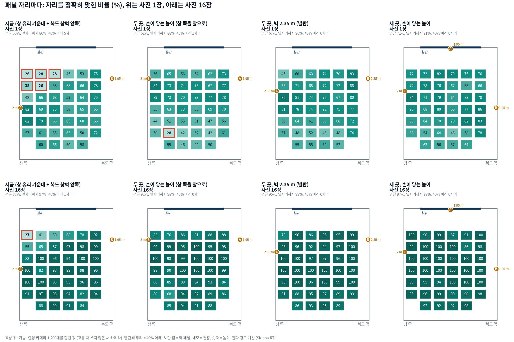
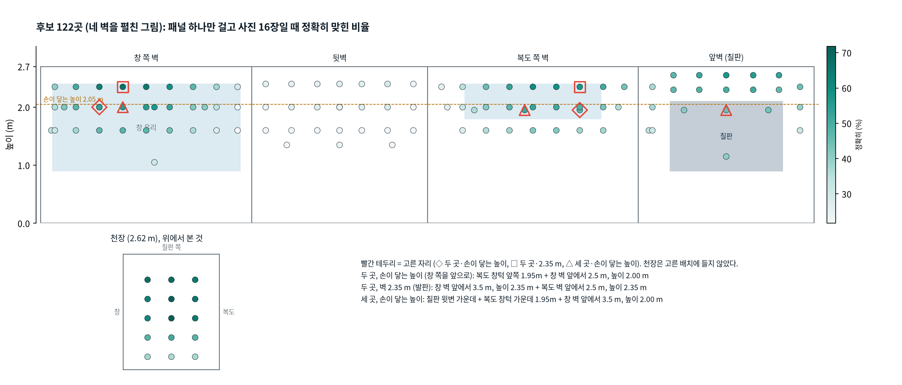
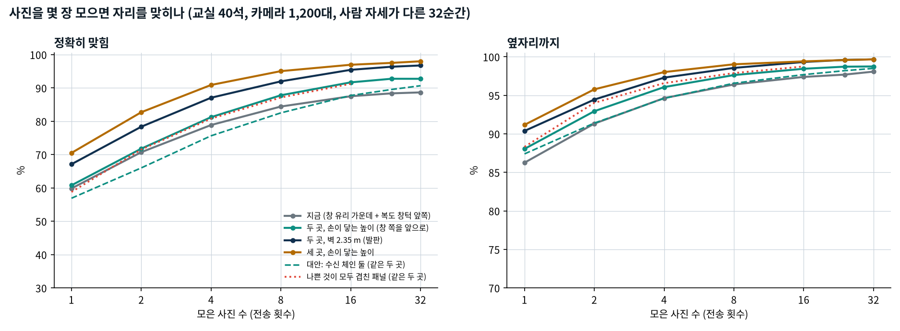

---
tags:
  - DeteCam
  - 검토
고친날: 2026-11-18
---

# 패널을 어디에 걸까: 3차원 자리 찾기와 사진 16장

2026-11-18 기준. 시험 문제를 찍어 보내는 카메라는 한 장에 한 문제(많아야 두세 문제)를 찍으므로, 시험 한 번에 적어도 16번은 보낸다. 그래서 **사진 16장을 모았을 때**를 기준으로, 패널을 걸 곳을 교실 네 벽의 세 높이와 천장까지 넓혀 모두 견줬다. 둘로 안 되면 셋도 봤다. 전부 전파 경로 계산(Sionna RT)이다. 숫자는 `sim/pre/place.json`, 그림은 `sim/pre/place_fig.py`.



## 1. 한눈에

| 물음 | 답 |
|---|---|
| 사진 16장이면 지금 거는 곳으로 되나 | 평균은 된다: 자리를 정확히 87%, 옆자리까지 97%. 그러나 **사각지대가 남는다.** 첫째 줄 창 쪽 두 자리가 23%·33% 다. 사진을 모아도 그 자리는 두 패널 모두에게 잘 갈리지 않는다 |
| 두 개로 사각지대를 없앨 수 있나 | **된다. 창 쪽 패널을 앞으로 옮기면 된다.** 창 유리 가운데(칠판에서 4.85 m)에서 창 유리 앞쪽(2.5 m)으로 옮기고 복도 쪽은 그대로 두면, 손이 닿는 2.0 m 높이에서 평균 91%, 가장 약한 자리 70% 다 (지금 23%). 패널을 숙이지 않고 걸면 94%, 80% 다 (5절) |
| 더 높이 걸면 | 두 패널을 창틀 위 끝 높이(2.35 m)로 올리고 창 쪽을 칠판에서 3.5 m 에 걸면 평균 96%, 가장 약한 자리 80%, 80% 아래 자리가 없다. 발판이나 걸이 막대가 있어야 한다 |
| 셋이 필요한가 | 두 개로도 사각지대는 없앨 수 있다. 셋(칠판 윗변 가운데 + 복도 창턱 가운데 + 창 쪽 3.5 m, 모두 2 m 안팎)이면 평균 97%, 가장 약한 자리 87% 로 더 고르다. 패널 하나에 약 24만 원 |
| 천장은 | 필요 없다. 천장을 넣은 가장 좋은 배치도 벽에만 건 배치보다 낫지 않았다 |
| 거는 각도는 | 경첩 하나면 된다. 좌우는 교실 가운데 쪽으로 돌리고, 2.0 m 에서는 숙이지 않는다. 2.35 m 에 걸면 15도쯤 숙인다. 각도는 평균을 1~2점만 바꾼다 (5절) |
| 옆자리까지는 | 고른 배치는 모두 98~100% 다. 틀려도 거의 옆자리다 |
| 사진이 적으면 | 어느 배치든 사진 한두 장이면 평균 60~83% 다. 네 장이면 기본 배치 81%, 2.35 m 87%, 셋 91% 로 오른다 (4절) |

## 2. 어떻게 셌나

| 항목 | 값 |
|---|---|
| 교실 | 7.5 × 9.0 × 2.7 m, 40석, 사람 40명 (자세를 섞음). 창 유리, 복도 창, 문, 칠판(금속), 사물함 |
| 후보 자리 122곳 | 손이 닿는 스무 곳 (지금까지 쓴 곳) + 창 쪽 벽·복도 쪽 벽·앞벽·뒷벽에 높이 1.6 / 2.0 / 2.35~2.55 m + 천장 15곳 (2.62 m) |
| 패널 방향 | 벽: 교실 가운데 쪽으로 돌리고 15도 아래로 숙인다 (경첩). 천장: 교실 가운데를 똑바로. 앱이 아는 패널 자세는 5 cm, 2도, 1도 틀린다고 뒀다 |
| 카메라 | 책상 위·가슴·안경 400대씩, 자리마다 30대 (고르기). 고른 뒤에는 **고를 때 쓰지 않은 새 카메라 1,200대**로 다시 쟀다 (아래 숫자는 모두 이것) |
| 사진 | 사람 자세가 다른 16순간에 한 번씩 잰 점수를 더한다 (사진 한 장 = 한 순간). 사진 수 곡선은 고른 곳만 32순간까지 더 계산했다 |
| 재는 법 | 지금 설계 그대로 (패치 16개, 기준 안테나와 합친 세기를 네 단계로). 패킷마다 이득 0.5 dB, 서브캐리어마다 0.5 dB 흔들림, 보정하고 남은 오차 5도·0.5 dB |
| 고르는 기준 | ① 가장 약한 자리 ② 약한 다섯 자리의 평균 ③ 평균, 차례로. 사각지대를 줄이는 것이 먼저다 |
| 견준 수 | 두 곳 7,381가지, 세 곳 295,240가지 모두. 갈래(손이 닿는 곳 / 천장 빼고 / 아무 곳)마다 위쪽 다섯~여덟을 새 카메라로 다시 재서 골랐다 |



## 3. 결과 (사진 16장, 새 카메라 1,200대)

| 배치 | 높이 | 정확히 | 옆자리까지 | 책상 · 가슴 · 안경 (정확히) | 가장 약한 자리 | 약한 다섯 평균 | 80% 아래 자리 |
|---|---|---|---|---|---|---|---|
| 지금: 창 유리 가운데 + 복도 창턱 앞쪽 | 2.0 · 1.95 m | 87 | 97 | 91 · 81 · 88 | 23 | 49 | 10 |
| **두 곳, 손이 닿는 높이**: 창 유리 앞쪽 (칠판 쪽 벽에서 2.5 m) + 복도 창턱 앞쪽 (2.5 m) | 2.0 · 1.95 m | 91 | 98 | 87 · 92 · 94 | 70 | 77 | 3 |
| **두 곳, 2.35 m**: 창 쪽 (칠판에서 3.5 m) + 복도 쪽 (2.5 m), 창틀 위 끝 | 2.35 · 2.35 m | 96 | 99 | 94 · 96 · 98 | 80 | 85 | 0 |
| **세 곳, 손이 닿는 높이**: 칠판 윗변 가운데 + 복도 창턱 가운데 + 창 쪽 (칠판에서 3.5 m) | 1.95 · 1.95 · 2.0 m | 97 | 100 | 96 · 97 · 99 | 87 | 91 | 0 |
| (참고) 세 곳, 천장을 넣으면: 칠판 윗변 왼쪽 끝 + 창 쪽 (4.5 m) + 천장 | 1.95 · 2.0 · 2.62 m | 98 | 100 | 98 · 98 · 98 | 87 | 91 | 0 |

- **지금 거는 곳의 사각지대는 첫째 줄이다.** 첫째 줄 셋째 칸 23%, 첫째 줄 창가 33%, 둘째 줄 창가 53%. 사진 한 장 때의 사각지대([사각지대](사각지대.md))와 같은 곳이다. 모아도 그 자리를 가르는 정보가 늘지 않는다.
- **창 쪽 패널을 앞으로.** 창 쪽 패널이 첫째·둘째 줄을 정면에 가깝게 보게 되어 그 자리가 70~83% 로 오른다. 가장 약한 곳은 여섯째 줄 창 쪽(73~77%)으로 가지만 40% 아래는 없다. 사진 한 장 때는 뒤쪽이 크게 떨어졌는데([사각지대](사각지대.md) 3절), 16장을 모으면 뒤쪽은 사람 자세가 바뀌며 메워진다.
- **높이 2.35 m.** 높이 걸면 앞사람의 머리와 몸에 덜 가려 가슴 카메라가 오른다 (지금 81% → 96%). 창 쪽은 3.5 m 가 가장 좋았다.
- **셋.** 칠판 윗변 가운데를 더하면 앞줄을 정면에서 보므로 모든 자리가 87% 이상이다. 천장을 넣은 가장 좋은 셋(칠판 윗변 왼쪽 끝 + 창 쪽 4.5 m + 천장)도 같은 수준이라, 천장은 필요 없다.

## 4. 사진을 몇 장 모으면 (1~32장)



정확히 / 옆자리까지 (%), 괄호는 가장 약한 자리. 고른 곳만 사람 자세 32순간을 계산해 이어진 사진 K장을 모았다 (새 카메라 1,200대, 위 표와 다른 카메라라 1~2점 다르다).

| 사진 | 지금 | 두 곳, 손이 닿는 높이 | 두 곳, 2.35 m | 세 곳, 손이 닿는 높이 |
|---|---|---|---|---|
| 1장 | 60 / 86 (26) | 61 / 88 (28) | 67 / 90 (45) | 71 / 91 (46) |
| 2장 | 71 / 91 (29) | 72 / 93 (40) | 78 / 94 (58) | 83 / 96 (62) |
| 4장 | 79 / 95 (29) | 81 / 96 (52) | 87 / 97 (66) | 91 / 98 (76) |
| 8장 | 84 / 96 (29) | 88 / 98 (61) | 92 / 99 (72) | 95 / 99 (82) |
| 16장 | 88 / 97 (27) | 92 / 98 (68) | 95 / 99 (79) | 97 / 99 (86) |
| 32장 | 89 / 98 (27) | 93 / 99 (60) | 97 / 100 (87) | 98 / 100 (90) |

- **지금 거는 곳은 32장을 모아도 가장 약한 자리가 27% 에 머문다.** 평균만 오르고 사각지대는 남는다.
- **창 쪽을 앞으로 옮긴 배치는 사진 한 장일 때도 평균이 지금과 같다** (61 대 60). 책상 위 카메라는 6점 낮고 가슴·안경은 4점 높다. 잃는 것 없이 사각지대를 줄인다.
- 네 장부터 차이가 벌어진다. 가장 약한 자리가 지금 29%, 기본 배치 52%, 2.35 m 66%, 셋 76%.
- 가장 약한 자리의 숫자는 자리마다 카메라 30대로 센 것이라 ±10점쯤 흔들린다 (32장의 60 이 16장의 68 보다 낮은 것도 그 흔들림이다). 평균과 '80% 아래 자리 수'가 더 믿을 만하다.

## 5. 거는 각도

벽 패널은 경첩 받침으로 좌우를 교실 가운데 쪽으로 돌리고, 아래로 숙이는 각만 바꿔 봤다: 0도, 15도 (3·4절의 계산), 30도. 그리고 두 축으로 꺾이는 받침으로 자리 한가운데를 똑바로 보게 한 것. 4절과 같은 새 카메라 1,200대, 사람 자세 1~16순간만 썼다 (그래서 4절과 1~2점 다르다).

정확히 / 옆자리까지 (%), 괄호는 가장 약한 자리, 점 뒤는 80% 아래 자리 수. 사진 16장.

| 배치 | 0도 | 15도 | 30도 | 한가운데를 똑바로 |
|---|---|---|---|---|
| 지금 | 87 / 96 (23) · 6 | 87 / 98 (27) · 8 | 88 / 99 (23) · 7 | 87 / 97 (30) · 8 |
| 두 곳, 손이 닿는 높이 | **94 / 99 (80) · 0** | 92 / 99 (67) · 4 | 91 / 98 (60) · 6 | 92 / 98 (67) · 4 |
| 두 곳, 2.35 m | 94 / 99 (33) · 1 | 95 / 99 (77) · 1 | 95 / 99 (80) · 0 | 95 / 99 (83) · 0 |
| 세 곳, 손이 닿는 높이 | 97 / 99 (83) · 0 | 98 / 100 (80) · 0 | 96 / 99 (83) · 0 | 98 / 100 (80) · 0 |

- **각도는 평균을 1~2점만 바꾼다.** 사진 한 장일 때는 어느 각이든 같다 (±1점). 바뀌는 것은 약한 자리다.
- **2.0 m 에서는 숙이지 않는다.** 0도가 가장 좋았다: 평균 94%, 가장 약한 자리 80%, 80% 아래 자리 없음 (15도는 92%, 넷). 사진 네 장에서도 0도가 낫다 (84% 대 82%).
- **2.35 m 에 걸면 15도 넘게 숙인다.** 0도면 첫째 줄 창가 한 자리가 33% 로 떨어진다 (사진 네 장이면 39% 대 15도 57%).
- 셋이면 각도는 상관없다 (96~98%).
- 두 축 받침(한가운데를 똑바로)은 경첩보다 낫지 않다. **경첩 하나면 된다** (좌우로 교실 가운데, 아래로 0~15도).
- 3절의 자리는 15도로 놓고 골랐다. 0도로 다시 고르면 다른 자리가 나올 수도 있지만, 고른 자리가 0도에서 더 좋아졌으므로 그대로 쓴다. 가장 약한 자리의 숫자는 ±10점 흔들리므로 실물에서 0도와 15도를 둘 다 재 본다.

## 6. 권하는 배치

| 상황 | 배치 | 무엇이 바뀌나 |
|---|---|---|
| **기본 (손이 닿는 높이)** | 창 쪽: 창 유리 앞쪽 (칠판 쪽 벽에서 2.5 m), 2.0 m. 복도 쪽: 창턱 앞쪽 (2.5 m), 1.95 m. 둘 다 좌우만 교실 가운데로 돌리고 숙이지 않는다 | 창 쪽 패널만 칠판 쪽으로 옮긴다 (4.85 m → 2.5 m). 값은 같다 |
| 발판이 있으면 | 창 쪽: 칠판에서 3.5 m, 2.35 m (창틀 위 끝). 복도 쪽: 칠판에서 2.5 m, 2.35 m (복도 창 위 끝). 15도쯤 숙인다 | 걸이를 창틀 위에 건다 |
| 사각지대를 더 줄이려면 | 기본 둘 대신 칠판 윗변 가운데 1.95 m + 복도 창턱 가운데 1.95 m + 창 쪽 칠판에서 3.5 m 2.0 m | 패널 하나 더 (약 24만 원) |

- 실물 교실에서는 지금 거는 곳과 기본 배치를 둘 다 재 본다 (패널만 옮기면 된다). 숙이는 각도 0도와 15도를 견준다. 창 유리 가운데에 걸 수 없는 교실이면 창 쪽 벽의 칠판 쪽 1/3 어디든 비슷하다 (창 쪽 2.5~3.5 m, 2.0~2.35 m 가 위쪽 순위를 차지했다).
- 강의실(72석)은 계산하지 않았다. 지금처럼 셋을 권한다.

## 7. 한계

- 교실 하나, 사람 모형(단순한 덩어리)이다. 다른 교실에서는 숫자가 달라질 수 있어, 실물에서 두 배치를 견준다.
- 카메라가 사진을 16번 보내고, 보내는 동안 패널이 잴 수 있다고 봤다 (전송 한 번 = 한 번 재기). 녹화만 하는 카메라는 여전히 못 찾는다 ([사각지대](사각지대.md) 5절).
- 사람 자세는 사진마다 새로 뽑았다. 같은 자세로 굳어 있으면 모으는 효과가 줄어든다.
- 자리 찾기는 15도로 숙인 패널로만 했다. 거는 각도는 고른 배치에서만 바꿔 봤다 (5절).

## 다시 해 보기

```
cd sim/rt
./run_place.sh                       # 길(GPU) → 재기 → 고르기: study/place_g16.json
python place_followup.py all         # 검증, 사진 1~32장 곡선, 대안 수신기, 나쁜 경우, 5G, 거는 각도
cd ../pre && python3 place_fig.py collect && python3 place_fig.py figs
```

돌리는 법과 꼬리표는 [패널 연구](../sim/rt/패널%20연구.md)에 있다.
