---
tags:
  - DeteCam
  - 부품
고친날: 2026-11-16
---

# 부품표 (그림과 치수)

## 한눈에

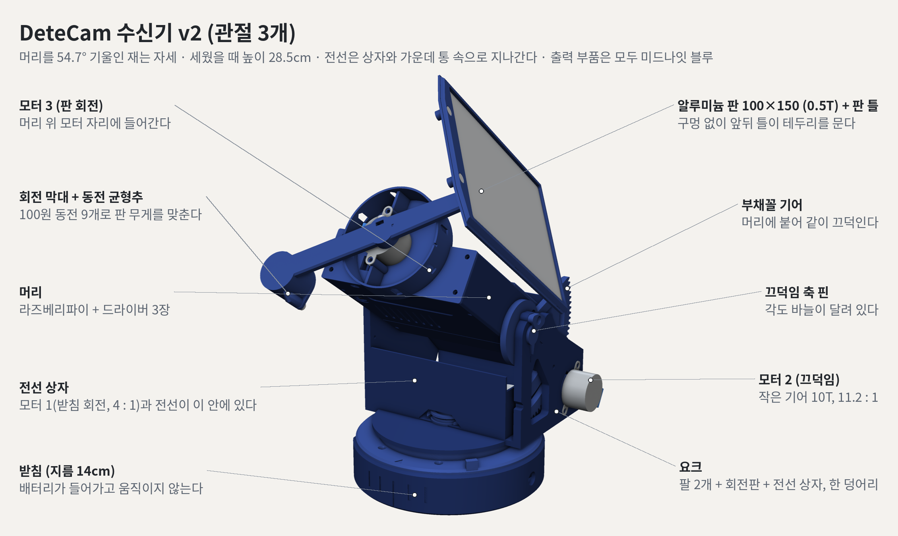

수신기 하나에 출력 부품 22가지(시험용 2가지 더), 사는 전자 부품과 전선·판·동전, 나사 59개와 너트 7개가 든다. 치수는 모두 mm 다. 조립 순서는 [조립 안내](조립%20안내.md), 표 계산용 목록은 [부품표.csv](부품표.csv) 에 있다.

| 무리 | 무엇 | 얼마나 |
|---|---|---|
| 출력 부품 | 장치에 들어가는 것 22가지 + 시험용 2가지 (파일 33개: 맞춤 1·2·3, 받침 S·L 포함) | 출력판 6장, 14시간 47분, 필라멘트 455 g (작은 받침 S 로 뽑을 때) |
| 사는 전자 부품 | 28BYJ-48 모터 + ULN2003 드라이버 3세트, 전원 버튼 KY-004, 탐지 동글(듀얼밴드), ESP32 (XIAO ESP32-C3, 핀 납땜된 것) + FPC 안테나 | 라즈베리파이 3B+ 와 무선 동글 WNA3100M 은 가지고 있는 것 |
| 사는 기계 부품 | 알루미늄 판 100 × 150 × 1, 100원 동전 12개, 6mm 비비탄 45개 | 판에는 구멍을 뚫지 않는다 |
| 전선 | 전원 케이블 50cm (양쪽 ㄱ자), 점퍼선 26가닥 (10cm 20, 20cm 6), Y 분배 케이블 2개, 케이블 타이 3~4개 | 납땜 없음: 모두 꽂기만 한다 |
| 나사·너트 | 나사 59개 (7가지), 너트 7개 | 모두 보통 미터 나사 (볼트) |
| 가지고 있는 것 | 보조배터리 (5V 2A 이상) | S 받침이면 106 × 71 × 22 안 |
| 연장 | 십자드라이버 2개, 줄·사포, 디지털 캘리퍼스(권함), 자·각도기, 순간접착제 | 드릴과 납땜인두는 필요 없다 |

**그림 읽는 법.** 출력 부품 그림은 출력판에 놓는 방향 그대로다. 점선 상자가 부품의 바깥 크기이고, 주황 모서리 셋이 가로 · 세로 · 높이다. 그림마다 배율이 다르니 크기는 숫자로 본다 (나사·너트 그림만 모두 같은 배율이다).

## 출력 부품

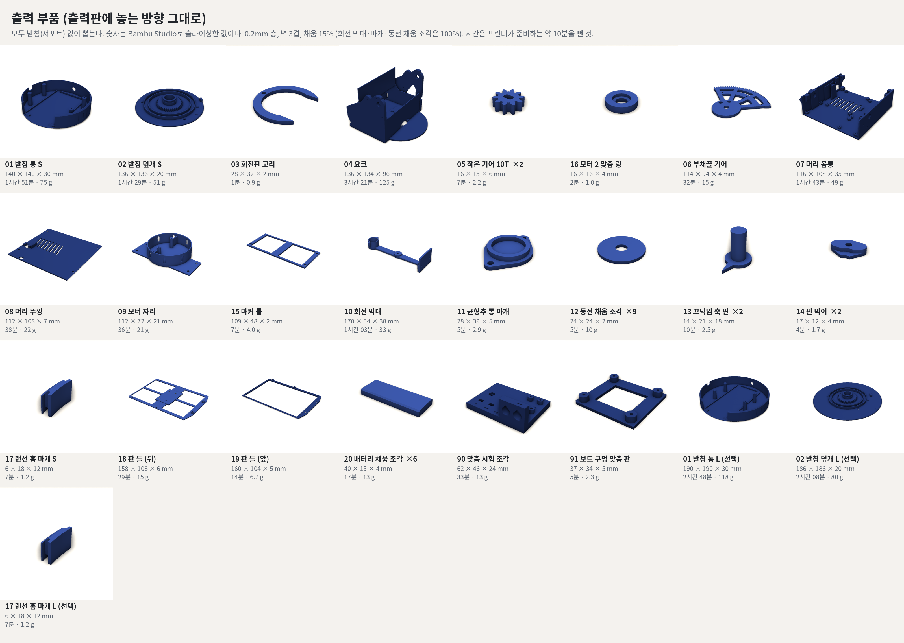

장치에 들어가는 22가지와 시험용 2가지를 뽑는다 (파일 33개). 출력판 6장에 14시간 47분, 필라멘트 455 g 이다 (작은 받침 S 로 뽑을 때). Bambu X1 Carbon, 0.4 노즐, PLA, 0.2 층, 벽 3겹, 채움 15% (회전 막대, 균형추 마개, 동전 채움 조각은 100%), 서포트 없이 뽑는다. 아래 시간과 무게는 부품 하나의 값이고 프린터 준비 시간은 뺐다. 판마다 무엇을 올리는지는 [조립 안내](조립%20안내.md) 3절.

| 번호 | 이름 | 뽑는 수 | 크기 (mm) | 판 |
|---|---|---|---|---|
| 01 | 받침 통 | S·L 중 1개 | 140 × 140 × 30 / 190 × 190 × 30 | 1판 |
| 02 | 받침 덮개 | S·L 중 1개 | 136 × 136 × 20 / 186 × 186 × 20 | 1판 |
| 03 | 회전판 고리 | 1개 | 27.7 × 32.3 × 2 | 0판 |
| 04 | 요크 (회전판 + 팔 + 전선 상자) | 1개 | 136 × 134 × 95.6 | 2판 |
| 05 | 작은 기어 10T | 2개씩 3가지 | 15.7 × 15.1 × 5.5 | 0판 |
| 06 | 부채꼴 기어 | 1개 | 114.3 × 94.2 × 4.5 | 3판 |
| 07 | 머리 몸통 | 1개 | 116.5 × 108 × 35.2 | 3판 |
| 08 | 머리 뚜껑 | 1개 | 111.7 × 108 × 20.2 | 3판 |
| 09 | 모터 자리 | 1개 | 112 × 72 × 21 | 3판 |
| 10 | 회전 막대 (판 받이 + 균형추 통) | 3가지 중 1개 | 170.4 × 54 × 38 | 4판 |
| 11 | 균형추 통 마개 | 1개 | 27.8 × 38.8 × 5.4 | 4판 |
| 12 | 동전 채움 조각 | 2개 | 23.6 × 23.6 × 1.6 | 4판 |
| 13 | 끄덕임 축 핀 | 2개씩 3가지 | 14 × 21 × 18 | 0판 |
| 14 | 핀 막이 | 2개 | 17.3 × 12.2 × 3.9 | 0판 |
| 15 | 마커 틀 | 1개 | 109 × 47.5 × 2 | 0판 |
| 16 | 모터 2 맞춤 링 | 1개 | 16.1 × 16.1 × 3.9 | 0판 |
| 17 | 랜선 홈 마개 | S·L 중 1개 | 6.4 × 18 × 12.3 / 6.3 × 18 × 12.3 | 1판 |
| 18 | 판 틀 | 1개 | 159.5 × 104 × 4.6 | 5판 |
| 19 | 판 누름쇠 | 1개 | 11 × 61 × 2.4 | 5판 |
| 20 | 배터리 채움 조각 | 6개 | 40 × 15 × 4 | 1판 |
| 21 | ESP32 안테나 누름판 | 1개 | 64.4 × 31.7 × 1.2 | 5판 |
| 22 | ESP32 막음쇠 | 1개 | 6.9 × 27 × 1.6 | 5판 |
| 90 | 맞춤 시험 조각 | 1개 | 62 × 46 × 24 | 0판 |
| 91 | 보드 구멍 맞춤 판 | 1개 | 37 × 34 × 5 | 0판 |

### 01 받침 통

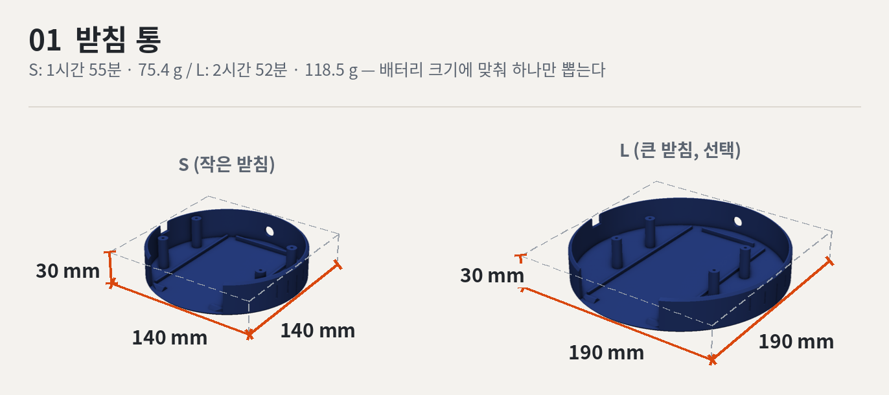

- **파일:** `01_base_tub_S.stl` (S) · `01_base_tub_L.stl` (L). 뽑는 판: 1판 (L 은 `선택_받침통_L`)
- **크기:** S: 140 × 140 × 30 mm / L: 190 × 190 × 30 mm
- **출력:** S: 1시간 51분, 74.7 g / L: 2시간 48분, 117.7 g
- **하는 일:** 장치의 맨 아래 통. 보조배터리가 옆 창으로 들어가고, 바닥의 낮은 턱을 넘으면 걸려서 저절로 밀려 나오지 않는다. 뒤쪽 홈은 랜선이 지나는 길이다 (쓰지 않으면 마개 `17` 로 막는다).
- **나사:** 받침 덮개(02)가 M3 × 10 나사 4개로 이 통에 조여진다.
- **고르기:** 배터리가 106 × 71 × 22 안이면 S, 152 × 76 × 22 안이면 L. 하나만 뽑는다.

### 02 받침 덮개

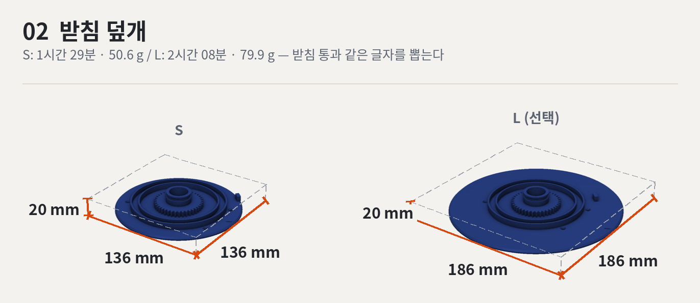

- **파일:** `02_base_cover_S.stl` (S) · `02_base_cover_L.stl` (L). 뽑는 판: 1판 (L 은 `선택_받침덮개_L`)
- **크기:** S: 136 × 136 × 20 mm / L: 186 × 186 × 20 mm
- **출력:** S: 1시간 29분, 50.6 g / L: 2시간 08분, 79.9 g
- **하는 일:** 통 위를 덮는다. 가운데 통에 요크가 끼워져 돌고, 가운데 기어에 모터 1의 작은 기어가 물린다. 둥근 테의 홈에 비비탄 45개쯤을 넣어 요크가 미끄러지듯 돌게 한다. 세모 표시를 통의 눈금에 맞춘다.
- **나사:** M3 × 10 4개로 통(01)에 (접시머리도 된다).
- **고르기:** 받침 통과 같은 글자(S 또는 L)를 뽑는다.

### 03 회전판 고리

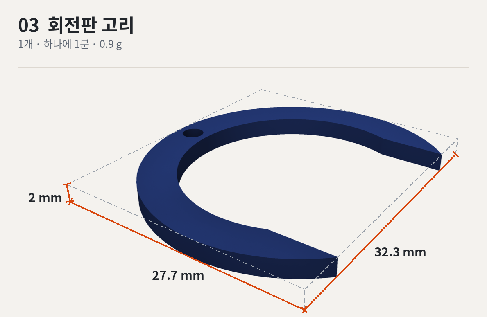

- **파일:** `03_clip.stl` · 1개. 뽑는 판: 0판
- **크기:** 27.7 × 32.3 × 2 mm
- **출력:** 1분, 0.9 g
- **하는 일:** 요크를 받침 가운데 통에 잠근다. 요크의 상자 안에서 통의 홈에 뒤에서 앞으로 밀어 끼운다. 입구가 홈보다 1.5 좁아서 조금 벌어졌다가 딸깍 하고 들어간다.
- **나사:** 없음.

### 04 요크 (회전판 + 팔 + 전선 상자)

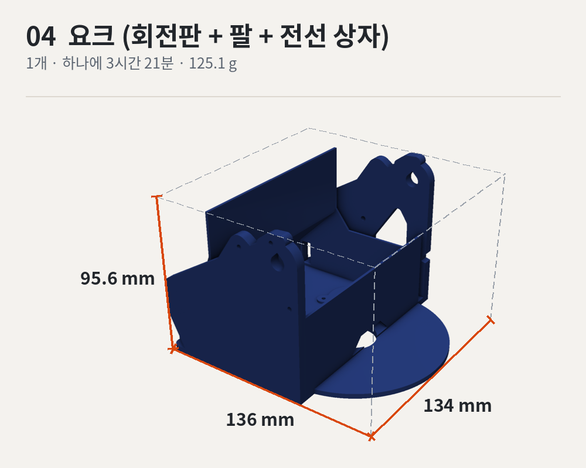

- **파일:** `04_yoke.stl` · 1개. 뽑는 판: 2판
- **크기:** 136 × 134 × 95.6 mm
- **출력:** 3시간 21분, 125.1 g
- **하는 일:** 받침 위에서 좌우로 도는 몸체. 두 팔이 머리를 끄덕임 축 핀으로 잡고, 전선 상자 속에 모터 1이 들어간다. 오른쪽 팔에 모터 2와 0°, 54.7°, 90° 눈금이 있다.
- **나사:** 모터 1 귀 M3 × 6 2개, 받침 회전 멈춤 M3 × 10 1개 (아래로 6mm 나온다), 모터 2 귀 M3 × 6 2개, 핀 막이 M3 × 6 2개, 끄덕임 멈춤 M3 × 10 2개 (왼쪽 팔), 고정 나사 M3 × 10 1개 (옮길 때만, 재기 전에 뺀다).

### 05 작은 기어 10T

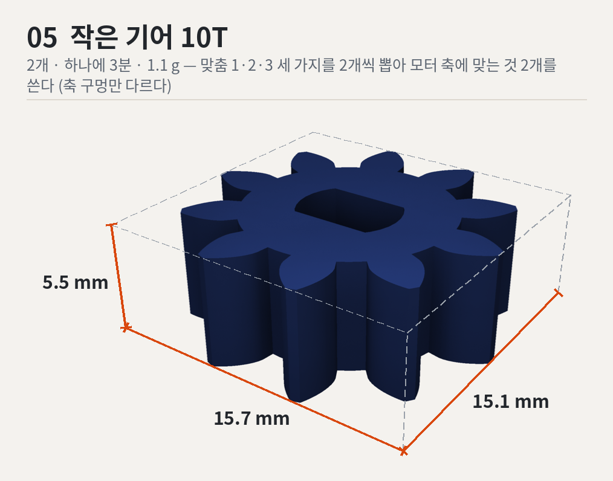

- **파일:** `05_pinion_fit1.stl` · `05_pinion_fit2.stl` · `05_pinion_fit3.stl` (2개씩). 뽑는 판: 0판
- **크기:** 15.7 × 15.1 × 5.5 mm (셋 다 같다)
- **출력:** 하나에 3분, 1.1 g
- **하는 일:** 모터 1과 모터 2의 축에 하나씩 끼운다 (2개 쓴다). 모터 1의 것은 받침 덮개의 가운데 기어에, 모터 2의 것은 부채꼴 기어(06)에 물린다.
- **나사:** 없음 (축에 눌러 끼운다).
- **고르기:** 맞춤 1·2·3 세 가지를 2개씩 뽑아, 시험 조각(90)의 D자 구멍에서 고른 번호의 것 2개를 쓴다. 축 구멍만 다르다.

### 06 부채꼴 기어

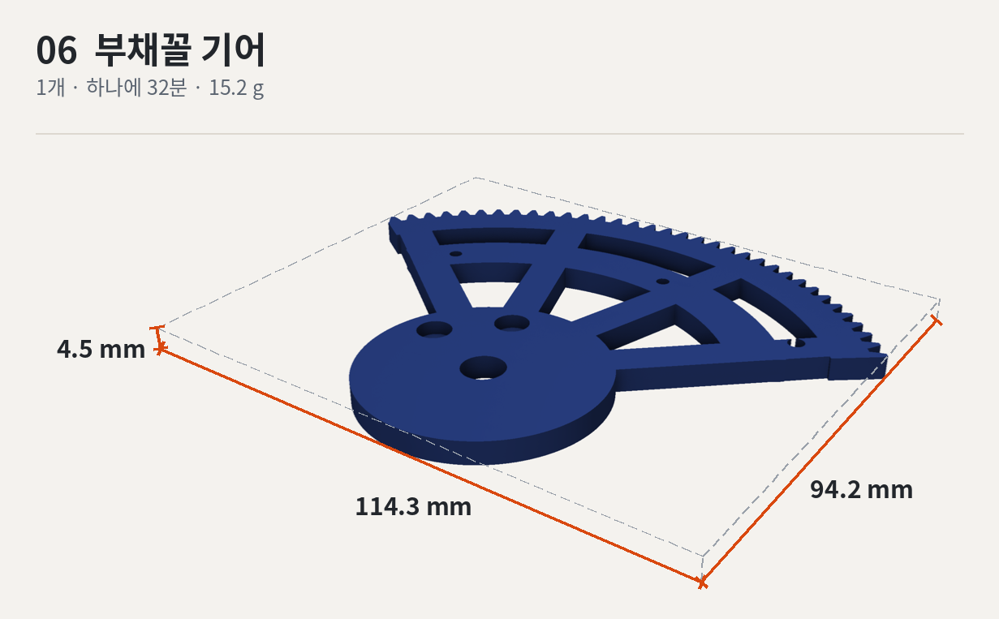

- **파일:** `06_sector_gear.stl` · 1개. 뽑는 판: 3판
- **크기:** 114.3 × 94.2 × 4.5 mm
- **출력:** 31분, 15.2 g
- **하는 일:** 머리 오른쪽 옆면에 붙는다. 모터 2의 작은 기어가 이것을 돌려 머리를 끄덕인다. 나사 머리 자리가 파인 면이 바깥이다.
- **나사:** M3 × 6 2개로 머리 몸통(07)에. 옮길 때는 요크 오른쪽 팔의 고정 나사(M3 × 10)가 이 기어를 잡는다.

### 07 머리 몸통

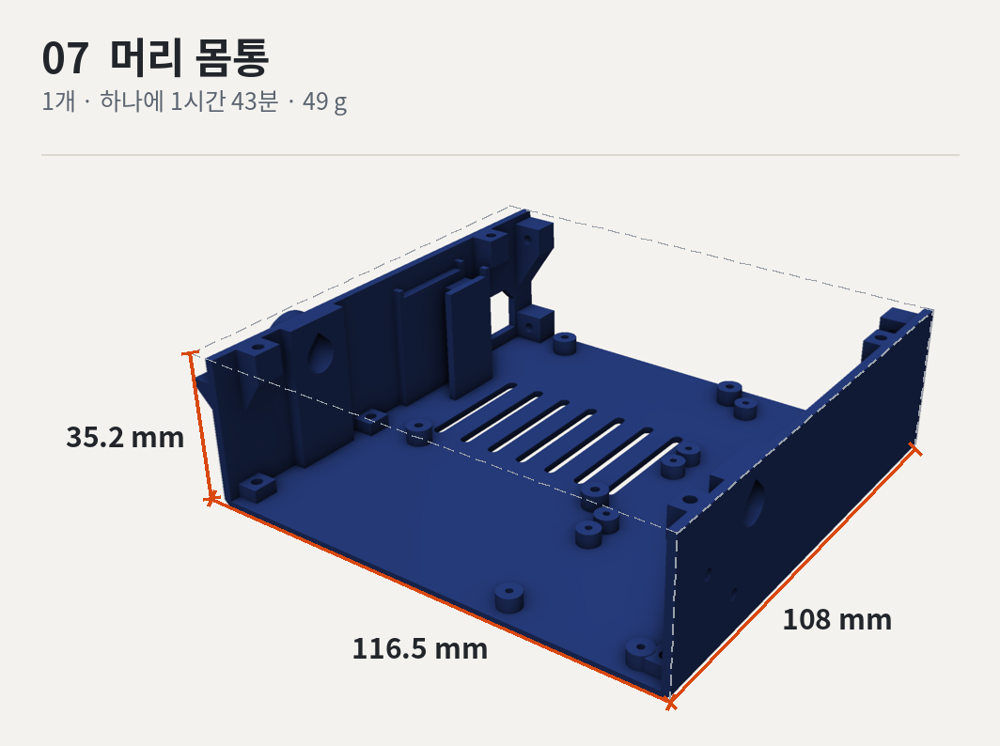

- **파일:** `07_head_shell.stl` · 1개. 뽑는 판: 3판
- **크기:** 116.5 × 108 × 35.2 mm
- **출력:** 1시간 43분, 49.0 g
- **하는 일:** 수신기의 머리. 뒷벽에 라즈베리파이, 오른쪽 기둥에 드라이버 보드 3장, 왼쪽 받침 살에 전원 버튼이 들어가고, 파이의 USB 에 동글 2개를 꽂는다. 양옆의 축 구멍에 끄덕임 축 핀이 들어간다.
- **나사:** 파이 M2.5 × 6 4개, 드라이버 보드 M2 × 6 12개, 모터 자리 M3 × 8 4개, 부채꼴 기어 M3 × 6 2개, 마커 틀 M3 × 6 4개, 뚜껑 M3 × 6 4개.

### 08 머리 뚜껑

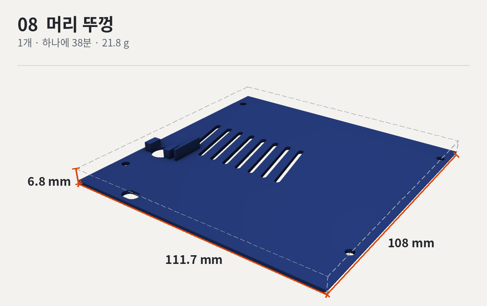

- **파일:** `08_head_lid.stl` · 1개. 뽑는 판: 3판
- **크기:** 111.7 × 108 × 20.2 mm
- **출력:** 46분, 22.8 g
- **하는 일:** 머리 몸통의 열린 면을 덮는다. 뚜껑의 구멍으로 전원 버튼을 누른다. 조립 ⑤의 맨 끝에 닫는다.
- **나사:** M3 × 6 4개로 머리 몸통에.

### 09 모터 자리

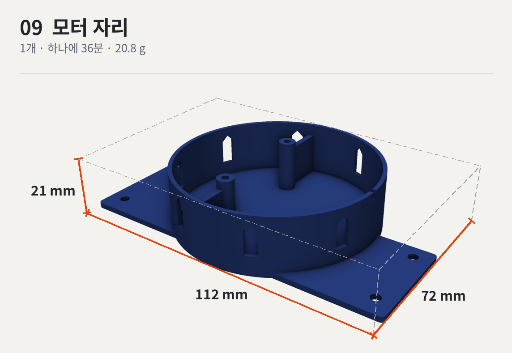

- **파일:** `09_crown.stl` · 1개. 뽑는 판: 3판
- **크기:** 112 × 72 × 21 mm
- **출력:** 37분, 20.9 g
- **하는 일:** 머리 몸통 위에 얹는다. 모터 3이 들어가고, 위로 나온 모터 3의 축에 회전 막대(10)가 끼워져 판을 돌린다. 모터 3의 플러그는 네모 구멍으로 먼저 내려보낸다.
- **나사:** 모터 3 귀 M3 × 6 2개, 모터 자리 → 머리 몸통 M3 × 8 4개.

### 10 회전 막대 (판 받이 + 균형추 통)

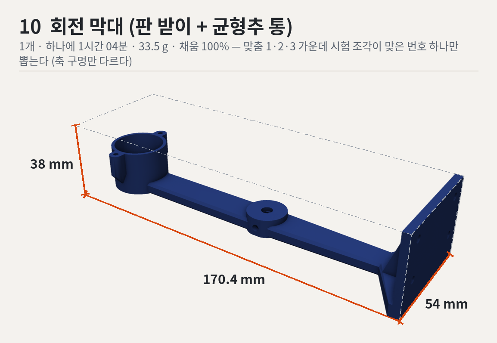

- **파일:** `10_rotor_bar_fit1.stl` · `10_rotor_bar_fit2.stl` · `10_rotor_bar_fit3.stl` (하나만). 뽑는 판: 4판 (`4판_회전부_맞춤N`)
- **크기:** 170.4 × 54 × 38 mm (셋 다 같다)
- **출력:** 하나에 1시간 04분, 33.5 g, 채움 100%
- **하는 일:** 모터 3의 축에 끼워 돈다. 한쪽 끝은 판 받이로 판 틀(18)과 알루미늄 판을 들고, 다른 쪽 끝은 동전 12개를 넣는 균형추 통이다.
- **나사:** 판 틀 M3 × 6 접시머리 4개 + 너트 4개 (판 받이 안쪽 육각 자리), 균형추 마개 M3 × 8 2개, 축 고정 M3 × 8 1개 + 너트 (윗면 네모 홈).
- **고르기:** 맞춤 1·2·3 가운데 시험 조각에서 고른 번호 하나만 뽑는다. 축 구멍만 다르다.

### 11 균형추 통 마개

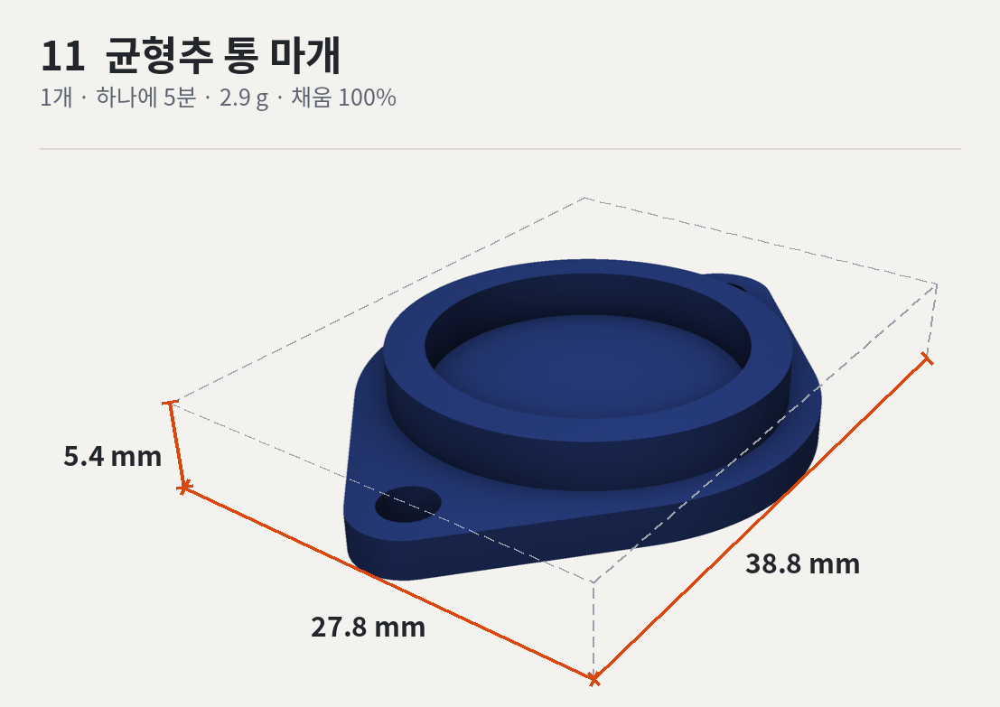

- **파일:** `11_coin_cap.stl` · 1개. 뽑는 판: 4판
- **크기:** 27.8 × 38.8 × 5.4 mm
- **출력:** 4분, 2.9 g, 채움 100%
- **하는 일:** 동전을 넣은 균형추 통을 막는다.
- **나사:** M3 × 8 2개로 회전 막대에.

### 12 동전 채움 조각

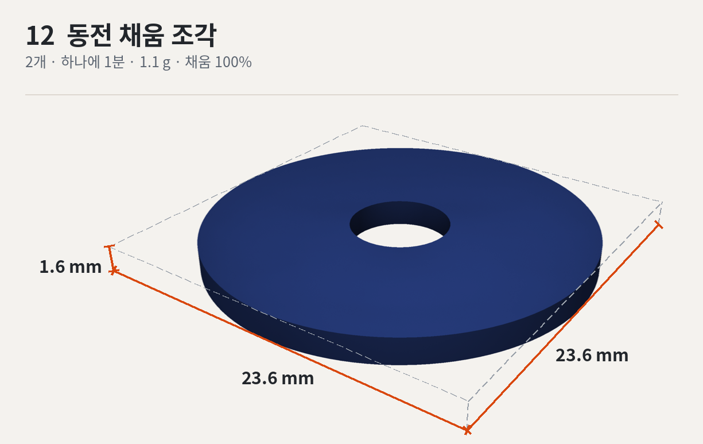

- **파일:** `12_coin_spacer.stl` · 2개. 뽑는 판: 4판
- **크기:** 23.6 × 23.6 × 1.6 mm
- **출력:** 1분, 1.1 g, 채움 100%
- **하는 일:** 1T 판이면 동전 12개로 통이 꽉 차서 쓰지 않는다. 동전을 빼서 균형을 맞출 때 빈 자리에 넣는다. 2개 뽑아 둔다.
- **나사:** 없음.

### 13 끄덕임 축 핀

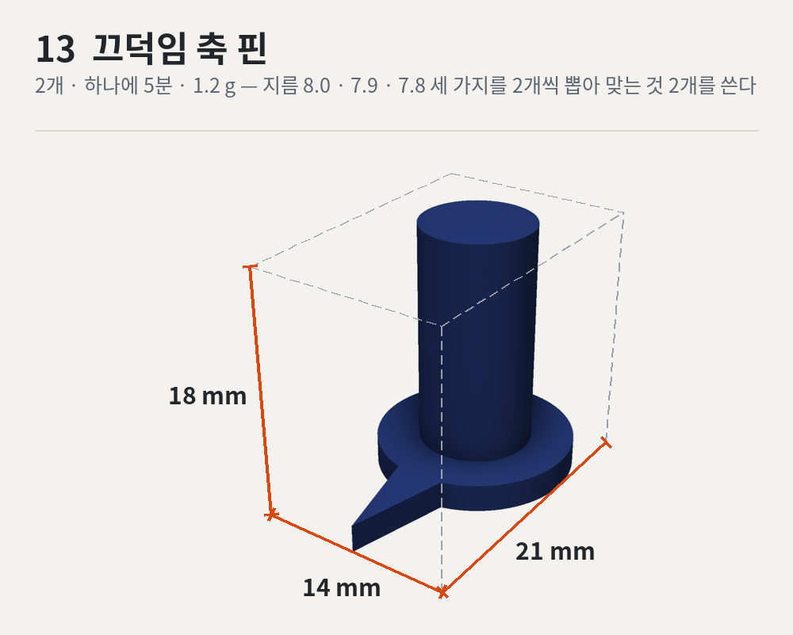

- **파일:** `13_pin_fit1.stl` · `13_pin_fit2.stl` · `13_pin_fit3.stl` (2개씩). 뽑는 판: 0판
- **크기:** 14 × 21 × 18 mm (셋 다 같다)
- **출력:** 하나에 5분, 1.2 g
- **하는 일:** 양쪽 팔 바깥에서 머리의 축 구멍으로 꽂는다. 머리가 이 축으로 끄덕인다. 핀의 바늘이 오른쪽 팔의 각도 눈금을 가리킨다.
- **나사:** 없음 (핀 막이가 빠지지 않게 막는다).
- **고르기:** 지름 8.0 · 7.9 · 7.8 세 가지를 2개씩 뽑아, 시험 조각의 벽 구멍에서 맞는 것 2개를 고른다.

### 14 핀 막이

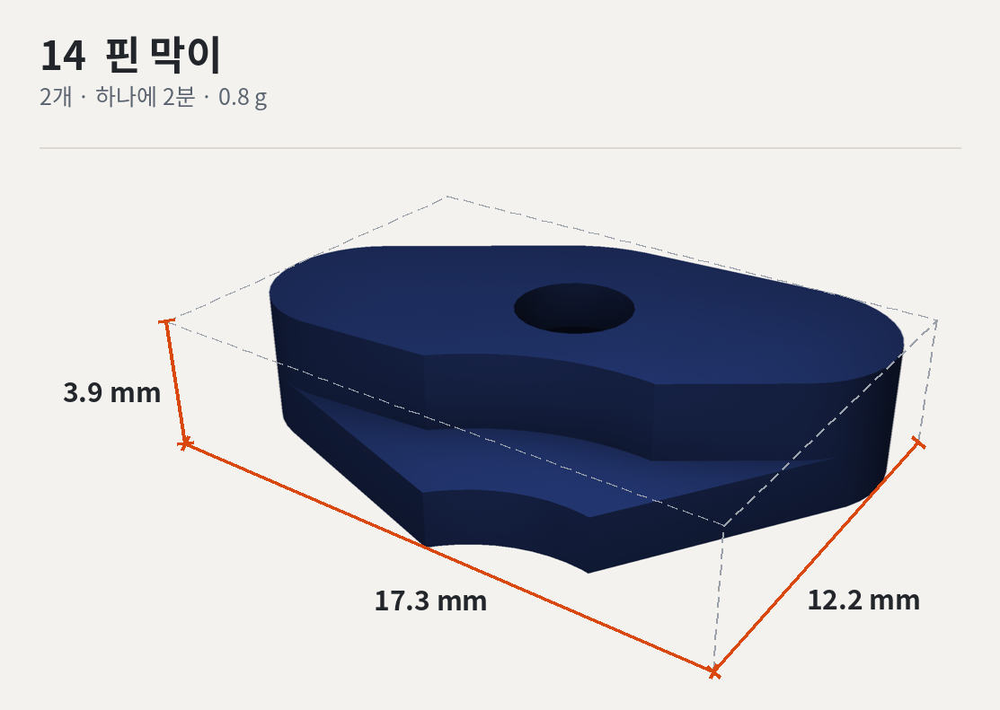

- **파일:** `14_pin_keeper.stl` · 2개. 뽑는 판: 0판
- **크기:** 17.3 × 12.2 × 3.9 mm
- **출력:** 1분, 0.8 g
- **하는 일:** 핀 머리를 덮어 핀이 빠지지 않게 한다. 좌우 같은 것 2개.
- **나사:** M3 × 6 1개씩 팔 바깥면에.

### 15 마커 틀

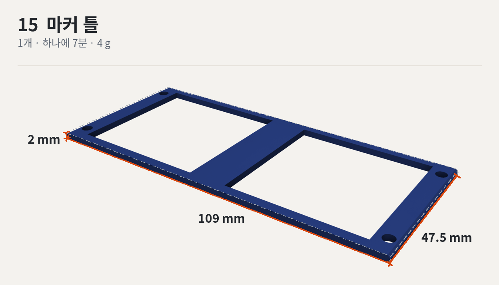

- **파일:** `15_marker_frame.stl` · 1개. 뽑는 판: 0판
- **크기:** 109 × 47.5 × 2 mm
- **출력:** 6분, 4.0 g
- **하는 일:** AR 마커 종이를 머리 등판에 대고 덮어 누른다. 풀이나 테이프는 쓰지 않는다.
- **나사:** M3 × 6 4개 (8mm 를 쓰면 안쪽의 드라이버 보드에 닿는다).

### 16 모터 2 맞춤 링

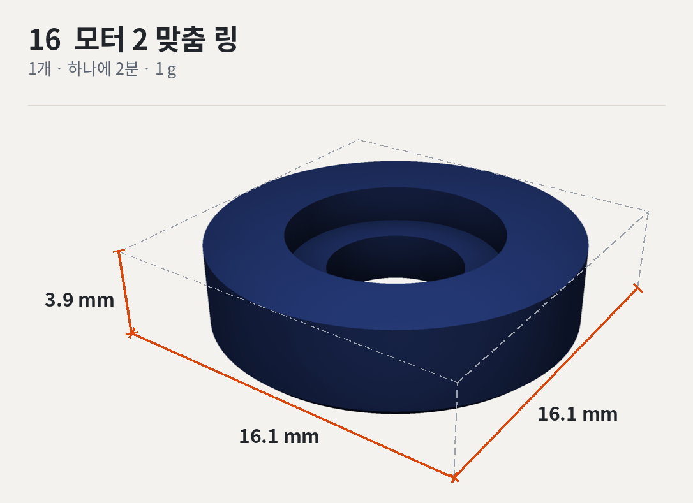

- **파일:** `16_m2_ring.stl` · 1개. 뽑는 판: 0판
- **크기:** 16.1 × 16.1 × 3.9 mm
- **출력:** 1분, 1.0 g
- **하는 일:** 모터 2의 축 둘레 턱에 씌운다 (넓은 구멍이 모터 쪽). 링이 오른쪽 팔의 구멍(지름 16.5)을 채워 모터 2의 자리를 잡는다.
- **나사:** 없음.

### 17 랜선 홈 마개

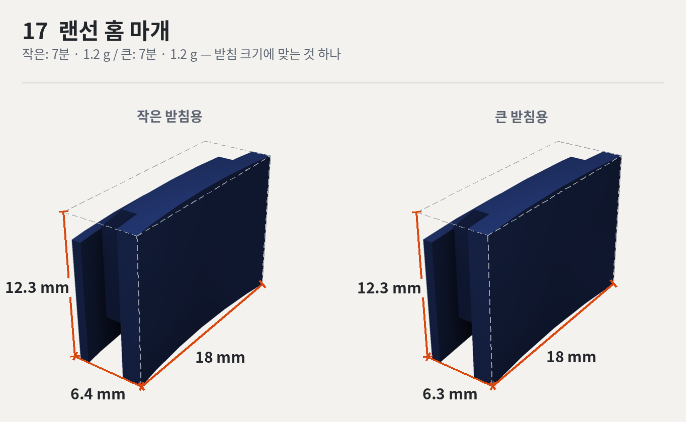

- **파일:** `17_lan_cap.stl` (S) · `17_lan_cap_L.stl` (L). 뽑는 판: 1판 (L 용은 L 덮개 판)
- **크기:** S: 6.4 × 18 × 12.3 mm / L: 6.3 × 18 × 12.3 mm
- **출력:** S: 6분, 1.2 g / L: 6분, 1.2 g
- **하는 일:** 랜선을 장치 안에 넣지 않을 때, 덮개를 덮기 전에 받침 통 뒤쪽 홈에 위에서 끼운다. 벽을 사이에 무는 모양이다. 바닥에 닿는 곳이 좁아서 뽑다가 떨어지면 챙(Brim)을 켠다.
- **나사:** 없음.
- **고르기:** 받침 크기에 맞는 것 하나.

### 18 판 틀

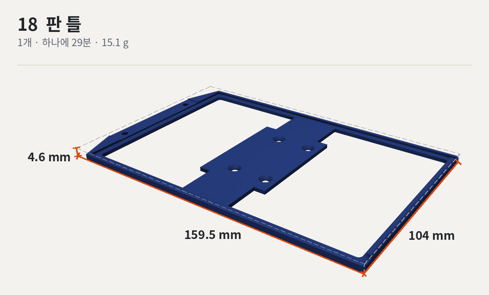

- **파일:** `18_plate_frame.stl` · 1개. 뽑는 판: 5판
- **크기:** 159.5 × 104 × 4.6 mm
- **출력:** 28분, 15.1 g
- **하는 일:** 알루미늄 판이 쏙 들어가는 홈이 있는 한 장짜리 받침판. 회전 막대의 판 받이에 붙고, 아래 턱이 판 아래 변을, 누름쇠(19)가 위 변을 잡는다. 판에는 구멍을 뚫지 않는다. 뒷면(평평한 면)을 출력판에 놓는다.
- **나사:** 판 받이에 M3 × 6 접시머리 4개 + 너트. 누름쇠의 M3 × 8 접시머리 2개가 이 틀 뒷면 위쪽 육각 자리의 너트에 물린다.

판 틀(18)과 누름쇠(19)의 맞춤 치수 (알루미늄 판 100 × 150 × 1 에 맞춘 값):

| 곳 | 치수 (mm) |
|---|---|
| 홈 (판이 들어가는 곳) | 100.4 × 150.4, 깊이 1.15 (판 앞면이 테두리보다 0.15 낮다) |
| 바닥 (판 뒷면을 받친다) | 두께 2.0. 판 둘레 3mm 를 받치는 테두리 + 가로대 + 판 받이에 닿는 받침 (뒷면이 한 평면) |
| 옆 테두리 | 두께 1.8, 바깥 반지름 96 안 (판 회전축에서) |
| 아래 턱 | 길이 92, 두께 1.0, 45° (판 앞면 모서리와 턱 밑면 사이 0.25) |
| 위 띠 | 판 위 변에서 8.5 위까지. 누름쇠 자리는 판 앞면보다 0.2 낮다. 뒷면에 너트 자리 2개 (육각 맞변 5.8, 깊이 1.2) |
| 누름쇠 | 61 × 11.0 × 2.4, 판 위 변을 3mm 덮는다. 나사 간격 48 |
| 판 틀 나사 자리 | 접시 자리 지름 6.7, 나사 구멍 3.4. 간격 38 × 18 (판 받이의 너트 자리와 같은 자리) |

### 19 판 누름쇠

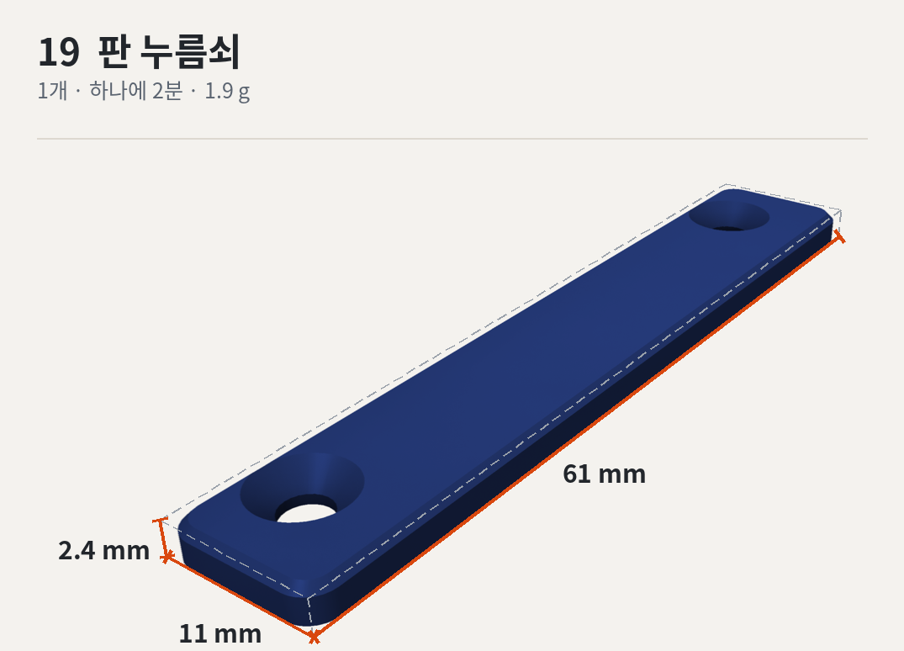

- **파일:** `19_plate_clamp.stl` · 1개. 뽑는 판: 5판
- **크기:** 11 × 61 × 2.4 mm
- **출력:** 2분, 1.9 g
- **하는 일:** 판 위 변을 3mm 덮어 눌러 잡는다. 누름쇠가 판에 닿아 멈추면 그만 조인다.
- **나사:** M3 × 8 접시머리 2개 + 너트 (판 틀 뒷면).

### 20 배터리 채움 조각

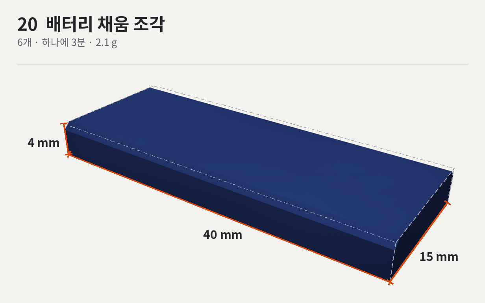

- **파일:** `20_batt_fill.stl` · 6개. 뽑는 판: 1판
- **크기:** 40 × 15 × 4 mm
- **출력:** 2분, 2.1 g
- **하는 일:** 배터리가 자리보다 작아 흔들릴 때 배터리 뒤나 옆 틈에 끼운다. 겹쳐 쓴다. 6개.
- **나사:** 없음.

### 21 ESP32 안테나 누름판

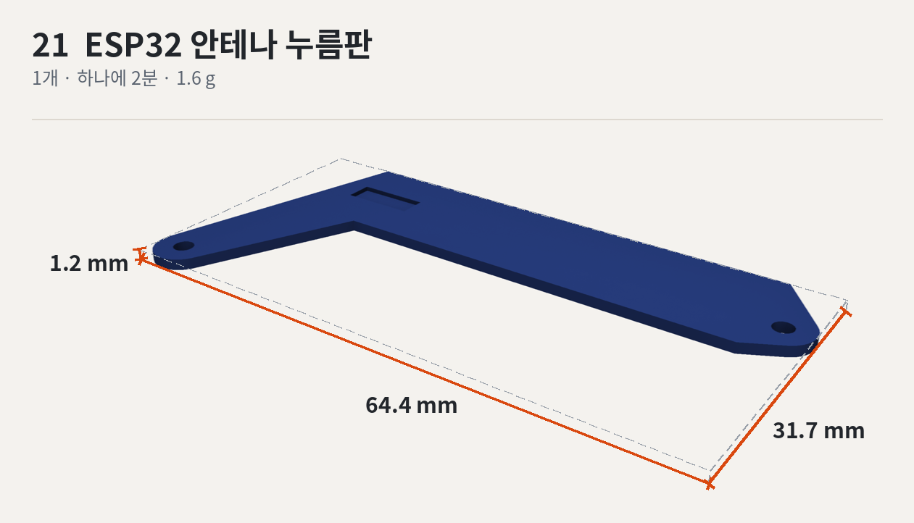

- **파일:** `21_ant_clip.stl` · 1개. 뽑는 판: 5판
- **크기:** 64.4 × 31.7 × 1.2 mm
- **출력:** 1분, 1.6 g
- **하는 일:** ESP32 의 납작한 FPC 안테나를 모터 자리 밑면(머리 안 천장)의 얕은 홈에 대고 눌러 잡는다. 안테나가 판 회전축 위, 파이 안테나 바로 위에 온다. 왼쪽 끝의 홈으로 동축선이 나간다.
- **나사:** M2 × 6 나사 2개 (모터 자리를 뒤집어 놓고 밑에서).

### 22 ESP32 막음쇠

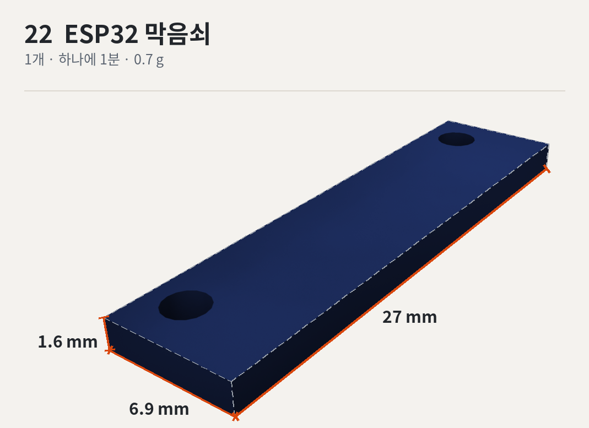

- **파일:** `22_xiao_cap.stl` · 1개. 뽑는 판: 5판
- **크기:** 6.9 × 27 × 1.6 mm
- **출력:** 1분, 0.7 g
- **하는 일:** 뚜껑 안쪽의 홈 받침 2개에 세워 끼운 ESP32(XIAO) 위를 막아 빠지지 않게 한다.
- **나사:** M2 × 6 나사 2개 (뚜껑을 떼어 엎어 놓고).

### 90 맞춤 시험 조각

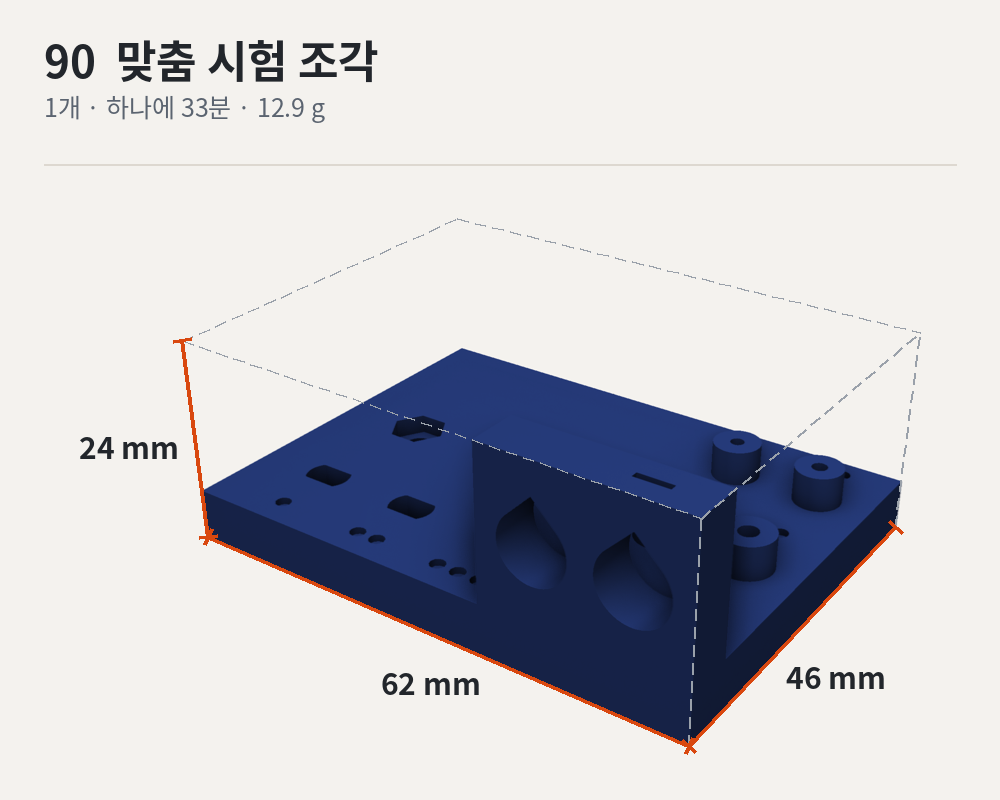

- **파일:** `90_test_coupon.stl` · 1개. 뽑는 판: 0판
- **크기:** 62 × 46 × 24 mm
- **출력:** 32분, 12.9 g
- **하는 일:** 조립에는 들어가지 않는다. 0판에서 먼저 뽑아 모터 축 구멍(회전 막대·작은 기어의 맞춤 번호), 핀 지름, 나사 구멍(M3 2.6 · 3.4, M2.5 2.1 · 2.3, M2 1.6 · 1.8), 너트 자리를 시험한다 (조립 안내 3절).
- **나사:** 시험할 때만 나사를 돌려 본다.

### 91 보드 구멍 맞춤 판

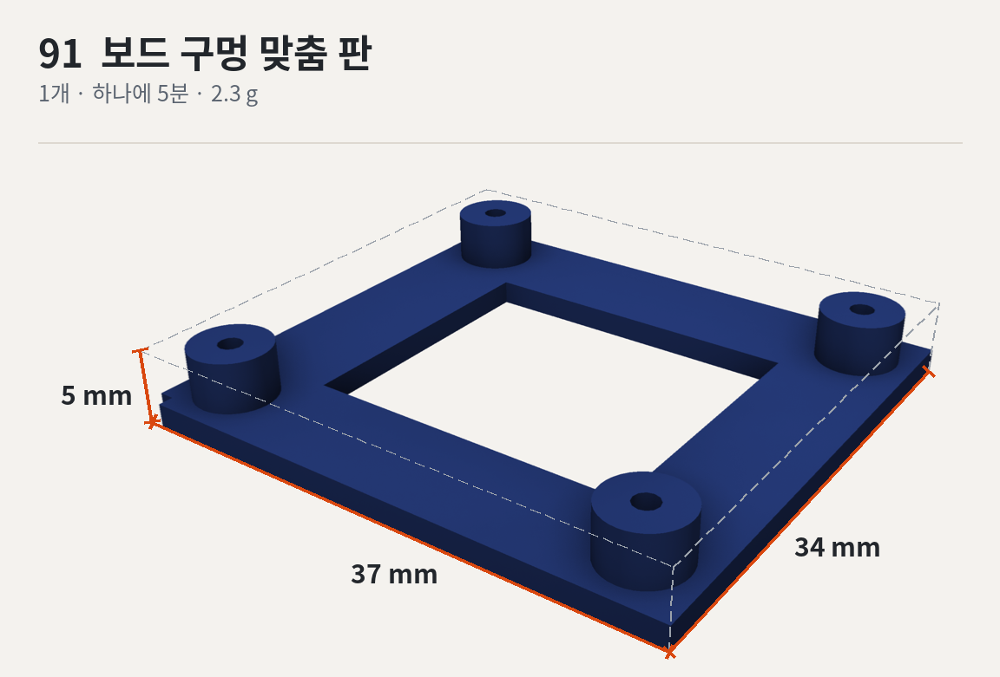

- **파일:** `91_driver_check.stl` · 1개. 뽑는 판: 0판
- **크기:** 37 × 34 × 5 mm
- **출력:** 5분, 2.3 g
- **하는 일:** 조립에는 들어가지 않는다. 드라이버 보드를 얹어 구멍 네 개가 머리 몸통 기둥과 맞는지 미리 본다.
- **나사:** 없음.

## 사는 부품

모터·드라이버 3세트, 전원 버튼, 탐지 동글, 알루미늄 판, 100원 동전, 전선과 소모품을 산다. 라즈베리파이 3B+, 무선 동글 WNA3100M, 보조배터리는 가지고 있는 것을 쓴다. 치수는 공식 자료가 있는 것은 그 값이고, 나머지는 모델에 넣은 흔한 값이다 (조립 안내 1절의 범위 안이면 재지 않아도 된다). 그림은 모양을 알아보기 쉽게 그린 것이라 실물과 작은 곳이 다를 수 있다.

| 부품 | 수량 | 치수 (mm) | 무게 | 들어가는 곳 |
|---|---|---|---|---|
| 28BYJ-48 스텝모터 (5V) | 3 | 몸통 지름 28 × 높이 19. 귀 구멍 간격 35 (구멍 지름 4.2). 축 지름 5 (양쪽 납작, 폭 3) · 길이 10, 몸통 가운데에서 8 비켜 있다 | 약 34g | 모터 1: 요크 전선 상자 속, 모터 2: 오른쪽 팔, 모터 3: 모터 자리 |
| ULN2003 드라이버 보드 | 3 | 34 × 31.7 (실측), 부품 높이 약 15. 구멍 지름 3, 간격 29.5 × 26.5 (모델 값, ±1mm 까지 들어간다) | 약 8g | 머리 몸통 오른쪽 기둥 (위에서부터 3, 2, 1번) |
| 라즈베리파이 3B+ | 1 | 85 × 56 × 17 (기판 1.6). 구멍 지름 2.7, 간격 58 × 49 | 50g | 머리 몸통 뒷벽 기둥 4개 |
| 알루미늄 판 | 1 | 100 × 150 × 1 | 40.5g | 판 틀 홈 (구멍 없음) |
| 100원 동전 | 12 | 지름 24, 두께 1.5 안팎 (옛 동전 1.6) | 5.42g | 회전 막대의 균형추 통 (12칸을 다 채운다) |
| 보조배터리 | 1 | S 받침: 106 × 71 × 22 안, L 받침: 152 × 76 × 22 안 | 가진 것 | 받침 통 (옆 창으로) |
| 전원 케이블, 양쪽 ㄱ자 | 1 | 길이 50cm (받침에서 머리까지 약 34cm) |  | 받침 → 가운데 통 → 머리 안 파이 전원 단자 |
| 전원 버튼 모듈 KY-004 | 1 | 기판 15 × 18.5 (자리는 16.5 × 20.5 까지) | 약 2g | 머리 왼쪽 받침 살 |
| 무선 동글 WNA3100M | 1 | 34 × 16 × 8 (NETGEAR 공식 값) | 4g | 파이 GPIO 쪽 USB 위 칸 |
| 탐지 동글 | 1 | 몸통 45 × 18 × 10 안 |  | 파이 가운데 USB 위 칸 |
| ESP32 (XIAO ESP32-C3, 핀 머리 납땜된 것) | 1 | 21 × 17.8 × 3.5, 핀 머리 높이 2.5 (위에 점퍼선 소켓 14) | 약 3g | 뚜껑 안쪽 홈 받침 2개 + 막음쇠 (세워서) |
| ESP32 FPC 안테나 | 1 | 45 × 10 × 0.3 안, 동축선 8cm 이상 | 약 1g | 모터 자리 밑면(머리 안 천장)의 홈, 누름판으로 |
| 6mm 비비탄 | 45 | 지름 6 |  | 받침 덮개 둥근 테 홈 |
| AR 마커 종이 | 1 | 인쇄한 띠 108 × 44 (A4에 실제 크기로) |  | 머리 등판, 마커 틀 아래 |

### 28BYJ-48 스텝모터와 ULN2003 드라이버 보드 (3세트)

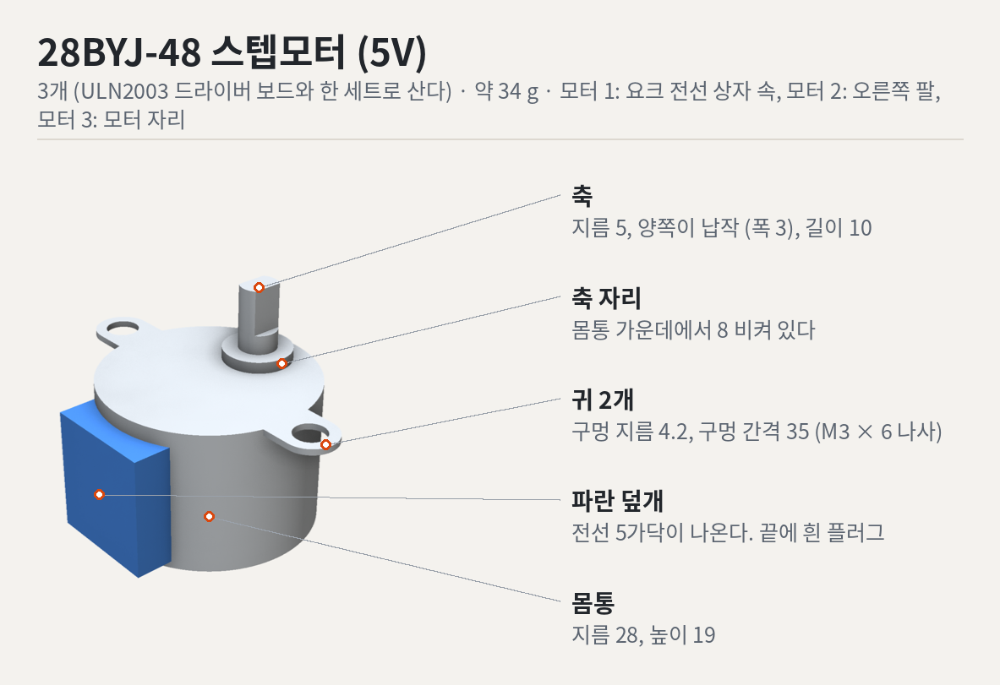

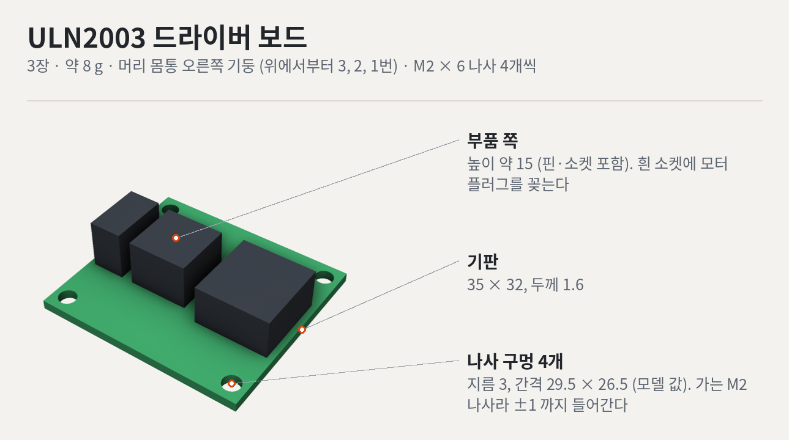

- **28BYJ-48 스텝모터 (5V)** (3개): 몸통 지름 28 × 높이 19. 귀 구멍 간격 35 (구멍 지름 4.2). 축 지름 5 (양쪽 납작, 폭 3) · 길이 10, 몸통 가운데에서 8 비켜 있다. 무게 약 34g. 들어가는 곳: 모터 1: 요크 전선 상자 속, 모터 2: 오른쪽 팔, 모터 3: 모터 자리.
- **ULN2003 드라이버 보드** (3개): 34 × 31.7 (실측), 부품 높이 약 15. 구멍 지름 3, 간격 29.5 × 26.5 (모델 값, ±1mm 까지 들어간다). 무게 약 8g. 들어가는 곳: 머리 몸통 오른쪽 기둥 (위에서부터 3, 2, 1번).
- 준비: **28BYJ-48 (5V) 스텝모터 + ULN2003 드라이버 보드** — 3세트. 관절마다 한 세트. 라벨이 5V인지 본다. 보드는 흔한 34×31.7mm 짜리 (2026-11-16 실측). 가는 M2 나사를 써서 구멍 간격이 한 방향으로 1mm 까지 달라도 나사 네 개가 들어가고, 두 방향 다 1mm 다르면 한쪽 두 개만 박는다. 재지 않아도 된다
- 모터 1은 좌우 회전, 모터 2는 끄덕임, 모터 3은 판 회전을 맡는다. 보드는 흰 소켓이 아래를 보게 붙이고 모터 플러그를 꽂는다.

### 라즈베리파이 3B+

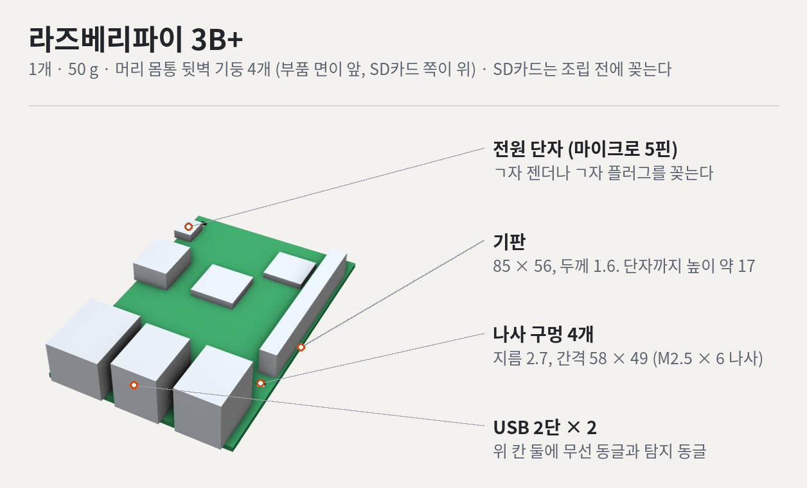

- **라즈베리파이 3B+** (1개): 85 × 56 × 17 (기판 1.6). 구멍 지름 2.7, 간격 58 × 49. 무게 50g. 들어가는 곳: 머리 몸통 뒷벽 기둥 4개.
- CSI 를 재는 본체다. 가지고 있는 파이를 쓴다 (그래서 살 것 표에는 없다). SD카드는 조립하기 전에 꽂는다: 조립한 뒤에는 뚜껑을 열고 파이의 나사 4개를 풀어야 바꿀 수 있다.

### 알루미늄 판 1T

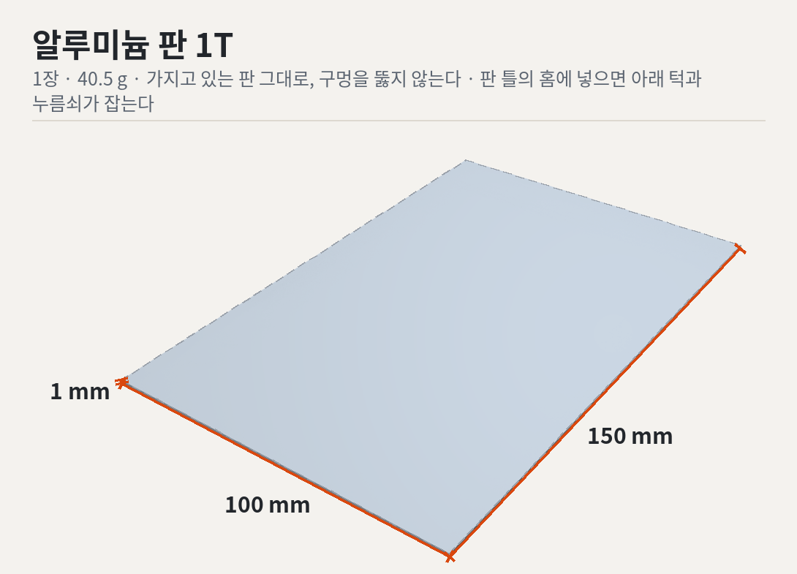

- **알루미늄 판** (1개): 100 × 150 × 1. 무게 40.5g. 들어가는 곳: 판 틀 홈 (구멍 없음).
- 준비: **알루미늄 판 100 × 150mm, 두께 1T (1mm)** — 1장. 가지고 있는 판 그대로 쓴다. 구멍을 뚫지 않는다: 판 틀(`18`)의 홈(둘레 틈 0.2mm, 깊이 1.15mm)에 넣으면 아래 턱과 누름쇠(`19`)가 잡는다. 무게 약 40g. 단단한 A5052 든 무른 A1050 이든 된다

### 100원 동전 12개

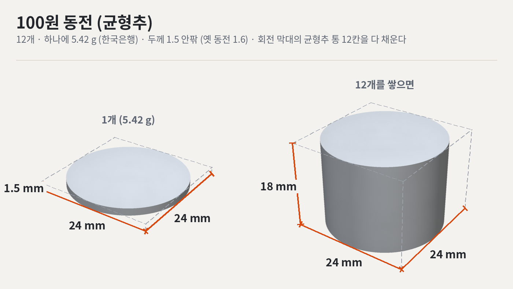

- **100원 동전** (12개): 지름 24, 두께 1.5 안팎 (옛 동전 1.6). 무게 5.42g. 들어가는 곳: 회전 막대의 균형추 통 (12칸을 다 채운다).
- 준비: **100원 동전** — 12개. 균형추. 균형추 통 12칸을 동전으로 다 채운다. 지름 24mm, 5.42g (한국은행), 두께 1.5mm 안팎 (옛 동전은 1.6mm). 구멍 없는 M12 와셔(바깥지름 24)로 대신할 수 있지만 무게를 재서 맞춰야 한다

### 보조배터리

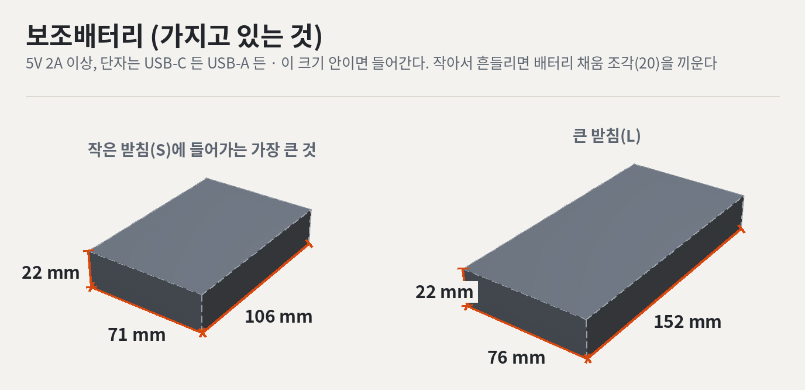

- **보조배터리** (1개): S 받침: 106 × 71 × 22 안, L 받침: 152 × 76 × 22 안. 들어가는 곳: 받침 통 (옆 창으로).
- 준비: **보조배터리 (5V 2A 이상, 단자는 USB-C 든 USB-A 든)** — 1개. 가지고 있는 것을 쓴다. 106×71×22mm 안이면 작은 받침(S), 152×76×22mm 안이면 큰 받침(L)에 들어간다. 자리보다 작으면 배터리 채움 조각(`20`)을 뒤·옆 틈에 끼운다. 파이 + 모터 1개 + 동글 2개가 같이 쓰는 전류는 많아야 1.7A쯤이다

### 전원 버튼 모듈 KY-004

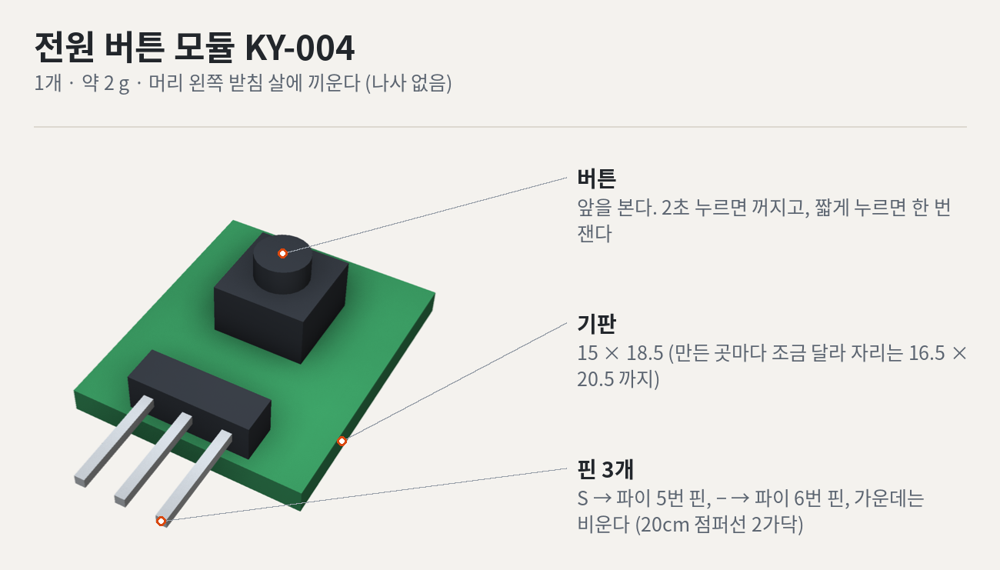

- **전원 버튼 모듈 KY-004** (1개): 기판 15 × 18.5 (자리는 16.5 × 20.5 까지). 무게 약 2g. 들어가는 곳: 머리 왼쪽 받침 살.
- 준비: **전원 버튼 모듈 KY-004** — 1개. 머리 앞의 전원 버튼. 2초 누르면 안전하게 꺼지고, 짧게 누르면 한 번 잰다. 만든 곳마다 기판이 조금 달라서 자리를 20.5×16.5mm 까지 넉넉히 두었다. 재지 않아도 된다

### 무선 동글 2개

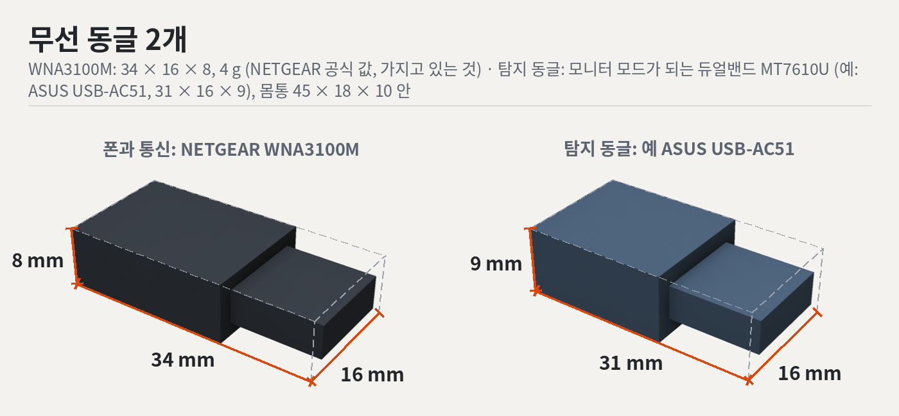

- **무선 동글 WNA3100M** (1개): 34 × 16 × 8 (NETGEAR 공식 값). 무게 4g. 들어가는 곳: 파이 GPIO 쪽 USB 위 칸.
- **탐지 동글** (1개): 몸통 45 × 18 × 10 안. 들어가는 곳: 파이 가운데 USB 위 칸.
- 준비: **무선 동글 (가지고 있는 NETGEAR WNA3100M)** — 1개. 폰과 통신하는 둘째 Wi-Fi. 새로 살 필요 없다. 34×16×8mm, 4g (NETGEAR 공식 값), 2.4GHz
- 준비: **탐지 동글: 모니터 모드가 되는 듀얼밴드(2.4·5GHz) USB 무선 동글. 칩이 MT7610U 인 작은 것 (예: ASUS USB-AC51, 31×16×9mm)** — 1개 (권함). 둘레 기기를 엿들어 카메라 후보를 추린다. 5GHz 카메라와 핫스팟도 듣는다. 안테나가 몸통 안에 든 작은 것, 몸통이 45×18×10mm 안쪽. 드라이버(mt76x0u)가 파이 커널에 들어 있다. 2.4GHz 전용(RT5370, MT7601U)도 꽂으면 돌지만 5GHz 를 못 듣는다. 없어도 수신기는 돈다 (그때는 초당 개수만으로 고른다)

### ESP32 와 FPC 안테나

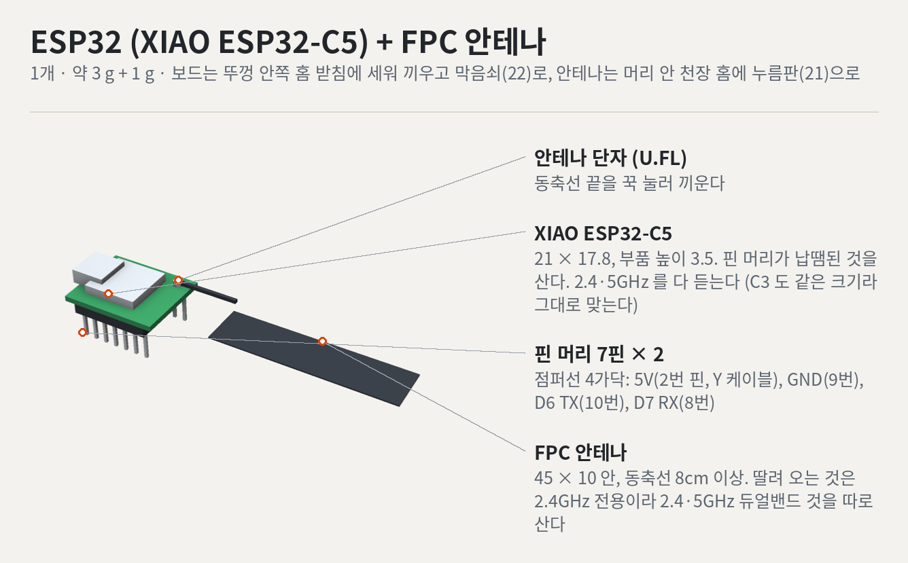

- **ESP32 (XIAO ESP32-C3, 핀 머리 납땜된 것)** (1개): 21 × 17.8 × 3.5, 핀 머리 높이 2.5 (위에 점퍼선 소켓 14). 무게 약 3g. 들어가는 곳: 뚜껑 안쪽 홈 받침 2개 + 막음쇠 (세워서).
- **ESP32 FPC 안테나** (1개): 45 × 10 × 0.3 안, 동축선 8cm 이상. 무게 약 1g. 들어가는 곳: 모터 자리 밑면(머리 안 천장)의 홈, 누름판으로.
- 준비: **ESP32 보드: Seeed Studio XIAO ESP32-C3, **핀 머리가 납땜되어 나온 것** (Pre-Soldered)** — 1개. 응답 프레임(ACK)의 CSI 를 듣는 둘째 수신기. 파이 칩(nexmon)은 ACK 에서 CSI 를 내지 않아서 더한다 (2026-11-16 실험 S4-1). 21×17.8mm. 핀 머리가 없는 것을 사면 납땜해야 하니 꼭 '납땜된 것'을 산다. 파이와는 점퍼선 4가닥 (UART)
- 준비: **ESP32 안테나: XIAO 에 딸려 오는 납작한 FPC 안테나 (U.FL, 동축선 8cm 이상)** — 1개. 보통 보드와 같이 들어 있다. 없으면 '2.4GHz FPC 안테나 U.FL(IPEX1)' 을 산다. 크기 45×10mm 안 (흔한 것 35×8 ~ 42×10). 머리 안 천장의 홈에 대고 누름판(`21`)으로 조인다
- 응답 프레임(ACK)의 CSI 를 듣는다. 보드는 뚜껑 안쪽에 세워 끼우고(막음쇠 `22`), 안테나는 머리 안 천장에 누름판(`21`)으로 조인다. 파이와는 점퍼선 4가닥 (2번 5V 는 Y 케이블로 나눈다, 9번 GND, 8·10번 UART).

### AR 마커 종이

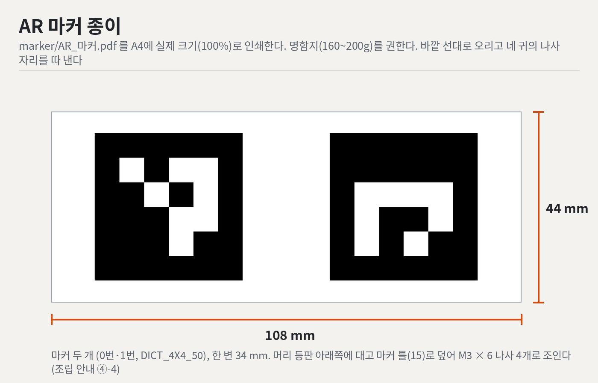

- **AR 마커 종이** (1개): 인쇄한 띠 108 × 44 (A4에 실제 크기로). 들어가는 곳: 머리 등판, 마커 틀 아래.
- 준비: **AR 마커 종이 (`marker/AR_마커.pdf` 를 A4에 인쇄)** — 1장. 폰이 수신기가 놓인 자리를 알아내는 데 쓴다. 조금 두꺼운 종이(명함지, 160~200g)에 실제 크기(100%)로 인쇄한다. 풀이나 테이프 없이 틀로 덮어 나사로 조인다

### 전선과 작은 소모품

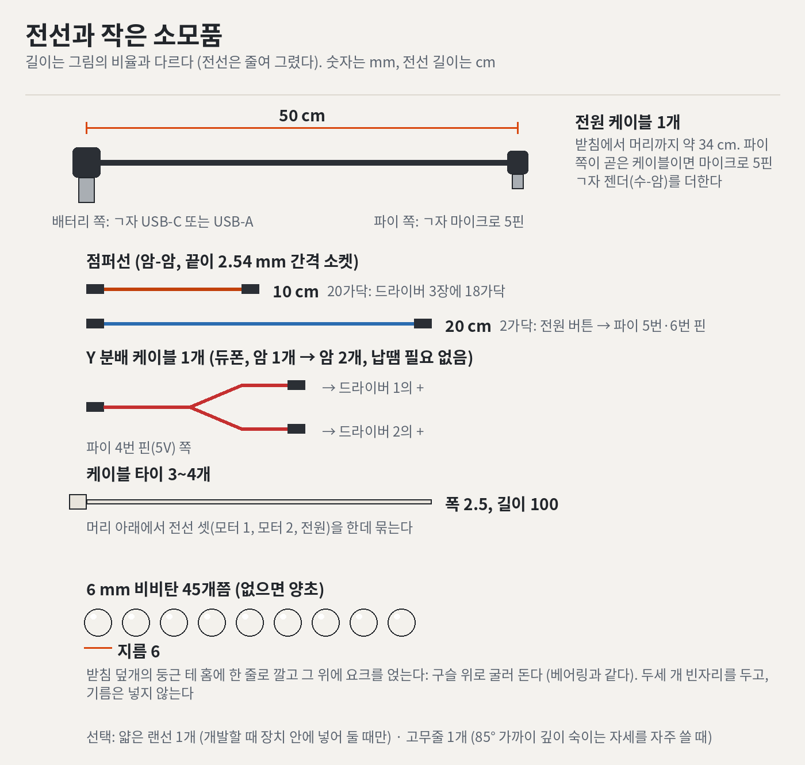

- **전원 케이블, 양쪽 ㄱ자** (1개): 길이 50cm (받침에서 머리까지 약 34cm). 들어가는 곳: 받침 → 가운데 통 → 머리 안 파이 전원 단자.
- **6mm 비비탄** (45개): 지름 6. 들어가는 곳: 받침 덮개 둥근 테 홈.
- 준비: **전원 케이블 50cm: 배터리 쪽 ㄱ자 → 마이크로 5핀 ㄱ자** — 1개. 배터리 단자에 맞춘다: USB-C 배터리면 'USB-C(ㄱ자) → 마이크로 5핀(ㄱ자)', USB-A 배터리면 'USB-A(ㄱ자) → 마이크로 5핀(ㄱ자)'. 받침에서 머리까지 약 34cm. 배터리 쪽이 ㄱ자여야 받침 창 안에 들어가고, 파이 쪽이 ㄱ자여야 머리 안(파이 전원 단자 옆 12mm)에 들어간다. 곧은 'C→5핀 젠더'는 머리 안에 들어가지 않고, 젠더 속에 저항이 없으면 C 배터리에서 전원이 안 들어온다. C→5핀 케이블에는 그 저항이 들어 있다. 아주 가는 선은 파이 전압이 떨어지니 피한다
- 준비: **(파이 쪽이 곧은 케이블일 때만) 마이크로 5핀 ㄱ자 젠더 (수-암, 좌·우 꺾임 세트)** — 1세트. 선이 아래(USB 단자 쪽)로 가는 것을 쓴다. 파이 쪽이 ㄱ자인 케이블이면 필요 없다
- 준비: **점퍼선 암-암 10cm** — 20가닥. 드라이버에 18가닥을 쓴다. 20cm짜리는 머리 안에 접어 넣기 빠듯하다
- 준비: **점퍼선 암-암 20cm** — 6가닥. 전원 버튼에서 파이 5번·6번 핀까지 2가닥, ESP32 에서 파이 2·8·9·10번 핀까지 4가닥
- 준비: **Y 분배 점퍼 케이블 (듀폰, 암 1개 → 암 2개, '1분배2')** — 2개. 파이 4번 핀의 5V 를 드라이버 1과 2에, 2번 핀의 5V 를 드라이버 3과 ESP32 에 나눈다. 꽂기만 하면 되니 납땜이 필요 없다. 못 구하면 레버식 전선 연결 단자(3구) 하나와 점퍼선으로 만들거나, 피복을 벗긴 끝을 단단히 꼬아 절연테이프를 감는다
- 준비: **케이블 타이 (폭 2.5mm, 길이 10cm)** — 3~4개. 머리 아래에서 전선 셋을 한데 묶는다
- 준비: **6mm 비비탄 45개 (없으면 양초)** — 택1. 받침 덮개의 둥근 홈에 깔아 요크가 구슬 위로 굴러 돌게 한다 (베어링 속 쇠구슬과 같다). 마찰이 그냥 PLA끼리일 때의 1/15쯤으로 준다. 문구점·완구점의 흔한 6mm 0.12~0.2g 짜리면 된다. 비비탄을 권한다
- 준비: **얇은 랜선 (선택)** — 1개. 개발할 때 랜선을 장치 안에 넣어 두고 싶을 때만. 혼자 동작할 때는 쓰지 않는다
- 준비: **고무줄 (선택)** — 1개. 85° 가까이 깊이 숙이는 자세를 자주 쓸 때 끄덕임 모터를 거든다
- 비비탄 쓰는 법: 받침 덮개의 둥근 테 홈에 한 줄로 45개쯤 깔고 두세 개 자리는 비운다 (꽉 차면 구슬끼리 밀려 구르지 못한다). 그 위에 요크를 얹으면 구슬 위로 굴러 돈다. 기름은 넣지 않는다. 요크를 손으로 돌려 덜컥거림 없이 부드럽게 돌면 된다.

## 나사와 너트

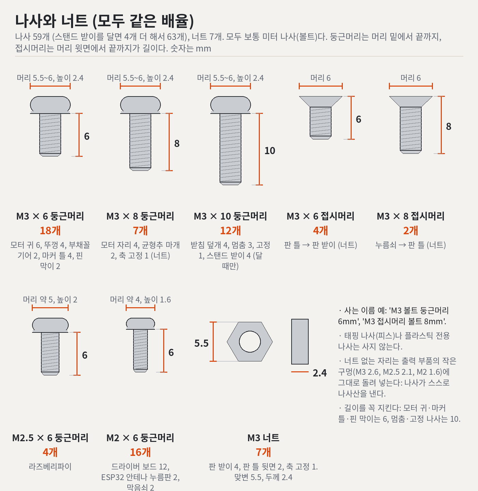

나사는 모두 **59개**, 너트는 **7개**다. 모두 보통 미터 나사(볼트)다: 'M3 볼트 둥근머리 6mm', 'M3 접시머리 볼트 8mm' 처럼 파는 것. 태핑 나사(피스)나 플라스틱 전용 나사는 사지 않는다. 둥근머리는 머리 밑에서 끝까지, 접시머리는 머리 윗면에서 끝까지가 길이다.

| 규격 | 수량 | 치수 (mm) | 어디에 |
|---|---|---|---|
| M3 나사 둥근머리 6mm | 18개 + 예비 | 머리 지름 5.5~6, 높이 2.4. 머리 밑 길이 6 | 모터 귀 6, 뚜껑 4, 부채꼴 기어 2, 마커 틀 4, 핀 막이 2. 이 자리에는 꼭 6mm만 쓴다 |
| M3 나사 둥근머리 8mm | 7개 + 예비 | 머리 지름 5.5~6, 높이 2.4. 머리 밑 길이 8 | 모터 자리 4, 균형추 마개 2, 모터 축 고정 1 |
| M3 나사 둥근머리 10mm | 8개 + 예비 | 머리 지름 5.5~6, 높이 2.4. 머리 밑 길이 10 | 받침 덮개 4(접시머리도 됨), 끄덕임 멈춤 2, 받침 회전 멈춤 1, 고정 나사 1. 멈춤 나사와 고정 나사는 꼭 10mm |
| M3 나사 접시머리 6mm | 4개 + 예비 | 머리 지름 6, 90° 접시. 머리 포함 길이 6 | 판 틀을 판 받이에 (너트와 함께). 머리가 홈 바닥보다 조금 낮게 묻히고, 그 위를 판이 덮는다 |
| M3 나사 접시머리 8mm | 2개 + 예비 | 머리 지름 6, 90° 접시. 머리 포함 길이 8 | 누름쇠를 판 틀 위 띠에 (너트와 함께. 너트는 판 틀 뒷면 위쪽) |
| M2.5 나사 둥근머리 6mm | 4개 + 예비 | 머리 지름 5 안팎. 머리 밑 길이 6 | 파이 |
| M2 나사 둥근머리 6mm | 16개 + 예비 | 머리 지름 4 안팎. 머리 밑 길이 6 | 드라이버 보드 12 (한 장에 4개. 보드 구멍(지름 3)보다 가늘어서 구멍 간격이 조금 달라도 들어간다), ESP32 안테나 누름판 2, ESP32 막음쇠 2 |
| M3 너트 | 7개 + 예비 | 맞변 5.5, 두께 2.4 | 판 받이 4, 판 틀 뒷면 2, 모터 축 고정 1 |

너트를 쓰는 7곳(판 틀 4, 누름쇠 2, 모터 3 축 고정 1)을 빼면, 출력 부품의 작은 구멍(M3 2.6, M2.5 2.1, M2 1.6)에 그대로 돌려 넣는다: 나사가 스스로 나사산을 낸다. 3D 프린터로 나사산을 뽑지는 않는다. 0판의 시험 조각에 먼저 돌려 보고, 손으로 돌려지지 않을 만큼 빡빡하면 2.6mm 드릴로 한 번 훑거나 M3 탭을 쓴다 (조립 안내 3절).

**자리마다** (조립 순서, 나사산이 물리는 길이는 모델에서 잰 값):

| 단계 | 자리 | 나사 | 개수 | 무엇을 어디에 | 물리는 길이 |
|---|---|---|---:|---|---:|
| ① | 받침 덮개 | M3 × 10 접시머리 | 4 | 덮개(02) → 통(01) | 6.9 mm |
| ② | 모터 1 귀 | M3 × 6 둥근머리 | 2 | 모터 1 → 요크(04) 전선 상자 속 자리 | 5.1 mm |
| ② | 받침 회전 멈춤 | M3 × 10 둥근머리 | 1 | 요크 회전판 구석. 아래로 6mm 나와 받침의 멈춤턱에 닿는다 | 4.0 mm |
| ③ | 파이 | M2.5 × 6 둥근머리 | 4 | 파이 → 머리 몸통(07) 뒷벽 기둥 4개 | 4.3 mm |
| ③ | 드라이버 보드 | M2 × 6 둥근머리 | 12 | 보드 3장 → 머리 몸통 기둥 (한 장에 4개) | 4.3 mm |
| ④ | 모터 3 귀 | M3 × 6 둥근머리 | 2 | 모터 3 → 모터 자리(09) | 5.1 mm |
| ④ | ESP32 안테나 누름판 | M2 × 6 둥근머리 | 2 | 누름판(21) → 모터 자리(09) 밑면. FPC 안테나를 사이에 | 4.7 mm |
| ④ | 모터 자리 | M3 × 8 둥근머리 | 4 | 모터 자리(09) → 머리 몸통 위 | 5.9 mm |
| ④ | 부채꼴 기어 | M3 × 6 둥근머리 | 2 | 부채꼴 기어(06) → 머리 오른쪽 옆면 | 4.2 mm |
| ④ | 마커 틀 | M3 × 6 둥근머리 | 4 | 마커 틀(15) → 머리 등판 (마커 종이를 사이에) | 4.0 mm |
| ⑤ | 모터 2 귀 | M3 × 6 둥근머리 | 2 | 모터 2 → 요크 오른쪽 팔 | 5.1 mm |
| ⑤ | 핀 막이 | M3 × 6 둥근머리 | 2 | 핀 막이(14) → 팔 바깥면 (좌우 1개씩) | 4.5 mm |
| ⑤ | 끄덕임 멈춤 | M3 × 10 둥근머리 | 2 | 요크 왼쪽 팔. 머리 옆 돌기가 두 나사 사이에 온다 | 5.9 mm |
| ⑤ | ESP32 막음쇠 | M2 × 6 둥근머리 | 2 | 막음쇠(22) → 뚜껑(08) 안쪽 홈 받침. XIAO 를 끼운 뒤 | 4.3 mm |
| ⑤ | 머리 뚜껑 | M3 × 6 둥근머리 | 4 | 뚜껑(08) → 머리 몸통 | 4.3 mm |
| ⑤ | 고정 나사 (옮길 때만) | M3 × 10 둥근머리 | 1 | 요크 오른쪽 팔 → 부채꼴 기어. 재기 전에 뺀다 | 3.5 mm |
| ⑥ | 균형추 마개 | M3 × 8 둥근머리 | 2 | 마개(11) → 회전 막대(10) | 5.1 mm |
| ⑥ | 판 틀 | M3 × 6 접시머리 + 너트 | 4 | 판 틀(18) → 판 받이. 너트는 판 받이 안쪽 육각 자리 | 2.4 mm |
| ⑥ | 누름쇠 | M3 × 8 접시머리 + 너트 | 2 | 누름쇠(19) → 판 틀 위 띠. 너트는 판 틀 뒷면 위쪽 육각 자리 | 2.4 mm |
| ⑥ | 모터 3 축 고정 | M3 × 8 둥근머리 + 너트 | 1 | 회전 막대 → 모터 3 축의 납작한 면. 너트는 막대 윗면 홈 | 2.4 mm |

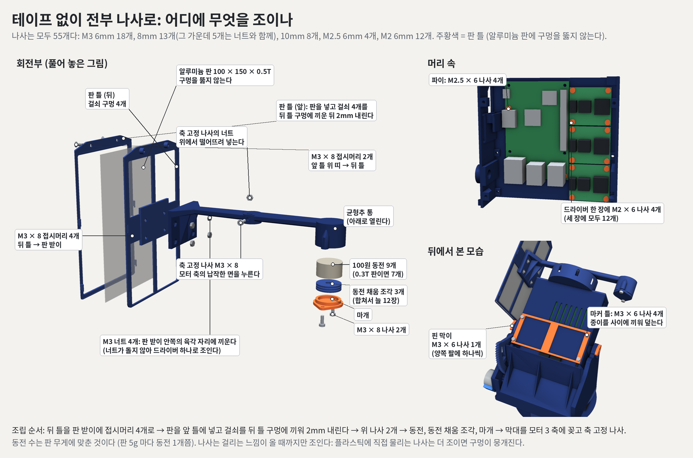

길이를 꼭 지킨다: 모터 귀, 마커 틀, 핀 막이는 6mm (8mm 면 도는 부품이나 드라이버 보드에 닿는다), 멈춤 나사 3개와 고정 나사는 10mm (12mm 면 머리 옆벽이나 받침 덮개를 긁는다).

## 연장과 소모품

연장은 다섯 가지면 된다. 드릴과 납땜인두는 필요 없다.

| 연장 | 어디에 쓰나 |
|---|---|
| 십자드라이버 (M3용 하나, M2·M2.5용 작은 것 하나. 축 길이 6cm 이상) | 나사 59개를 전부 이 둘로 조인다 |
| 줄이나 사포, 니퍼나 칼 | 출력물 가장자리를 다듬는다. 알루미늄 판에는 구멍을 뚫지 않으니 드릴은 필요 없다 |
| 디지털 캘리퍼스 (권함, 1~2만원) | 0판의 구멍·핀·시험 조각을 재서 프린터가 설계보다 얼마나 작게·크게 뽑는지 본다 (3절). 납땜인두는 필요 없다 |
| 자, 각도기 | 잴 때 카메라의 실제 방향을 적어 둔다 (첫 실험). 출력 전에 부품을 재지 않아도 된다 |
| 순간접착제 (필요할 때만) | 작은 기어나 핀이 헐겁게 나왔을 때 한 방울 |

파이의 5V 핀은 2번과 4번 둘뿐이라, 4번의 5V 를 드라이버 1과 2에 나누는 **Y 분배 케이블**(듀폰, 암 1 → 암 2)을 하나 산다. 꽂기만 하면 되니 **납땜은 하지 않는다.** 못 구했으면 레버식 전선 연결 단자(3구)에 피복을 8mm 벗긴 점퍼선 세 가닥을 끼우거나, 세 끝을 단단히 꼬고 절연테이프를 감는다. **디지털 캘리퍼스**는 없어도 조립은 되지만, 0판의 구멍과 핀을 재 보면 프린터가 설계보다 얼마나 작게·크게 뽑는지 바로 알 수 있다 (조립 안내 3절).

