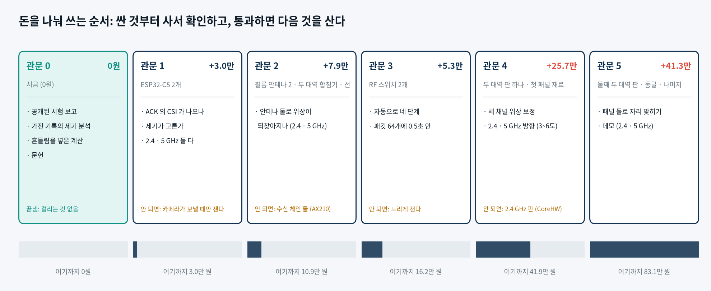
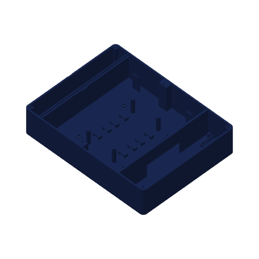

---
tags:
  - DeteCam
  - 부품
고친날: 2026-11-18
---

# 부품표 (패널 수신기)

수신기 한 벌은 **패널 2개 + 허브 1개**다. 왜 이 부품인지는 [부품 검토](부품%20검토.md)에, 조립은 [조립 안내](조립%20안내.md)에 있다. 살 것을 모은 목록은 [부품표.csv](부품표.csv).

## 한눈에

| 무리 | 무엇 | 얼마나 |
|---|---|---|
| 뽑는 부품 | 여덟 가지 (패널 통, 앞덮개, 자석 걸이판, 받침 발, ESP32 누름쇠, 허브 통·선반·뚜껑) | 출력판 다섯 장(1·2판은 두 번), 21시간 53분, 필라멘트 802 g. 받침 없이 |
| 사는 전자 부품 | 안테나 배열 보드 2, ESP32-C5 3, RF 스위치 모듈 4, 합침기 2, 탐지용 동글 1, 케이블과 변환 단자 | 약 51만 원 (어림) |
| 사는 기계 부품·나사·재료 | 자석 8, 나사 42, 너트 11, 필라멘트 1통 | 약 3만 원 |
| 가지고 있는 것 | 라즈베리파이 3B+, 무선 동글 하나(폰과 통신), 보조배터리 | 허브에 쓴다 |
| 이제 사지 않는 것 | 28BYJ-48 모터와 ULN2003 드라이버 3세트, 전원 버튼, 알루미늄 판, 100원 동전, 비비탄, 조명 스탠드와 모래주머니 | 돌판 수신기의 부품 |
| **한꺼번에 사지 않는다** | 싼 것부터 사서 확인하고, 통과하면 다음 것을 산다 | 3.0만 → 3.6만 → 5.3만 → 15.4만 → 26.7만 원 (권장 관문 6: 6.0만). 아래 [사는 순서](#사는-순서-관문) |

값은 2026-11-17 에 본 판매처 값을 원으로 어림한 것이다. 배송비와 세금은 넣지 않았다. 모두 합쳐 약 54만 원이다 (관문 1~5). 권장 관문 6 을 더하면 약 60만 원이다.

## 사는 순서 (관문)

비싼 부품을 사 놓고 안 되면 돈만 버린다. 그래서 다섯 번에 나눠 산다 (권장인 관문 6 은 그 뒤). 앞 관문을 통과해야 다음 것을 산다. 무엇을 어떻게 확인하는지는 [사전 검증](사전%20검증.md)에 있다.

| 관문 | 이때 사는 것 | 값 | 여기까지 | 확인하는 것 | 안 되면 |
|---|---|---|---|---|---|
| 관문 1 | ESP32-C5 보드 2 | 30,000원 | 30,000원 | ESP32-C5 가 ACK 의 CSI 를 내는가, 세기가 고른가, 5 GHz 도 엿듣는가 | 카메라가 보낼 때만 잰다 (ACK 대신 데이터 프레임) |
| 관문 2 | 합침기 1, SMA 케이블 한 벌 1, U.FL-SMA 변환선 1, U.FL-SMA 변환 단자 2, SMA 암-암 젠더 1 | 36,000원 | 66,000원 | 안테나 둘과 합침기로, 선을 손으로 바꿔 가며 위상이 되찾아지는가 | 이득 고정과 세 번 재기를 넣어 다시 본다. 그래도 안 되면 받는 쪽만 수신 체인 둘(Intel AX210)로 바꾼다. 패널·스위치·선은 그대로 쓰고 돌판으로 돌아가지 않는다 ([되는지 근거와 대안](되는지%20근거와%20대안.md)) |
| 관문 3 | RF 스위치 모듈 2, 짧은 SMA 케이블 1, 점퍼선 10 | 53,000원 | 119,000원 | 스위치로 네 단계를 자동으로 바꿔도 같은 위상이 나오는가, 패킷 64개가 0.5초 안에 끝나는가 | 단계마다 패킷을 더 받아 느리게 잰다 |
| 관문 4 | 안테나 배열 보드 1, U.FL-SMA 변환선 1, FPC 케이블과 변환 기판 1, 자석 4, 1/4인치 너트 1, 흡착 걸이 1, 필라멘트 1, 묶음끈 20, 나사 | 154,400원 | 273,400원 | 패널 하나로 아는 자리의 송신기 방향이 맞는가, 교실에서 자리를 맞히는가 | 보정표를 만든다. 패널 하나로 쓰는 범위(옆자리까지)를 받아들인다 |
| 관문 5 | 안테나 배열 보드 1, ESP32-C5 보드 1, RF 스위치 모듈 2, 합침기 1, SMA 케이블 한 벌 1, U.FL-SMA 변환선 2, U.FL-SMA 변환 단자 1, 짧은 SMA 케이블 1, FPC 케이블과 변환 기판 1, 점퍼선 10, 탐지용 동글 1, 18650 배터리와 홀더 1, USB-C 케이블 1, 자석 4, 흡착 걸이 1 | 266,700원 | 540,100원 | 패널 둘로 자리를 맞히는가 (데모) | - |
| 관문 6 (권장) | RTL-SDR 과 안테나 1 | 60,000원 | 600,100원 | 교실 안 휴대폰 송신을 1분 안에 알리는가, 교실 밖 폰에 잘못 울리는가 | 경보 없이 Wi-Fi 만으로 간다 |

- 관문 0 은 돈이 들지 않는 확인이고 이미 했다 (공개된 시험 보고, 가진 기록의 분석, 계산).
- 관문 6 은 [작품 범위](작품%20범위.md)의 권장이다. 관문 5 (패널 둘의 데모)가 된 뒤에 산다. LTE 로 우회하는 경우를 일부 알린다 (850 · 900 MHz 와 1.7 GHz 송신).
- 관문 3 을 지나면 보드를 사기 전에 **안테나 4개로 먼저** 방향을 재 볼 수 있다 (스위치 1개와 2.4 GHz 패치 안테나 4개, 약 3.7만 원을 더). 계산으로는 안테나 4개 패널 둘이 옆자리까지 77~86% 다 (16개는 81~93%).

## 뽑는 부품

| 번호 | 이름 | 뽑는 수 | 크기 (mm) | 시간 (1개) | 무게 (1개) | 판 | 쓰임 |
|---|---|---|---|---|---|---|---|
| 01 | 패널 통 | 2 | 164.8 × 224.8 × 27.6 | 4시간 46분 | 174 g | 1판 | 패널 하나에 1개. 뒷면을 바닥에, 받침 없이 |
| 02 | 패널 앞덮개 | 2 | 164.8 × 224.8 × 4.2 | 1시간 48분 | 69 g | 2판 | 패널 하나에 1개. 겉면을 바닥에, 받침 없이 |
| 03 | 자석 걸이판 | 2 | 112 × 128 × 6 | 1시간 12분 | 41 g | 3판 | 칠판·철문·사물함에 붙이거나 걸이에 거는 패널에. 통에 닿는 면을 바닥에 |
| 04 | 받침 발 | 1 | 125.6 × 99.7 × 80 | 1시간 48분 | 66 g | 4판 | 창턱·교탁·사물함 위에 세우거나 삼각대에 올리는 패널에 (걸이판 대신). 옆으로 눕혀서 |
| 05 | ESP32 누름쇠 | 2 | 6 × 31.8 × 3.1 | 10분 | 1 g | 2판 | 패널 하나에 1개. 납작한 면을 바닥에 |
| 06 | 허브 통 | 1 | 164.8 × 86.8 × 56.4 | 2시간 56분 | 111 g | 5판 |  |
| 07 | 허브 선반 | 1 | 159.2 × 81.2 × 6 | 50분 | 24 g | 3판 | 배터리 위에 얹고 파이를 올린다 |
| 08 | 허브 뚜껑 | 1 | 164.8 × 86.8 × 5.4 | 1시간 03분 | 33 g | 4판 | 겉면을 바닥에 |

PLA, 층 0.2 mm, 벽 3줄, 채움 15%. 프린터는 Bambu X1-Carbon (판 256 × 256). 출력 검사는 다섯 판 모두 문제 0 이다 (`print/print_check.json`).

| 판 | 올리는 것 | 시간 | 무게 |
|---|---|---|---|
| [1판_패널통](../print/gcode/1판_패널통.gcode.3mf) | 패널 통 1개. 패널이 둘이면 이 판을 두 번 뽑는다. 뒷면을 바닥에, 받침 없이 | 4시간 46분 | 174 g |
| [2판_패널앞덮개](../print/gcode/2판_패널앞덮개.gcode.3mf) | 패널 앞덮개 1개와 ESP32 누름쇠 2개. 패널이 둘이면 두 번 뽑는다 (누름쇠는 남는다). 앞덮개는 겉면을 바닥에 | 1시간 51분 | 70 g |
| [3판_걸이판_선반](../print/gcode/3판_걸이판_선반.gcode.3mf) | 자석 걸이판 2개와 허브 선반 | 2시간 56분 | 106 g |
| [4판_받침발_허브뚜껑](../print/gcode/4판_받침발_허브뚜껑.gcode.3mf) | 받침 발(옆으로 눕혀서)과 허브 뚜껑(겉면을 바닥에) | 2시간 43분 | 99 g |
| [5판_허브통](../print/gcode/5판_허브통.gcode.3mf) | 허브 통 | 2시간 56분 | 111 g |

## 사는 부품

| 구분 | 품목 | 수 | 규격 | 값 (1개, 어림) | 메모 |
|---|---|---|---|---|---|
| 전자 | 안테나 배열 보드 CoreHW CHW1010-ANT2-1.1 | 2 | 150 × 150 × 3.6, 2400~2483 MHz, 패치 16개 + 16갈래 스위치, FPC 10핀(1 mm) + 동축 단자 1 | 120,000원 | DigiKey 3920-CHW1010-ANT2-1.1-ND (70~88달러, 나라마다 다르다). 패널마다 1 |
| 전자 | ESP32-C5 보드 Seeed XIAO ESP32-C5 | 3 | 21 × 17.8, U.FL 단자, 리튬 배터리 충전, 핀 헤더는 윗면으로 납땜 | 15,000원 | 패널 2 + 시험용 송신기 1. 딸려 오는 2.4 GHz FPC 안테나를 기준 안테나로 쓴다 |
| 전자 | RF 스위치 모듈 SP4T (HMC7992, SMA 암 단자) | 4 | 0.1~6 GHz, 손실 0.6 dB, 기판 45 × 30 | 25,000원 | 기준 길의 위상 4단. 패널마다 2. 2.4 GHz 를 지나는 SP4T 면 더 싼 것도 된다 (예: HMC241) |
| 전자 | 2갈래 분배기 모듈 (합침기로 쓴다, SMA 암 단자) | 2 | 2.4 GHz 를 지나는 것 | 15,000원 | 제품을 아직 정하지 않았다. 패널마다 1 |
| 전자 | SMA 케이블 (수-수) 길이가 다른 4개 한 벌 | 2 | 길이 차이 약 21 mm 씩 (RG316 에서 90도) | 12,000원 | 두 스위치 사이에. 실제 위상은 장치가 스스로 잰다 |
| 전자 | U.FL - SMA 변환선 10 cm (U.FL 플러그 ↔ SMA 수) | 4 | 패널마다 2: ESP32 ↔ 합침기, 보드 ↔ 합침기 | 3,000원 | 보드 쪽 단자 규격(MCRF)은 받은 뒤 확인하고 그 선을 산다 |
| 전자 | U.FL 잭 - SMA 수 변환 단자 (젠더) | 3 | FPC 안테나의 U.FL 플러그를 받아 SMA 수로 바꾼다 (예: Linx ADP-SMAM-UFLF, Hirose HRMP-U.FLAJ) | 2,000원 | 기준 안테나 → 스위치 A 에 바로 꽂는다. 안테나의 선과 변환선은 둘 다 U.FL 플러그라 서로 끼워지지 않는다. 관문 2 에서는 안테나 둘에 |
| 전자 | SMA 케이블 (수-수) 짧은 것 | 2 | 10 cm 안팎 | 2,000원 | 스위치 B → 합침기. 둘 다 SMA 암이라 수-수 선이 있어야 한다. 패널마다 1 |
| 전자 | SMA 암-암 젠더 (일자) | 1 |  | 2,000원 | 관문 2 에서 기준 안테나의 변환 단자(SMA 수) ↔ 길이가 다른 선(SMA 수) |
| 전자 | FPC 케이블 10핀 1.0 mm + 변환 기판 | 2 | 보드의 스위치 신호 (안테나 고르기 4, 켜기 1, 제어 1, 전원) | 3,000원 | 패널마다 1 |
| 전자 | 점퍼선 (암-암) 10 cm | 20 |  | 100원 | ESP32 ↔ FPC 변환 기판, 스위치 모듈 |
| 전자 | 탐지용 듀얼밴드 USB 무선 동글 (MT7610U 칩) | 1 | 예: ASUS USB-AC51, 31 × 16 × 9 | 25,000원 | 허브에 꽂아 둘레를 엿듣는다. 꼭 산다: 패널의 C5 는 재는 동안 한 채널에 묶인다 (5 GHz 는 탐지만 하므로 탐지가 확실해야 한다) |
| 전자 | 18650 배터리 + 홀더 (스위치 달린 것) | 1 | 홀더 77 × 21 × 20 | 8,000원 | 허브에서 먼 패널에. USB 보조배터리를 꽂아도 된다 |
| 전자 | USB-C 케이블 1 m | 1 |  | 3,000원 | 허브 ↔ 가까운 패널 (전원과 자료) |
| 기계 | 네오디뮴 자석 지름 20 × 3 (접시 구멍) | 8 |  | 800원 | 자석 걸이판마다 4. 고무 패드를 붙이면 덜 미끄러진다 |
| 기계 | 1/4인치 육각 너트 | 1 | 맞변 11.1, 두께 5.6 | 300원 | 받침 발을 삼각대에 올릴 때 |
| 기계 | 유리용 흡착 걸이 | 2 |  | 1,500원 | 창 유리에 걸 때 (선택) |
| 나사 | M3 × 10 둥근머리 | 16 |  | 50원 | 앞덮개 6 × 2, 허브 뚜껑 4 |
| 나사 | M3 × 8 둥근머리 + M3 너트 | 10 |  | 80원 | 걸이판 4 × 2, 받침 발 2 |
| 나사 | M3 × 6 접시머리 | 8 |  | 50원 | 자석 |
| 나사 | M2 × 8 | 4 |  | 50원 | ESP32 누름쇠 2 × 2 |
| 나사 | M2.5 × 6 | 4 |  | 50원 | 파이 |
| 소모품 | PLA 필라멘트 1.75 mm 1 kg | 1 | 약 800 g 을 쓴다 | 20,000원 | 뽑는 부품의 재료. 프린터는 학교 것을 쓰고 재료는 가져간다 |
| 소모품 | 묶음끈 (작은 것), 양면테이프 | 20 |  | 50원 | RF 모듈과 선, 배터리 홀더 |
| 전자 | RTL-SDR Blog V3 또는 V4 + 안테나 (권장, 관문 6) | 1 | 24~1766 MHz, USB | 60,000원 | 허브에 꽂아 휴대폰 송신 경보 (스펙 007). 관문 1~5 의 합계에는 넣지 않았다 |

## 권장과 선택 (관문 1~5 밖)

[작품 범위](작품%20범위.md)에서 정한 것이다. 관문 5 (패널 둘의 데모)가 된 뒤의 일이다.

| 구분 | 무엇 | 값 (어림) | 하는 일 |
|---|---|---|---|
| 권장 (관문 6) | RTL-SDR Blog V3 또는 V4 + 안테나 | 약 6만 원 | 허브에 꽂아 교실 안 휴대폰 송신을 알린다. LTE 로 우회하는 경우의 일부(850 · 900 MHz, 1.7 GHz 송신)를 본다. 2.1 · 2.6 GHz 와 5G 는 못 본다 (스펙 007) |
| 선택 | 두 대역 판: 두 대역 필름 안테나 16개 + 6 GHz SP4T 모듈 다섯 (패널 하나 약 23만 원), 기준 안테나 · 합침기 · 위상 선(0 · 11 · 30 · 58 mm)을 두 대역용으로 | 패널 둘에 약 46만 원 + 두 대역 합침기 · 기준 안테나 | 5 GHz 카메라의 자리 ([다른 방법 검토](다른%20방법%20검토.md) 5.5절). 사서 쓰는 두 대역 판은 없다 |

## 가지고 있는 것

| 품목 | 쓰는 곳 |
|---|---|
| 라즈베리파이 3B+ (microSD) | 허브 |
| 무선 동글 NETGEAR WNA3100M (폰과 통신) | 허브 |
| 보조배터리 (5 V 2 A 이상, 152 × 76 × 22 안) | 허브 |

## 치수 (받은 뒤 재서 고칠 값)

`cad/model/panel.py` 에 [실측] 으로 적어 둔 값이다. 보드 요약서에 없어서 어림했다.

| 값 | 지금 | 어디에 쓰나 |
|---|---|---|
| 패치 간격 | 37.5 mm | 방향 계산 (`firmware/core/panel.py` 의 `grid`) |
| 보드 뒷면 부품 높이 | 6 mm 까지 | 통의 깊이 (보드 뒤 빈칸 22 mm) |
| 합침기 모듈 크기 | 32 × 26 × 11 | 통 안 자리 (묶음끈으로 묶으므로 달라도 된다) |
| 보드의 RF 단자 | 요약서에 'MCRF 동축' | 맞는 변환선 |
