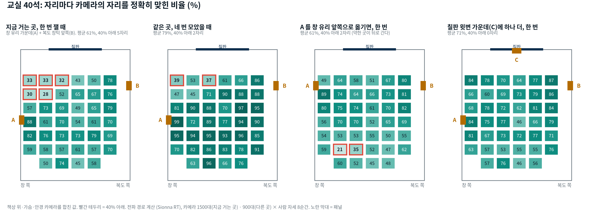

---
tags:
  - DeteCam
  - 검토
고친날: 2026-11-18
---

# 사각지대: 패널 둘이 잘 못 맞히는 자리

2026-11-18 기준. 교실 40석을 전파 경로 계산(Sionna RT)으로 풀어, 자리마다 카메라의 자리를 얼마나 맞히는지 나눠 봤다. 전부 계산이다. 숫자를 내는 코드는 `sim/rt/blind_study.py`, 숫자는 `sim/pre/blind.json`, 그림은 `sim/pre/blind_fig.py`.

> **사진을 16장 넘게 보낼 때** (문제를 한 장씩 찍는 카메라)와, 벽 높이·천장까지 넓혀 찾은 자리는 [배치 계산](배치%20계산.md)에 있다. 그때는 창 쪽 패널을 칠판 쪽(2.5 m)으로 옮기면 두 패널로도 사각지대가 없어진다 (가장 약한 자리 23% → 70%).

## 1. 한눈에

| 물음 | 답 |
|---|---|
| 사각지대가 있나 | 있다. **창가 쪽 앞 두 줄(칠판 가까운 창가 다섯 자리)** 이 한 번 잴 때 28~33% 다. 교실 평균은 61% 다 |
| 왜 거기인가 | 복도 쪽 패널(B)에서 보면 앞 두 줄의 창가 세 자리가 줄마다 1.5~2.3도 안에 겹쳐 보여서 좌우를 못 가른다. 그 자리를 가를 창 쪽 패널(A)은 그 자리를 자기가 보는 쪽에서 44~75도 벗어난 가장자리로 본다. 가슴 카메라는 A 가 등 뒤에 있어 몸이 가린다 |
| 모으면 없어지나 | 줄어든다. 네 번 모으면 평균 79%, 40% 아래 자리가 다섯에서 둘로. 첫째 줄 창가 쪽 두 자리(39%, 37%)가 남는다 |
| 거는 곳을 바꾸면 | 한 번 잴 때는 A 를 창 유리 앞쪽으로 옮기면 약한 자리가 다섯에서 둘이 되지만, 약한 곳이 뒤쪽(뒤에서 둘째 줄)으로 간다. 한 번만 보면 두 개로는 옮길 수만 있다. **사진을 16장 모으면 다르다**: 창 유리 앞쪽이 사각지대를 없앤다 (평균 91%, 가장 약한 자리 70%. [배치 계산](배치%20계산.md)) |
| 없애려면 | 한 번 잴 때는 칠판 윗변 가운데에 패널 하나를 더 건다 (약 24만 원). 40% 아래 자리가 없어지고, 한 번에 71%, 네 번이면 90% 다. 사진이 많으면 둘로도 된다 (위 줄) |
| 틀릴 때는 어디로 | 틀린 답의 절반(48%)이 같은 줄의 옆자리다. 앞뒤만 틀린 것은 14% 다. 그래서 앱은 후보 셋을 보여 주고, 약한 자리에서는 감독관이 옆자리까지 본다 |

## 2. 지금 거는 곳 (창 유리 가운데 + 복도 창턱 앞쪽)

카메라 1,500대(책상 위·가슴·안경 500대씩)를 사람 자세가 다른 여덟 순간에 잰 것이다. 자리를 정확히 / 옆자리까지 맞힌 비율(%).

| 모은 횟수 | 책상 위 | 가슴 | 안경 | 모두 | 40% 아래 자리 |
|---|---|---|---|---|---|
| 1번 | 69 / 89 | 52 / 79 | 62 / 91 | 61 / 86 | 5 |
| 2번 | 78 / 94 | 64 / 86 | 72 / 94 | 71 / 91 | 4 |
| 4번 | 86 / 95 | 73 / 91 | 79 / 97 | 79 / 94 | 2 |
| 8번 | 90 / 96 | 79 / 93 | 84 / 98 | 84 / 96 | 2 |

**앞서 쓴 숫자를 고친다.** 설계 검토의 첫 계산(카메라 210대)은 한 번 잴 때 70 · 56 · 70% 였다. 일곱 배로 늘려 다시 세니 가슴은 4점, 안경은 8점 낮았다 (책상 위는 1점). 네 번 모았을 때는 책상 위가 6점 높고 가슴·안경이 7~9점 낮다. 이 글의 숫자가 더 믿을 만하다.

자리마다 보면 고르지 않다 (맨 위 그림의 첫째와 둘째).

- **앞 두 줄의 창가 다섯 자리**: 한 번 28~33%, 옆자리까지 47~84%. 네 번 모아도 37~53%.
- **뒤 두 줄**: 한 번 45~74% (대부분 50%대). 네 번 모으면 63~96% 로 오른다. 멀어서 약하지만 사람 자세가 바뀌면 보인다.
- **가운데 세 줄 (셋째~다섯째)**: 한 번 49~88%, 대부분 60~70%대. 가장 잘 맞힌다.

### 왜 앞줄 창가인가

| 자리 (줄, 칸) | A 까지 | A 가 보는 쪽에서 벗어난 각 | B 까지 | B 가 보는 쪽에서 벗어난 각 |
|---|---|---|---|---|
| 첫째 줄 창가 | 3.0 m | 75도 | 6.9 m | 34도 |
| 첫째 줄 둘째 칸 | 3.4 m | 57도 | 5.8 m | 34도 |
| 둘째 줄 창가 | 2.2 m | 69도 | 6.9 m | 26도 |
| 넷째 줄 둘째 칸 (잘 맞히는 자리) | 2.0 m | 21도 | 6.3 m | 8도 |

1. **B 는 앞줄을 한 줄로 본다.** B(복도 창턱 앞쪽)는 첫째 줄보다 0.5 m 뒤에 있다. 그래서 첫째 줄의 창가 세 자리는 B 에서 1.5도, 둘째 줄의 창가 세 자리는 2.3도 안에 겹친다. 패널의 방향 오차(직접 보일 때 가운데값 3.6도)보다 작다. 높이각으로 거리를 가늠하지만 6~7 m 밖에서는 한 칸(1.1 m)의 높이각 차이가 1~2도다.
2. **A 는 그 자리를 가장자리로 본다.** A(창 유리 가운데)는 교실 가운데를 향해 걸려 있다. 앞줄 창가는 A 가 보는 쪽에서 44~75도 벗어난 곳이라, 패치가 받는 세기가 떨어지고 방향을 가르는 힘도 1/cos 만큼 무뎌진다.
3. **가슴 카메라는 몸이 가린다.** A 는 앞줄 학생의 등 뒤 옆에 있다. 계산에서 앞 두 줄의 가슴 카메라는 A 까지의 직접파가 대부분 막혔다.

두 눈이 모두 약한 자리가 사각지대가 된다. 반대로 넷째 줄 둘째 칸은 A 에서 2.0 m 로 가깝고, A 와 B 모두 거의 정면(21도, 8도)으로 봐서 잘 맞힌다.

## 3. 거는 곳을 바꾸면

같은 카메라 900대로 거는 곳만 바꿔 견줬다 (손이 닿는 스무 곳의 모든 쌍 190가지). 정확히 / 옆자리까지 (%), 40% 아래 자리 수.

| 거는 곳 | 1번 (책상 · 가슴 · 안경) | 1번 모두 | 4번 모두 | 40% 아래 (1번 / 4번) | 가장 약한 다섯 자리 평균 (1번) |
|---|---|---|---|---|---|
| 창 유리 가운데 + 복도 창턱 앞쪽 (지금) | 69 · 54 · 65 | 62 / 87 | 81 / 95 | 5 / 1 | 34% |
| 창 유리 앞쪽 + 복도 창턱 앞쪽 | 61 · 55 · 68 | 61 / 88 | 83 / 97 | 2 / 1 | 39% |
| 칠판 윗변 가운데 + 창 유리 가운데 | 62 · 48 · 65 | 58 / 84 | 79 / 95 | 4 / 0 | 36% |
| 위 셋 (칠판 윗변 가운데를 더함) | 73 · 61 · 78 | 71 / 92 | 90 / 98 | 0 / 0 | 51% |

- **한 번 잴 때 평균은 지금 거는 곳이 가장 높다** (190쌍 가운데 1위). 사진을 16장 넘게 모으면 이 순위가 바뀐다: 창 유리 앞쪽이 평균도 높다 (91% 대 87%, [배치 계산](배치%20계산.md)).
- **약한 자리를 줄이려면 창 쪽 패널을 앞으로.** 창 유리 앞쪽(칠판에서 2.5 m)으로 옮기면 앞줄 창가가 49~89% 로 오르고, 네 번 모으면 평균도 2점 높다. 대신 뒤에서 둘째 줄의 창 쪽 두 자리가 21%, 35% 로 떨어지고, 한 번 잴 때 책상 위 카메라가 7.5점 낮다. **한 번만 보면 두 개로는 사각지대를 옮길 수만 있다.** 사진을 16장 모으면 뒤쪽은 사람 자세가 바뀌며 메워지므로 창 유리 앞쪽이 낫다 ([배치 계산](배치%20계산.md)). 실물에서 둘 다 재 본다 (패널만 옮기면 된다).
- **없애려면 셋.** 칠판 윗변 가운데에 하나를 더 걸면 가장 약한 자리도 46% 이고, 네 번 모으면 모든 자리가 71% 이상이다. 패널 하나에 약 24만 원 (안테나 보드 12만, 스위치 둘 5만, ESP32-C5, 합침기, 선, 배터리)이 더 든다. 강의실(72석)에는 이미 셋을 권하고 있다.

## 4. 소프트웨어로 메우기 (돈이 들지 않는 것)

1. **후보 셋.** 정확히 맞히지 못해도 후보 셋 안에는 한 번에 81%, 네 번에 94% 든다. 앱은 지금처럼 후보 셋을 보여 준다.
2. **약한 자리 표시.** 위 지도를 앱에 넣어, 답이 약한 자리 근처면 '옆자리까지 확인' 을 띄운다. 틀린 답의 절반이 같은 줄의 옆자리이므로 감독관은 그 줄을 본다.
3. **더 모으기.** 가끔 보내는 카메라라도 네 번 모으면 평균 79%, 여덟 번이면 84% 다. 30초마다 보내는 카메라면 2분 안팎이다.
4. **다른 증거와 겹치기.** 같은 사람의 폰이 핫스팟을 열어 두었다면 그 폰도 같은 패널로 잴 수 있다 (폰은 0.1초마다 비콘을 낸다). 두 기기가 같은 자리를 가리키면 믿음이 커진다 ([전파 넓히기 검토](https://github.com/DeteCam/docs/blob/main/research/전파%20넓히기%20검토.md)).

## 5. 거는 곳과 상관없는 사각지대

| 무엇 | 왜 | 어떻게 하나 |
|---|---|---|
| 재는 동안 전파를 내지 않는 카메라 | 녹화만 하거나 나중에 몰아 올리면 잴 것이 없다 | 탐지와 위치 모두 못 한다. 재는 동안 기다린다. 응답 유도(빈 프레임)로 깨울 수 있는지는 관문 1 에서 본다 |
| 5 GHz 로만 보내는 카메라 | 안테나 보드가 2.4 GHz 용이다 | 탐지는 ESP32-C5(두 대역)나 듀얼밴드 동글로 한다. 방향은 지금 판으로 못 잰다. 5 GHz 판을 새로 만들면 계산상 2.4 GHz 와 거의 같다 ([다른 방법 검토](다른%20방법%20검토.md) 5절) |
| Wi-Fi 가 아닌 것 (블루투스, 선으로 폰에 붙인 카메라, LTE 로 바로 올리는 카메라) | 패널은 Wi-Fi 를 받는다 | 있다는 것만 따로 알리는 방법을 검토했다 ([전파 넓히기 검토](https://github.com/DeteCam/docs/blob/main/research/전파%20넓히기%20검토.md)) |
| 몸에 가린 가슴 카메라 | 모든 종류 가운데 가장 낮다 (한 번 52%) | 모으기. 사람이 자세를 바꾸는 순간을 기다린다 |
| 계산이 두지 않은 높이 | 후보 점은 책상 위 0.80 m, 가슴 1.17 m, 안경 1.22 m 뿐이다. 바닥의 가방, 신발, 무릎 위는 계산에 없다 | 계산해 보지 않았다. 다음 계산에 넣는다 |
| 같은 반사에 굳기 | 한 패널이 늘 같은 반사를 보면 곱할수록 틀린 자리로 굳는다 | 후보 셋, 패널끼리 어긋나면 알리기 ([설계 검토](설계%20검토.md) 6절) |

## 6. 숙소 방에서

방은 [숙소 방 계산](숙소%20방%20계산.md)에 있다. 방 가운데에서 다섯 쪽으로 돌려 재면, 현관 쪽(옷장 위·문 위)이 49%, 욕실 선반·거울 둘레가 52%, 창가 화분·휴지통과 욕실 환풍기가 60% 로 50 cm 안에 든다 (다른 곳은 77~96%). 창턱과 현관 통로에서 한 번씩 더 재면 현관 쪽은 88% 로 오르지만, **창가 화분·휴지통(67%)과 욕실 선반·거울(71%)은 남는다.** 유리와 거울의 반사 때문이다. 그곳은 눈으로 한 번 더 본다.

## 7. 다음에 할 일

- 실물 교실에서 지금 거는 곳과 '창 유리 앞쪽' 을 둘 다 재 본다. 높이 2.35 m 와 숙이는 각(0도·15도)도 견준다 ([스펙 006](../specs/006-panel-receiver/tasks.md), [배치 계산](배치%20계산.md)).
- 앱의 자리 지도에 약한 자리를 표시한다 (app 저장소).
- 바닥·무릎 높이의 카메라를 계산에 넣는다.
