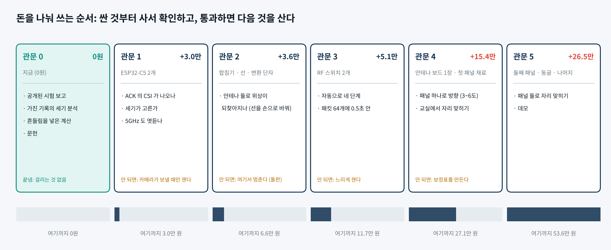
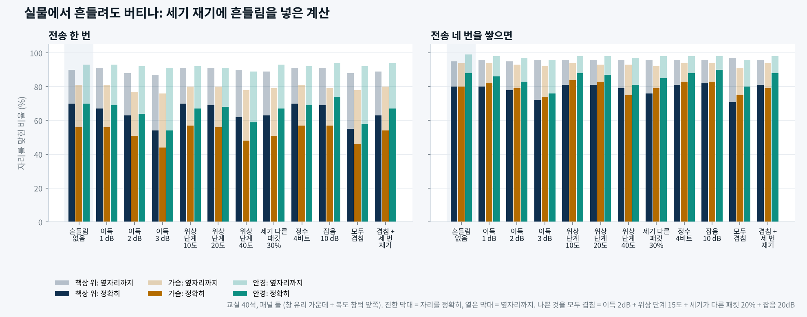
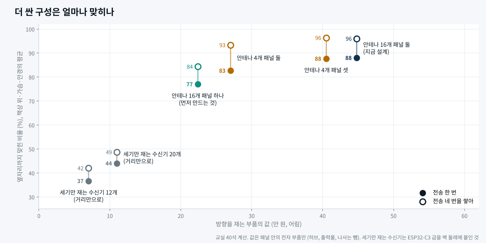

---
tags:
  - DeteCam
  - 검증
고친날: 2026-11-17
---

# 사전 검증: 부품을 사기 전에 어디까지 알 수 있나

패널 구조는 실물에서 두 가지가 되어야 선다. **ESP32-C5 가 응답 프레임(ACK)의 CSI 를 내는가**, **세기만 재서 위상이 되찾아지는가**. 이 글은 그 둘을 돈을 쓰기 전에 확인한 내용과, 그래도 남는 것을 싼 순서로 확인하는 계획이다.

- 돈을 들이지 않고 네 가지로 확인했다: 공개된 시험 보고, 내 카메라로 받아 둔 기록의 분석, 흔들림을 넣은 계산, 문헌. **걸리는 것은 없었다.**
- 그래도 계산은 계산이다. 그래서 54만 원을 한꺼번에 쓰지 않고 **다섯 번에 나눠** 쓴다: 3만 → 3.6만 → 5.1만 → 15.4만 → 26.5만 원. 가장 위험한 두 가지는 처음 6.6만 원 안에서 결판이 난다.
- 더 싼 구성도 견줬다. 세기만 재는 값싼 수신기를 여러 개 두는 방법은 자리를 못 맞힌다. 안테나를 4개로 줄인 패널은 값이 60% 이고 정확도는 5점쯤 낮다.



## 1. 한눈에

| 걱정 | 돈을 들이지 않고 확인한 것 | 결과 | 실물로 확인하는 때 |
|---|---|---|---|
| ESP32-C5 가 ACK 의 CSI 를 내는가 | 공개된 시험 보고 (ESP-IDF 이슈 19062) | ESP32-C5 에서 나온다고 보고됨. 공식 답은 아직 없다 | 관문 1 (3만 원) |
| 카메라가 잴 만큼 자주 보내는가 | 내 카메라를 파이로 받아 둔 기록 | 실시간 보기 중 초당 81~125개. 핑을 보내면 초당 92번까지 답한다 | 끝 |
| 세기만으로 위상을 되찾는 방법이 있는 방법인가 | 문헌 | 위상 배열 안테나를 보정할 때 40년 넘게 써 온 방법이다 (REV 법) | 관문 2 (3.6만 원) |
| 카메라 신호의 세기가 그만큼 고른가 | 같은 기록의 진폭 분석 | 이어진 두 패킷의 차가 0.03~0.13 dB. 1 dB 넘게 뛰는 것이 3~12% 있고, 걸러 내면 된다 | 관문 1 |
| 실물에서 흔들려도 자리를 맞히는가 | 흔들림을 넣은 계산 | 이득 2 dB, 위상 단계 20도, 4비트, 잡음 10 dB 까지 거의 그대로다 | 관문 2~4 |
| 더 싸고 확실한 구성이 있는가 | 같은 교실 계산으로 여섯 구성을 견줌 | 세기만 재는 방법은 안 된다. 안테나 4개 패널은 된다 (조금 낮다) | 관문 3 뒤에 고른다 |

## 2. ACK 의 CSI

**왜 필요한가.** 카메라가 보낼 때만 재면, 쉬고 있는 카메라는 못 잰다. 수신기가 빈 프레임을 보내면 Wi-Fi 기기는 같은 네트워크가 아니어도 곧바로 짧은 응답(ACK)을 돌려보낸다 ([Abedi, Abari. HotNets 2020](https://doi.org/10.1145/3422604.3425951), [Wi-Peep. MobiCom 2022](https://doi.org/10.1145/3495243.3560530)). 그 응답으로 재면 원하는 때에 원하는 만큼 잴 수 있다. 그러려면 수신기의 칩이 ACK 에서도 CSI 를 내야 한다.

**확인한 것.**

- ESP-IDF 저장소의 [이슈 19062](https://github.com/espressif/esp-idf/issues/19062) (ESP-IDF 5.5.5). 보고자가 칩 다섯 가지에 같은 시험을 했다: 6 Mbps 로 빈 데이터 프레임 500개를 10 ms 간격으로 보내고, 돌아온 ACK 의 CSI 를 받는다 (`acquire_csi_legacy = 1`, `dump_ack_en = 1`). ESP32, ESP32-C3, ESP32-S3, **ESP32-C5 는 쓸 수 있는 CSI 가 나왔고**, ESP32-C6 만 12,512개 가운데 0개였다. 이 글을 쓰는 날까지 Espressif 의 답은 없다. 그래서 '제조사가 보증한 것'은 아니고 '한 사람이 시험해 된 것'이다.
- 내 기록에서 본 것. 라즈베리파이의 nexmon 은 ACK 와 CTS 의 CSI 를 내지 않는다 (기록 다섯 개 모두 0개). 그래서 이 방법은 파이로는 못 하고 ESP32-C5 로 해야 한다.
- 보내는 속도가 중요하다. 6 Mbps(OFDM)로 보내야 응답도 OFDM 으로 와서 CSI 가 나온다. 1 Mbps(11b)로 보내면 응답도 11b 라 CSI 가 없다.

**안 되어도 설계는 선다.** 카메라가 스스로 보내는 프레임만으로 잰다. 내 카메라(MISUKO, 2.4 GHz)는 실시간 보기 중에 초당 81~125개를 보낸다. 패킷 64개를 모으는 데 0.5~0.8초다. 달라지는 것은 둘이다: 쉬고 있는 카메라는 못 재고, 사진 한 장만 0.5초 동안 보내는 카메라는 한 번에 다 못 재서 두 번에 나눠 잰다.

| 내 카메라의 기록 (2026-11-10, 11-16) | 초당 프레임 | 쓴 것 |
|---|---|---|
| 실시간 보기를 켠 채 (14초) | 81 | 데이터 프레임 |
| 실시간 보기, 다른 날 (70초, 121초) | 125, 104 | 데이터 프레임 |
| 핑을 0.2 / 0.05 / 0.02 / 0.01초 간격으로 보냄 (같은 핫스팟에 붙어서, 30초씩) | 답 150/150, 591/592, 1452/1464, 2773/2825 | 초당 92번까지 답한다 |

**관문 1 에서 하는 실험 (ESP32-C5 두 개, 3만 원).**

1. 하나에 CSI 예제를 올리고 `dump_ack_en` 을 켠다. 다른 하나(또는 내 카메라, 폰 핫스팟)의 주소로 6 Mbps 빈 프레임을 초당 200개 보낸다.
2. 돌아온 ACK 의 CSI 를 센다. **통과: 보낸 것의 80% 이상에서 CSI 가 나오고, 서브캐리어 52개가 0 이 아니다.**
3. 같은 자리에서 1,000개를 받아 진폭이 얼마나 고른지 본다 (수신 이득 값을 함께 읽어 되돌린 뒤). **통과: 이어진 패킷의 진폭 차가 0.5 dB 안 (가운데 덩어리).**
4. 채널을 바꿔 가며 5 GHz 의 프레임도 엿듣는지 본다. 되면 탐지용 동글(2.5만 원)을 사지 않는다.

## 3. 세기만으로 위상 되찾기

**원리.** ESP32 는 수신 길이 하나라 패킷마다 위상의 기준이 달라진다. 그래서 안테나를 바꿔 가며 받은 위상을 서로 견줄 수 없다. 대신 기준 안테나의 신호 r 과 고른 안테나의 신호 h 를 **합쳐서 세기만** 잰다. 기준 길의 위상을 0·90·180·270도로 바꾸면 세기 넷에서 `(I₀ − I₁₈₀) − j(I₉₀ − I₂₇₀) = 4 r* h` 가 나온다. 세기에는 패킷마다 달라지는 위상이 들어 있지 않다.

**있는 방법인가.** 위상 배열 안테나를 보정할 때, 한 소자의 위상만 돌려 가며 합쳐진 세기를 재서 소자마다의 크기와 위상을 구하는 방법(REV 법)이 1982년부터 쓰였다 (Mano, Katagi 1982; Takahashi 외 2012; He 외 2019). 재는 대상이 다를 뿐 셈은 같다. Wi-Fi 에서 기준 안테나를 두고 다른 안테나를 옮겨 가며 전파의 모양을 찍은 일도 있다 ([Holl, Reinhard. PRL 2017](https://doi.org/10.1103/PhysRevLett.118.183901)). 그쪽은 수신기 둘로 위상까지 함께 쟀고, 우리는 수신기 하나로 세기만 잰다는 점이 다르다.

**세기가 그만큼 고른가.** 네 번 재는 사이에 신호의 세기가 달라지면 위상이 틀어진다. 가진 기록(파이로 받은 내 카메라의 CSI)에서 이어진 패킷의 진폭이 얼마나 다른지 봤다.

| 기록 | 초당 | 이어진 두 패킷의 진폭 차 (가운데 덩어리) | 1 dB 넘게 뛴 비율 | 네 번 재기를 흉내 낸 위상 오차: 가운데값 / 90% | 뛴 묶음을 버리면 | 버린 비율 |
|---|---|---|---|---|---|---|
| 실시간 보기 (14초) | 81 | 0.04 dB | 11.7% | 0.6도 / 13.7도 | 0.5도 / 2.0도 | 26% |
| 실시간 보기, 필터 0x88 (7초) | 92 | 0.07 dB | 9.0% | 1.2도 / 10.6도 | 0.8도 / 3.9도 | 26% |
| 실시간 보기, 필터 0x94 (7초) | 101 | 0.03 dB | 3.4% | 0.5도 / 2.6도 | 0.4도 / 1.7도 | 9% |
| 핑으로 깨운 기록 (170초) | 33 | 0.13 dB | 11.7% | 1.5도 / 10.9도 | 1.0도 / 3.4도 | 29% |
| 손을 흔든 기록 (70초) | 125 | 0.04 dB | 7.2% | 0.6도 / 7.8도 | 0.5도 / 2.5도 | 19% |
| 긴 기록 (121초) | 104 | 0.03 dB | 7.8% | 0.6도 / 7.6도 | 0.5도 / 2.0도 | 19% |

- 대부분의 패킷은 아주 고르다 (0.1 dB 안팎). 가끔 통째로 1 dB 넘게 뛴다. 파이의 CSI 는 수신 이득이 바뀔 때 진폭이 뛰기 때문이고, 카메라가 전송 속도를 바꿀 때도 뛴다.
- 넷 가운데 하나라도 뛴 묶음을 버리고 다시 재면 위상 오차의 90% 가 2~4도 안이다. 버리는 것이 9~29% 라 재는 시간이 그만큼 는다 (0.3초 → 0.4초).
- ESP32 는 패킷마다 수신 이득 값을 알려 주므로 이득 때문에 뛰는 것은 되돌릴 수 있다. 그래서 위 숫자는 실제보다 나쁜 쪽이다. 다만 ESP32 의 값은 아직 직접 보지 못했다 (관문 1).
- 계산은 `sim/pre/amp_stability.py`. 기록 파일은 내 기기의 주소가 들어 있어 저장소에 올리지 않는다.

**흔들려도 자리를 맞히는가.** 교실 40석 계산의 세기 재기에 실물에서 생길 흔들림을 넣었다 (패널 둘, 정확히 / 옆자리까지 %).



| 넣은 흔들림 | 책상 위 | 가슴 | 안경 | 네 번 쌓으면 (책상 위 · 가슴 · 안경, 정확히) |
|---|---|---|---|---|
| 없음 (기준) | 70 / 90 | 56 / 81 | 70 / 93 | 80 · 80 · 88 |
| 패킷마다 이득이 1 dB 흔들림 | 67 / 91 | 56 / 81 | 69 / 93 | 80 · 82 · 86 |
| 2 dB | 63 / 88 | 51 / 77 | 64 / 92 | 78 · 79 · 83 |
| 3 dB | 54 / 87 | 44 / 76 | 54 / 91 | 72 · 74 · 76 |
| 서브캐리어마다 2 dB | 69 / 91 | 57 / 80 | 75 / 94 | 80 · 82 · 87 |
| 위상 단계가 10도 틀림 | 70 / 91 | 57 / 80 | 67 / 92 | 81 · 84 · 88 |
| 20도 | 69 / 91 | 56 / 80 | 68 / 91 | 81 · 83 · 87 |
| 40도 | 62 / 90 | 48 / 78 | 59 / 89 | 79 · 75 · 81 |
| 패킷의 10% 가 ±2 dB 다르게 나옴 | 68 / 91 | 55 / 81 | 72 / 94 | 82 · 81 · 89 |
| 패킷의 30% 가 ±3 dB | 63 / 89 | 51 / 79 | 67 / 93 | 76 · 79 · 85 |
| CSI 를 4비트 정수로 받음 (6비트도 같다) | 70 / 91 | 57 / 81 | 69 / 92 | 81 · 83 · 88 |
| 잡음이 10 dB (15 dB 도 같다) | 69 / 91 | 57 / 79 | 74 / 94 | 82 · 83 · 90 |
| 나쁜 것을 모두 겹침 (이득 2 dB, 위상 단계 15도, 20% 가 ±3 dB, 잡음 20 dB) | 55 / 88 | 46 / 78 | 58 / 92 | 71 · 75 · 80 |
| 모두 겹침 + 단계마다 세 번 재서 가운데값 | 63 / 89 | 54 / 80 | 67 / 94 | 81 · 79 · 88 |

- **'옆자리까지'는 가장 나쁜 경우에도 5점 안에서 버틴다** (이득 3 dB 에서 가슴 81 → 76). 네 번 쌓으면 어느 경우에도 91% 이상이다. 흔들림은 주로 '정확히'를 깎는다.
- 견디는 한계는 이득 2 dB, 위상 단계 20도쯤이다. 가진 기록에서 본 흔들림(가운데 덩어리 0.1 dB, 가끔 1 dB 넘게)은 그 안이다.
- 나쁜 것이 모두 겹쳐도 단계마다 세 번 재서 가운데값을 쓰면 기준 가까이 돌아온다. 재는 시간이 0.3초에서 1초로 는다.
- 위상 단계(선 길이)는 정확할 필요가 없다. 20도 틀려도 같고, 실물에서는 장치가 스스로 잰다.

**관문 2 에서 하는 실험 (합침기, 선, 변환 단자, 3.6만 원).** 스위치 없이 선을 손으로 바꿔 끼운다.

1. 안테나 둘을 6 cm 띄워 자에 붙인다. 하나는 기준 길(길이가 다른 선 넷 가운데 하나)로, 하나는 곧바로 합침기에 잇는다. 합침기의 합쳐진 쪽을 ESP32-C5 에 잇는다.
2. 송신기(다른 ESP32-C5 나 내 카메라)를 2 m 앞 가운데에 둔다. 선을 0·90·180·270도 것으로 바꿔 가며 30패킷씩 받는다. 세기 넷에서 위상을 셈한다.
3. 송신기를 왼쪽·오른쪽으로 20도, 40도 옮겨 되풀이한다. **통과: 위상이 `2π·d·sin(각)/λ` 를 따라오고, 가운데값 오차가 15도 안.**
4. 같은 자리에서 열 번 되풀이해 흩어짐을 본다. **통과: 10도 안.**

**관문 3 (RF 스위치 2개, 5.1만 원).** 스위치로 네 단계를 패킷마다 바꾼다. **통과: 손으로 잰 위상과 10도 안에서 같고, 패킷 64개가 0.5초 안에 끝난다.**

**안 되면.** 관문 2 에서 위상이 따라오지 않으면 이득 보정과 세 번 재기를 넣어 다시 본다. 그래도 안 되면 거기서 멈추고 돌판 수신기(태그 `plate-v2`)로 간다. 그때까지 쓴 돈은 6.6만 원이고, ESP32-C5 는 탐지용으로 남는다.

## 4. 더 싸게, 더 확실하게: 견준 구성

같은 교실 계산에서 받는 쪽만 바꿨다 (옆자리까지 맞힌 비율, 책상 위 · 가슴 · 안경).



| 구성 | 방향을 재는 부품 값 | 전송 한 번 | 네 번 쌓아 | 평가 |
|---|---|---|---|---|
| **안테나 16개 패널 둘 (지금 설계)** | 약 45만 원 | 90 · 81 · 93 | 95 · 94 · 99 | 가장 잘 맞힌다 |
| 안테나 16개 패널 하나 (창 유리 가운데) | 약 22만 원 | 80 · 69 · 82 | 88 · 79 · 86 | 여덟 번 쌓으면 93 · 86 · 86. **먼저 이것부터 만든다** |
| 안테나 4개 패널 둘 (2 × 2) | 약 27만 원 | 86 · 77 · 85 | 93 · 91 · 96 | 4~8점 낮다. 정확히는 59 · 46 · 55 로 10점쯤 낮다 |
| 안테나 4개 패널 셋 | 약 41만 원 | 86 · 84 · 93 | 95 · 95 · 99 | 16개 둘과 비슷하다. 걸 곳이 셋 |
| 안테나 8개 패널 둘 (2 × 4) | 맞는 보드가 없다 | 89 · 77 · 89 | 94 · 90 · 98 | 16개와 거의 같다. 직접 만들어야 한다 |
| 수신 넷이 한꺼번에 받는 2 × 2 둘 (공유기 방식) | 맞는 장비를 못 찾았다 | 87 · 78 · 85 | 92 · 88 · 96 | 세기 재기가 필요 없어 확실하지만, 2.4 GHz 에서 CSI 를 내는 4체인 장비가 마땅치 않다 |
| 세기만 재는 수신기 12개 / 20개를 벽 둘레에 (거리만으로) | 약 7만 / 11만 원 | 56 · 25 · 29 / 65 · 28 · 39 | 77 · 23 · 26 / 86 · 26 · 34 | **안 된다.** 몸에 가린 카메라는 세기로 거리를 알 수 없다 |
| 같은 것, 자리마다 미리 재 둔 값이 있다면 (위쪽 한계) | 같다 | 71 · 47 · 78 / 85 · 66 · 87 | 94 · 78 · 97 / 100 · 92 · 100 | 교실마다 40자리를 미리 재야 한다. 사람이 앉으면 달라진다 |

- **세기만으로는 안 된다.** 값은 싸지만 가슴과 안경의 카메라를 25~39% 밖에 못 맞힌다. 방향(위상)을 재야 한다.
- **안테나 수는 4개까지 줄여도 쓸 만하다.** 16개 보드(12만 원) 대신 2.4 GHz 패치 안테나 4개와 스위치 하나(약 3.7만 원)를 쓴다. 패널 하나에 9만 원쯤 싸다. 다만 통과 틀을 새로 그려야 하고, 낱개 안테나는 보정이 더 필요하다.
- **패널 하나로도 시작할 수 있다.** 옆자리까지 69~82% 이고, 카메라가 여덟 번 보내는 동안 쌓으면 86~93% 다. 둘째 패널은 그 결과를 보고 산다.

값을 더 줄일 수 있는 곳.

| 곳 | 줄어드는 값 | 언제 정하나 |
|---|---|---|
| 탐지용 동글을 사지 않는다 (ESP32-C5 가 2.4 와 5 GHz 를 다 듣는다) | 2.5만 원 | 관문 1 |
| RF 스위치를 2.4 GHz 용 싼 것으로 (예: HMC241 모듈) | 개마다 5천~1만 원 | 살 때 값을 견줘서 |
| 둘째 패널을 미룬다 | 22만 원 | 관문 4 뒤 |
| 보드 대신 안테나 4개 | 패널마다 9만 원 | 관문 3 뒤 |
| 허브를 뺀다 (폰이 계산한다) | 값은 그대로 (허브는 가진 것). 들고 다닐 것이 준다 | 패널이 된 뒤 |

## 5. 사는 순서 (관문)

| 관문 | 사는 것 | 값 | 확인하는 것 | 통과 기준 | 안 되면 |
|---|---|---|---|---|---|
| 0 | 없음 | 0원 | 이 글의 2~4절 | 끝냄 | - |
| 1 | ESP32-C5 2 | 3.0만 원 | ACK 의 CSI, 세기의 고르기, 5 GHz 엿듣기 | ACK 의 80% 이상에서 CSI, 진폭 차 0.5 dB 안 | 카메라가 보낼 때만 잰다 |
| 2 | 합침기 1, 선 한 벌, 변환선과 변환 단자 | 3.6만 원 | 안테나 둘로 위상 되찾기 (선을 손으로 바꿔) | 위상 오차 15도 안, 되풀이 10도 안 | 세 번 재기를 넣어 다시. 그래도 안 되면 돌판으로 |
| 3 | RF 스위치 2 | 5.1만 원 | 자동으로 네 단계 | 손으로 잰 것과 10도 안, 64패킷에 0.5초 안 | 느리게 잰다 |
| 4 | 안테나 보드 1, 첫 패널의 재료 | 15.4만 원 | 패널 하나로 방향, 교실에서 자리 | 직접 보일 때 방향 6도 안, 옆자리까지 70% 이상 | 보정표를 만든다 |
| 5 | 둘째 패널, 동글, 나머지 | 26.5만 원 | 패널 둘로 자리, 데모 | [데모 환경](데모%20환경.md)의 기준 | - |

품목마다 어느 관문에서 사는지는 [부품표](부품표.md#사는-순서-관문)에 있다. 선과 단자는 암수를 맞춰 산다: 스위치와 합침기 모듈은 SMA 암이라 선은 SMA 수이고, ESP32 에 딸려 온 안테나의 선 끝은 U.FL 플러그라 변환선(이것도 플러그)과는 끼워지지 않아 변환 단자가 있어야 한다.

## 6. 계산이 말해 주지 못하는 것

- 사람이 앉은 교실에서 계산과 실측이 얼마나 맞는지. 계산의 사람은 단순한 덩어리다.
- 보드의 패치가 실제로 어느 쪽을 얼마나 받는지 (요약서에는 무늬가 없다).
- 선과 스위치 사이로 새는 전파. 기준 길과 안테나 길이 섞이면 위상이 틀어진다.
- 카메라가 응답을 보내는 세기와 속도가 데이터를 보낼 때와 같은지.
- 다른 사람의 기기에 빈 프레임을 보내도 되는지 (법). 실험은 내 기기로만 한다.

## 7. 다시 해 보기

```
cd sim/rt
./run_pre.sh                 # 흔들림을 넣은 계산, 더 싼 구성, 세기만 재는 수신기 (study/log_pre.txt, 약 20분)
cd ../pre
python3 amp_stability.py 기록.pcap --mac 카메라주소      # 가진 기록의 진폭 분석
python3 collect.py && python3 figs.py                      # 숫자를 모으고 그림을 그린다
```

## 8. 바탕 자료

- ESP-IDF 이슈 19062, *ESP32-C6: invalid CSI for ACK frames on ESP-IDF 5.5.5*. <https://github.com/espressif/esp-idf/issues/19062>
- Abedi, Abari. *WiFi Says "Hi!" Back to Strangers!* HotNets 2020. <https://doi.org/10.1145/3422604.3425951>
- Abedi, Vasisht. *Non-cooperative Wi-Fi Localization & its Privacy Implications (Wi-Peep).* MobiCom 2022. <https://doi.org/10.1145/3495243.3560530>
- Mano, Katagi. *A method for measuring amplitude and phase of each radiating element of a phased array antenna.* Electronics and Communications in Japan B 65(5), 58–64, 1982 (REV 법)
- Takahashi, Konishi, Chiba. *A Novel Amplitude-Only Measurement Method to Determine Element Fields in Phased Arrays.* IEEE Trans. Antennas Propag. 60(7), 2012
- He, Gao, Zhou. *Fast Phased Array Calibration by Power-Only Measurements Twice for Each Antenna Element.* Int. J. Antennas Propag. 2019, 6432149
- Holl, Reinhard. *Holography of Wi-fi Radiation.* Phys. Rev. Lett. 118, 183901 (2017). <https://doi.org/10.1103/PhysRevLett.118.183901>
