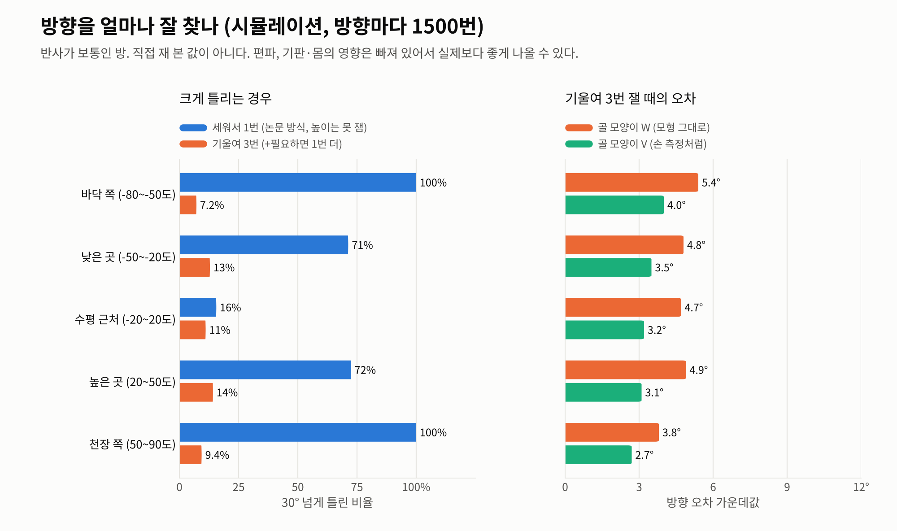
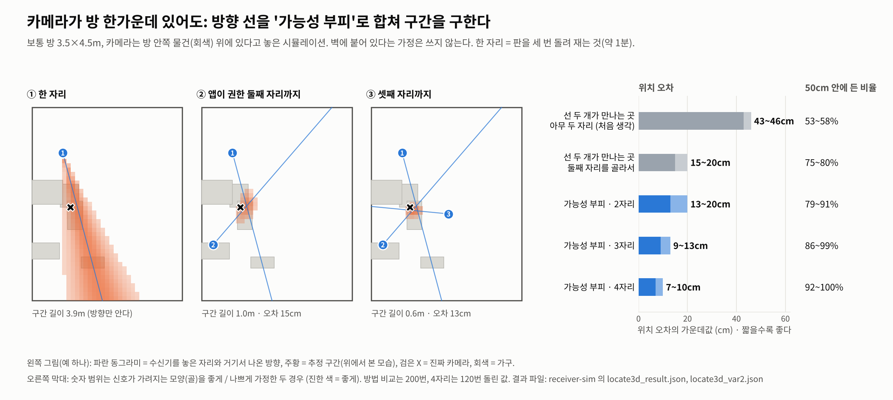
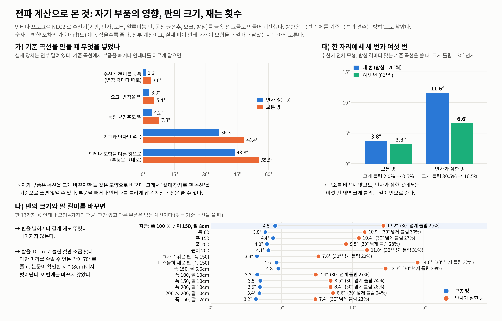
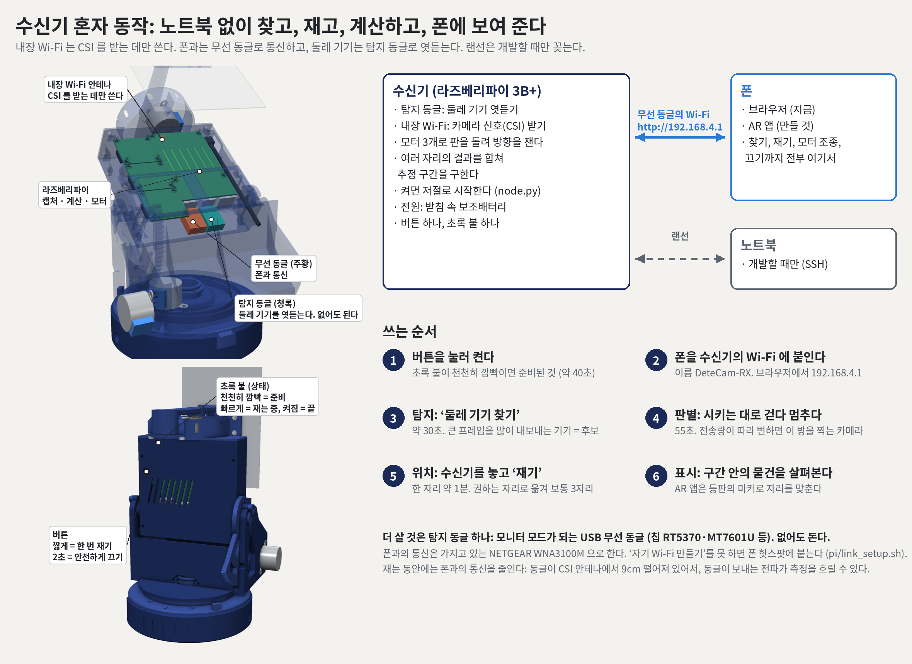
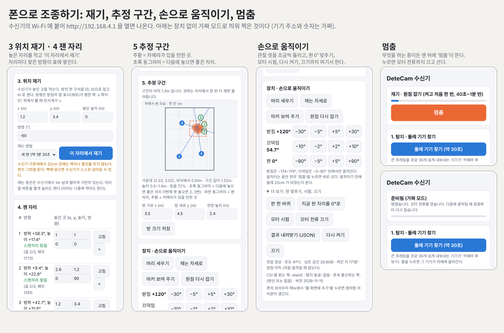
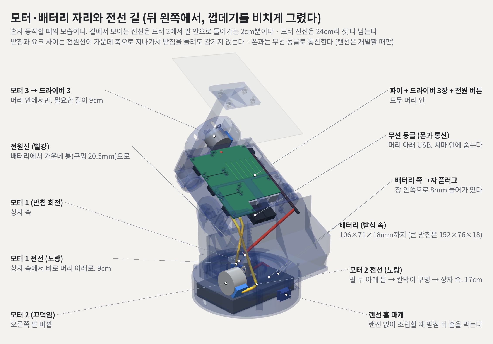
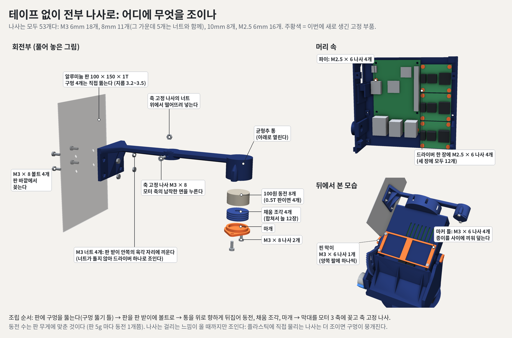
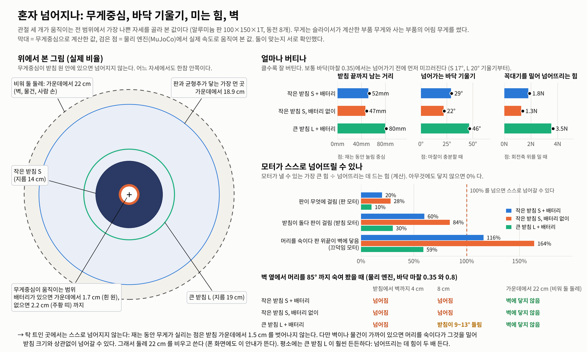
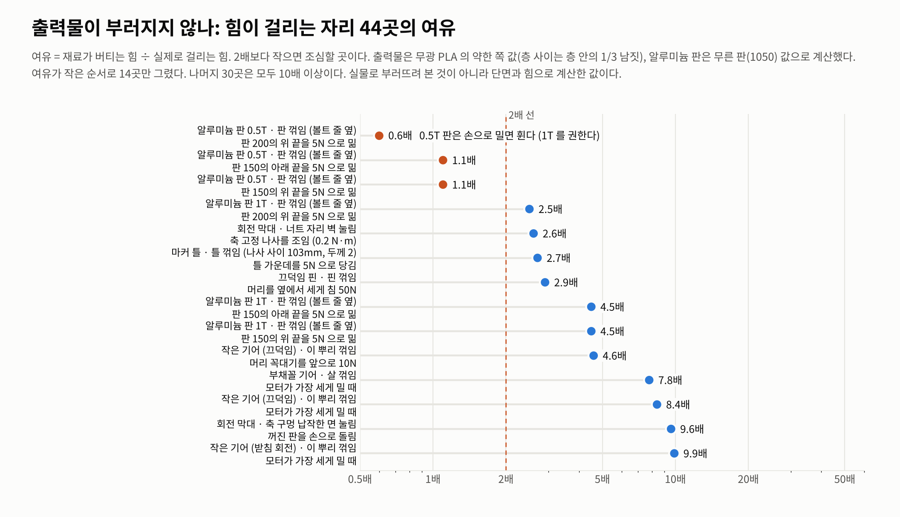
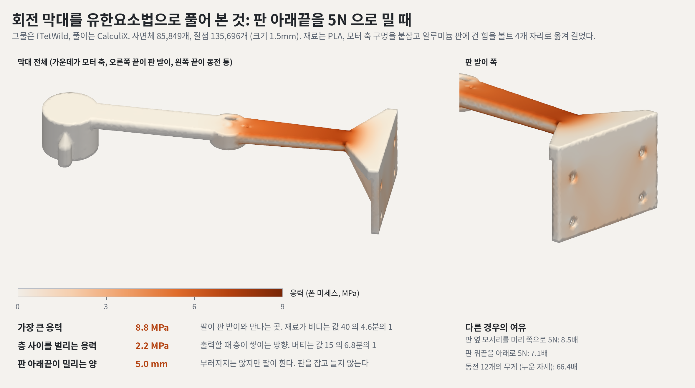

---
tags:
  - DeteCam
  - 검토
고친날: 2026-11-14
---

# 설계 검토: DeteCam 수신기 v2

2026-11-14 기준. 전부 모델 계산과 시뮬레이션으로 본 것이다. 실물로 확인해야 하는 것은 13절에 모았다. 탐지·판별 단계와 곳별(변기 칸, 욕실, 모텔 방, 강의실) 결과는 [네 단계 검토](네%20단계%20검토.md)에 있다.

## 1. 한눈에

| 물은 것 | 답 |
|---|---|
| 구조를 바꾸면 오차가 더 주나 | 거의 안 준다. 판을 넓히거나 길게 해도 차이가 없고, 팔을 10cm로 늘린 것만 조금 낫다. 남은 오차는 대부분 방의 반사에서 온다 (4절) |
| 선이 만나는 곳으로 찾는 것이 유일한가 | 안테나가 하나뿐인 이 장비로는 '여러 자리에서 방향을 재서 겹치기'가 가장 낫다. 다만 선이 아니라 부피로 겹치고, 둘째 자리를 골라 주는 것으로 이미 오차를 반 아래로 줄였다 (3절, 4절) |
| 자기 부품이 방해하나 | 곡선의 모양을 크게 바꾼다. 하지만 늘 같은 모양으로 바꾸므로 실제 장치로 잰 곡선을 기준으로 삼으면 없앨 수 있다. 실물에서 맨 먼저 확인할 것이다 (5절) |
| 혼자 고꾸라지나 | 탁 트인 곳에서는 넘어지지 않는다. 벽이나 물건이 22cm 안에 있으면 머리를 숙이다 그것을 밀어 넘어갈 수 있다 (10절) |
| 부품의 실제 크기에 맞나 | 파이, 모터는 공식 치수다. 드라이버 보드 구멍, 버튼 모듈, 안테나 위치, 배터리는 재 봐야 하고, 재는 방법과 고칠 곳을 정해 두었다 (8절) |
| 알루미늄 판은 100×150×1T 가 맞나 | 폭 10cm와 팔 8cm는 DiffLoc 논문의 값이다. 높이 15cm와 두께는 논문에 없어서 계산으로 정했다: 높이는 15cm와 20cm가 차이 없고, 두께는 전파와 상관없어 튼튼함으로 1T를 골랐다 (4절, 11절) |
| 폰으로 전부 조종하나 | 된다. 탐지, 판별, 재기, 관절 움직이기, 맞추기, 멈춤, 끄기까지 폰 화면에 있다 (6절) |
| 테이프 없이 볼트로 | 됐다. 나사 53개, 테이프와 풀은 0곳 (8절) |
| 좁은 곳(화장실)에서도 되나 | 된다. 다만 타일·거울 반사로 크게 틀리는 일이 늘어서 '여섯 번 재기'를 쓴다 (2절) |
| 사람이 가로막으면 | 카메라와 수신기 사이에 서 있으면 못 잰다. 옆에 있는 것은 괜찮다 (2절) |
| 방 한가운데 있는 카메라 | 된다. 방향 선 대신 '가능성 부피'로 합치고, 둘째 자리를 앱이 정해 준다. 보통 3자리 (3절) |
| 노트북 없이 혼자 | 된다. 파이가 캡처·계산을 다 하고, 폰과는 무선 동글로 통신한다 (6절) |
| 전선이 겉으로 보이나 | 재는 자세에서 보이는 길이 202 → 20mm (7절) |
| 모터 2가 버티나 | 버틴다. 재는 자세에서 모터 힘의 50%, 가장 깊이 숙이면 73% (9절) |
| 출력 | 다섯 판, 14시간 05분, 441g, 서포트 없음 (12절) |

## 2. 방향 찾기: 얼마나 맞나

한 자리에서 판을 여러 번 돌려 카메라의 **방향**(방위와 높이)을 찾는다. 시뮬레이션은 방 반사(벽·바닥·천장 3번까지), 가구, 패킷 흔들림, 모터 오차를 넣었다. 숫자 두 개는 신호가 가려지는 모양(골)을 좋게/나쁘게 가정한 두 경우다.

| 재는 방법 | 오차 가운데값 | 30° 넘게 틀림 | 시간 |
|---|---|---|---|
| 세 번 (기본) | 3.3~4.8° | 5~12% | 약 47~79초 |
| 여섯 번 | 2.6~4.5° | 3~5% | 약 111초 |
| 세 번, 반사가 심한 방 | 7.7~11.8° | 28~32% | |

세워서 한 번만 재는 논문 방식은 높이를 못 잰다. 그래서 54.7° 기울여 받침을 돌려 가며 잰다 (세 회전축이 서로 직각이 된다).

**방 크기와 사람** (세 번 재기, 방 모형을 따로 만들어 600번씩)

| 방 | 오차 가운데값 | 30° 넘게 틀림 | 사람이 옆에 | 사람이 움직임 | 사람이 가로막음 |
|---|---|---|---|---|---|
| 화장실 | 7~11° | 16~26% | 7~13° | 15~22° | 38~41° |
| 작은 방 | 4~6° | 6~15% | 5~7° | 10~14° | 26~29° |
| 보통 방 | 5~7° | 6~18% | 5~9° | 8~13° | 23° |

- 화장실(1.6×2.2m, 타일과 거울)은 반사가 세서 크게 틀리는 일이 는다. 여섯 번 재면 그 절반쯤으로 줄고, 틀렸을 때는 대부분 "스캔끼리 안 맞는다"는 경고가 뜬다.
- 사람이 카메라와 수신기 사이를 **가로막으면 쓸 수 없다**. 몸이 직접 오는 신호를 3dB 넘게 줄이면 판이 만드는 골이 반사에 묻힌다. 잴 때는 비켜선다.
- 틀린 결과의 대부분은 스캔끼리 맞는지 보는 점검에서 걸린다. 걸리면 자리를 옮겨 다시 잰다.

## 3. 위치 찾기: 카메라가 방 어디에 있어도

카메라는 벽에만 있지 않다 (방 한가운데 화분, 탁자 위 물건). 그래서 벽을 가정하지 않는 방법을 여러 개 견줬다 (`sim/locate3d.py`).

| 방법 (보통 방, 카메라는 방 안쪽 물건 위) | 위치 오차 가운데값 | 50cm 안 |
|---|---|---|
| 선 두 개가 만나는 곳, 아무 두 자리 (제안서의 처음 생각) | 43~46cm | 53~58% |
| 선 두 개, 둘째 자리를 골라서 | 15~20cm | 75~80% |
| 가능성 부피, 2자리 | 13~20cm | 79~91% |
| 가능성 부피, 3자리 | 9~13cm | 86~99% |
| 가능성 부피, 4자리 | 7~10cm | 92~100% |

**고른 방법**

1. **가능성 부피.** 방을 10cm 칸으로 나누고, 칸마다 "여기에 카메라가 있다면 각 자리의 측정이 얼마나 그럴듯한가"를 곱한다. 가장 그럴듯한 칸에 이어 붙은 덩어리가 **추정 구간**이다. 제안서의 "두 방향 선이 만나는 범위"를 계산으로 옮긴 것이다. 선은 공간에서 잘 안 만나지만 부피는 늘 겹친다.
2. **둘째 자리를 앱이 정한다.** 첫 방향 선을 옆에서 가르는 자리가 좋다. 아무 데나 놓는 것보다 오차가 절반 아래로 준다. 가장 효과가 컸다.
3. **구간이 1m보다 길면 한 번 더.** 2자리로 끝나는 것은 셋 중 하나쯤이고, 보통 3자리, 가끔 4자리다. 한 자리에서 여섯 번 재는 것(2자리 11~16cm)보다 자리를 하나 더 옮기는 쪽(3자리 9~13cm)이 낫다.
4. 한 자리의 측정이 통째로 틀렸을 때(가짜 골)를 대비해 칸마다 바닥값을 깔았다. 그러면 구간이 커지거나 믿음이 낮아져서 티가 난다.

**해 봤지만 안 쓰는 것**

- 두 자리에서 받은 세기의 비: 오차가 거의 안 준다 (20 → 18cm).
- AR이 아는 표면(벽, 가구 겉)만 남기기: 물건이 AR 지도에 있으면 조금 좋아지지만(20 → 15cm), 지도에 없는 물건이면 크게 틀린다(15~27 → 67~78cm). 그래서 계산에는 넣지 않고, 화면에서 "구간 안에 있는 물건"을 강조하는 데만 쓴다.

**구간을 얼마나 믿나.** 구간을 조금 넓게 잡는 설정(흔들림 1.5배)에 둘레 15cm 여유를 두면, 3자리에서 진짜 카메라가 구간 안에 드는 비율이 82~100%, 구간 길이는 0.8m다. 장치 코드(`firmware/core/locate.py`)는 이 설정을 쓴다. 실물에서 골 모양을 재 본 뒤 다시 맞춰야 한다.

**AR 앱과 나누는 일.** 폰은 머리 등판의 마커를 읽어 수신기가 놓인 자리와 향한 쪽을 알려 주고(마커가 안 읽히면 화면에서 찍는다. [네 단계 검토](네%20단계%20검토.md) 5절), 수신기는 구간(칸 목록, 상자, 가운데 점, 믿음, 다음에 놓을 자리)을 돌려준다. 앱은 그리기만 한다. 주소는 `GET /api/zone`.

## 4. 오차를 더 줄일 수 있나: 구조, 판, 재는 횟수, 다른 방법

수신기 전체를 금속 선 그물로 만들어 안테나 프로그램(NEC2)으로 계산했다. 2절·3절의 시뮬레이션과는 따로 만든 계산이라 서로 견줄 수 있다 (`sim/em/`).

**판의 크기와 팔 길이** (판 13가지 × 안테나 모형 4가지의 평균, 맞는 기준 곡선을 쓸 때)

| 판 | 보통 방: 가운데값 / 30° 넘게 | 반사가 심한 방 |
|---|---|---|
| **지금: 폭 100 × 높이 150, 팔 8cm** | 4.5° / 6.9% | 12.2° / 29% |
| 폭 150 | 4.4° / 4.4% | 10.4° / 27% |
| 폭 200 | 4.0° / 4.2% | 9.5° / 28% |
| 높이 200 | 4.1° / 6.5% | 11.0° / 31% |
| ㄱ자로 꺾은 판 (폭 150) | 3.3° / 2.9% | 7.6° / 22% |
| 폭 100, 팔 10cm | 3.3° / 2.7% | 7.4° / 27% |
| 폭 150, 팔 12cm | 3.2° / 2.7% | 7.4° / 23% |

- **판을 넓히거나 길게 해도 뚜렷이 나아지지 않는다.** DiffLoc+ 논문의 민감도 분석도 같은 말을 한다 (팔 길이와 판 폭을 바꿔도 방향 치우침이 1° 아래).
- **팔을 10cm로 늘린 것만 조금 낫다.** 다만 머리를 숙일 수 있는 각이 85°에서 70°쯤으로 줄고, 판이 닿는 범위가 넓어지고, 논문이 실제로 확인한 치수(폭 10cm, 팔 8cm)에서 벗어난다. 이득이 '곡선 전체를 맞추는 계산'을 쓸 때만 나오는 것이어서 이번에는 바꾸지 않았다. 실물에서 그 계산이 통하는 것을 본 다음에 해 볼 만한 선택지다.
- **판의 두께는 전파와 상관없다.** 0.5T든 1T든 2.4GHz 전파는 못 지나간다. 두께는 튼튼함과 무게로 정했다 (11절).

**재는 횟수** (구조는 그대로)

| | 세 번 (120°씩) | 여섯 번 (60°씩) |
|---|---|---|
| 보통 방 | 3.8°, 크게 틀림 2.0% | 3.3°, 0.5% |
| 반사가 심한 방 | 11.6°, 30.5% | 6.6°, 16.5% |

구조를 고치는 것보다 한 자리에서 더 여러 번 재는 쪽이 효과가 크다. 반사가 심한 곳에서 크게 틀리는 일이 반으로 준다 (시간은 79초 → 111초).

**왜 구조로는 더 줄이기 어려운가.** 기계에서 오는 오차(기어 유격 0.38°, 0.95°, 스텝 오차)는 1° 아래다. 2절의 3~5°는 방의 반사가 골의 자리를 흔들어서 생긴다. 반사는 판을 바꿔서는 없어지지 않고, 여러 번 재거나 자리를 옮겨야 줄어든다.

**'선이 만나는 곳' 말고 다른 방법**

| 방법 | 되나 | 까닭 |
|---|---|---|
| 여러 자리에서 방향을 재서 겹치기 (지금 방법) | 된다 | 안테나 하나로 할 수 있는 것 가운데 가장 낫다. 선 대신 부피로 겹치고 둘째 자리를 골라 준다 (3절) |
| 한 자리에서 잰 방향 + AR이 아는 벽·가구 | 반만 된다 | 카메라가 AR 지도에 있는 물건에 붙어 있으면 한 자리로 끝난다. 지도에 없는 물건이면 크게 틀린다. 그래서 화면 강조에만 쓴다 (3절) |
| 신호 세기로 거리 재기 | 거칠다 | 반사 때문에 세기가 거리와 잘 안 맞는다. 두 자리 세기의 비를 넣어 봐도 오차가 거의 안 줄었다. 구간 안에서 마지막으로 가까이 가며 찾는 데는 쓸 수 있다 |
| 전파가 오는 시간으로 거리 재기 | 안 된다 | 20MHz 폭으로는 거리 분해능이 15m쯤이다 |
| 안테나 여러 개로 방향 재기 | 이 장비로는 안 된다 | 파이의 안테나는 하나다. 안테나 배열이 있는 다른 장비가 필요하다 |
| 손전등으로 렌즈 반짝임 찾기 | 보조로 좋다 | 추정 구간 안에서 마지막 확인에 쓴다. 전파와 상관없이 된다 |

## 5. 수신기 자기 부품이 방해하나

수신기에는 안테나 가까이에 금속이 많다: 파이 기판과 단자, 모터 3(안테나 바로 위), 동전 균형추, 드라이버 보드, 요크의 모터 2개, 받침의 배터리. 이것들을 넣고 뺀 계산을 견줬다 (그림 17의 가).

| 기준 곡선을 만들 때 넣은 것 (실제 장치는 전부 달려 있다) | 반사 없는 곳 | 보통 방 |
|---|---|---|
| 수신기 전체 (받침 각마다 따로) | 1.2° | 3.6° |
| 요크·받침을 뺌 | 3.0° | 5.4° |
| 동전 균형추도 뺌 | 4.2° | 7.8° |
| 기판과 단자만 | 36.3° | 48.4° |
| 부품은 그대로, 안테나 모형만 다른 것으로 | 30~64° | |

- **방해한다. 다만 늘 같은 모양으로 방해한다.** 자기 부품은 판이 돌 때 생기는 곡선의 모양을 크게 바꾼다. 하지만 부품은 움직이지 않으니 바뀌는 모양도 늘 같다. 그래서 실제 장치로 미리 재 둔 곡선을 기준으로 삼으면 없앨 수 있다 (맨 윗줄).
- **계산으로 만든 기준 곡선은 믿을 수 없다.** 부품을 빼거나 안테나를 조금만 다르게 잡아도 30° 넘게 틀린다. 파이의 실제 안테나가 어떻게 생겼는지는 계산으로 알 수 없다.
- **'가장 깊은 골'만 읽는 지금의 방법이 실물에서 통할지는 아직 모른다.** 손으로 잰 옛 측정(판만 있고 모터·균형추가 없던 때)에서는 골이 뚜렷했다 (그림 22). 그런데 이번 전파 계산에서는 자기 부품 때문에 진짜 골과 가짜 골의 깊이 차이가 0.3~2dB뿐이었고, 가장 깊은 골만 읽으면 방향의 절반쯤에서 20° 넘게 틀렸다. 어느 쪽이 맞는지는 실물로만 알 수 있다. 그래서 **조립하고 맨 처음 할 일**을 정했다 (13절의 1번): 탁 트인 곳에서 방향을 아는 송신기를 두고 재서, 그 곡선을 `sim/em/compare_real.py` 로 모형들과 견준다.
- **동전 균형추.** 금속이라 곡선에 영향을 준다 (위 표의 셋째 줄). 그래도 빼지는 못한다: 균형추가 없으면 기울인 자세에서 판을 들어 올리는 데 판 모터 힘의 80% 넘게 든다. 0.5T 판을 쓰면 동전이 반(4개)으로 준다.
- **무선 동글.** CSI 안테나에서 약 9cm 떨어져 있다. 동글이 전파를 보내는 순간 CSI가 흐려질 수 있어서, 재는 동안에는 화면이 5초에 한 번만 상태를 묻는다. 영향은 실물에서 재 봐야 한다 (13절).
- 모터 전류의 잡음은 문제가 되지 않는다. 드라이버가 모터를 켜고 끄는 빠르기는 1kHz 아래여서 2.4GHz와 멀다.

## 6. 수신기 혼자 동작과 폰 조종

- 파이의 내장 Wi-Fi는 CSI를 받는 동안 다른 통신을 못 한다. 그래서 폰과는 **USB 무선 동글**로 통신한다. 노트북 중계는 없앴다.
- 캡처, 방향 계산, 구간 계산을 모두 파이가 한다 (`firmware/pi/node.py`, 켜면 저절로 뜬다). 파이의 파이썬 3.7 + numpy 1.16.2 와 같은 환경에서 가짜 데이터로 끝까지 돌려 같은 값이 나오는 것을 확인했다. **실물에서는 아직 돌려 보지 못했다.**
- 랜선은 개발할 때만 쓴다.

**폰으로 하는 조종.** 수신기가 띄우는 화면(`http://192.168.4.1`)에 모든 동작이 있다. 홈 화면에 추가하면 앱처럼 열린다. 안드로이드 AR 앱은 같은 주소(`/api/...`)를 부르기만 하면 된다.

| 할 일 | 화면 | 주소 |
|---|---|---|
| 둘레 기기 찾기, 카메라인지 확인 | 1, 2 | `POST /api/detect`, `/api/identify` |
| 그 자리에서 재기, 자리 고치기·지우기 | 3, 4 | `POST /api/measure`, `/api/pose`, `/api/delete`, `/api/reset` |
| 추정 구간 보기 | 5 | `GET /api/zone` |
| 관절 움직이기 | 장치 | `POST /api/jog`, `/api/goto`, `/api/spin`, `/api/park` |
| 맞추기와 시험 | 장치 | `POST /api/zero`, `/api/home`, `/api/test`, `/api/release` |
| **멈춤** | 맨 위 | `POST /api/stop` (하던 일을 끊고 모터 전류를 끈다) |
| 결과 내려받기, 다시 켜기, 끄기 | 장치 | `GET /api/export`, `POST /api/reboot`, `/api/off` |

- 움직이는 범위를 프로그램이 지킨다 (받침 ±174°, 끄덕임 −5~85°). 범위 밖으로 가라고 하면 가지 않고 알려 준다.
- 멈춤은 모터, 판별, 재기 세 경우 모두 장치 없이(가짜 모드) 시험했다 (`firmware/tests/test_control.py`).
- 폰 앱(안드로이드, AR)은 아직 만들지 않았다. 지금은 브라우저 화면이 그 일을 한다.

**NETGEAR WNA3100M**

| 항목 | 내용 |
|---|---|
| 칩 | Realtek RTL8192CU, USB ID 0846:9021, 2.4GHz 전용 |
| 파이에서 잡히나 | 잡힌다. 쓰는 커널(5.4.51)에 들어 있는 `8192cu` 드라이버의 목록에 이 ID가 있다 |
| 폰 핫스팟·공유기에 붙기 | 된다 |
| 자기 Wi-Fi 만들기 (AP) | 드라이버에는 기능이 들어 있다. 실물에서 `link_setup.sh check` 로 확인해야 한다 |
| 다른 기기 엿듣기 (탐지 단계) | 안 된다. 탐지용 어댑터를 대신하지 못한다 |
| 크기와 자리 | 34×16×8mm. 파이 USB에 꽂으면 머리 치마 안에 숨는다. 모든 자세에서 요크와 10.9mm, 받침과 38mm 넘게 떨어진다 (`cad/dongle_gap.py`) |

**동글이 안 될 때의 다른 길.** 파이의 내장 블루투스로 결과만 주고받는 방법이 있다 (부품 추가 없음). nexmon 과 같이 쓸 때 CSI가 흔들리는지 확인이 필요해서 지금은 넣지 않았다.

## 7. 전선과 전원

- 요크에 **전선 상자**와 **뒷가림 벽**이 있다. 모터 1과 모터 전선이 상자 속에 있다. 전원선은 가운데 통(구멍 20.5mm)으로 지나가서 받침을 돌려도 감기지 않는다.
- 보이는 전선 길이 (사방 16곳에서 본 평균, 상자를 만들기 전 → 지금): 세웠을 때 167 → 12mm, 재는 자세 202 → 20mm, 85° 219 → 32mm.
- 아직 보이는 곳: 재는 자세에서 머리와 앞벽 사이 1.5cm 틈(머리가 도는 길이라 막을 수 없다), 모터 2에서 팔 안으로 들어가는 2cm, 배터리 창 안쪽. 신경 쓰이면 검은 전선 덮개(슬리브)를 씌운다.
- **전원 버튼**(KY-004, 5번·6번 핀): `/boot/config.txt` 의 `dtoverlay=gpio-shutdown,gpio_pin=3,debounce=2000` 이 2초 누름을 안전한 끄기로 바꾼다. 꺼진 뒤 한 번 누르면 켜진다. 뚜껑의 작은 창으로 초록 불이 보인다.
- 랜선 없이 조립할 때는 받침 뒤 홈을 **마개**로 막는다.

## 8. 볼트 고정과 실제 치수

**테이프와 풀을 쓰던 곳을 전부 나사로 바꿨다.**

| 곳 | 전에는 | 지금 |
|---|---|---|
| 판 | 출력한 판에 알루미늄 테이프 | 알루미늄 판 100×150×1T 를 M3 볼트 4개 + 너트로 판 받이에 |
| 균형추 | 출력한 덩어리 (채움 100%) | 100원 동전 8개 + 채움 조각을 통에 넣고 마개를 M3 나사 2개로 |
| 회전 막대와 모터 축 | 눌러 끼움 | 눌러 끼움 + M3 고정 나사와 너트 (축의 납작한 면을 누른다) |
| 파이 | 못 4개에 끼움 | 기둥 4개에 M2.5 나사 |
| 드라이버 보드 3장 | 양면 폼테이프 | 기둥에 M2.5 나사 4개씩 |
| 전원 버튼 모듈 | 살에 끼움 | 살에 끼우고 뚜껑 안쪽의 살이 눌러 잡는다 |
| AR 마커 | 종이를 풀이나 테이프로 | 종이를 틀로 덮어 M3 나사 4개로 |
| 끄덕임 축 핀 | 끼움 | 끼우고 핀 막이를 M3 나사로 (빠지지 않게) |
| 배터리 | 그냥 넣음 | 통 바닥의 턱을 넘어 걸린다 |

나사는 모두 53개다 (M3 6mm 18, 8mm 11, 10mm 8, M2.5 6mm 16). 하나하나 구멍 지름, 물리는 길이, 끝이 닿는 곳, 드라이버가 들어갈 길을 계산으로 확인했다: 확인할 것 0개 (`cad/audit_screws.py`). 조립 43단계도 부품을 순서대로 밀어 넣어 봤다: 걸리는 곳 0개 (`cad/audit_assembly.py`).

**사는 부품의 치수는 어디서 왔나**

| 부품 | 모델에 넣은 치수 | 근거 | 실물로 확인 |
|---|---|---|---|
| 라즈베리파이 3B+ | 85 × 56mm, 구멍 58 × 49mm (M2.5) | 공식 도면 | 필요 없음 |
| 파이의 안테나 자리 | SD카드 쪽 변에서 5mm, GPIO 쪽 변에서 14mm | 기판 사진으로 어림 | **재 본다** (3mm 넘게 다르면 `ANT_A`, `ANT_B`) |
| 28BYJ-48 모터 | 몸통 지름 28, 높이 19, 귀 구멍 사이 35, 축 5(납작한 곳 3), 축이 가운데에서 8 비켜 있음 | 제조사 자료 | 0판의 축 구멍 3종으로 맞춤을 고른다 |
| ULN2003 드라이버 보드 | 35 × 32mm, 구멍 사이 30 × 26.5mm | 파는 곳들의 치수 그림 (만든 곳마다 조금 다르다) | **0판의 맞춤 판에 얹어 본다** (`DRV_HOLE`) |
| 전원 버튼 KY-004 | 기판 18.5 × 15mm, 버튼이 윗변에서 4.5mm | 파는 곳들의 치수 그림 | **재 본다** (`BTN_W`, `BTN_L`, `BTN_TOP`) |
| 무선 동글 WNA3100M | 34 × 16 × 8mm | 제조사 자료 | 가지고 있는 것 |
| 보조배터리 | S 는 106×71×18mm, L 은 152×76×18mm 까지 | 정한 한계 | **재 본다** |
| 알루미늄 판 | 100 × 150 × 1mm, 구멍 4개 | 폭과 팔 길이는 DiffLoc 논문, 나머지는 계산 | 무게를 재서 동전 수를 맞춘다 |
| 100원 동전 | 지름 24mm, 5.42g, 두께 약 1.5mm | 한국은행 (두께는 어림) | 두께 차이는 마개가 0.4~1.3mm 눌러서 받는다 |
| M3, M2.5 나사 | 플라스틱 구멍 지름 2.6, 2.1mm | 흔히 쓰는 값 | 0판 시험 조각에 돌려 본다 |

## 9. 무게와 모터 하중

| | 1T 판 (권함) | 0.5T 판 |
|---|---|---|
| 회전부 무게 (판, 볼트, 동전, 막대) | 131g (동전 8개) | 92g (동전 4개) |
| 회전부에 남는 치우침 | 1.2 mN·m (판 모터 힘 34의 3%) | 0.4 mN·m |
| 머리 무게 (회전부, 파이, 모터 3, 드라이버, 동글 포함) | 419g | 380g |
| 끄덕임 축에 걸리는 힘: 재는 자세 / 85° | 150 / 221 mN·m | 125 / 186 mN·m |
| 모터 2 힘(302 mN·m)에서 차지하는 몫 | 50% / 73% | 41% / 61% |

- 모터 2가 낼 수 있는 힘은 30mN·m × 기어 11.2 × 효율 0.9 = 302 mN·m 로 잡았다. 전원 없이 기어가 버티는 힘은 661 mN·m 이상이라, 전류를 꺼도 자세가 내려앉지 않는다.
- 알루미늄 판과 동전을 쓰면서 머리가 전보다 무거워졌다. 재는 자세(54.7°)는 모터 힘의 절반, 가장 깊이 숙인 85°는 73%다. 85°를 자주 쓸 것이면 고무줄로 거들거나 0.5T 판을 쓴다.
- 동전 하나의 무게는 치우침 4.2 mN·m 어치다. 하나 더 넣거나 빼도 판 모터가 돌릴 수 있지만, 표의 개수가 가장 잘 맞는다.
- 받침 회전 마찰: 비비탄 / 양초 / 그냥 = 6 / 42 / 84 mN·m (모터 힘 108).
- 끄덕임 기어의 유격은 머리 각도로 0.38°, 받침은 0.95°다.

## 10. 넘어짐

두 가지로 봤다. 하나는 무게중심 계산이다 (`cad/tipover.py`): 관절 세 개의 전 범위에서 무게중심이 받침 원 안에 얼마나 들어와 있는지. 다른 하나는 물리 엔진 MuJoCo 로 실제 속도대로 움직여 본 것이다 (`cad/tip_mujoco.py`). 괄호 안이 물리 엔진의 값이다.

| | 전체 무게 | 받침 끝까지 남는 거리 (가장 나쁜 자세) | 넘어가는 바닥 기울기 | 꼭대기를 밀어 넘어뜨리는 힘 | 미끄러지기 시작하는 기울기 |
|---|---|---|---|---|---|
| 작은 받침 S + 배터리 | 990 g | 52 mm | 29° (30°) | 1.8 N (1.9 N) | 17° |
| 작은 받침 S, 배터리 없이 | 775 g | 47 mm | 22° (22°) | 1.3 N (1.4 N) | 17° |
| 큰 받침 L + 배터리 | 1262 g | 80 mm | 46° (47°) | 3.5 N (3.7 N) | 20° |

- **탁 트인 곳에서는 스스로 넘어지지 않는다.** 한 번 재는 동작을 처음부터 끝까지 움직여 봤을 때 받침의 기울어짐은 0.03°, 무게가 실리는 점은 가운데에서 1.5cm를 벗어나지 않았다 (받침 끝은 6.8cm). 미끄러지지 않으려면 바닥 마찰이 0.01만 있으면 된다.
- **배터리가 무게추다.** 빼면 넘어가는 기울기가 29° → 22°로 준다.
- **큰 받침(L)이 훨씬 든든하다.** 넘어뜨리는 데 드는 힘이 두 배다.

**벽이나 물건이 가까울 때.** 판과 균형추는 가운데에서 18.9cm까지 닿는다. 그 안에 벽이 있으면 머리를 숙이다가 판이 벽을 밀고, 끄덕임 모터의 힘(기어를 거쳐 세다)이 수신기를 넘어뜨릴 수 있다. 벽을 세워 놓고 머리를 85°까지 숙여 본 결과 (바닥 마찰 0.35와 0.8):

| | 받침에서 벽까지 4cm | 8cm | 가운데에서 22cm |
|---|---|---|---|
| 작은 받침 S + 배터리 | 넘어짐 | 넘어짐 | 닿지 않음 |
| 작은 받침 S, 배터리 없이 | 넘어짐 | 넘어짐 | 닿지 않음 |
| 큰 받침 L + 배터리 | 넘어짐 | 받침이 9~13° 들림 | 닿지 않음 |

그래서 **둘레 22cm를 비우고 쓴다**는 규칙을 넣었다. 폰 화면에도 뜬다. 판이 벽이 아닌 물건에 걸렸을 때(판 모터)나 받침이 돌다 걸렸을 때는 힘이 약해서 넘어가지 않는다 (넘어뜨리는 힘의 20%, 60%).

## 11. 튼튼함

출력물은 무광 PLA의 약한 쪽 값으로(층 사이는 층 안의 3분의 1 남짓), 알루미늄 판은 무른 판(A1050) 값으로 44곳을 계산했다 (`cad/strength.py`). 여유 = 버티는 힘 ÷ 걸리는 힘.

| 곳 | 경우 | 여유 |
|---|---|---|
| 알루미늄 판 0.5T: 판 꺾임 (볼트 줄 옆) | 판 200의 위 끝을 5N 으로 밂 | 0.6배 |
| 알루미늄 판 0.5T: 판 꺾임 (볼트 줄 옆) | 판 150의 아래 끝을 5N 으로 밂 | 1.1배 |
| 알루미늄 판 0.5T: 판 꺾임 (볼트 줄 옆) | 판 150의 위 끝을 5N 으로 밂 | 1.1배 |
| 알루미늄 판 1T: 판 꺾임 (볼트 줄 옆) | 판 200의 위 끝을 5N 으로 밂 | 2.5배 |
| 회전 막대: 너트 자리 벽 눌림 | 축 고정 나사를 조임 (0.2 N·m) | 2.6배 |
| 마커 틀: 틀 꺾임 (나사 사이 103mm, 두께 2) | 틀 가운데를 5N 으로 당김 | 2.7배 |
| 끄덕임 핀: 핀 꺾임 | 머리를 옆에서 세게 침 50N | 2.9배 |
| 알루미늄 판 1T: 판 꺾임 (볼트 줄 옆) | 판 150의 아래 끝을 5N 으로 밂 | 4.5배 |
| 알루미늄 판 1T: 판 꺾임 (볼트 줄 옆) | 판 150의 위 끝을 5N 으로 밂 | 4.5배 |

- **여유가 2배보다 작은 곳은 0.5T 알루미늄 판 하나다.** 판 끝을 5N(500g의 무게)으로 밀면 볼트 줄 옆에서 꺾이기 시작한다. 1T는 판 150에서 4.5배, 판 200에서 2.5배다. 그래서 1T를 권한다. 0.5T를 쓴다면 더 단단한 A5052를 고른다 (여유가 두 배쯤 는다).
- 나머지는 모두 2.5배 이상이다.

**회전 막대는 유한요소법으로 한 번 더 풀었다** (`cad/fem_rotor.py`: 그물은 fTetWild, 풀이는 CalculiX. 사면체 85,849개).

- 판 아래끝을 5N으로 밀 때 가장 큰 응력은 8.8MPa (여유 4.6배), 층 사이를 벌리는 응력은 2.2MPa (여유 6.8배)다. 그물을 더 굵게 했을 때(5.0배)와 비슷해서 그물 크기 탓은 아니다.
- 부러지지는 않지만 **막대가 휜다**: 같은 힘에 판 아래끝이 5mm 밀린다. 재는 동안에는 아무것도 닿지 않으니 문제가 없고, 손으로 판을 잡고 들지만 않으면 된다.

## 12. 모델 검사와 출력 검증

| 검사 | 결과 |
|---|---|
| 가만히 있을 때 겹침 (받침 S·L) | 없음 |
| 전 범위를 움직일 때 겹침 | 0건 |
| 머리와 받침 사이 가장 좁은 틈 | 10.1 mm |
| 나사 53개 (구멍, 물리는 길이, 드라이버 길) | 확인할 것 0개 |
| 조립 43단계 (밀어 넣는 길) | 확인할 것 0개 |
| 멈춤턱 | 끄덕임 -5.3° / 86.9°, 받침 ±175.4° |
| 판이 돌 때 요크·받침과의 가장 좁은 틈 (끄덕임 1°, 판 3° 간격으로 훑음) | 재는 자세 8.3mm, 85° 4.2mm, 멈춤턱(86.9°) 2.9mm |
| 판 축이 1° 흔들린다고 볼 때의 같은 틈 | 85°까지 2.9mm, 멈춤턱에서 1.7mm |
| STL 29개 | 모두 닫힌 형상, 한 덩어리 |
| Bambu Studio 2.5.1 슬라이싱 | 판 9개 모두 서포트 없음 |

출력 시간 14시간 05분, 필라멘트 441g. 판마다의 시간은 [조립 안내](조립%20안내.md) 3절, 파일은 `슬라이스/`.

**슬라이싱한 파일을 다시 읽어 검사했다** (`cad/slicing/print_check.py`). 프린터에 보내는 파일 속의 G코드를 층마다 0.2mm 칸으로 그려 모델의 단면과 견준다.

| 판 | 문제 | 빠진 곳 | 허공에 뜬 섬 | 다리 (허공을 건너는 곳) | 외팔 | 흘림 양 최대 (mm³/s, 한계 12) |
|---|---|---|---|---|---|---|
| 0판 시험 조각과 작은 것들 | 0 | 0 | 0 | 2 (가장 긴 것 2.2mm) | 0 | 11.8 |
| 1판 받침 | 0 | 0 | 0 | 1 (가장 긴 것 2.4mm) | 0 | 11.8 |
| 2판 요크 | 0 | 0 | 0 | 2 (가장 긴 것 19.2mm) | 0 | 11.8 |
| 3판 머리 | 0 | 0 | 0 | 5 (가장 긴 것 17.6mm) | 0 | 11.8 |
| 4판 회전부 | 0 | 0 | 0 | 5 (가장 긴 것 2.4mm) | 0 | 11.8 |
| (선택) 큰 받침 통 | 0 | 0 | 0 | 0 | 0 | 11.8 |
| (선택) 큰 받침 덮개 | 0 | 0 | 0 | 1 (가장 긴 것 2.4mm) | 0 | 11.8 |

- **파일**: 모두 프린터 종류(X1 Carbon), 노즐 0.4, PLA, 판 종류와 온도가 맞고, 파일이 깨지지 않았다.
- **빠진 곳 없음**: 모델에 있는 얇은 벽이나 돌기가 G코드에서 사라진 곳이 없다.
- **허공**: 아래에 받칠 것이 없는 곳은 모두 양쪽이 걸친 '다리'다. 가장 긴 것이 요크 문 윗변 19mm와 머리 몸통의 플러그 창 18mm다. 서포트 없이 뽑는 길이지만 윗변이 조금 처질 수 있다 (맞춤에는 지장 없는 자리다).
- **판 가장자리와 금지 구역**: 모두 안쪽이다.
- **Bambu Studio가 띄우는 경고 하나**: 판 온도 55°C가 PLA에는 높다는 것. **앞문을 열거나 윗덮개를 떼고 뽑으라**는 뜻이다. 닫아 두면 노즐이 막힐 수 있다.
- 실제 프린터에 넣어 본 것은 아니다. 프린터가 파일을 받아들이는지, 첫 층이 잘 붙는지는 0판에서 본다.

## 13. 실물에서 확인할 것 (순서대로)

1. **0판**을 뽑아 축 구멍, 핀, 나사 구멍, 너트 자리의 맞춤을 고르고, 드라이버 보드를 맞춤 판에 얹어 본다.
2. 파이 안테나 위치, 버튼 모듈, 배터리, 플러그 크기를 재서 모델 값과 견준다 (8절의 표).
3. 조립하고 폰 화면에서 모터 방향, 원점, 판 0°를 맞춘다 ([조립 안내](조립%20안내.md) 7절). 둘레 22cm를 비우고 한다.
4. **곡선이 어떻게 생겼는지 본다 (가장 중요).** 탁 트인 곳(벽에서 2m 넘게)에 수신기를 두고, 방향을 아는 곳에 카메라나 공유기를 2~3m 떨어뜨려 놓고 잰다. 방향을 서너 가지로 바꿔 가며 잰다. 폰 화면의 '결과 내려받기'로 받은 파일을 `python3 sim/em/compare_real.py 파일 --az 방위 --el 높이` 로 돌리면, 실제 곡선이 어느 모형과 닮았는지와 '가장 깊은 골'이 진짜 방향에서 얼마나 벗어나는지가 나온다.
   - 골이 뚜렷하고 방향이 맞으면: 지금 계산 그대로 쓴다.
   - 골이 흐리거나 엉뚱한 데 있으면: 이때 잰 곡선을 기준 곡선으로 삼는 계산(`sim/em/tmatch.py`)을 장치에 넣는다. 받침 각마다 곡선을 재 두는 '맞춤 재기'가 한 번 필요하다.
5. 무선 동글: `link_setup.sh check` 로 AP가 되는지. 안 되면 핫스팟 방식. 탐지 동글: `link_setup.sh mon` 으로 모니터 모드가 되는지.
6. **동글이 CSI를 흐리는지.** 동글을 꽂고 폰을 붙인 채로, 그리고 동글을 뺀 채로 같은 자리에서 한 번씩 재서 패킷 수와 골 깊이를 견준다. 차이가 크면 재는 동안 동글을 재운다.
7. 전압: 재는 동안 `vcgencmd get_throttled` 가 `0x0` 인지 (아니면 굵은 선, 큰 배터리).
8. 구간을 잡는 설정(`firmware/core/locate.py` 의 `SIG_SCALE`)을 실측에 맞춘다.

시뮬레이션에 없는 것: 카메라 안테나가 쪽마다 다르게 내보내는 것, 사람과 가구의 자세한 모양, 실제 파이 안테나의 생김새. 그래서 숫자는 실제보다 좋게 나올 수 있다.

## 14. 쓴 도구

| 무엇을 | 도구 |
|---|---|
| 모델, 겹침, 틈, 나사, 조립 순서 | manifold3d (자체 스크립트) |
| 넘어짐을 움직여 보기 | MuJoCo 4.0.1 (물리 엔진) |
| 회전 막대의 응력 | fTetWild (그물) + CalculiX 2.21 (유한요소 풀이) |
| 자기 부품과 판 모양의 전파 계산 | NEC2 (PyNEC), 일부는 gprMax (FDTD) 로 다시 확인 |
| 슬라이싱과 출력 검증 | Bambu Studio 2.5.1 |
| 폰 화면 시험 | 수신기 프로그램의 가짜 모드 + Chromium |
