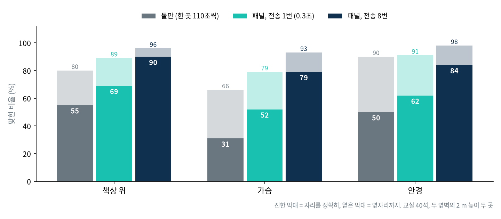
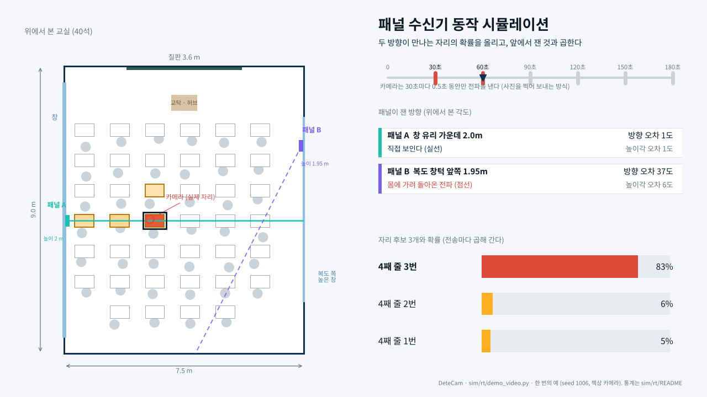
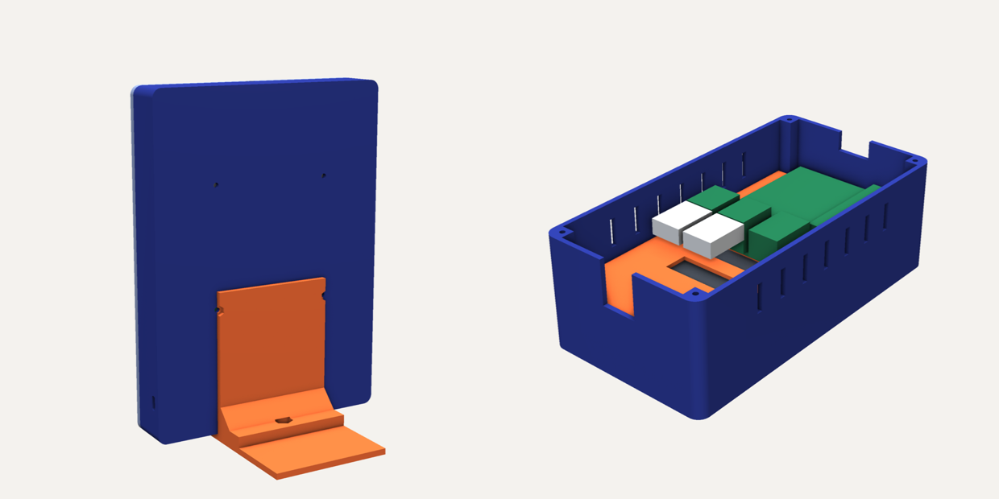

---
tags:
  - DeteCam
  - 검토
고친날: 2026-11-18
---

# 설계 검토: 돌판에서 패널로 (수신기 v3)

2026-11-17 기준. 전부 전파 경로 계산(Sionna RT)과 모델 계산으로 본 것이다. 실물로 확인해야 하는 것은 [12절](#12-남은-위험과-관문)에 모았다. 돌판 수신기(v2)의 설계와 검토, 코드는 [receiver-legacy](https://github.com/DeteCam/receiver-legacy) 저장소(태그 `plate-v2`)로 옮겼다. 2026-11-18 에 카메라를 일곱 배로 늘려 다시 센 숫자로 1·5·6절의 표를 고쳤다 ([사각지대](사각지대.md)).


## 1. 한눈에

| 물음 | 답 |
|---|---|
| 왜 두 곳으로는 자리를 못 잡았나 | 돌판은 직접 보이는 카메라의 방향도 9도쯤 틀린다. 자리 간격 1 m 를 두 곳에서 가르려면 2~3도가 필요하다 |
| 무엇으로 바꿨나 | 안테나 16개가 달린 15 cm 판(패널). 전자 스위치로 안테나를 바꿔 가며 0.3초에 방향을 잰다. 모터가 없다 |
| 어디에 두나 | 패널 둘을 마주 보는 두 옆벽(창 유리 앞쪽, 복도 쪽 창턱 앞쪽. 칠판 쪽 벽에서 2.5 m)의 2 m 높이에 걸어 둔다. 옮기지 않는다. 스탠드가 필요 없다. 2026-11-18 에 창 쪽을 가운데에서 앞쪽으로 옮겼다: 사진을 16장 넘게 보내면 평균 91%, 가장 약한 자리 70% (가운데에 걸면 87%, 23%. [배치 계산](배치%20계산.md)) |
| 얼마나 맞나 (교실 40석) | 한 번 재면 책상 위 69%, 가슴 52%, 안경 62%. 카메라가 여덟 번 보내는 동안 모으면 90%, 79%, 84% (옆자리까지는 93~98%). 창가 쪽 앞 두 줄이 가장 약하다 ([사각지대](사각지대.md)) |
| 사진만 가끔 보내는 카메라 | 돌판은 방향을 못 잰다. 패널은 전송 한 번(0.5초)마다 한 번 잰다 |
| 소음 | 움직이는 부품이 없다 |
| AI 는 | 물리 모델에 작은 신경망을 곱하면 책상 위 +3점, 가슴·안경 +9~10점이다. 다만 그 교실의 모형으로 가르쳐야 해서 실물을 본 뒤에 더한다 |
| 몰카(숙소 방)도 찾나 | 같은 패널 하나를 방 가운데에서 다섯 쪽으로 돌려 재면 가운데값 0.26 m, 창턱과 현관 통로에서 더 재면 0.21 m (50 cm 안 89%) 다 ([숙소 방 계산](숙소%20방%20계산.md)) |
| 아직 모르는 것 | ESP32-C5 가 ACK 의 CSI 를 내는지, 세기만으로 위상이 실물에서 되찾아지는지. 사기 전에 확인할 수 있는 것은 확인했고 걸리는 것이 없었다 ([사전 검증](사전%20검증.md)). 부품은 싼 것부터 다섯 번에 나눠 사서 확인한다. 안 되어도 돌판으로 돌아가지 않는다. 받는 쪽만 수신 체인이 둘인 Wi-Fi 카드로 바꾼다 ([되는지 근거와 대안](되는지%20근거와%20대안.md)) |



## 2. 무엇이 정확도를 막았나

조건은 이렇다. 칠판은 1.2 × 3.6 m 이고, 2.4 m 스탠드는 쓸 수 없고, 감독관이 수신기를 옮기는 곳은 둘 이하다. 이 조건에서 돌판 수신기를 다시 계산했다 (교실 40석, 사람 40명, 손이 닿는 높이).

| 돌판을 둔 곳 (한 곳에 110초) | 책상 위 | 가슴 | 안경 |
|---|---|---|---|
| 칠판 위 두 끝 | 21 / 49 | 29 / 57 | 32 / 84 |
| 두 옆벽 가운데 | 55 / 80 | 31 / 66 | 50 / 90 |
| 칠판 위 가운데 + 두 옆벽 (세 곳) | 57 / 85 | 42 / 78 | 59 / 95 |
| (견줌) 여섯 곳, 2.4 m 스탠드 | 90 / 98 | 56 / 83 | 79 / 89 |

숫자는 자리를 정확히 / 옆자리까지 맞힌 비율(%)이다. 원인을 하나씩 떼어 보았다.

1. **기하는 문제가 아니다.** 방향을 1도로 안다고 치면 칠판 위 두 곳만으로 99% 를 맞힌다. 2도면 79%, 3도면 64%, 5도면 46%, 8도면 29% 다.
2. **돌판은 방향이 거칠다.** 한 곳에서 잰 방향의 오차(가운데값)가 직접 보일 때 8.6도, 가려졌을 때 39도다. 여섯 곳은 이 오차를 평균으로 지우는 방법이었다.
3. **절반은 가려져 있다.** 손이 닿는 높이에서 카메라가 직접 보이는 비율은 55% 다. 앉은 사람의 몸이 가린다. 직접파가 없으면 가장 센 반사를 카메라로 본다.
4. **앞에서는 책상 위가 안 보인다.** 칠판 쪽에서 보면 책상 위 카메라는 앞사람의 등에 가린다. 옆벽에서는 책상 줄 사이로 보인다. 가슴과 안경은 반대로 앞에서 잘 보인다.
5. **시간.** 돌판은 한 곳에서 110초 동안 신호가 이어져야 한다 (판 한 바퀴 6.14초 × 18번).

사람 몸이 2.4 GHz 를 얼마나 가리는지는 [Januszkiewicz 2018](https://doi.org/10.3390/s18103412), [Chen 외 2023](https://doi.org/10.1109/ACCESS.2023.3301339)이 재고 모형을 만들었다.

## 3. 견준 방법들

같은 전파 길 위에서 받는 쪽만 바꿔 견줬다 (`sim/rt/rt_study.py`). 숫자는 책상 위 카메라의 자리를 정확히 / 옆자리까지 맞힌 비율이다.

| 방법 | 방향 오차 (직접 보일 때) | 칠판 위 두 끝에서 | 가장 좋은 두 곳에서 | 본 것 |
|---|---|---|---|---|
| 돌판 (지금까지) | 8.6도 | 21 / 49 | 55 / 80 | 거칠고 느리다 |
| 안테나 8개를 둥글게 (지름 16 cm) | 방위각 2.5도, 높이각 6.2도 | 31 / 61 | - | 높이를 못 가른다 |
| 안테나 하나를 돌려 합치기 (반지름 10 cm) | 방위각 1.7도 | 36 / 62 | - | 모터가 남는다 |
| 칠판 테두리에 안테나 12~24개 (3.6 m) | - | 23~27 / 35~43 | - | 책상 위는 앞에서 안 보인다 (안경은 78~90%) |
| 패치 4 × 4, 간격 반 파장 (18 cm) | 방위각 1.2도, 높이각 1.0도 | 54 / 76 | 78 / 96 | 고른 것의 바탕 |
| 패치 8 × 8 (43 cm) | 0.9도 | 60 / 83 | 87 / 95 | 크기를 키워도 가려진 것은 못 고친다 (가려졌을 때 18도 그대로) |
| 반사 방향까지 함께 맞추기 (거울상) | - | +1~3점 | | 이득이 작다 |
| MUSIC (부분공간) | - | 차이 없음 | | 길이 많아 이득이 없다 |

이 표는 사람 자세가 고르고 패널의 자리를 정확히 안다고 본 첫 계산이다. '가장 좋은 두 곳'은 돌판이 두 옆벽, 패치가 앞 모서리와 옆벽이다 (높이 2.2 m).

패치 4 × 4 를 실제로 살 수 있는 보드(간격 37.5 mm 로 어림)와 ESP32 한 대로 바꾸고, 거는 자리와 자세의 오차까지 넣은 결과가 5절과 6절이다.

## 4. 고른 구조: 패널

```
카메라 ~~전파~~>  [패치 안테나 16개] --스위치(16 가운데 1)--+
                  [기준 안테나] --위상 4단(0·90·180·270도)--(합침)--> ESP32-C5 (세기만 잰다) --USB / ESP-NOW--> 허브(파이) --> 폰
```

- **왜 세기만 재나.** ESP32 는 수신 길이 하나라 패킷마다 위상의 기준이 달라진다. 그래서 안테나를 바꿔 가며 잰 위상은 서로 견줄 수 없다.
- **어떻게 위상을 되찾나.** 기준 안테나의 신호 r 과 고른 안테나의 신호 h 를 합쳐 세기를 잰다. 기준 길의 위상을 네 단계로 바꾸면 `(I₀ − I₁₈₀) − j(I₉₀ − I₂₇₀) = 4 r* h` 다. 안테나 16개 × 네 단계 = 패킷 64개다.
- **이것은 새 방법이 아니다.** 광학의 위상 이동 간섭계와 같은 식이다. 위상 배열 안테나를 보정할 때 한 소자의 위상만 돌려 가며 합친 세기를 재는 방법(REV 법, 1982)이 같은 셈을 쓴다. Wi-Fi 로는 [Holl & Reinhard 2017](https://doi.org/10.1103/PhysRevLett.118.183901)이 고정 안테나 하나를 기준으로 두고 움직이는 안테나로 방 안의 Wi-Fi 홀로그램을 찍었다 (그쪽은 수신기 둘로 위상까지 쟀다). 스위치로 안테나를 늘리는 것은 [SWAN (MobiCom 2018)](https://doi.org/10.1145/3241539.3241572)이, 수신 길 하나에 스위치를 다는 것은 블루투스 5.1 방향 찾기가 쓰는 방법이다.
- **안테나 판은 사 온다.** 블루투스 방향 찾기용 보드 [CoreHW CHW1010-ANT2](https://www.corehw.com/products/antenna-array-ant2/)는 150 × 150 mm 에 패치 16개와 16갈래 스위치가 있고 RF 단자가 하나다. ESP32 는 안테나 16개까지 고르는 신호를 낸다 ([ESP-IDF PHY](https://docs.espressif.com/projects/esp-idf/en/stable/api-guides/phy.html)).
- **계산 코드.** `firmware/core/panel.py` 와 검사 `firmware/tests/test_panel.py`. 잡음이 없으면 세기 네 번에서 `r* h` 가 0.3% 안으로 나오고, 위상 단계가 몇 도 틀어져 있어도 스스로 재서 맞춘다.

같은 뜻으로 ESP32 여덟 대의 시계를 묶은 [ESPARGOS](https://arxiv.org/abs/2502.09405)가 있다. 회로가 공개되어 있지 않아 따라 만들 수 없다.

## 5. 어디에 거나

손이 닿는 곳 스무 군데(칠판 윗변, 교탁, 창 유리, 창턱, 문 위, 복도 쪽 창턱, 사물함 위, 삼각대)를 모두 견줬다. 사람들의 자세는 바로 앉은 사람부터 깊이 숙인 사람까지 섞었다.

| 패널을 건 곳 (한 번 잰 것) | 책상 위 | 가슴 | 안경 |
|---|---|---|---|
| 창 유리 가운데 한 곳 | 50 / 80 | 35 / 66 | 38 / 77 |
| 창 유리 가운데 + 복도 창턱 앞쪽 | 69 / 89 | 54 / 81 | 65 / 91 |
| 창 유리 가운데 + 복도 창턱 가운데 | 68 / 87 | 49 / 75 | 58 / 87 |
| 창 유리 앞쪽 + 복도 창턱 앞쪽 | 61 / 85 | 55 / 86 | 68 / 94 |
| 칠판 윗변 가운데 + 창 유리 가운데 | 62 / 85 | 48 / 76 | 65 / 91 |
| 칠판 윗변 가운데 + 창 유리 가운데 + 복도 창턱 앞쪽 (셋) | 73 / 91 | 61 / 88 | 78 / 97 |

카메라 900대(종류마다 300대)를 사람 자세가 다른 여덟 순간에 잰 것이다. 처음 계산(카메라 210대)보다 가슴과 안경이 1~5점 낮게 나왔고, 거는 곳의 순서는 같았다.

- **두 옆벽이 가장 좋다.** 옆 패널은 줄(앞뒤)을, 앞 패널은 칸(좌우)을 잘 가른다. 책상 위 카메라가 옆에서 더 잘 보여서 두 옆벽이 앞 + 옆보다 낫다.
- **옆벽에 못 걸면** 하나를 칠판 윗변에 자석으로 붙인다. 책상 위가 7점쯤 떨어진다.
- **평균이 같아도 자리마다는 다르다.** 지금 거는 곳은 창가 쪽 앞 두 줄이 약하고, 창 쪽 패널을 앞으로 옮기면 그 자리가 나아지는 대신 뒤쪽이 약해진다 ([사각지대](사각지대.md)). 사진을 16장 넘게 모으면 뒤쪽은 메워져, 앞으로 옮긴 쪽이 평균도 약한 자리도 낫다 (91%·70% 대 87%·23%, [배치 계산](배치%20계산.md)).
- **벽 높이와 천장까지 넓혀 찾아도 두 옆벽이다.** 네 벽의 세 높이와 천장, 후보 122곳의 두 곳·세 곳을 모두 견줬다. 천장은 필요 없고, 두 패널을 2.35 m 로 올리면 사진 16장에서 96% 다 ([배치 계산](배치%20계산.md)).
- **벽에 납작하게 붙여도 된다.** 15도 숙여 자리 쪽을 보게 한 것과 벽에 그대로 붙인 것의 차이는 0~7점이다. 가운데 벽에서는 차이가 없다.
- **패널을 키워도 조금만 오른다.** 보드 둘을 이어 붙이면(4 × 8) 책상 위 70 → 72%, 간격을 반 파장으로 넓히면 76% 다. 가려진 것이 한계라서다.

## 6. 계속 재면 오른다

패널은 걸어 둔 채 계속 잰다. 사람들이 자세를 바꾸면 가려졌던 카메라가 보이는 순간이 온다. 카메라가 보낼 때마다 잰 것을 곱해 간다.


| 모은 횟수 | 교실 40석, 패널 둘 | 교실 40석, 패널 셋 | 강의실 72석, 패널 둘 | 강의실 72석, 패널 셋 |
|---|---|---|---|---|
| 1번 | 69 · 52 · 62 | 73 · 61 · 78 | 56 · 45 · 63 | 63 · 57 · 76 |
| 4번 | 86 · 73 · 79 | 89 · 86 · 96 | 76 · 71 · 81 | 82 · 86 · 93 |
| 8번 | 90 · 79 · 84 | 91 · 89 · 98 | 81 · 80 · 87 | 89 · 94 · 99 |

숫자는 책상 위 · 가슴 · 안경의 자리를 정확히 맞힌 비율(%)이다. 옆자리까지는 교실 패널 둘에서 4번이면 91~97%, 8번이면 93~98%, 패널 셋에서 4번이면 97~100% 다. 강의실(9 × 12 m)은 패널 셋을 권한다.

교실의 숫자는 카메라를 늘려 다시 센 것이다 (패널 둘 1,500대, 셋 900대). 처음 계산(210대)은 1번에 70 · 56 · 70, 8번에 84 · 87 · 90 이었다. 가슴과 안경이 4~9점 높게 나왔던 것이다. 강의실은 아직 처음 계산(카메라 210대)의 숫자다.

조심할 것이 하나 있다. 한 패널이 늘 같은 반사를 보면 곱할수록 틀린 자리로 굳는다. 카메라 여섯 대를 따라가 본 예에서 한 대가 그랬다. 그래서 앱은 자리 하나가 아니라 후보 셋을 보여 준다.

## 7. 사진만 가끔 보내는 카메라

시험지를 찍어 보내는 카메라는 영상을 계속 보내지 않고, 몇십 초마다 사진 한 장(0.2~1초)을 보낼 수 있다.

- **탐지는 된다.** 시험장에서는 전파를 내는 장치가 있다는 것부터 의심 대상이다. 짧은 전송도 엿듣는 채널에 있으면 잡힌다. 라디오가 넷(파이, 동글, 패널 둘)이라 2.4 GHz 의 1·6·11 번을 지키고 하나는 돌아다닌다. 휴대폰 핫스팟은 0.1초마다 신호를 내므로 먼저 잡힌다.
- **돌판은 방향을 못 잰다.** 0.5초는 판이 30도 도는 시간이다. 한 바퀴를 채우려면 전송 열두 번이 필요하고, 그것을 18번 해야 한다.
- **패널은 전송 한 번에 한 번 잰다.** 사진 한 장은 패킷 수십~수백 개다. 64개면 된다. 0.15초로 줄이고 잡음을 열 배 늘려도 결과가 같았다.
- **걸리는 시간.** 30초마다 보내는 카메라면 첫 전송에서 탐지하고, 둘째부터 잰다. 네 번 모으는 데 2분 30초다.
- **깨워서 더 받기.** 카메라가 공유기에 붙은 채 쉬는 방식이면 깨어 있는 틈에 빈 프레임을 보내 응답(ACK)을 받아 더 잴 수 있다 ([Wi-Peep, MobiCom 2022](https://doi.org/10.1145/3495243.3560530)). 실물에서 확인해야 한다. 전원을 끊고 자는 카메라는 깨울 수 없다.



## 8. 속도

| | 돌판 | 패널 |
|---|---|---|
| 한 번 재기 | 110초 (한 곳) | 0.3초 (패킷 64개) |
| 두 곳 | 220초 + 옮기는 시간 | 동시에 0.3초 |
| 계속 보내는 카메라의 첫 자리 후보 | 약 4분 | 1초 안 |
| 30초마다 사진을 보내는 카메라 | 못 잰다 | 60초에 첫 후보, 2분 30초에 네 번 |
| 설치 | 옮길 때마다 자리와 방향을 다시 잡는다 | 시험 전에 한 번 건다 |

## 9. 소음

패널에는 모터도 기어도 없다. 스위치는 반도체다. 허브(파이)에도 팬이 없다.

돌판을 조용하게 만드는 길도 보았다. 모터를 2상 스텝 모터로, 드라이버를 TMC2209(StealthChop)로, 기어를 벨트로 바꾸면 소리는 준다. 그래도 2절의 원인(거친 방향, 110초)은 남는다. 그래서 고르지 않았다.

## 10. AI (배운 모델)

패널이 낸 '후보 점마다의 점수'를 넣으면 자리를 내는 작은 신경망(은닉층 하나)을 가르쳤다. 가르친 자료는 사람 배치 여섯 가지에서 뽑은 13,500번, 시험은 처음 보는 사람 배치 두 가지의 4,500번이다. 한 번 잰 것으로 견줬다.

| 창 유리 가운데 + 복도 창턱 앞쪽 | 책상 위 | 가슴 | 안경 |
|---|---|---|---|
| 물리 모델 (방향 → 자리) | 66 / 87 | 50 / 76 | 66 / 90 |
| 배운 모델만 | 63 / 89 | 59 / 84 | 74 / 96 |
| 물리 모델 × 배운 모델 | 69 / 89 | 59 / 84 | 75 / 95 |
| 패널 셋, 물리 모델 | 73 / 90 | 59 / 84 | 77 / 95 |
| 패널 셋, 물리 모델 × 배운 모델 | 76 / 94 | 69 / 91 | 87 / 98 |

- **둘을 곱하면 모두 오른다.** 책상 위 +3점, 가슴 +9~10점, 안경 +9~10점이다. 배운 모델은 '가려졌을 때 전파가 어느 반사로 오는지'를 그 교실에서 익힌다.
- **자료가 적으면 해롭다.** 2,700번으로 가르쳤을 때는 책상 위가 8점 떨어졌다.
- **그 교실의 모형이 있어야 한다.** 다른 교실에서는 그 교실의 치수로 전파 계산을 다시 해서 가르친다 (자료 18,000번을 만드는 데 2분, 가르치는 데 몇 분).
- **순서.** 물리 모델로 먼저 만들고, 실물에서 계산과 실측이 맞는 것을 본 뒤에 더한다. 6절의 '모으기'와 함께 쓴 결과는 아직 없다.
- 견줄 논문은 [DLoc (MobiCom 2020)](https://wcsng.ucsd.edu/dloc)이다. 방의 반사 자체를 이용해 세기만으로 위치를 찾는 길은 [del Hougne 외 2021](https://doi.org/10.1103/PhysRevLett.127.043903)이 보였다.

## 11. 패널의 자세

앱이 패널의 자리와 방향을 알아야 한다. 앞덮개의 AR 마커를 폰으로 비춰 잡는다. 방향이 틀리면 그만큼 자리가 밀린다.

| 패널 방향의 오차 | 책상 위 | 가슴 | 안경 |
|---|---|---|---|
| 0.5도 | 74 / 90 | 61 / 81 | 74 / 94 |
| 2도 (처음 계산, 카메라 210대) | 70 / 90 | 56 / 81 | 70 / 93 |
| 4도 | 62 / 90 | 47 / 82 | 58 / 92 |

이 표는 처음 계산(카메라 210대)끼리 견준 것이라 다른 표보다 몇 점 높다. 오차가 커질 때 얼마나 떨어지는지를 보는 표다.

패널끼리는 서로 직접 보인다 (둘 다 머리 위 높이). 한 패널이 보낸 신호를 다른 패널이 재면 자기 방향을 스스로 맞출 수 있다. 장치 코드에 넣을 일이다.

## 12. 남은 위험과 관문

패널 구조는 두 가지가 실물에서 되어야 선다: ESP32-C5 가 응답(ACK)의 CSI 를 내는가, 세기만으로 위상이 되찾아지는가. 사기 전에 확인할 수 있는 것은 모두 확인했고 걸리는 것이 없었다 ([사전 검증](사전%20검증.md)). 그래도 부품은 싼 것부터 다섯 번에 나눠 사고, 앞 관문을 통과해야 다음 것을 산다.

| 관문 | 사는 것 (값) | 실험 | 통과 기준 | 안 되면 |
|---|---|---|---|---|
| 1 | ESP32-C5 2 (3.0만 원) | 다른 기기의 ACK 에서 CSI 를 낸다 (`dump_ack_en`). 세기가 고르다 ([esp_csi_gain_ctrl](https://components.espressif.com/components/espressif/esp_csi_gain_ctrl)) | ACK 의 80% 이상에서 CSI. 이어진 패킷의 진폭 차 0.5 dB 안 | 카메라가 보내는 프레임만 쓴다 (전송 중에만 잰다) |
| 2 | 합침기, 선, 변환 단자 (3.6만 원) | 안테나 둘 + 위상 네 단계(선을 손으로 바꿔)로 위상 차이가 되찾아진다 | 송신기를 20도씩 옮기면 위상이 따라온다. 오차 15도 안 | 이득 고정·세 번 재기를 넣어 다시 본다. 그래도 안 되면 받는 쪽을 AX210(수신 체인 둘)으로 바꾼다. 패널은 그대로 ([되는지 근거와 대안](되는지%20근거와%20대안.md)) |
| 3 | RF 스위치 2, 짧은 선 1 (5.3만 원) | 스위치로 네 단계를 자동으로 | 손으로 잰 것과 10도 안. 패킷 64개에 0.5초 안 | 느리게 잰다 |
| 4 | 안테나 보드 1 과 첫 패널의 재료 (15.4만 원) | 보드 16개로 아는 자리의 송신기 방향. 교실에서 자리 | 직접 보일 때 6도 안. 옆자리까지 70% 이상 | 보정표를 만든다 |
| 5 | 둘째 패널, 동글, 나머지 (26.7만 원) | 패널 둘로 자리 | [데모 환경](데모%20환경.md)의 기준 | - |

그 밖의 위험.

- 보드의 패치 간격, 뒷면 부품 높이, RF 단자 규격(MCRF)은 요약서에 없다. 받은 뒤 재서 `cad/model/panel.py` 의 [실측] 값을 고친다.
- 보드는 2400~2483 MHz 용이다. 5 GHz 로만 보내는 카메라는 탐지만 한다. 지금 판으로는 위치 재기를 막는다 (재면 엉뚱한 자리가 나온다, [다른 방법 검토](다른%20방법%20검토.md) 5.6절). 자리까지는 두 대역 판(필수 2단계, 스펙 008)이 있어야 한다 ([작품 범위](작품%20범위.md)).
- 블루투스로 폰에 보내는 AI 안경, LTE 로 직접 보내는 카메라는 범위 밖이다. 같은 2.4 GHz 보드로 블루투스 방향 찾기를 더할 수는 있다. 이것들을 '있다'는 것만이라도 알리는 방법(SDR 로 휴대폰의 LTE·5G 송신 세기 재기, 부정행위 사슬 겹치기)은 [전파 넓히기 검토](https://github.com/DeteCam/docs/blob/main/research/전파%20넓히기%20검토.md)에 있다. 2026-11-18 에 범위를 정했다: 휴대폰 송신 경보(RTL-SDR)를 권장으로 넣고([스펙 007](../specs/007-phone-uplink-alarm/spec.md), 관문 6), 블루투스 · LTE 기기의 자리는 범위 밖에 둔다 ([작품 범위](작품%20범위.md)).
- 다른 사람의 기기에 빈 프레임을 보내 응답을 받는 일은 써도 되는지 따로 검토해야 한다.
- 숙소 방에서는 패널 하나를 방 가운데에서 다섯 쪽으로 돌려 재면 가운데값 0.26 m, 창턱과 현관 통로에서 더 재면 0.21 m 다 ([숙소 방 계산](숙소%20방%20계산.md)). 손에 들고 재려면 패널의 뒷면에도 마커가 있어야 한다.

## 13. 기계

| | 값 |
|---|---|
| 패널 크기 | 165 × 225 × 38 mm (자석 걸이판까지) |
| 패널 무게 | 뽑는 부품 284 g + 보드·RF 모듈·배터리 = 약 0.64 kg (어림) |
| 허브 크기 | 165 × 87 × 59 mm |
| 출력 | 다섯 판, 약 22시간, 필라멘트 약 0.8 kg (패널 둘 + 허브). 받침 없이 뽑는다 |
| 겹침 | 뽑는 부품과 사 오는 부품의 모형 사이에 겹침 0 (`cad/checks/panel_check.py`) |
| 출력 검사 | 다섯 판 모두 문제 0 (`print/print_check.json`): 판 안, 금지 구역 밖, 허공에 찍는 곳 없음 |
| 보드 잡기 | 둘레 턱에 얹고 앞덮개가 누른다. 보드 끝 2.5 mm 만 닿는다. 보드에 구멍이 없어도 된다 |
| 패치 앞 | 빈틈 3 mm, 덮개 살 1.2 mm |
| 칠판에 붙이기 | 자석(지름 20 × 3) 4개. 칠판은 철판이 얇아 당기는 힘을 판매처 값의 절반으로 보면 미끄러지지 않는 무게가 1.2~1.8 kg 이다. 패널의 1.9~2.8배다. 실물에서 확인한다 |
| 세우기 | 받침 발 위에서 앞으로 19도, 뒤로 40도, 옆으로 21도까지 넘어지지 않는다 (`cad/results/panel_check.json`) |



## 14. 계산의 한계

- 사람은 팔각 기둥 몸통과 머리로 만든 모형이다. 팔, 책, 가방은 없다.
- 벽과 책상은 ITU 재질 값이다. 회절은 한 번까지 본다.
- 패치는 모두 같고 무늬는 cos 꼴이다. 안테나끼리의 간섭, 스위치 손실(2.7 dB)은 넣지 않았다. 보정하고 남는 오차는 위상 5도, 세기 0.5 dB 로 두었다.
- '모은 횟수'는 사람 40명의 자세를 매번 새로 뽑은 것이다. 실제로는 자세가 천천히 바뀌므로 같은 효과를 보려면 시간이 더 든다.
- 통계는 카메라 560대 × 종류 셋이다. 5점 안쪽의 차이는 읽지 않는다.

## 15. 바탕 자료

| 무엇 | 자료 |
|---|---|
| 세기만 재서 소자마다의 위상 구하기 (REV 법) | Mano, Katagi. Electron. Commun. Jpn. B 65(5), 58–64 (1982) · Takahashi 외. IEEE Trans. Antennas Propag. 60(7) (2012) · He 외. Int. J. Antennas Propag. 2019, 6432149 |
| 기준 안테나를 두고 Wi-Fi 전파의 모양 찍기 | Holl, Reinhard. *Holography of Wi-fi Radiation.* Phys. Rev. Lett. 118, 183901 (2017). [doi](https://doi.org/10.1103/PhysRevLett.118.183901) |
| ESP32-C5 의 ACK CSI 시험 보고 | [ESP-IDF 이슈 19062](https://github.com/espressif/esp-idf/issues/19062) |
| 방의 반사를 이용한 위치 찾기 (세기만, 신경망) | del Hougne 외. *Deeply Subwavelength Localization with Reverberation-Coded Aperture.* Phys. Rev. Lett. 127, 043903 (2021). [doi](https://doi.org/10.1103/PhysRevLett.127.043903) |
| 스위치로 안테나 늘리기 | Xie 외. *SWAN: Stitched Wi-Fi ANtennas.* MobiCom 2018. [doi](https://doi.org/10.1145/3241539.3241572) |
| ESP32 여러 대의 위상 맞추기 | Euchner 외. *ESPARGOS.* [arXiv:2502.09405](https://arxiv.org/abs/2502.09405), [arXiv:2408.16377](https://arxiv.org/abs/2408.16377) |
| 빈 프레임으로 응답 받기 | Abedi, Abari. *WiFi Says "Hi!" Back to Strangers!* HotNets 2020. [doi](https://doi.org/10.1145/3422604.3425951) · Abedi, Vasisht. *Wi-Peep.* MobiCom 2022. [doi](https://doi.org/10.1145/3495243.3560530) |
| 배운 모델로 위치 찾기 | Ayyalasomayajula 외. *Deep Learning based Wireless Localization for Indoor Navigation (DLoc).* MobiCom 2020. [누리집](https://wcsng.ucsd.edu/dloc) |
| 사람 몸이 가리는 정도 (2.4 GHz) | Januszkiewicz. Sensors 18(10), 3412 (2018). [doi](https://doi.org/10.3390/s18103412) · Chen 외. IEEE Access (2023). [doi](https://doi.org/10.1109/ACCESS.2023.3301339) |
| 돌판으로 방향 찾기 (앞선 구조의 바탕) | DiffLoc (USENIX Security 2025), CamLoPA (IEEE S&P 2025), LocCams |
| 안테나 보드와 스위치 | [CoreHW CHW1010-ANT2 요약서](https://www.corehw.com/CHW1010-ANT2-Product-Brief.pdf), [DigiKey](https://www.digikey.com/en/product-highlight/c/corehw/chw1010-ant-antenna-arrays) |
| ESP32 의 안테나 고르기, 수신 이득 | [ESP-IDF PHY](https://docs.espressif.com/projects/esp-idf/en/stable/api-guides/phy.html), [esp_csi_gain_ctrl](https://components.espressif.com/components/espressif/esp_csi_gain_ctrl) |

계산을 다시 돌리는 법은 [sim/rt/패널 연구](../sim/rt/패널%20연구.md)에 있다.
