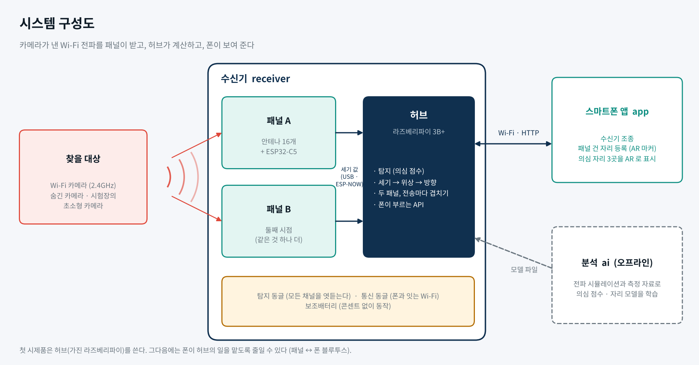
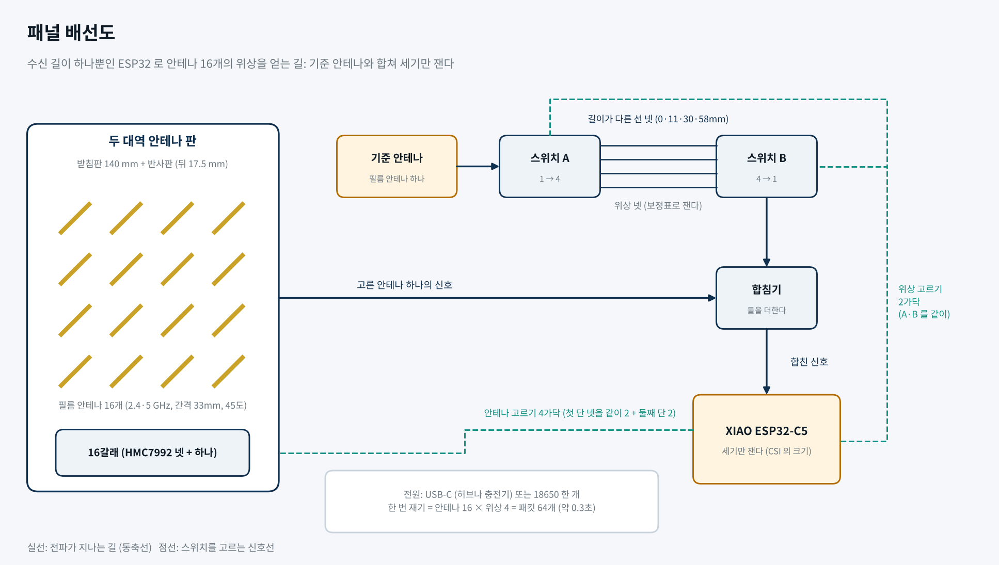
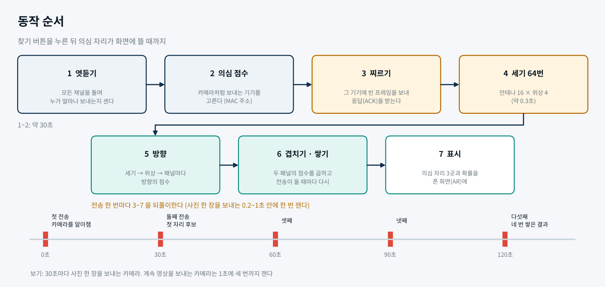
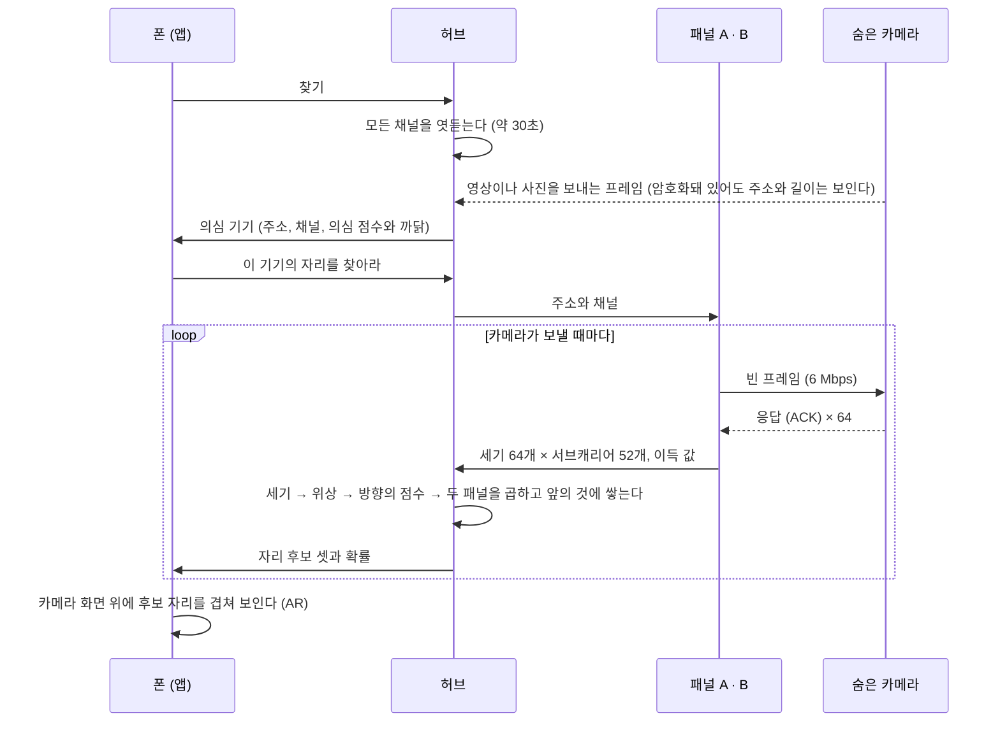
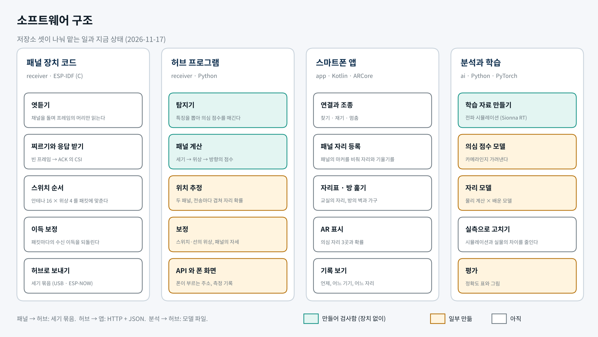
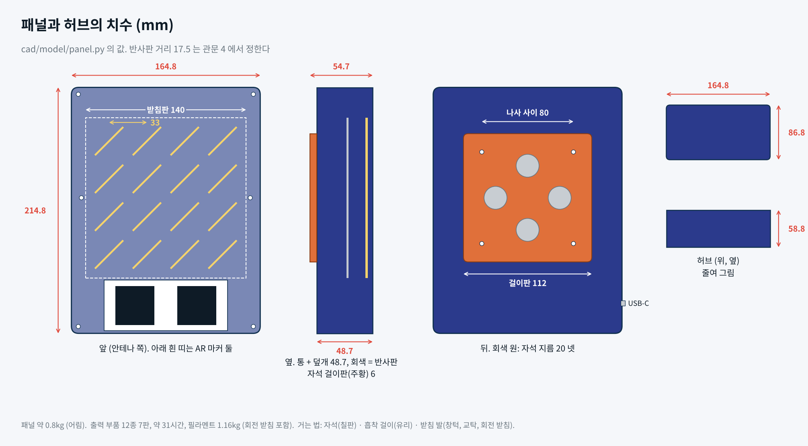
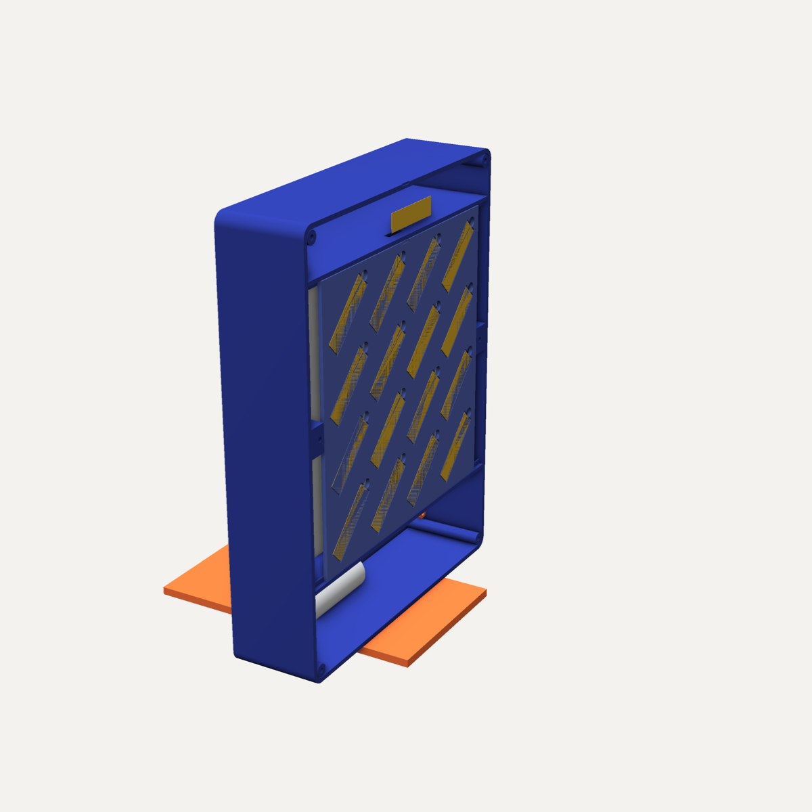
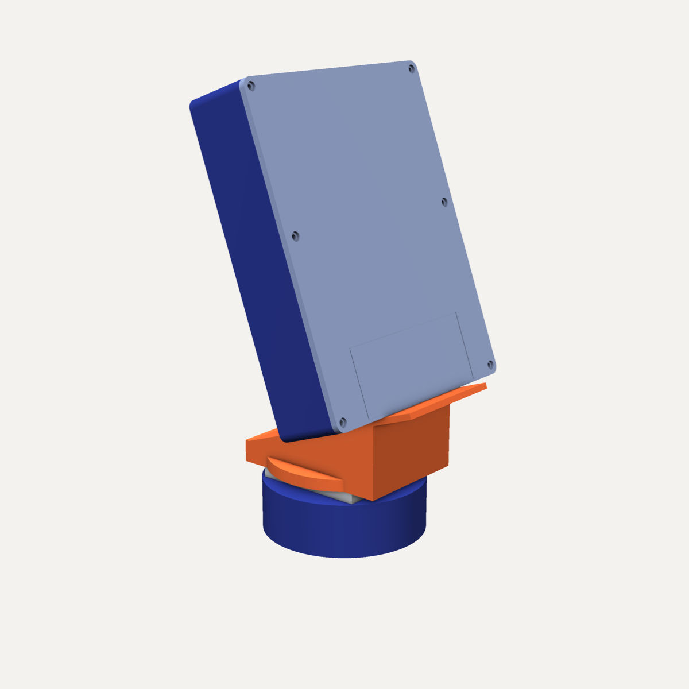

---
tags:
  - DeteCam
  - 설계
고친날: 2026-11-19
---

# 설계도

> **2026-11-19 바뀜.** 안테나 판을 사 오는 2.4 GHz 판(CoreHW CHW1010-ANT2)에서 직접 만드는 두 대역 판(필름 안테나 16개 + HMC7992 스위치)으로 바꿨다 ([작품 범위](작품%20범위.md), [스펙 008](../specs/008-dual-band-panel/spec.md)). 배선과 치수는 새 판에 맞춰 고쳤다. 숙소에서 쓰는 회전 받침도 더했다.

무엇을 만드는지를 그림 다섯 장으로 보인다: 시스템 구성, 패널 배선, 동작 순서, 소프트웨어 구조, 치수. 왜 이렇게 정했는지는 [설계 검토](설계%20검토.md)에, 사기 전에 확인한 것은 [사전 검증](사전%20검증.md)에 있다.

## 1. 시스템 구성



| 덩어리 | 하는 일 | 무엇으로 | 저장소 |
|---|---|---|---|
| 패널 (둘) | 고른 기기가 보내는 전파의 방향을 잰다. 안테나 16개를 전자 스위치로 바꿔 가며 세기만 잰다 | 필름 안테나 17, HMC7992 스위치 일곱, 합침기, 반사판, XIAO ESP32-C5 | receiver |
| 허브 | 둘레의 Wi-Fi 를 엿들어 의심 기기를 고른다. 패널이 잰 세기로 방향과 자리를 셈한다. 폰에 결과를 준다 | 라즈베리파이 3B+, 동글 둘, 보조배터리 (가진 것) | receiver |
| 스마트폰 앱 | 수신기를 조종한다. 패널의 마커를 비춰 패널이 걸린 자리를 알려 준다. 의심 자리를 카메라 화면 위에 겹쳐 보여 준다 | 안드로이드, Kotlin, ARCore | app |
| 분석 | 전파 시뮬레이션과 측정 자료로 의심 점수와 자리 모델을 가르친다. 수신기에는 모델 파일만 넣는다 | Python, PyTorch, Sionna RT | ai |

전파와 자료가 가는 길.

```
카메라 ──전파──▶ 패널 A, B ──세기 묶음 (USB · ESP-NOW)──▶ 허브 ──자리 후보 (Wi-Fi · HTTP)──▶ 폰
                                                         ▲
                                           탐지 동글이 엿들은 프레임
```

**허브가 꼭 있어야 하나.** 아니다. 허브가 하는 일은 넷이다: 엿듣기, 셈, 폰과의 통신, 패널 둘을 묶기. ESP32-C5 는 2.4 와 5 GHz 를 다 듣고 블루투스가 있어서, 엿듣기는 패널이 하고 셈은 폰이 하게 옮길 수 있다. 그래도 첫 시제품은 허브를 쓴다. 가진 라즈베리파이라 돈이 들지 않고, 탐지와 폰 화면의 코드가 이미 있고, 패널의 코드를 고칠 때마다 폰 앱까지 고치지 않아도 되기 때문이다. 패널이 실물에서 된 뒤에 허브를 뺀다.

| 구성 | 들고 다닐 것 | 언제 |
|---|---|---|
| 패널 둘 + 허브 + 폰 | 패널 2, 허브 1 | 첫 시제품, 교실 데모 |
| 패널 하나 + 허브 + 폰 | 패널 1, 허브 1 | 숙소 방 데모 |
| 패널 + 폰 (허브 없음) | 패널 1~2 | 패널이 된 뒤. 패널 ↔ 폰은 블루투스 |

## 2. 패널 배선



수신 길이 하나뿐인 ESP32 는 안테나를 바꿔 가며 받은 위상을 서로 견줄 수 없다 (패킷마다 위상의 기준이 다르다). 그래서 **기준 안테나의 신호와 고른 안테나의 신호를 합쳐 세기만** 잰다. 기준 길의 위상을 네 단계로 바꾸면 세기 넷에서 위상이 나온다.

| 선 | 가닥 | 어디서 어디로 | 하는 일 |
|---|---|---|---|
| 첫 단 고르기 | 2 | ESP32 → 첫 단 스위치 넷 (같이) | 넷씩 묶인 안테나에서 몇 번째를 받을지 고른다 |
| 둘째 단 고르기 | 2 | ESP32 → 둘째 단 스위치 | 첫 단 넷 가운데 하나를 고른다. 둘을 합쳐 16개 가운데 하나 |
| 위상 고르기 | 2 | ESP32 → 스위치 A 와 B (같이) | 선 넷 가운데 하나를 고른다 |
| 전파 길 (동축) | - | 기준 안테나 → 스위치 A → 선 넷 → 스위치 B → 합침기 ← 둘째 단 ← 첫 단 ← 안테나 16, 합침기 → ESP32 | 두 신호를 더해 ESP32 로 |
| 전원 | 2 | USB-C 또는 18650 → ESP32 → 스위치 일곱 (3.3 V) | |

- ESP32 의 핀은 여섯 개를 쓴다. 부팅 때 쓰이는 핀을 피해서 장치 코드를 쓸 때 정한다.
- 한 번 재기 = 안테나 16 × 위상 4 = 패킷 64개, 약 0.3초.
- 위상선 넷은 0 · 11 · 30 · 58 mm 다. 2.4 GHz 와 5 GHz 에서 모두 위상 넷이 고루 갈리도록 고른 길이다. 정확하지 않아도 된다. 실제 위상은 장치가 스스로 재서 보정표에 적는다 (관문 4). 5 GHz 로 자리를 재는 것은 세 채널의 보정이 끝날 때까지 잠가 둔다.
- 필름 안테나는 받침판에 45도로 눕혀 붙인다. 이웃과 겹치지 않고, 카메라 안테나가 어느 쪽으로 누웠든 고루 받는다. 뒤 17.5 mm 에 반사판을 두어 뒤쪽 전파를 막는다 (15~20 mm 사이에서 관문 4 에 정한다).
- 단자의 암수: 스위치와 합침기 모듈은 SMA 암, 선은 SMA 수. 필름 안테나와 XIAO 는 U.FL 이라, U.FL 잭을 SMA 수로 바꾸는 변환 단자를 끼워 스위치에 꽂는다.

## 3. 동작 순서





| 단계 | 걸리는 시간 | 누가 |
|---|---|---|
| 엿듣기와 의심 점수 | 약 30초 (채널 13개 + 5 GHz) | 허브 |
| 한 번 재기 | 0.3초 (뛴 묶음을 버리고 다시 재면 0.4초) | 패널 |
| 방향과 자리 셈 | 0.1초 안 | 허브 |
| 쌓기 | 카메라가 보낼 때마다. 계속 보내는 카메라는 1초에 세 번까지 | 허브 |

응답(ACK)을 받아 재는 길이 막히면 카메라가 스스로 보내는 프레임으로 잰다. 그때는 '빈 프레임'과 '응답' 두 줄이 빠진다.

## 4. 소프트웨어 구조



부품을 잇는 것보다 소프트웨어가 훨씬 많다. 덩어리 넷, 일 스무 가지다.

### 4.1 패널 장치 코드 (ESP32-C5, C, ESP-IDF). 아직 없다

| 일 | 무엇을 하나 | 어려운 점 |
|---|---|---|
| 엿듣기 | 채널을 돌며 프레임의 머리(주소, 길이, 종류, 속도, 세기)만 읽어 0.5초 칸마다 기기별로 센다 | 채널을 도는 동안 놓치는 것 |
| 찌르기와 응답 받기 | 고른 기기에 6 Mbps 빈 프레임을 보내고 응답의 CSI 를 받는다 | 응답은 10~16 µs 뒤에 온다. 보내기 전에 스위치가 자리를 잡아야 한다 |
| 스위치 순서 | 안테나 16 × 위상 4 를 패킷마다 바꾸고, 어느 패킷이 어느 조합인지 짝을 맞춘다 | 한 패킷이라도 밀리면 전체가 틀어진다 |
| 이득 보정 | 패킷마다의 수신 이득 값을 읽어 세기를 되돌린다. 뛴 묶음은 버리고 다시 잰다 | 칩이 알려 주는 값이 얼마나 맞는지 |
| 허브로 보내기 | 세기 묶음을 USB 나 ESP-NOW 로 보낸다. 명령(주소, 채널, 시작, 멈춤)을 받는다 | 패널 둘의 시각 맞추기 |

### 4.2 허브 프로그램 (라즈베리파이, Python). 반쯤 있다

| 일 | 무엇을 하나 | 지금 |
|---|---|---|
| 탐지기 | 엿들은 것에서 특징을 뽑아 기기마다 의심 점수와 까닭을 낸다. 새로 나타났나, 올려 보내는 양, 보내는 무늬(꾸준히, 주기로, 터지듯), 핫스팟에 붙었나 | 만들어 검사함 (`pi/detect.py`, `core/score.py`) |
| 패널 계산 | 세기 넷 → 위상 → 안테나 16개의 값 → 방향마다의 점수 | 만들어 검사함 (`core/panel.py`) |
| 위치 추정 | 자리마다(교실) 또는 겉면의 점마다(방) 두 패널의 점수를 곱하고, 전송마다 쌓아 후보 셋을 낸다. 등진 쪽은 버린다 | 계산은 `sim/rt` 에 있다. 허브로 옮겨야 한다 |
| 보정 | 위상 단계의 실제 값, 안테나마다의 길이 차, 패널의 자세(마커), 패널끼리 서로 재서 방향 맞추기 | 마커 계산만 있다 |
| API 와 폰 화면 | 폰이 부르는 주소, 측정 기록, 앱이 없을 때 쓰는 웹 화면 | 새로 쓴다. 돌판 때의 것(`node.py`, `web.html`)은 receiver-legacy 에 있어 참고한다 |

### 4.3 스마트폰 앱 (안드로이드, Kotlin, ARCore). 아직 없다

| 일 | 무엇을 하나 |
|---|---|
| 연결과 조종 | 허브의 Wi-Fi 에 붙어 찾기, 재기, 멈춤을 시킨다. 의심 기기의 목록과 까닭을 보인다 |
| 패널 자리 등록 | 패널의 마커를 비춰 패널의 자리와 기울기를 방 좌표로 구해 허브에 준다 |
| 자리표와 방 훑기 | 교실은 줄과 칸을 넣어 자리표를 만든다. 방은 벽과 천장을 훑어 겉면을 잡는다 |
| AR 표시 | 후보 세 곳을 카메라 화면 위에 확률과 함께 겹쳐 보인다. 교실은 자리에, 방은 벽의 점에 |
| 기록 | 언제, 어느 기기를, 어디로 짚었는지 남긴다 |

### 4.4 분석과 학습 (Python, PyTorch). 일부 있다

| 일 | 무엇을 하나 | 지금 |
|---|---|---|
| 학습 자료 만들기 | 교실과 방을 전파 경로 계산으로 만들고, 사람의 자세와 카메라의 자리를 바꿔 가며 잰 값을 만든다 | 있다 (`sim/rt`) |
| 의심 점수 모델 | 손으로 정한 점수를 배운 모델로 바꾼다 (작은 모델. 까닭을 보여 줄 수 있어야 한다) | 규칙만 있다 |
| 자리 모델 | 물리 계산의 점수에 배운 모델의 점수를 곱한다. 가려진 카메라가 어느 반사로 보이는지를 익힌다 | 계산으로 +3~10점을 봤다 |
| 실측으로 고치기 | 실물에서 몇 자리만 재서 계산과 실물의 차이를 줄인다 | 아직 |
| 평가 | 정확도 표와 그림을 낸다 | 있다 |

### 4.5 덩어리 사이의 약속

| 사이 | 무엇이 오가나 |
|---|---|
| 패널 → 허브 | 세기 묶음: 패널 번호, 시각, 대상의 주소, 채널, 패킷 64개마다 (안테나, 위상 단계, 이득 값, 서브캐리어 52개의 세기) |
| 허브 → 패널 | 대상의 주소와 채널, 시작, 멈춤, 엿듣기 |
| 허브 ↔ 앱 | HTTP 와 JSON. `GET /api/status`(상태, 기기 표, 패널 표), `POST /api/watch`(점검 시작), `POST /api/target`(자리를 찾을 기기), `POST /api/pose`(패널의 자리), `POST /api/seats` 와 `/api/room`(자리표, 방), `POST /api/locate`(재기 시작·멈춤), `GET /api/top`(후보 셋), `POST /api/stop`. 자세한 것은 [주소 계약](https://github.com/DeteCam/app/blob/main/docs/주소%20계약.md) |
| 분석 → 허브 | 모델 파일 (의심 점수의 가중치, 자리 모델) |

## 5. 치수



| 것 | 값 |
|---|---|
| 패널 (통 + 덮개) | 164.8 × 214.8 × 48.7 mm, 걸이판을 달면 두께 54.7, 약 0.8 kg (어림) |
| 안테나 | 필름 안테나 16개 (Molex 146153, 34.9 × 9 mm), 간격 33 mm, 45도, 받침판 140 × 140 |
| 반사판 | 알루미늄 140 × 140, 안테나 면 뒤 17.5 mm [관문 4] |
| 통 속 | 반사판 뒤 24 mm 에 RF 모듈 여덟, 아래 칸에 XIAO 와 18650 |
| AR 마커 | 한 변 34 mm 둘, 앞덮개의 아래 띠 |
| 자석 걸이판 | 112 × 112 × 6 mm, 자석 지름 20 mm 넷, 나사 사이 80 mm |
| 허브 | 164.8 × 86.8 × 58.8 mm |
| 회전 받침 | 받침대 지름 110, 돌림판 20도 기울기, 축 이음쇠, 28BYJ-48 모터(베어링 밑), 75 mm 베어링 [실측]. 패널을 얹으면 높이 약 30 cm, 약 1.1 kg |
| 출력 | 부품 12가지, 일곱 판, 약 31시간, 필라멘트 약 1.16 kg, 받침 없이 (Bambu X1 Carbon, PLA) |





- 치수의 원본은 `cad/model/panel.py` 이고, 그림은 `cad/figures/design_figs.py` 가 그 값을 읽어 그린다.
- [관문 4] 와 [실측] 표시 값은 부품을 받은 뒤 재서 고친다.
- 조립 순서는 [조립 안내](조립%20안내.md), 3D 모습과 조립 영상은 [영상](https://detecam.github.io/receiver/videos/)에 있다.

## 6. 그림을 다시 그리기

```
python3 cad/figures/design_figs.py     # 이 글의 그림 다섯 장과 데모 환경 두 장
```
