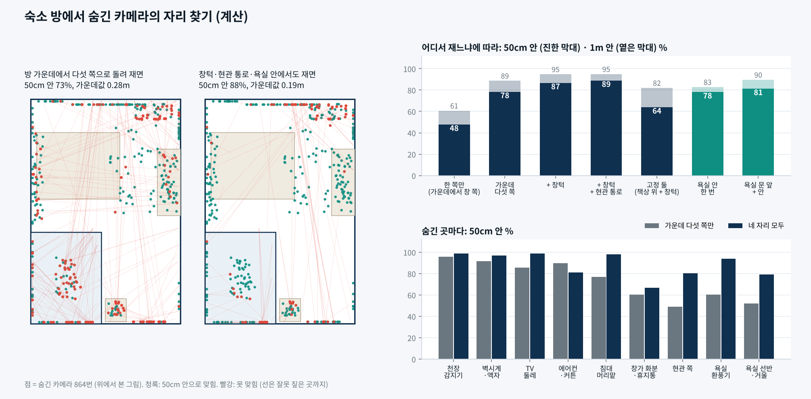
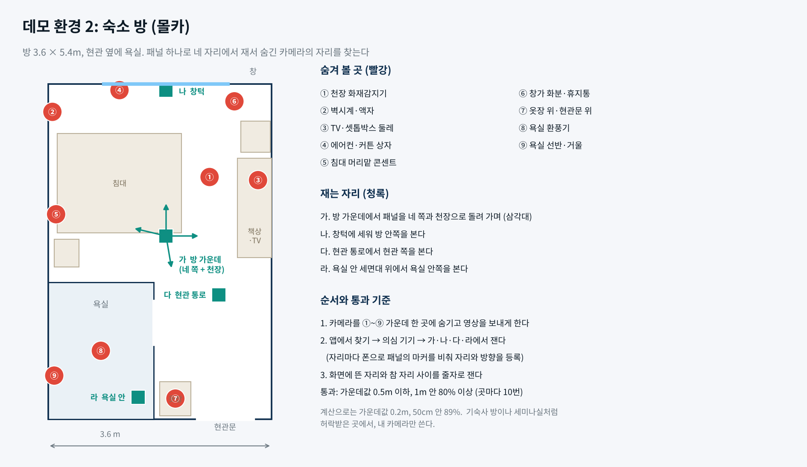

---
tags:
  - DeteCam
  - 검증
  - 몰카
고친날: 2026-11-19
---

# 숙소 방 계산: 숨긴 카메라의 자리를 패널로 찾기

교실에서 자리를 맞히는 것과 같은 패널로, 숙소 방에 숨긴 Wi-Fi 카메라의 자리도 찾을 수 있는지를 전파 경로 계산으로 봤다. 방은 모텔·원룸 크기(3.6 × 5.4 m, 현관 옆에 욕실)이고, 몰카가 흔히 나오는 아홉 곳에 카메라를 864번 숨겼다.

- **방 가운데에서 패널을 다섯 쪽(네 벽과 천장)으로 돌려 재면** 고른 자리와 참 자리의 거리가 가운데값 0.26 m 이고, 78% 가 50 cm 안이다.
- **창턱과 현관 통로에서 한 번씩 더 재면** 0.21 m, 89% 다. 후보 세 곳 가운데 하나가 50 cm 안에 드는 것은 97% 다.
- **욕실은 욕실 안에서 재야 한다.** 욕실 안에서 한 번이면 0.20 m, 78%. 문 앞에서 한 번 더 재면 0.16 m, 81%.
- **한 곳에 세워만 두면 안 된다.** 책상 위 한 곳에서는 0.78 m, 40% 다. 패널은 앞쪽 반만 본다.
- **구석에 고정해 두는 것은 손으로 돌리는 것보다 못하다.** 천장 가까운 구석 둘이면 0.33~0.46 m, 55~67% 다. 구석 넷이어야 0.24 m, 88% 로 손으로 돌리는 것과 같다. 구석은 욕실을 보지 못한다 (`room_study.py table --tag corner`).
- **옛 돌판(도는 알루미늄 판)으로 재도 거의 같다.** 같은 방에서 가운데 한 곳 0.26 m·83%, 세 곳 0.20 m·95% 다 ([8절](#8-돌판과-견줌)).
- 전부 계산이다. 방에 사람과 잡동사니가 없고, 카메라는 물건 속이 아니라 겉면에서 4 cm 뜬 점이다.



## 1. 방과 숨긴 곳



| 것 | 값 |
|---|---|
| 방 | 3.6 × 5.4 × 2.4 m. 콘크리트 벽과 바닥, 석고보드 천장, 창(유리 2.0 × 1.2 m), 나무 현관문 |
| 욕실 | 현관 옆 1.7 × 2.2 m. 벽돌 벽 10 cm, 나무 문(닫음), 거울 |
| 가구 | 침대, 협탁, 책상, 냉장고, TV, 거울, 옷장 |
| 카메라 | 2.4 GHz, 아래 아홉 곳에 곳마다 16개씩, 묶음 셋 × 두 번 = 864번 |
| 고르는 점 | 벽, 천장, 욕실 벽의 안팎, 가구 위의 겉면에 20 cm 간격으로 2,156개. 이 가운데 점수가 가장 높은 점을 고른다 |
| 패널 | 안테나 16개 (교실과 같은 것). 세기만 재서 위상을 되찾는다. 잡음 25 dB |
| 패널의 자세를 아는 정도 | 자리 3 cm, 좌우 2도, 기울기 1.5도 흩어짐 (폰이 마커를 보고 안다고 봄) |
| 전파 경로 | Sionna RT, 반사 세 번까지와 모서리 회절 |

숨긴 곳 아홉 가지.

| 숨긴 곳 | 자리 |
|---|---|
| 천장 화재감지기 | 방 천장 |
| 벽시계·액자 | 벽의 1.5~2.0 m 높이 |
| TV·셋톱박스 둘레 | 책상 위 벽 쪽, 0.8~1.0 m |
| 에어컨·커튼 상자 | 창 위 2.15~2.3 m |
| 침대 머리맡 (콘센트·충전기·스탠드) | 침대 머리 쪽 벽, 0.25~0.95 m |
| 창가 화분·휴지통 | 창가 바닥 쪽, 0.1~0.9 m |
| 현관 쪽 (옷장 위·문 위) | 옷장 위 2.04 m, 현관문 위 2.1~2.3 m |
| 욕실 환풍기 | 욕실 천장 |
| 욕실 선반·거울 둘레 | 욕실 벽 1.1~1.9 m |

## 2. 어디서 재느냐

오차 = 고른 점과 참 자리 사이의 거리.

| 재는 곳 | 찾는 곳 | 가운데값 | 80% 가 이 안 | 30 cm 안 | 50 cm 안 | 1 m 안 | 후보 셋 가운데 50 cm 안 |
|---|---|---|---|---|---|---|---|
| 방 가운데에서 한 쪽만 (창 쪽) | 방 | 0.53 m | 2.76 m | 33% | 48% | 61% | 59% |
| **방 가운데에서 다섯 쪽으로 돌림** | 방 | 0.26 m | 0.54 m | 58% | 78% | 89% | 91% |
| 다섯 쪽 + 창턱 | 방 | 0.23 m | 0.41 m | 66% | 87% | 95% | 94% |
| 다섯 쪽 + 현관 통로 | 방 | 0.24 m | 0.52 m | 62% | 79% | 87% | 94% |
| **다섯 쪽 + 창턱 + 현관 통로** | 방 | 0.21 m | 0.37 m | 71% | 89% | 95% | 97% |
| 책상 위 한 곳에 세워 둠 | 방 | 0.78 m | 3.19 m | 23% | 40% | 54% | 50% |
| 책상 위 + 창턱에 세워 둠 | 방 | 0.34 m | 0.87 m | 44% | 64% | 82% | 80% |
| 창턱 + 현관문 안쪽에 세워 둠 | 방 | 0.46 m | 1.61 m | 36% | 53% | 73% | 73% |
| 책상 위 + 창턱 + 현관문 안쪽 | 방 | 0.27 m | 0.66 m | 54% | 73% | 87% | 87% |
| 욕실 문 앞에서 한 번 | 욕실 | 0.28 m | 0.88 m | 55% | 66% | 83% | 83% |
| 욕실 안에서 한 번 | 욕실 | 0.20 m | 0.63 m | 67% | 78% | 83% | 83% |
| 욕실 문 앞 + 욕실 안 | 욕실 | 0.16 m | 0.44 m | 73% | 81% | 90% | 90% |
| **네 자리 모두 (가운데 다섯 쪽, 창턱, 현관 통로, 욕실 안)** | 방 | 0.20 m | 0.36 m | 71% | 89% | 95% | 97% |
| 같은 것 | 욕실 | 0.17 m | 0.35 m | 74% | 86% | 92% | 91% |

- **돌려야 한다.** 패널은 앞쪽 반만 본다. 한 쪽만 보면 뒤에 있는 카메라는 반사로만 보여 엉뚱한 곳을 짚는다 (80% 가 2.8 m 안).
- **자리를 옮기면 한 번 더 좁혀진다.** 방향 둘이 만나야 거리가 나온다. 가운데에서만 재면 방향은 맞아도 그 줄 위의 어디인지가 흐리다.
- **후보 셋을 보여 주면 91~97% 다.** 앱이 한 곳이 아니라 세 곳을 띄우는 까닭이다.
- 세워 두는 것보다 가운데에서 돌리는 것이 낫다. 세 곳에 세워 둔 것이 73%, 가운데에서 다섯 쪽으로 돌린 것이 78% 다.

## 3. 숨긴 곳마다

가운데값 / 50 cm 안.

| 숨긴 곳 | 가운데 다섯 쪽 | 다섯 쪽 + 창턱 + 현관 통로 | 책상 위 + 창턱 (세워 둠) | 네 자리 모두 |
|---|---|---|---|---|
| 천장 화재감지기 | 0.12 m / 96% | 0.11 m / 99% | 0.16 m / 94% | 0.11 m / 99% |
| 벽시계·액자 | 0.21 m / 92% | 0.18 m / 97% | 0.26 m / 73% | 0.16 m / 97% |
| TV·셋톱박스 둘레 | 0.28 m / 85% | 0.22 m / 99% | 0.35 m / 67% | 0.21 m / 99% |
| 에어컨·커튼 상자 | 0.23 m / 90% | 0.26 m / 78% | 0.73 m / 43% | 0.26 m / 81% |
| 침대 머리맡 | 0.23 m / 77% | 0.20 m / 96% | 0.29 m / 79% | 0.20 m / 98% |
| 창가 화분·휴지통 | 0.42 m / 60% | 0.39 m / 67% | 0.67 m / 43% | 0.39 m / 67% |
| 현관 쪽 (옷장 위·문 위) | 0.55 m / 49% | 0.23 m / 88% | 0.51 m / 50% | 0.24 m / 80% |
| 욕실 환풍기 | 0.36 m / 60% | 0.24 m / 84% | 0.62 m / 42% | 0.16 m / 94% |
| 욕실 선반·거울 둘레 | 0.44 m / 52% | 0.26 m / 71% | 0.35 m / 61% | 0.19 m / 79% |

- 높은 곳(천장, 벽시계, 에어컨)은 가운데에서만 재도 90% 넘게 맞는다. 가리는 것이 없다.
- **낮은 곳이 어렵다.** 창가 바닥 쪽의 화분·휴지통은 60~67% 다. 침대와 책상에 가리고, 바닥과 벽에서 반사가 겹친다. 여기는 가까이 가서 한 번 더 재는 것이 맞다.
- 현관 쪽은 방 가운데에서 직접 보이지 않는다 (욕실 벽과 옷장에 가린다). 현관 통로에 서서 한 번 재면 49% 가 88% 가 된다.
- 욕실은 벽 너머라 방 안에서는 60% 를 못 넘는다. 욕실 안에서 재면 79~94% 다.

## 4. 겹치는 법: 카메라를 등진 쪽은 버린다

여러 곳에서 잰 점수를 그냥 더하면 **현관 쪽 카메라를 거의 못 찾았다** (가운데 다섯 쪽에서 가운데값 5.1 m, 2%). 원인을 찾아 고쳤다.

| 겹치는 법 | 가운데 다섯 쪽 (방 전체) | 그 가운데 현관 쪽 카메라 | 네 자리 모두일 때 현관 쪽 카메라 |
|---|---|---|---|
| 점수를 그대로 더함 | 0.28 m, 71% (80% 가 1.32 m 안) | 5.13 m, 2% | 4.87 m, 42% |
| 곳마다 평균을 빼고 더함 | 0.28 m, 72% (1.06 m) | 5.13 m, 2% | 4.86 m, 43% |
| **등진 쪽을 버리고 더함** (기본) | 0.26 m, 78% (0.54 m) | 0.55 m, 49% | 0.24 m, 80% |

- **원인.** 카메라를 등진 패널은 직접 오는 전파를 못 받고, 벽에서 반사된 것만 받는다. 그 반사가 온 쪽을 자신 있게 짚는다. 다섯 쪽 가운데 넷이 등지고 있으면 엉뚱한 점수가 넷, 맞는 점수가 하나라 엉뚱한 쪽이 이긴다.
- **고친 법.** 같은 자리에서 돌려 가며 잰 것들 가운데, 패널이 받은 세기가 가장 센 쪽보다 6 dB 넘게 약한 쪽은 버린다. 등진 쪽은 세기가 약하다.
- 문턱은 3, 6, 10 dB 어느 것이어도 비슷하다 (50 cm 안 81, 78, 78%).
- 실물에서 '패널이 받은 세기'는 따로 재지 않아도 나온다. 세기 넷의 평균은 `|r|² + |h|²` 이고 되찾은 값의 크기는 `|r||h|` 라, 둘에서 기준 안테나의 세기와 패널 안테나의 세기가 따로 나온다.
- 교실에서는 이 문제가 없다. 두 패널이 모두 자리 쪽을 본다.

## 5. 방향 오차

한 곳에서 잰 방향이 참 방향과 얼마나 다른가 (가운데값, 카메라가 패널 앞쪽 60도 안에 있을 때).

| 재는 곳 | 직접 보일 때 | 가려졌을 때 |
|---|---|---|
| 가운데에서 창 쪽 / TV 쪽 / 침대 머리 쪽 / 천장 쪽 | 4.6 / 4.0 / 4.8 / 4.5도 | 8.9 / 9.0 / 2.9도 / 없음 |
| 가운데에서 현관 쪽 | 7.4도 | 5.5도 (78% 가 가려져 있다) |
| 창턱 | 5.0도 | 6.0도 |
| 현관 통로에서 현관 쪽 | 5.5도 | 4.2도 |
| 욕실 문 앞에서 욕실 쪽 | 직접 보이는 것 없음 | 6.1도 (벽과 문 너머) |
| 욕실 안 세면대 위 | 5.1도 | 6.9도 |
| 현관문 안쪽에 세워 둠 | 6.3도 | 24.0도 |

방 안의 2~3 m 거리에서 5도는 20~25 cm 다. 2절의 가운데값과 맞는다.

## 6. 세기 재기가 나쁠 때

[사전 검증](사전%20검증.md)의 '나쁜 것을 모두 겹침'(이득 2 dB, 위상 단계 15도, 패킷의 20% 가 ±3 dB, 잡음 20 dB)에 단계마다 세 번 재기를 넣었다.

| 재는 곳 | 보통 | 나쁠 때 |
|---|---|---|
| 가운데 다섯 쪽 | 0.26 m, 78% | 0.30 m, 76% |
| 다섯 쪽 + 창턱 + 현관 통로 | 0.21 m, 89% | 0.25 m, 83% |
| 네 자리 모두 (방 / 욕실) | 0.20 m, 89% / 0.17 m, 86% | 0.24 m, 86% / 0.20 m, 84% |

## 7. 쓰는 순서

1. 허브(또는 패널)가 방의 Wi-Fi 를 30초쯤 엿들어 의심 기기를 고른다. 카메라가 붙은 공유기가 어디든, 이름을 숨겼든 상관없다.
2. 패널을 삼각대나 받침 발에 올려 방 가운데에 둔다. 폰으로 패널의 마커를 비추면 앱이 패널의 자리와 방향을 안다.
3. 패널을 네 벽과 천장 쪽으로 돌려 가며 잰다 (쪽마다 1초 안팎). 돌릴 때마다 마커를 다시 비춘다.
4. 화면에 후보 세 곳이 뜬다. 흐리면 창턱, 현관 통로, 욕실 안에서 한 번씩 더 잰다.
5. 후보 자리를 눈과 손으로 확인한다. 렌즈는 폰 손전등을 비춰 반사로 찾는다.

패널을 손에 들고 재려면 폰이 패널의 뒤쪽에서 자세를 알아야 한다. 지금 마커는 앞덮개에만 있다. 뒷면에도 마커 띠를 붙이는 것이 다음 일이다 ([스펙 006](../specs/006-panel-receiver/tasks.md)).

## 8. 돌판과 견줌

예전 설계인 돌판(안테나 하나 + 도는 알루미늄 판, receiver-legacy)을 같은 방, 같은 전파 길, 같은 카메라 432곳에 놓고 쟀다. 돌판은 모든 쪽을 보므로 방 가운데에서는 한 번만 잰다.

| 재는 곳 | 돌판: 가운데값 / 50 cm 안 | 패널: 가운데값 / 50 cm 안 |
|---|---|---|
| 방 가운데 한 곳 (패널은 다섯 쪽으로 돌림) | 0.26 m / 83% | 0.26 m / 78% |
| 가운데 + 창턱 | 0.22 m / 88% | 0.23 m / 87% |
| 가운데 + 창턱 + 현관 통로 | 0.20 m / 95% | 0.21 m / 89% |
| 책상 위 한 곳 | 0.55 m / 46% | 0.78 m / 40% |
| 욕실 안에서 한 번 | 0.18 m / 93% | 0.20 m / 78% |

한 곳에서 잰 돌판의 방향 오차 (가운데값):

| 재는 곳 | 직접 보일 때 | 가려졌을 때 | 30도 넘게 틀림 |
|---|---|---|---|
| 가운데에서 | 4.6도 | 5.2도 | 3% |
| 창턱 | 7.2도 | 11.1도 | 13% |
| 현관 통로 | 5.6도 | 6.3도 | 5% |
| 욕실 안 세면대 위 | 4.8도 | 8.6도 | 17% |
| 책상 위 | 7.9도 | 12.8도 | 29% |
| 현관문 안쪽 | 6.6도 | 36.5도 | 31% |

읽는 법:

- **숙소 방에서는 돌판이 패널과 같거나 조금 낫다.** 모든 쪽을 한 번에 보기 때문이다.
- **계산이 실물보다 좋게 나온다.** 실물 돌판 논문(DiffLoc+, 방 6곳·카메라 11대)의 평균 방향 오차는 11.92도로, 이 계산의 5~8도보다 크다. 패널도 같은 모형이라 둘의 견줌은 공정하지만 절대값은 실물에서 나빠진다.
- **돌판은 한 곳에서 약 110초 걸리고 모터 소리가 난다.** 그동안 카메라가 계속 보내야 한다. 사진을 가끔 보내는 카메라나 시험장(좌석을 가르는 일)에는 맞지 않는다. 교실 계산에서 돌판은 21~55% 였다.

## 9. 이 계산의 한계

- **방이 비어 있다.** 사람(재는 사람 자신), 옷, 가방, 금속 선반이 없다. 실물에서는 반사가 더 많다.
- **카메라가 맨몸이다.** 실제로는 시계나 감지기의 껍데기 안에 있고, 금속 껍데기면 전파가 틈으로만 나온다.
- **옆방의 카메라.** 고르는 점이 이 방의 겉면뿐이라, 벽 너머의 기기는 그 벽에 찍힌다. '이 벽 쪽'이라는 뜻으로 읽어야 한다. 신호 세기로 옆방인지 가리는 것은 탐지 단계의 일이다.
- **2.4 GHz 만.** 안테나 보드가 2.4 GHz 용이다. 5 GHz 로만 보내는 카메라는 탐지만 한다.
- **계속 보내는 카메라를 가정했다.** 움직임이 있을 때만 보내는 카메라는 그 앞에서 움직여 보내게 한 뒤 잰다.

## 10. 다시 해 보기

```
cd sim/rt
./run_room.sh                                    # 길 묶음 셋 → 재기 → 표 (study/log_room.txt, 약 2분. GPU)
python room_study.py table --fuse sum --brief    # 겹치는 법을 바꿔 보기: sum, center, power
python room_study.py table --drop 3 --brief      # 등진 쪽을 버리는 문턱 (dB)
python room_study.py measure --sets room_c_s1 room_c_s2 room_c_s3 --tag corner   # 구석 고정 (room_paths.py room_c_s1~3 --seed 301~303 먼저)
python room_plate.py measure && python room_plate.py table   # 8절 돌판 (옆에 receiver-legacy 가 있어야 한다. CPU 약 1시간)
cd ../pre && python3 collect.py && python3 figs.py
```

방은 `scene_room.py`, 길은 `room_paths.py`, 재기와 표는 `room_study.py` 에 있다. 재는 법(세기 → 위상 → 방향의 점수)은 교실 계산의 `rt_study.py` 를 그대로 쓴다.
