---
tags:
  - DeteCam
  - 시뮬레이션
고친날: 2026-11-16
---

# 시뮬레이션 화면

장치를 만들기 전에 움직임과 재는 과정을 미리 돌려 보는 화면, 그리고 시뮬레이션 결과 그림이다. 숫자의 뜻과 한계는 [설계 검토](설계%20검토.md) 2~5절에 있다.

## 3축 화면

3D 모델을 끌어서 돌려 보고, 카메라를 숨긴 뒤 **재기 시작**을 누르면 장치가 실제 순서대로 움직이며 방향을 찾는다. 실제 장치와는 연결되어 있지 않다 (장치를 조종하는 폰 화면은 [혼자 동작](혼자%20동작.md)).

- 인터넷으로 바로 열기: **https://detecam.github.io/receiver/** (깃허브 Pages. 폰에서도 열린다)
- 파일로 열기: [simulator/index.html](simulator/index.html) (인터넷 없이도 열린다)
- 옵시디언에서는 아래에 화면이 바로 뜬다. 커뮤니티 플러그인 **Embed HTML** 이 켜져 있어야 한다 (설정 → 커뮤니티 플러그인 → 탐색에서 `Embed HTML` 설치와 활성화). 깃허브에서는 아래 줄이 글자로만 보인다.

![[simulator/index.html|-]]

> [!TIP]
> 노트 안에서는 폭이 좁아 세로로 길게 놓인다. 화면 바로 위의 **Open in external browser** 단추를 누르면 브라우저에서 넓게 열린다.

> [!NOTE]
> **화면 읽는 법.** 스캔마다 잰 신호 = 판을 한 바퀴 돌리는 동안의 세기. 꺼진 구간의 한가운데가 카메라 쪽이다. 방향 지도 = 스캔 하나가 선 하나를 준다. 선들이 만나는 곳이 찾은 방향이다. 지도를 누르면 그 자리에 카메라를 둔다. 점검 = 찾은 방향이 스캔 하나하나와 맞는지 본다.

## 재는 동작

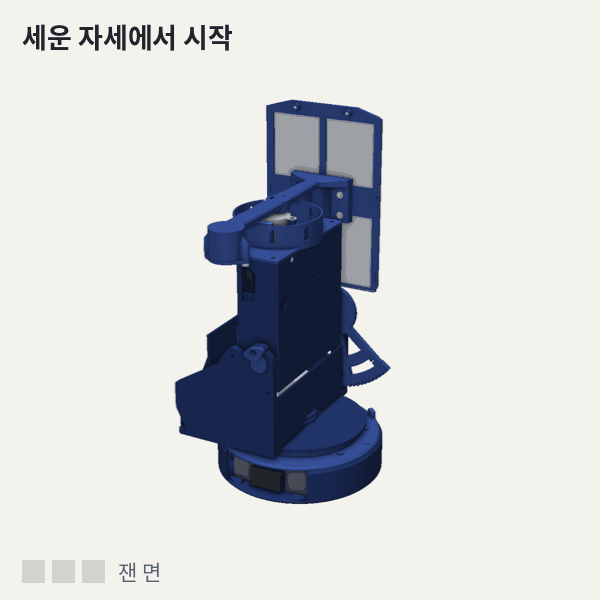

## 시뮬레이션 결과 그림

**판이 가리는 범위.** 판이 안테나 아래로 58mm, 위로 92mm라 한쪽이 짧다. 그래서 판이 도는 면에서 −36°~+49° 안에 있는 카메라만 가린다.

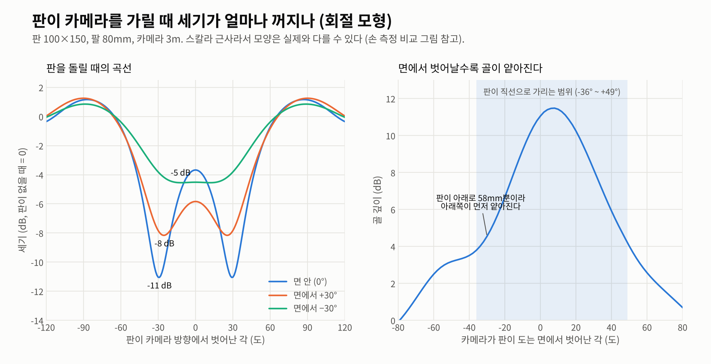

**모형과 손 측정.** 깊이는 비슷하고 모양은 다르다 (모형은 W, 잰 값은 V).

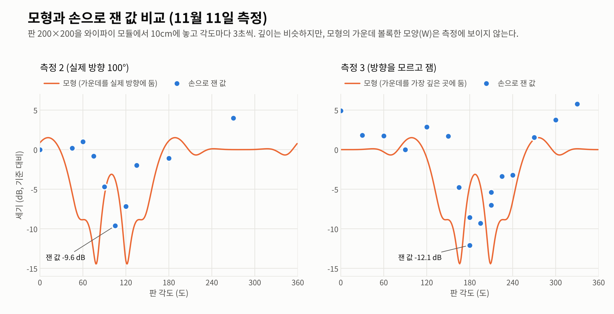

**방향 오차.** 보통 방, 1500방향.

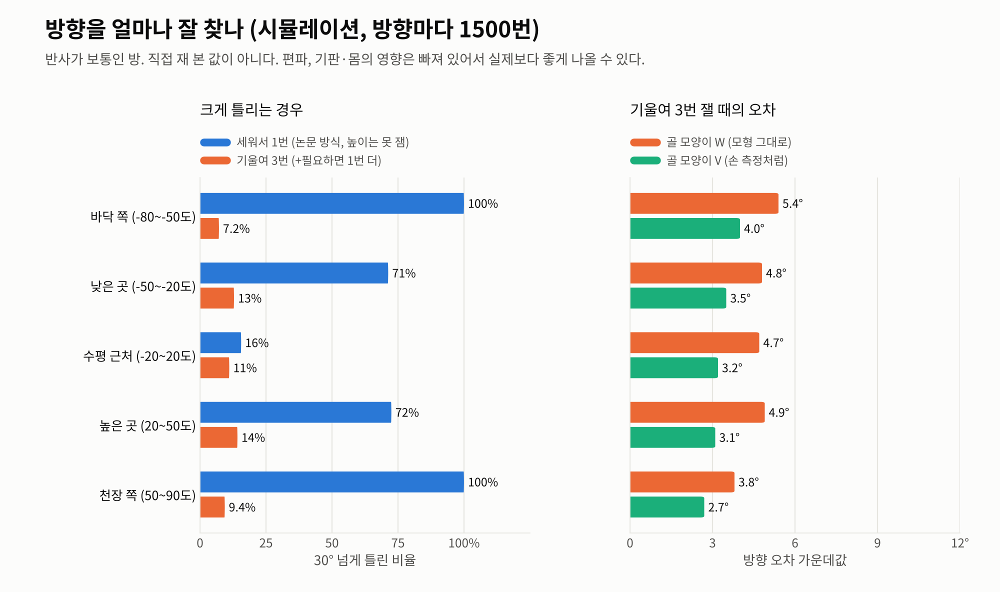

**스캔 한 번의 예.**

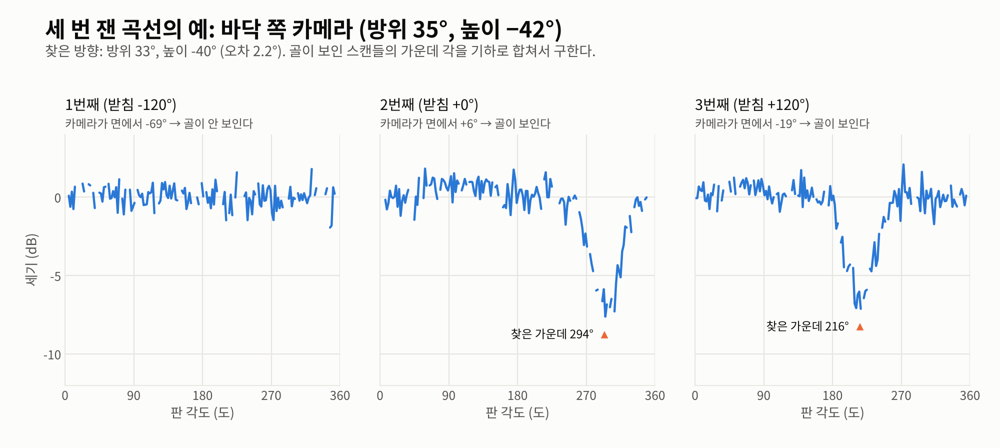

**어느 방향이 보이나.** 기울여 세 번 재면 97% 방향에서 적어도 한 스캔에 골이 보인다.

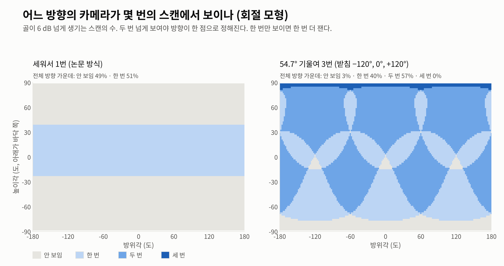

**위치 추정 방법 비교.** 카메라가 방 한가운데 있어도 되는 방법들.

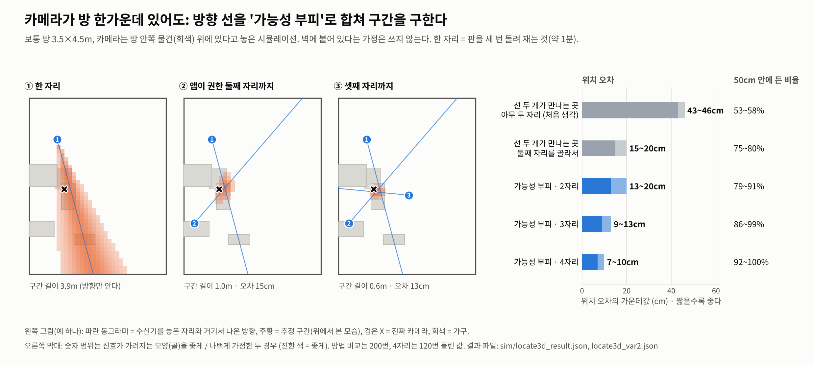

**곳별 결과와 판별.** 설명은 [네 단계 검토](네%20단계%20검토.md) 3절과 4절.

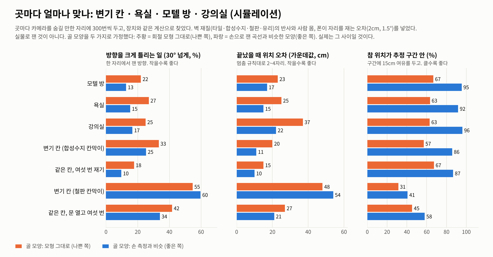

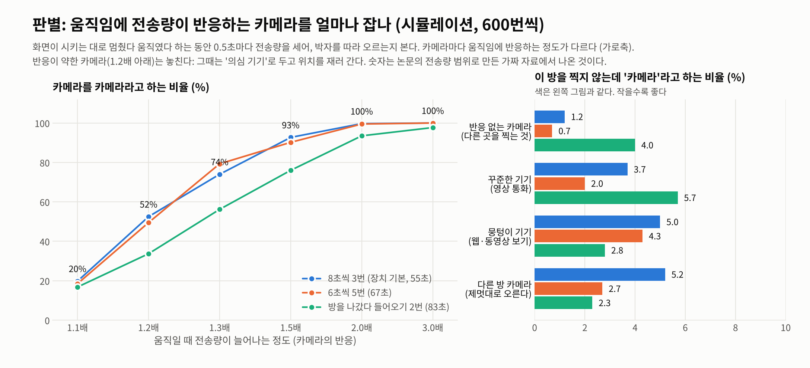

**전파 계산 (NEC2).** 수신기 자기 부품의 영향, 판 크기, 재는 횟수. 설명은 [설계 검토](설계%20검토.md) 4절과 5절.

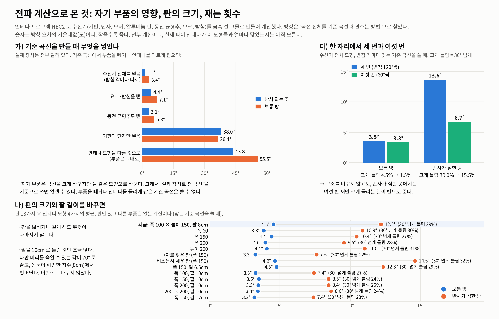

**넘어짐 (MuJoCo)과 회전 막대 (CalculiX).** 설명은 [설계 검토](설계%20검토.md) 10절과 11절.

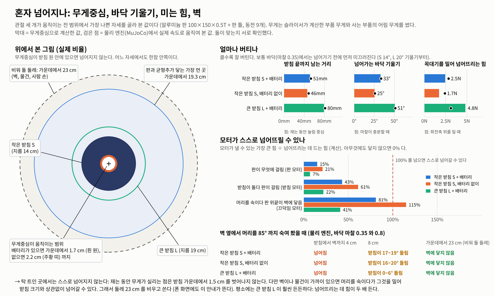

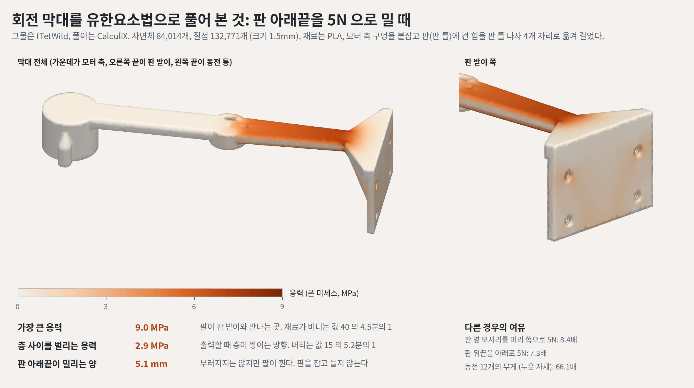

## 장치의 화면을 미리 보기

수신기가 폰에 보여 주는 화면은 장치 없이도 볼 수 있다. 저장소에서 `python3 firmware/pi/node.py --dry --port 8080` 을 켜고 브라우저에서 `http://localhost:8080` 을 연다. 자세한 것은 [혼자 동작](혼자%20동작.md) 4절.
