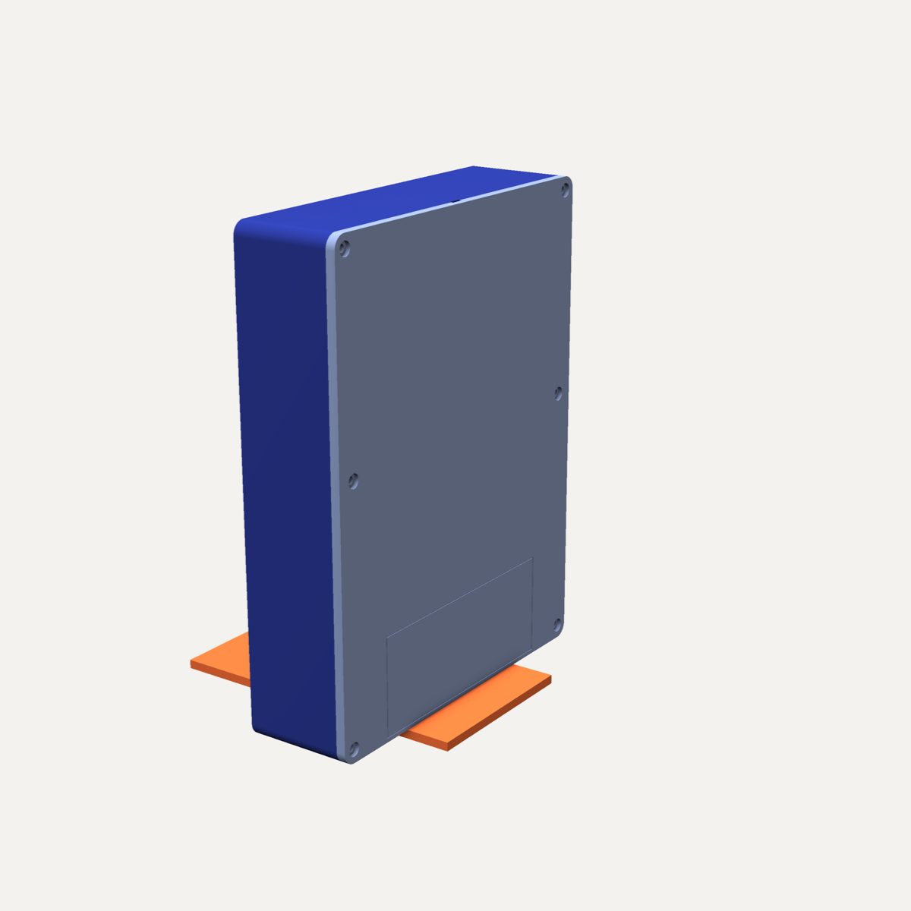
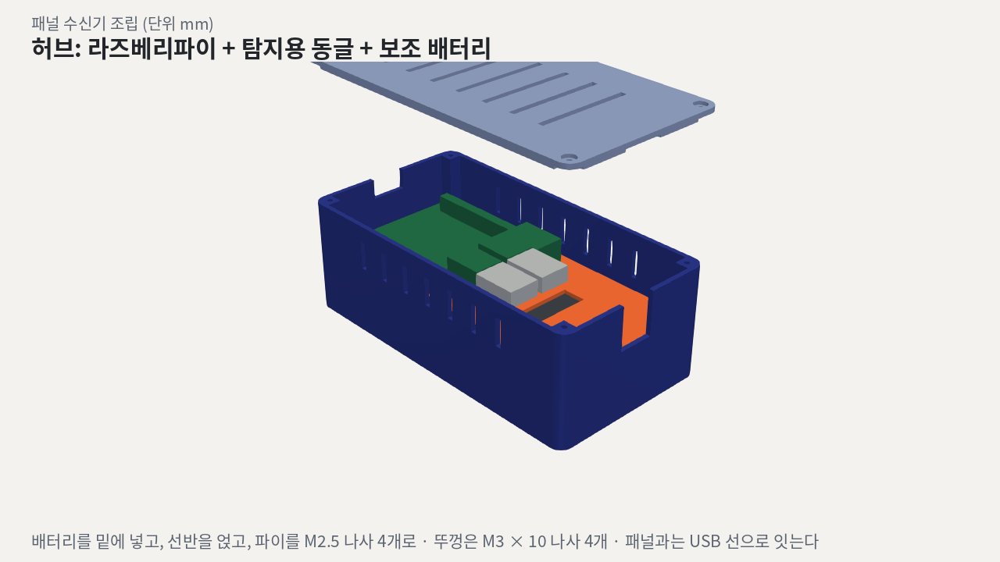
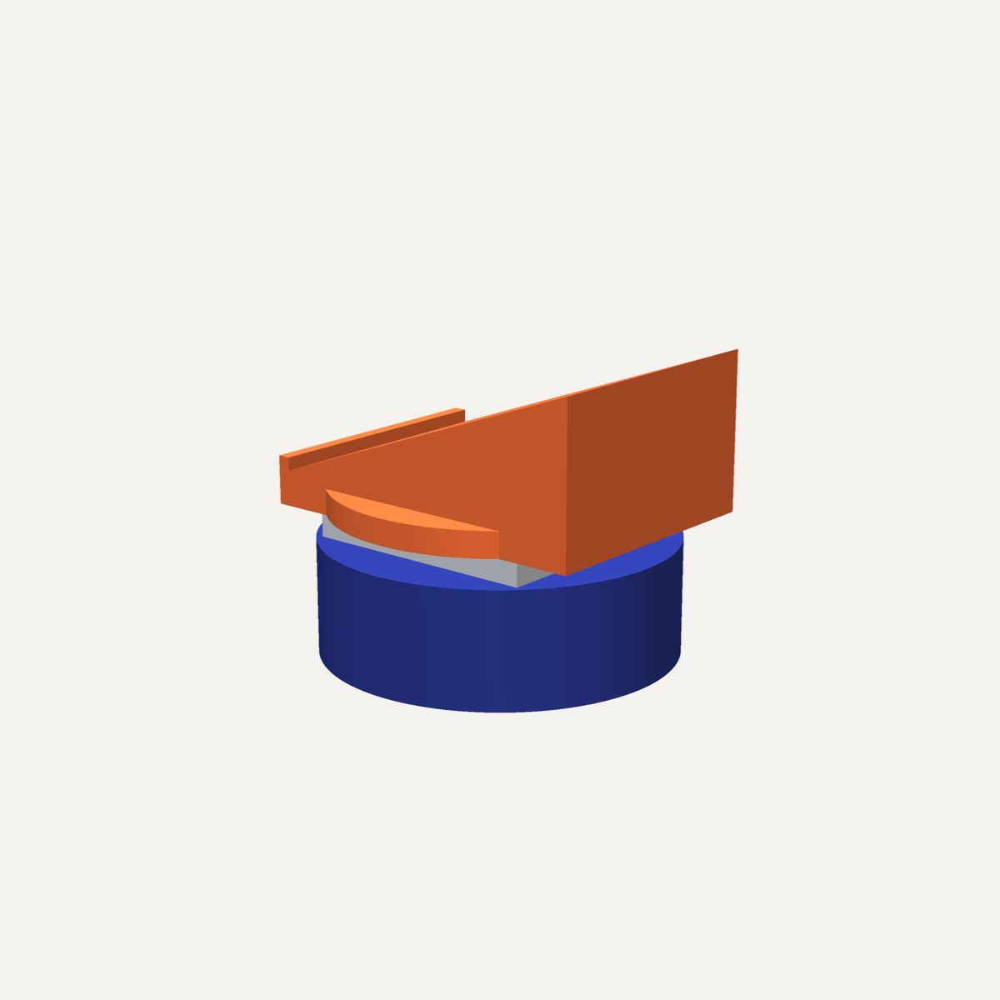

---
tags:
  - DeteCam
  - 조립
고친날: 2026-11-19
---

# 조립 안내 (패널 수신기, 두 대역 판)

패널 하나를 만드는 순서다. 둘째 패널도 같다. 그다음은 허브, 끝은 숙소에서 쓰는 회전 받침이다. 움직이는 그림은 [조립 영상](videos/조립_시뮬레이션.mp4), 부품은 [부품표](부품표.md)에 있다.

> 먼저 [체크리스트](체크리스트.md)의 관문 1~3 을 한다. 이 실험들은 통 없이 책상 위에서 한다. 필름 안테나와 스위치를 사는 것은 관문 4 다. [관문 4] 표시가 붙은 치수(반사판 거리 17.5 mm)는 그때 재 보고 정한다.

패널 하나의 바깥 크기는 165 × 215 × 49 mm(통 44.5 + 앞덮개 4.2)다.

## 준비

| 뽑는 것 (판) | 사는 것 | 연장 |
|---|---|---|
| 통 · 앞덮개 (1, 2판), 걸이판 또는 받침 발 (3, 4판), 안테나 받침판 (6판), 회전 받침 셋 (7판), ESP32 누름쇠 | 필름 안테나 17 (16 + 기준 1), HMC7992 스위치 모듈 7, 합침기 (2~6 GHz) 1, 위상선 한 벌, U.FL 잭 변환 단자, 짧은 SMA 선, 반사판 (알루미늄 140 × 140), XIAO ESP32-C5, 18650 홀더, 자석 4, 나사 | 십자드라이버 (M2, M3), 납땜인두 (XIAO 의 핀 헤더), 묶음끈, 양면테이프 |

XIAO 의 핀 헤더는 **윗면으로** 납땜한다. 핀이 부품이 있는 쪽으로 서야 점퍼선을 위에서 꽂을 수 있다.

## 1. 통 뒤에 자석 걸이판

1. 걸이판의 둥근 자리 넷에 자석을 넣고 M3 × 6 접시머리 나사로 조인다.
2. 걸이판의 육각 자리 넷에 M3 너트를 넣는다.
3. 통 안에서 M3 × 8 나사 넷을 뒤로 넣어 걸이판에 조인다.

창턱이나 교탁 위에 세울 패널, 그리고 숙소에서 회전 받침에 얹을 패널은 걸이판 대신 받침 발을 단다 (5번).

## 2. 통 바닥에 RF 모듈 여덟

통 바닥, 반사판이 덮일 자리에 모듈 여덟이 3 × 3 칸(오른쪽 아래 한 칸은 빈칸)으로 들어간다. 바닥의 고리에 묶음끈으로 묶는다.

| 자리 (앞에서 볼 때) | 모듈 | 하는 일 |
|---|---|---|
| 윗줄 셋, 가운데 줄 왼쪽 | HMC7992 넷 | 첫 단: 안테나 16개를 넷씩 받는다 |
| 가운데 줄 가운데 | HMC7992 | 둘째 단: 첫 단 넷 중 하나를 고른다 |
| 가운데 줄 오른쪽 | 합침기 | 배열 쪽과 기준 쪽을 합쳐 XIAO 로 보낸다 |
| 아랫줄 둘 | HMC7992 둘 (A, B) | 기준 안테나의 위상을 0 / 11 / 30 / 58 mm 선으로 바꾼다 |

잇는 순서는 이렇다.

- 배열 쪽: 안테나 16 → 첫 단 스위치 넷 → 둘째 단 스위치 → 합침기의 한쪽.
- 기준 쪽: 기준 안테나 → 스위치 A → 위상선 넷 (짧은 것부터 1, 2, 3, 4번 단자) → 스위치 B → 합침기의 다른 쪽.
- 합침기의 합쳐진 쪽 → XIAO 의 U.FL.

통 아래 칸에는 18650 홀더(왼쪽, 양면테이프)와 XIAO(오른쪽 받침)를 넣는다. XIAO 의 USB-C 가 오른쪽 벽의 창으로 나오게 놓고, 누름쇠를 단자 위에 걸쳐 M2 × 8 나사 둘로 조인다.

| XIAO 의 핀 | 가는 곳 |
|---|---|
| 둘 | 첫 단 스위치 넷의 제어 V1 · V2 (넷을 같이 묶는다) |
| 둘 | 둘째 단 스위치의 제어 V1 · V2 |
| 둘 | 위상 스위치 A · B 의 제어 V1 · V2 (둘을 같이 묶는다) |
| 3V3, GND | 스위치 모듈 일곱 |
| BAT+, BAT− | 18650 홀더 |

핀 번호는 장치 코드를 쓸 때 정한다. 위상선과 스위치마다 위상 차이가 조금씩 다르므로, 다 조립한 뒤 관문 4 에서 보정표를 만든다.

## 3. 반사판과 안테나 받침판

1. 반사판을 통 안 기둥 넷 위에 얹는다. 모듈 여덟이 반사판 뒤에 숨는다.
2. 필름 안테나 16개를 받침판 앞면의 홈에 붙인다. 45도로 눕혀 4 × 4 로 놓이고, 간격은 33 mm 다. 안테나 선은 홈 끝의 구멍으로 뒤로 뺀다.
3. 선을 받침판 둘레와 통 벽 사이의 틈(10 mm)으로 반사판 뒤로 내려 첫 단 스위치에 꽂는다. 안테나 1~4번은 첫째 스위치, 5~8번은 둘째 스위치에 꽂는 식이다. 몇 번을 어디에 꽂았는지는 적어 둔다.
4. 받침판을 다리 넷이 반사판에 닿게 얹는다. 다리 길이가 안테나 면과 반사판 사이 거리(17.5 mm)를 정한다.

## 4. 앞덮개

1. 기준 안테나(필름 안테나 1개)를 받침판 위 띠에 붙이고, 선은 위쪽 틈으로 스위치 A 에 꽂는다.
2. 앞덮개를 덮고 M3 × 10 나사 여섯으로 조인다. 덮개 테두리가 받침판 가장자리를 누른다.
3. 아래쪽 네모 표시선 안에 AR 마커 띠를 붙인다.

## 5. 받침 발 (걸이판 대신)

1. 발 밑의 두꺼운 곳에 1/4인치 너트를 위에서 넣는다. 삼각대나 회전 받침에 얹을 때 쓴다.
2. 발의 육각 자리 둘에 M3 너트를 넣는다. 통을 발 위에 얹고, 통 안에서 M3 × 8 나사 둘(아래쪽 구멍)로 조인다.

## 6. 허브

1. 보조배터리를 통 바닥에 넣는다. 선은 왼쪽 끝으로 올린다.
2. 선반을 양 끝 턱에 얹는다.
3. 파이를 선반 기둥에 M2.5 × 6 나사 넷으로 조인다. 동글 둘을 USB 에 꽂는다.
4. 패널로 가는 USB 선을 오른쪽 끝 홈으로 내고, 뚜껑을 M3 × 10 나사 넷으로 조인다.

## 7. 회전 받침 (숙소)

받침 발을 단 패널 하나를 얹어 위로 20도 기울인 채 45도씩 돌린다. 받침대 지름은 110 mm, 패널을 얹은 전체 높이는 약 30 cm, 무게는 약 1.1 kg 이다. 무게 중심이 도는 축에서 3 mm 안에 있어 모터에 걸리는 힘이 작고, 어느 쪽으로 20도 기울여도 넘어지지 않는다 (`cad/results/panel_check.json`).

1. 28BYJ-48 모터를 받침대(10)의 칸에 위에서 넣는다. 귀가 윗면의 홈(깊이 1 mm)에 얹혀 모터 윗면이 받침대 윗면보다 낮다. 귀를 M3 × 8 나사 둘로 조인다. 모터 선은 받침대 옆의 홈으로 빼서 밖의 ULN2003 판에 꽂는다.
2. 베어링(75 mm 정사각 턴테이블)의 아래 판을 받침대 윗면에 M3 × 8 나사 넷으로 조인다. 모터가 베어링 밑에 숨는다.
3. 축 이음쇠(12)를 모터 축에 끝까지 끼운다. 이음쇠의 D 구멍이 축의 납작한 면에 맞는다.
4. 돌림판(11) 밑의 육각 홈을 이음쇠에 맞춰 얹는다. 베어링 아래 판의 큰 구멍으로 드라이버를 넣어, 베어링 위 판을 돌림판에 M3 × 8 나사 넷으로 조인다.
5. 패널 발을 돌림판의 기운 면에 얹고, 돌림판 밑에서 1/4인치 × 50 mm 볼트를 넣어 발의 너트에 조인다. 볼트 머리는 돌림판 밑의 홈에 숨는다.
6. ULN2003 판은 XIAO 나 파이에 잇는다 (IN1~4, 5 V). 어느 쪽에 이을지는 장치 코드를 쓸 때 정한다.

베어링 나사 자리(62 mm 간격)와 두께는 [실측] 값이다. 물건을 받으면 재서 `cad/model/panel.py` 의 `BEAR_LO`, `BEAR_HI` 를 고치고 다시 뽑는다.

## 8. 걸기

| 거는 곳 | 방법 |
|---|---|
| 칠판 | 자석 걸이판을 칠판 윗변 가까이에 붙인다 |
| 창 유리 | 흡착 걸이를 2 m 높이에 붙이고 걸이판의 고리를 건다 |
| 복도 쪽 창턱, 사물함 위, 교탁 | 받침 발로 세운다 |
| 숙소 | 회전 받침에 얹어 방 두 곳 이상에서 잰다 ([추정 구간 계산 5절](추정%20구간%20계산.md)) |
| 삼각대 | 받침 발 밑의 1/4인치 너트에 조인다 |

다 걸었으면 폰으로 패널의 AR 마커를 비춘다. 어디에 걸지는 [설계 검토 5절](설계%20검토.md#5-어디에-거나)에 있다.

## 틀리기 쉬운 것

- 안테나 선을 엉뚱한 스위치 단자에 꽂는다. 1~16번이 어디에 꽂혔는지 적어 두어야 방향 계산이 맞는다.
- 위상선을 엇갈려 꽂는다. 스위치 A 의 1번과 B 의 1번을 잇는다.
- 받침판 다리 밑에 선이 깔린다. 그러면 반사판까지 거리가 틀어진다. 선은 둘레 틈으로만 지나가게 한다.
- 앞덮개 나사를 너무 세게 조인다. 덮개가 통에 닿으면 멈춘다.
- 회전 받침의 볼트를 덜 조인다. 기운 패널이 돌다가 흔들리면 방향이 틀어진다.
