---
tags:
  - DeteCam
  - 조립
고친날: 2026-11-16
---

# DeteCam 수신기 v2 (관절 3개): 출력과 조립 안내

2026-11-16 기준. 계산과 시뮬레이션으로만 확인했고, 아직 출력해서 맞춰 보지 않은 첫 판이다. 맞지 않는 곳이 나오면 `cad/model/p2.py`의 숫자를 고쳐 다시 내보낸다.

**테이프와 풀은 쓰지 않는다. 알루미늄 판, 균형추, 보드, AR 마커까지 전부 나사로 조인다.**

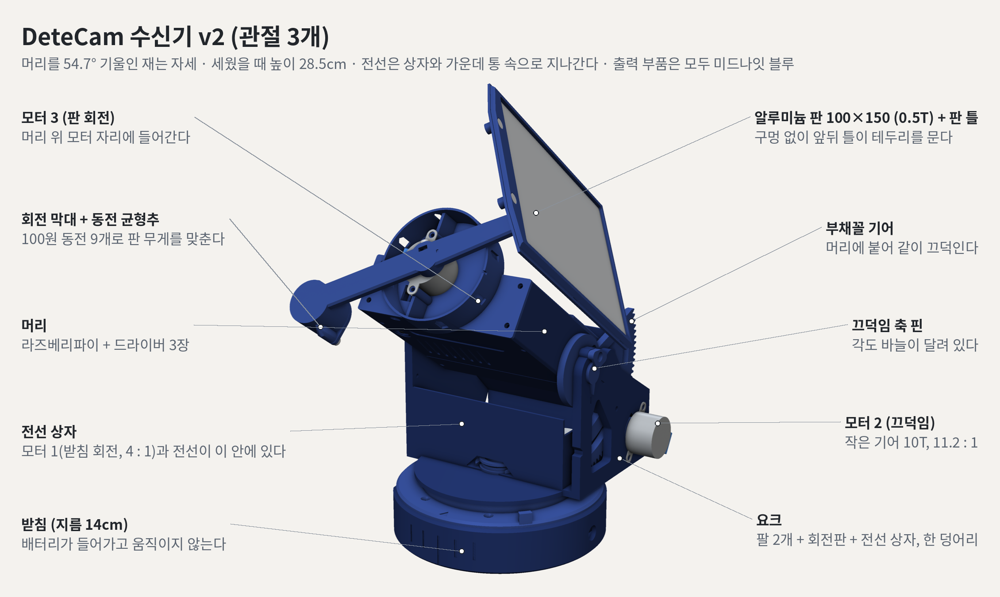

| 관절 | 하는 일 | 모터 | 기어 | 범위 |
|---|---|---|---|---|
| J1 받침 회전 | 요크와 머리를 수평으로 돌린다 | 모터 1 (요크의 전선 상자 속) | 4 : 1 | −174° ~ +174° |
| J2 끄덕임 | 머리를 세우거나 기울인다 | 모터 2 (오른쪽 팔 바깥) | 11.2 : 1 | −5° ~ 85° (멈춤턱은 −5.3°와 86.9°) |
| J3 판 회전 | 알루미늄 판을 안테나 둘레로 돌린다 (재는 동작) | 모터 3 (머리 위) | 없음 | 계속 돈다 |

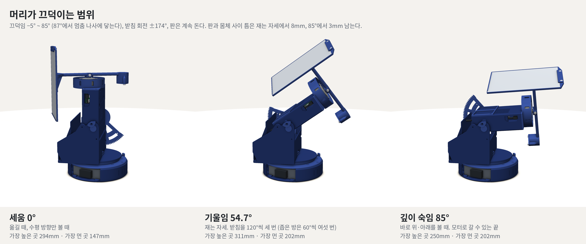


수신기는 노트북 없이 혼자 동작하고, 모든 동작을 폰 화면에서 조종한다 (8절, 10절).


## 1. 출력하기 전에: 부품을 재지 않아도 된다

만든 곳마다 크기가 조금씩 다른 부품은 자리를 넉넉하게 두었다. 아래 범위 안이면 그대로 맞는다. 다 넉넉하게 하지 않고 이 정도로만 둔 것은, 자리가 너무 크면 부품이 덜그럭거리거나 머리·받침이 커져서 넘어지기 쉬워지기 때문이다.

| 부품 | 들어가는 범위 | 어떻게 맞추나 |
|---|---|---|
| 보조배터리 | S: 106×71×22mm 안, L: 152×76×22mm 안. 단자는 USB-C 든 USB-A 든 | 자리보다 작으면 배터리 채움 조각(`20`, 40×15×4mm) 여섯 개를 뒤·옆 틈에 겹쳐 끼운다. 잘 안 넘어지는 쪽은 L이다 (9절) |
| 드라이버 보드 (ULN2003, 34×31.7mm 실측) | 보드 폭 36mm 안. 구멍 간격이 기둥(29.5×26.5mm)과 한 방향으로 1mm 까지 다르면 나사 네 개, 두 방향 다 1mm 다르면 한쪽 두 개 | 보드 구멍(지름 3)에 가는 M2 나사를 써서 구멍마다 0.5mm 씩 비켜도 들어간다. 흔한 보드(구멍이 모서리에서 2.5~3mm)는 네 개가 다 들어간다 |
| 전원 버튼 모듈 (KY-004) | 기판 16.5×20.5mm 까지 | 기판 왼쪽 위 귀를 옆벽과 윗턱에 대면 된다. 버튼이 3.0mm 까지 비켜도 뚜껑 구멍(지름 9.5) 안에 든다 |
| 무선 동글 (WNA3100M) | 34×16×8mm (NETGEAR 공식 값) | 가지고 있는 것 그대로. 꽂으면 머리 치마 안에 거의 다 숨는다 |
| 탐지 동글 | 몸통 45×18×10mm 안 | MT7610U 듀얼밴드의 작은 동글 (예: ASUS USB-AC51, 31×16×9mm, 안테나가 몸통 안에 든 것). 2.4GHz 전용 RT5370·MT7601U 도 들어간다 |
| 전원 플러그 | 양쪽 다 ㄱ자 | 파이 쪽은 옆 자리가 12mm뿐이고, 배터리 쪽은 받침 창 안에 들어가야 한다 (2절의 케이블) |
| 알루미늄 판 | 100 × 150mm, 1T (두께 0.8~1.2mm 면 된다) | 판 틀 홈은 판보다 둘레가 0.2mm 씩 크고 깊이가 1.15mm 다. 누름쇠 자리가 판 앞면보다 0.2mm 낮아서 판이 조금 얇아도 누름쇠가 판을 누른다. 동전은 12개 (저울이 없어도 된다) |
| 파이 안테나 자리 | 모델은 SD카드 쪽 짧은 변에서 5mm, GPIO 쪽 긴 변에서 14mm 로 잡았다 | 재지 않아도 된다. 3mm 틀려도 판이 도는 축이 안테나에서 그만큼 비켜 방향이 많아야 2°쯤 치우친다 (판까지 80mm 이므로 3/80 라디안. DiffLoc+ 의 민감도 분석도 1cm 에 6°) |

**0판(시험 조각)은 그래도 맨 먼저 뽑는다.** 프린터마다 구멍과 축이 조금씩 다르게 나와서 모터 축 구멍, 핀, 나사 구멍의 맞춤 번호를 고르는 판이다 (3절). 드라이버 보드를 0판의 맞춤 판(`91`)에 얹어 보면 머리를 뽑기 전에 구멍을 확인할 수도 있다 (하지 않아도 된다).

## 2. 부품 목록과 치수

출력 부품 33가지, 사는 부품, 나사·너트를 모두 적었다. 치수는 mm.

### 사는 것

| 품목 | 수량 | 메모 |
|---|---|---|
| 28BYJ-48 (5V) 스텝모터 + ULN2003 드라이버 보드 | 3세트 | 관절마다 한 세트. 라벨이 5V인지 본다. 보드는 흔한 34×31.7mm 짜리 (2026-11-16 실측). 가는 M2 나사를 써서 구멍 간격이 한 방향으로 1mm 까지 달라도 나사 네 개가 들어가고, 두 방향 다 1mm 다르면 한쪽 두 개만 박는다. 재지 않아도 된다 |
| 알루미늄 판 100 × 150mm, 두께 1T (1mm) | 1장 | 가지고 있는 판 그대로 쓴다. 구멍을 뚫지 않는다: 판 틀(`18`)의 홈(둘레 틈 0.2mm, 깊이 1.15mm)에 넣으면 아래 턱과 누름쇠(`19`)가 잡는다. 무게 약 40g. 단단한 A5052 든 무른 A1050 이든 된다 |
| 100원 동전 | 12개 | 균형추. 균형추 통 12칸을 동전으로 다 채운다. 지름 24mm, 5.42g (한국은행), 두께 1.5mm 안팎 (옛 동전은 1.6mm). 구멍 없는 M12 와셔(바깥지름 24)로 대신할 수 있지만 무게를 재서 맞춰야 한다 |
| 보조배터리 (5V 2A 이상, 단자는 USB-C 든 USB-A 든) | 1개 | 가지고 있는 것을 쓴다. 106×71×22mm 안이면 작은 받침(S), 152×76×22mm 안이면 큰 받침(L)에 들어간다. 자리보다 작으면 배터리 채움 조각(`20`)을 뒤·옆 틈에 끼운다. 파이 + 모터 1개 + 동글 2개 + ESP32(약 0.08A)가 같이 쓰는 전류는 많아야 1.8A쯤이다 |
| 전원 케이블 50cm: 배터리 쪽 ㄱ자 → 마이크로 5핀 ㄱ자 | 1개 | 배터리 단자에 맞춘다: USB-C 배터리면 'USB-C(ㄱ자) → 마이크로 5핀(ㄱ자)', USB-A 배터리면 'USB-A(ㄱ자) → 마이크로 5핀(ㄱ자)'. 받침에서 머리까지 약 34cm. 배터리 쪽이 ㄱ자여야 받침 창 안에 들어가고, 파이 쪽이 ㄱ자여야 머리 안(파이 전원 단자 옆 12mm)에 들어간다. 곧은 'C→5핀 젠더'는 머리 안에 들어가지 않고, 젠더 속에 저항이 없으면 C 배터리에서 전원이 안 들어온다. C→5핀 케이블에는 그 저항이 들어 있다. 아주 가는 선은 파이 전압이 떨어지니 피한다 |
| (파이 쪽이 곧은 케이블일 때만) 마이크로 5핀 ㄱ자 젠더 (수-암, 좌·우 꺾임 세트) | 1세트 | 선이 아래(USB 단자 쪽)로 가는 것을 쓴다. 파이 쪽이 ㄱ자인 케이블이면 필요 없다 |
| 전원 버튼 모듈 KY-004 | 1개 | 머리 앞의 전원 버튼. 2초 누르면 안전하게 꺼지고, 짧게 누르면 한 번 잰다. 만든 곳마다 기판이 조금 달라서 자리를 20.5×16.5mm 까지 넉넉히 두었다. 재지 않아도 된다 |
| 점퍼선 암-암 10cm | 20가닥 | 드라이버에 18가닥을 쓴다. 20cm짜리는 머리 안에 접어 넣기 빠듯하다 |
| 점퍼선 암-암 20cm | 6가닥 | 전원 버튼에서 파이 5번·6번 핀까지 2가닥, ESP32 에서 파이 2·8·9·10번 핀까지 4가닥 |
| Y 분배 점퍼 케이블 (듀폰, 암 1개 → 암 2개, '1분배2') | 2개 | 파이 4번 핀의 5V 를 드라이버 1과 2에, 2번 핀의 5V 를 드라이버 3과 ESP32 에 나눈다. 꽂기만 하면 되니 납땜이 필요 없다. 못 구하면 레버식 전선 연결 단자(3구) 하나와 점퍼선으로 만들거나, 피복을 벗긴 끝을 단단히 꼬아 절연테이프를 감는다 |
| 무선 동글 (가지고 있는 NETGEAR WNA3100M) | 1개 | 폰과 통신하는 둘째 Wi-Fi. 새로 살 필요 없다. 34×16×8mm, 4g (NETGEAR 공식 값), 2.4GHz |
| 탐지 동글: 모니터 모드가 되는 듀얼밴드(2.4·5GHz) USB 무선 동글. 칩이 MT7610U 인 작은 것 (예: ASUS USB-AC51, 31×16×9mm) | 1개 (권함) | 둘레 기기를 엿들어 카메라 후보를 추린다. 5GHz 카메라와 핫스팟도 듣는다. 안테나가 몸통 안에 든 작은 것, 몸통이 45×18×10mm 안쪽. 드라이버(mt76x0u)가 파이 커널에 들어 있다. 2.4GHz 전용(RT5370, MT7601U)도 꽂으면 돌지만 5GHz 를 못 듣는다. 없어도 수신기는 돈다 (그때는 초당 개수만으로 고른다) |
| ESP32 보드: Seeed Studio XIAO ESP32-C5, **핀 머리가 납땜되어 나온 것** (Pre-Soldered) | 1개 | 응답 프레임(ACK)의 CSI 를 듣는 둘째 수신기. 파이 칩(nexmon)은 ACK 에서 CSI 를 내지 않아서 더한다 (2026-11-16 실험 S4-1). 21×17.8mm. 핀 머리가 없는 것을 사면 납땜해야 하니 꼭 '납땜된 것'을 산다. 파이와는 점퍼선 4가닥 (UART) |
| ESP32 안테나: 2.4·5GHz 듀얼밴드 FPC 안테나 (U.FL, 동축선 8cm 이상) | 1개 | 보드에 딸려 오는 안테나는 2.4GHz 전용이라 '2.4G/5G 듀얼밴드 FPC 안테나 U.FL(IPEX1)' 을 따로 산다 (2.4GHz 만 잴 때는 딸려 온 것도 된다). 크기 45×10mm 안 (흔한 것 35×8 ~ 42×10). 머리 안 천장의 홈에 대고 누름판(`21`)으로 조인다 |
| 케이블 타이 (폭 2.5mm, 길이 10cm) | 3~4개 | 머리 아래에서 전선 셋을 한데 묶는다 |
| AR 마커 종이 (`marker/AR_마커.pdf` 를 A4에 인쇄) | 1장 | 폰이 수신기가 놓인 자리를 알아내는 데 쓴다. 조금 두꺼운 종이(명함지, 160~200g)에 실제 크기(100%)로 인쇄한다. 풀이나 테이프 없이 틀로 덮어 나사로 조인다 |
| M3 나사 둥근머리 6mm | 18개 + 예비 | 모터 귀 6, 뚜껑 4, 부채꼴 기어 2, 마커 틀 4, 핀 막이 2. 이 자리에는 꼭 6mm만 쓴다 |
| M3 나사 둥근머리 8mm | 7개 + 예비 | 모터 자리 4, 균형추 마개 2, 모터 축 고정 1 |
| M3 나사 접시머리 6mm | 4개 + 예비 | 판 틀을 판 받이에 (너트와 함께). 머리가 홈 바닥보다 조금 낮게 묻히고, 그 위를 판이 덮는다 |
| M3 나사 접시머리 8mm | 2개 + 예비 | 누름쇠를 판 틀 위 띠에 (너트와 함께. 너트는 판 틀 뒷면 위쪽) |
| M3 너트 | 7개 + 예비 | 판 받이 4, 판 틀 뒷면 2, 모터 축 고정 1 |
| M3 나사 둥근머리 10mm | 8개 + 예비 | 받침 덮개 4(접시머리도 됨), 끄덕임 멈춤 2, 받침 회전 멈춤 1, 고정 나사 1. 멈춤 나사와 고정 나사는 꼭 10mm |
| M2.5 나사 둥근머리 6mm | 4개 + 예비 | 파이 |
| M2 나사 둥근머리 6mm | 16개 + 예비 | 드라이버 보드 12 (한 장에 4개. 보드 구멍(지름 3)보다 가늘어서 구멍 간격이 조금 달라도 들어간다), ESP32 안테나 누름판 2, ESP32 막음쇠 2 |
| 6mm 비비탄 45개 (없으면 양초) | 택1 | 받침 덮개의 둥근 홈에 깔아 요크가 구슬 위로 굴러 돌게 한다 (베어링 속 쇠구슬과 같다). 마찰이 그냥 PLA끼리일 때의 1/15쯤으로 준다. 문구점·완구점의 흔한 6mm 0.12~0.2g 짜리면 된다. 비비탄을 권한다 |
| 얇은 랜선 (선택) | 1개 | 개발할 때 랜선을 장치 안에 넣어 두고 싶을 때만. 혼자 동작할 때는 쓰지 않는다 |
| 고무줄 (선택) | 1개 | 85° 가까이 깊이 숙이는 자세를 자주 쓸 때 끄덕임 모터를 거든다 |

**나사는 모두 보통 미터 나사(볼트)다.** 'M3 볼트 둥근머리 6mm', 'M3 접시머리 볼트 8mm' 처럼 파는 것이다. 태핑 나사(피스)나 플라스틱 전용 나사는 사지 않는다: 너트와 함께 쓰는 자리가 있어서 한 가지로 맞췄다. 3D 프린터로 나사산을 뽑지는 않는다. 출력 부품의 작은 구멍(M3 2.6, M2.5 2.1, M2 1.6)에 이 나사를 처음 돌려 넣으면 나사가 스스로 나사산을 낸다 (탭이 필요 없다). 너트를 쓰는 곳은 판 받이 4, 판 틀 뒷면 2, 모터 축 고정 1 의 일곱 곳이다.

### 사는 부품의 치수

공식 자료가 있는 것은 그 값이고, 나머지는 모델에 넣은 흔한 값이다. 1절의 범위 안이면 재지 않아도 된다.

| 부품 | 수량 | 치수 (mm) | 무게 | 들어가는 곳 |
|---|---:|---|---|---|
| 28BYJ-48 스텝모터 (5V) | 3 | 몸통 지름 28 × 높이 19. 귀 구멍 간격 35 (구멍 지름 4.2). 축 지름 5 (양쪽 납작, 폭 3) · 길이 10, 몸통 가운데에서 8 비켜 있다 | 약 34g | 모터 1: 요크 전선 상자 속, 모터 2: 오른쪽 팔, 모터 3: 모터 자리 |
| ULN2003 드라이버 보드 | 3 | 34 × 31.7 (실측), 부품 높이 약 15. 구멍 지름 3, 간격 29.5 × 26.5 (모델 값, ±1mm 까지 들어간다) | 약 8g | 머리 몸통 오른쪽 기둥 (위에서부터 3, 2, 1번) |
| 라즈베리파이 3B+ | 1 | 85 × 56 × 17 (기판 1.6). 구멍 지름 2.7, 간격 58 × 49 | 50g | 머리 몸통 뒷벽 기둥 4개 |
| 알루미늄 판 | 1 | 100 × 150 × 1 | 40.5g | 판 틀 홈 (구멍 없음) |
| 100원 동전 | 12 | 지름 24, 두께 1.5 안팎 (옛 동전 1.6) | 5.42g | 회전 막대의 균형추 통 (12칸을 다 채운다) |
| 보조배터리 | 1 | S 받침: 106 × 71 × 22 안, L 받침: 152 × 76 × 22 안 | 가진 것 | 받침 통 (옆 창으로) |
| 전원 케이블, 양쪽 ㄱ자 | 1 | 길이 50cm (받침에서 머리까지 약 34cm) |  | 받침 → 가운데 통 → 머리 안 파이 전원 단자 |
| 전원 버튼 모듈 KY-004 | 1 | 기판 15 × 18.5 (자리는 16.5 × 20.5 까지) | 약 2g | 머리 왼쪽 받침 살 |
| 무선 동글 WNA3100M | 1 | 34 × 16 × 8 (NETGEAR 공식 값) | 4g | 파이 GPIO 쪽 USB 위 칸 |
| 탐지 동글 | 1 | 몸통 45 × 18 × 10 안 |  | 파이 가운데 USB 위 칸 |
| ESP32 (XIAO ESP32-C5, 핀 머리 납땜된 것) | 1 | 21 × 17.8 × 3.5, 핀 머리 높이 2.5 (위에 점퍼선 소켓 14) | 약 3g | 뚜껑 안쪽 홈 받침 2개 + 막음쇠 (세워서) |
| ESP32 FPC 안테나 | 1 | 45 × 10 × 0.3 안, 동축선 8cm 이상 | 약 1g | 모터 자리 밑면(머리 안 천장)의 홈, 누름판으로 |
| M3 나사 둥근머리 | 33 | 머리 지름 5.5~6, 높이 2.4. 길이 6 (18개), 8 (7개), 10 (8개) |  | 아래 나사 표 |
| M3 나사 접시머리 | 6 | 머리 지름 6, 90° 접시. 길이(머리 포함) 6 (4개), 8 (2개) |  | 판 틀 4, 누름쇠 2 |
| M3 너트 | 7 | 맞변 5.5, 두께 2.4 | 0.35g | 판 받이 4, 판 틀 뒷면 2, 모터 축 고정 1 |
| M2.5 나사 둥근머리 | 4 | 길이 6 |  | 파이 |
| M2 나사 둥근머리 | 16 | 길이 6 |  | 드라이버 보드 3장 12, ESP32 안테나 누름판 2, ESP32 막음쇠 2 |
| 6mm 비비탄 | 45 | 지름 6 |  | 받침 덮개 둥근 테 홈 |
| AR 마커 종이 | 1 | 인쇄한 띠 108 × 44 (A4에 실제 크기로) |  | 머리 등판, 마커 틀 아래 |

### 출력 부품

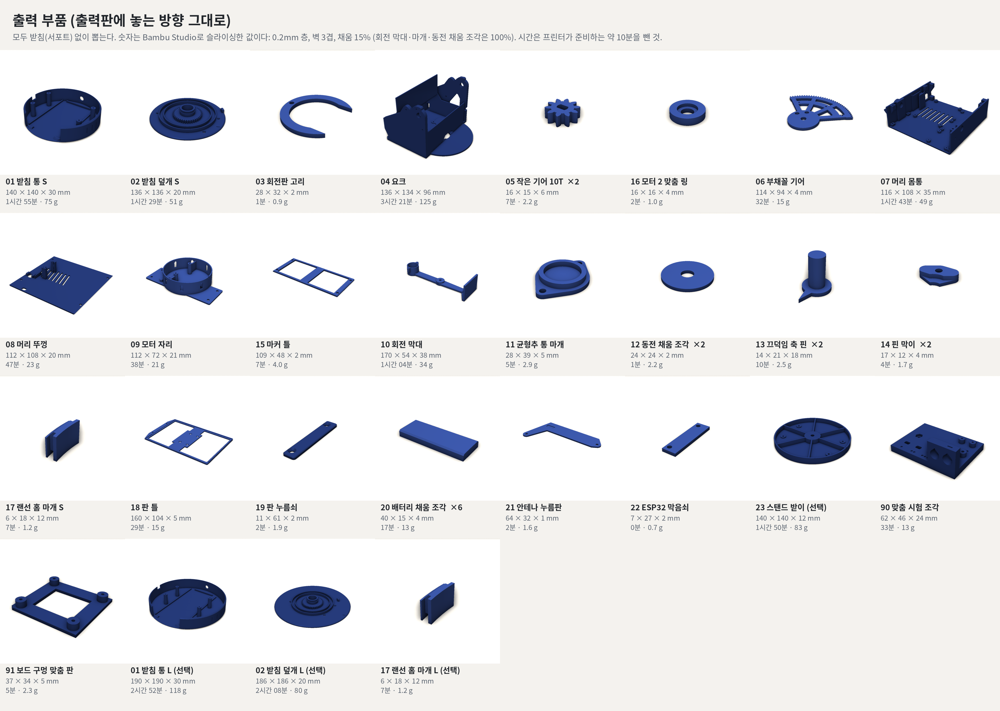

크기는 출력판에 놓는 방향 그대로의 가로 × 세로 × 높이다. 시간은 부품 하나만 뽑을 때의 값이고 프린터 준비 시간은 뺀 것이다.

| 파일 | 이름 | 수량 | 크기 (mm) | 시간 | 무게 | |
|---|---|---:|---|---:|---:|---|
| `01_base_tub_S.stl` | 받침 통 (작은 것, 지름 140) | 1 | 140 × 140 × 30 | 1시간 51분 | 75 g | |
| `01_base_tub_L.stl` | 받침 통 (큰 것, 지름 190) | 1 | 190 × 190 × 30 | 2시간 48분 | 118 g | |
| `02_base_cover_S.stl` | 받침 덮개 (작은 것) | 1 | 136 × 136 × 20 | 1시간 29분 | 51 g | |
| `02_base_cover_L.stl` | 받침 덮개 (큰 것) | 1 | 186 × 186 × 20 | 2시간 08분 | 80 g | |
| `03_clip.stl` | 회전판 고리 | 1 | 28 × 32 × 2 | 1분 | 1 g | |
| `04_yoke.stl` | 요크 (회전판 + 팔 + 전선 상자) | 1 | 136 × 134 × 96 | 3시간 21분 | 125 g | |
| `05_pinion_fit1.stl` | 작은 기어 10T (맞춤 1) | 2 | 16 × 15 × 6 | 3분 | 1 g | |
| `05_pinion_fit2.stl` | 작은 기어 10T (맞춤 2) | 2 | 16 × 15 × 6 | 3분 | 1 g | |
| `05_pinion_fit3.stl` | 작은 기어 10T (맞춤 3) | 2 | 16 × 15 × 6 | 3분 | 1 g | |
| `06_sector_gear.stl` | 부채꼴 기어 | 1 | 114 × 94 × 4 | 31분 | 15 g | |
| `07_head_shell.stl` | 머리 몸통 | 1 | 116 × 108 × 35 | 1시간 43분 | 49 g | |
| `08_head_lid.stl` | 머리 뚜껑 | 1 | 112 × 108 × 20 | 46분 | 23 g | |
| `09_crown.stl` | 모터 자리 | 1 | 112 × 72 × 21 | 37분 | 21 g | |
| `10_rotor_bar_fit1.stl` | 회전 막대 (판 받이 + 균형추 통, 맞춤 1) | 1 | 170 × 54 × 38 | 1시간 04분 | 34 g | 채움 100% |
| `10_rotor_bar_fit2.stl` | 회전 막대 (판 받이 + 균형추 통, 맞춤 2) | 1 | 170 × 54 × 38 | 1시간 04분 | 34 g | 채움 100% |
| `10_rotor_bar_fit3.stl` | 회전 막대 (판 받이 + 균형추 통, 맞춤 3) | 1 | 170 × 54 × 38 | 1시간 04분 | 34 g | 채움 100% |
| `11_coin_cap.stl` | 균형추 통 마개 | 1 | 28 × 39 × 5 | 4분 | 3 g | 채움 100% |
| `12_coin_spacer.stl` | 채움 조각 (동전 1개 자리) | 2 | 24 × 24 × 2 | 1분 | 1 g | 채움 100% |
| `13_pin_fit1.stl` | 끄덕임 축 핀 (지름 8.0) | 2 | 14 × 21 × 18 | 5분 | 1 g | |
| `13_pin_fit2.stl` | 끄덕임 축 핀 (지름 7.9) | 2 | 14 × 21 × 18 | 5분 | 1 g | |
| `13_pin_fit3.stl` | 끄덕임 축 핀 (지름 7.8) | 2 | 14 × 21 × 18 | 5분 | 1 g | |
| `14_pin_keeper.stl` | 핀 막이 | 2 | 17 × 12 × 4 | 1분 | 1 g | |
| `15_marker_frame.stl` | 마커 틀 | 1 | 109 × 48 × 2 | 6분 | 4 g | |
| `16_m2_ring.stl` | 모터 2 맞춤 링 | 1 | 16 × 16 × 4 | 1분 | 1 g | |
| `17_lan_cap.stl` | 랜선 홈 마개 (작은 받침용) | 1 | 6 × 18 × 12 | 6분 | 1 g | |
| `17_lan_cap_L.stl` | 랜선 홈 마개 (큰 받침용) | 1 | 6 × 18 × 12 | 6분 | 1 g | |
| `18_plate_frame.stl` | 판 틀 | 1 | 160 × 104 × 5 | 28분 | 15 g | |
| `19_plate_clamp.stl` | 판 누름쇠 | 1 | 11 × 61 × 2 | 2분 | 2 g | |
| `20_batt_fill.stl` | 배터리 채움 조각 (40 x 15 x 4) | 6 | 40 × 15 × 4 | 2분 | 2 g | |
| `21_ant_clip.stl` | ESP32 안테나 누름판 | 1 | 64 × 32 × 1 | 1분 | 2 g | |
| `22_xiao_cap.stl` | ESP32 막음쇠 | 1 | 7 × 27 × 2 | 1분 | 1 g | |
| `90_test_coupon.stl` | 맞춤 시험 조각 | 1 | 62 × 46 × 24 | 32분 | 13 g | |
| `91_driver_check.stl` | 보드 구멍 맞춤 판 | 1 | 37 × 34 × 5 | 5분 | 2 g | |

**판 틀(`18`)과 누름쇠(`19`)의 맞춤 치수** (알루미늄 판 100 × 150 × 1 에 맞춘 값)

| 곳 | 치수 (mm) |
|---|---|
| 홈 (판이 들어가는 곳) | 100.4 × 150.4, 깊이 1.15 (판 앞면이 테두리보다 0.15 낮다) |
| 바닥 (판 뒷면을 받친다) | 두께 2.0. 판 둘레 3mm 를 받치는 테두리 + 가로대 + 판 받이에 닿는 받침 (뒷면이 한 평면) |
| 옆 테두리 | 두께 1.8, 바깥 반지름 96 안 (판 회전축에서) |
| 아래 턱 | 길이 92, 두께 1.0, 45° (판 앞면 모서리와 턱 밑면 사이 0.25) |
| 위 띠 | 판 위 변에서 8.5 위까지. 누름쇠 자리는 판 앞면보다 0.2 낮다. 뒷면에 너트 자리 2개 (육각 맞변 5.8, 깊이 1.2) |
| 누름쇠 | 61 × 11.0 × 2.4, 판 위 변을 3mm 덮는다. 나사 간격 48 |
| 판 틀 나사 자리 | 접시 자리 지름 6.7, 나사 구멍 3.4. 간격 38 × 18 (판 받이의 너트 자리와 같은 자리) |

### 나사와 너트 (자리마다)

나사는 모두 **59개**, 너트는 **7개**다: M3 둥근머리 6mm 18개 · 8mm 7개, M3 접시머리 6mm 4개 · 8mm 2개, M3 10mm 8개(받침 덮개 4개는 접시머리도 된다), M2.5 6mm 4개(파이), M2 6mm 16개(드라이버 보드). 너트를 쓰는 7곳(판 틀 4, 누름쇠 2, 모터 축 고정 1)을 빼면 플라스틱 구멍에 그대로 돌려 넣는다. 걸리는 느낌이 오면 멈춘다. 더 조이면 구멍이 뭉개진다. **알루미늄 판에는 구멍을 뚫지 않는다.** 아래 표는 나사를 하나씩 모델에 넣어 본 검사(`cad/checks/audit_screws.py`)에서 센 것이다.

| 단계 | 자리 | 나사 | 개수 | 무엇을 어디에 | 나사산이 물리는 길이 |
|---|---|---|---:|---|---:|
| ① | 받침 덮개 | M3 × 10 접시머리 | 4 | 덮개(02) → 통(01) | 6.9 mm |
| ② | 모터 1 귀 | M3 × 6 둥근머리 | 2 | 모터 1 → 요크(04) 전선 상자 속 자리 | 5.1 mm |
| ② | 받침 회전 멈춤 | M3 × 10 둥근머리 | 1 | 요크 회전판 구석. 아래로 6mm 나와 받침의 멈춤턱에 닿는다 | 4.0 mm |
| ③ | 파이 | M2.5 × 6 둥근머리 | 4 | 파이 → 머리 몸통(07) 뒷벽 기둥 4개 | 4.3 mm |
| ③ | 드라이버 보드 | M2 × 6 둥근머리 | 12 | 보드 3장 → 머리 몸통 기둥 (한 장에 4개) | 4.3 mm |
| ④ | 모터 3 귀 | M3 × 6 둥근머리 | 2 | 모터 3 → 모터 자리(09) | 5.1 mm |
| ④ | ESP32 안테나 누름판 | M2 × 6 둥근머리 | 2 | 누름판(21) → 모터 자리(09) 밑면. FPC 안테나를 사이에 | 4.7 mm |
| ④ | 모터 자리 | M3 × 8 둥근머리 | 4 | 모터 자리(09) → 머리 몸통 위 | 5.9 mm |
| ④ | 부채꼴 기어 | M3 × 6 둥근머리 | 2 | 부채꼴 기어(06) → 머리 오른쪽 옆면 | 4.2 mm |
| ④ | 마커 틀 | M3 × 6 둥근머리 | 4 | 마커 틀(15) → 머리 등판 (마커 종이를 사이에) | 4.0 mm |
| ⑤ | 모터 2 귀 | M3 × 6 둥근머리 | 2 | 모터 2 → 요크 오른쪽 팔 | 5.1 mm |
| ⑤ | 핀 막이 | M3 × 6 둥근머리 | 2 | 핀 막이(14) → 팔 바깥면 (좌우 1개씩) | 4.5 mm |
| ⑤ | 끄덕임 멈춤 | M3 × 10 둥근머리 | 2 | 요크 왼쪽 팔. 머리 옆 돌기가 두 나사 사이에 온다 | 5.9 mm |
| ⑤ | ESP32 막음쇠 | M2 × 6 둥근머리 | 2 | 막음쇠(22) → 뚜껑(08) 안쪽 홈 받침. XIAO 를 끼운 뒤 | 4.3 mm |
| ⑤ | 머리 뚜껑 | M3 × 6 둥근머리 | 4 | 뚜껑(08) → 머리 몸통 | 4.3 mm |
| ⑤ | 고정 나사 (옮길 때만) | M3 × 10 둥근머리 | 1 | 요크 오른쪽 팔 → 부채꼴 기어. 재기 전에 뺀다 | 3.5 mm |
| ⑥ | 균형추 마개 | M3 × 8 둥근머리 | 2 | 마개(11) → 회전 막대(10) | 5.1 mm |
| ⑥ | 판 틀 | M3 × 6 접시머리 + 너트 | 4 | 판 틀(18) → 판 받이. 너트는 판 받이 안쪽 육각 자리 | 2.4 mm |
| ⑥ | 누름쇠 | M3 × 8 접시머리 + 너트 | 2 | 누름쇠(19) → 판 틀 위 띠. 너트는 판 틀 뒷면 위쪽 육각 자리 | 2.4 mm |
| ⑥ | 모터 3 축 고정 | M3 × 8 둥근머리 + 너트 | 1 | 회전 막대 → 모터 3 축의 납작한 면. 너트는 막대 윗면 홈 | 2.4 mm |


### 연장

| 연장 | 어디에 쓰나 |
|---|---|
| 십자드라이버 (M3용 하나, M2·M2.5용 작은 것 하나. 축 길이 6cm 이상) | 나사 59개를 전부 이 둘로 조인다 |
| 줄이나 사포, 니퍼나 칼 | 출력물 가장자리를 다듬는다. 알루미늄 판에는 구멍을 뚫지 않으니 드릴은 필요 없다 |
| 디지털 캘리퍼스 (권함, 1~2만원) | 0판의 구멍·핀·시험 조각을 재서 프린터가 설계보다 얼마나 작게·크게 뽑는지 본다 (3절). 납땜인두는 필요 없다 |
| 자, 각도기 | 잴 때 카메라의 실제 방향을 적어 둔다 (첫 실험). 출력 전에 부품을 재지 않아도 된다 |
| 순간접착제 (필요할 때만) | 작은 기어나 핀이 헐겁게 나왔을 때 한 방울 |

파이의 5V 핀은 2번과 4번 둘뿐이라, 4번의 5V 를 드라이버 1과 2에 나누는 **Y 케이블**이 하나 필요하다. 사는 것(듀폰 Y 분배 케이블, 암 1 → 암 2)을 꽂기만 하면 된다: **납땜은 하지 않는다.** 못 구했으면 레버식 전선 연결 단자(3구)에 피복을 8mm 벗긴 점퍼선 세 가닥을 끼우고 레버를 내린다. 그것도 없으면 피복을 벗긴 세 끝을 단단히 꼬고 절연테이프를 두세 번 감는다 (가장 덜 믿음직하다).

## 3. 출력

### 바로 뽑기

`print/gcode/` 의 파일은 Bambu Studio로 슬라이싱까지 끝낸 것이다. Bambu Studio에서 열어 **출력** 을 누르거나, SD카드에 넣어 프린터에서 고른다. 자리나 설정을 바꾸고 싶으면 `print/project/` 의 같은 이름 파일을 열어 다시 슬라이싱한다.

- 프린터 Bambu X1 Carbon, 노즐 0.4mm, Textured PEI 판. 필라멘트는 Generic PLA 값(노즐 220°C, 판 55°C)으로 잡았다. CaiLab PLA Matte 라벨 값이 다르면 프로젝트 파일에서 고친다.
- 0.20mm 층, 벽 3겹, 채움 15%, **서포트 없음**. 4판(회전 막대, 균형추 마개, 동전 채움 조각)만 **채움 100%**: 판과 동전의 무게를 받는 부품이다.
- **PLA는 앞문을 열어 두거나 윗덮개를 떼고 뽑는다.** 닫아 두면 안이 더워져 노즐이 막힐 수 있다 (Bambu Studio도 같은 안내를 띄운다).
- 부품은 판에 놓는 방향으로 저장했다. 돌리지 않는다. 자동 방향 잡기는 누르지 않는다.
- 랜선 홈 마개(17)는 바닥에 닿는 곳이 좁다. 뽑다가 떨어지면 프로젝트 파일에서 그 부품에 챙(Brim)을 켠다.

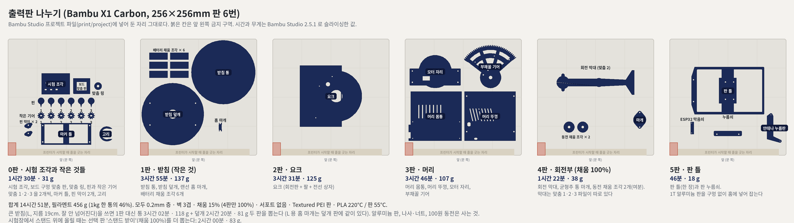

| 판 | 파일 (`print/gcode/`) | 올리는 것 | 시간 | 무게 |
|---|---|---|---:|---:|
| 0판 | `0판_시험조각` | 시험 조각(90), 보드 구멍 맞춤 판(91), 맞춤 링(16), 핀(13)과 작은 기어(05) 맞춤 1·2·3을 2개씩, 마커 틀(15), 핀 막이(14) 2개, 고리(03) | 1시간 30분 | 31 g |
| 1판 | `1판_받침_S` | 받침 통(01), 받침 덮개(02), 랜선 홈 마개(17), 배터리 채움 조각(20) 6개 | 3시간 51분 | 137 g |
| 2판 | `2판_요크` | 요크(04) | 3시간 31분 | 125 g |
| 3판 | `3판_머리` | 머리 몸통(07), 뚜껑(08), 모터 자리(09), 부채꼴 기어(06) | 3시간 46분 | 107 g |
| 4판 | `4판_회전부_맞춤1 · 2 · 3 중 하나` | 회전 막대(10), 균형추 마개(11), 동전 채움 조각(12) 2개. 막대의 맞춤 번호별로 파일이 셋 있다 | 1시간 22분 | 38 g |
| 5판 | `5판_판틀` | 판 틀(18), 판 누름쇠(19) | 45분 | 18 g |

합쳐서 **14시간 47분, 필라멘트 455g** 이다 (1kg 한 통의 46%). Bambu Studio 2.5.1로 슬라이싱한 값이고, 판마다 프린터가 준비하는 약 10분이 들어 있다. 큰 받침(L)을 쓰면 1판 대신 `선택_받침통_L`과 `선택_받침덮개_L` 두 판을 뽑는다 (5시간 19분, 198g). 큰 받침에 맞는 홈 마개(`17_lan_cap_L`)는 덮개 판에 같이 있다. 마커 틀, 핀 막이처럼 받침 크기와 상관없는 작은 부품은 0판에 같이 있다. 판 틀과 누름쇠는 5판에 따로 있다.

### 출력 전에 프린터 맞추기

설계가 맞아도 프린터가 크게·작게 뽑으면 맞지 않는다. 그래서 맞추는 곳은 0판으로 골라 쓰게 했지만, 프린터 자체가 많이 벗어나 있으면 고를 것이 없다 ([설계 검토](설계%20검토.md) 12절의 출력 오차 시뮬레이션). 처음 한 번 이것만 한다.

1. **필라멘트를 마른 것으로.** 오래 열어 둔 PLA 는 습기를 먹어 실처럼 늘어지고 치수가 흔들린다. 새 것을 쓰거나 건조기(또는 X1C 의 열판 위, 50°C 에서 몇 시간)로 말린다. AMS 에 넣을 때 건조제를 같이 둔다.
2. **유량 보정(Flow Dynamics, Flow Rate).** Bambu Studio 의 보정 메뉴에서 처음 쓰는 필라멘트마다 한 번 돌린다. 유량이 많으면 구멍이 작아지고 핀·기어 이가 커진다: 이번 장치에서 가장 큰 오차 원인이다.
3. **설정은 이 저장소의 출력 파일 그대로.** 0.2mm 층, 벽 3겹, 구멍 보정(X-Y hole compensation) 0, 첫 층 퍼짐 보정(Elephant foot compensation)은 Bambu 기본값을 그대로 둔다. 구멍 보정을 따로 넣으면 0판의 맞춤 번호가 어긋난다.
4. **첫 층.** 판을 닦고(손 기름) 첫 층이 고르게 붙는지 본다. 첫 층이 뭉개지면 바닥 쪽 구멍과 모서리가 커진다.

**읽는 법.** 잘 맞춘 프린터와 보통 프린터에서는 거의 다 맞는다. 맞춤을 0판으로 고르는 것이 크게 돕는다: 고르지 않고 맞춤 2번만 뽑으면 끄덕임 축 핀이 73% / 53% 만 맞는다 (고르면 97% / 90%). 덜 맞춘 프린터에서는 핀(34%), M3 나사 구멍(51%), 기어(끼임 17%·24%)가 무너진다. 이것은 고를 맞춤이 모자라서가 아니라 프린터가 전체로 크게 뽑기 때문이라, **0판에서 여러 곳이 한꺼번에 빡빡하면 부품을 고르지 말고 프린터(유량)를 맞춘 뒤 0판을 다시 뽑는다.** 작은 기어는 축에 들어가도 납작 면에 0.1mm 쯤 틈이 남는 일이 많다 (가운데 값 0.10mm): 그만큼 기어 유격이 커져 위 표의 유격(설계 0.38°·0.95°)이 되지만, 모터는 늘 같은 쪽에서 다가가 멈추게 해 두어 재는 각도에는 거의 들어가지 않는다. 신경 쓰이면 작은 기어 구멍에 순간접착제를 한 방울 넣는다.

### 0판으로 맞춤 고르기

프린터마다 구멍이 조금씩 다르게 나온다. 그래서 축 구멍과 핀은 세 가지 크기로 넣어 두었다. 0판에 핀과 작은 기어가 세 가지 다 들어 있으니, 맞는 것을 골라 쓰면 된다.

1. 모터 축을 시험 조각의 D자 구멍 세 개에 차례로 끼워 본다. 손으로 눌러 들어가고, 끼운 채 비틀어도 헛돌지 않는 구멍을 고른다. 구멍 옆 점의 개수(1~3)가 맞춤 번호다. 1번이 가장 빡빡하다.
2. 작은 기어는 그 번호의 것 2개를 쓴다. 4판은 그 번호의 파일(`4판_회전부_맞춤N`)을 뽑는다.
3. 핀 세 종류(지름 8.0, 7.9, 7.8)를 세운 벽의 두 구멍에 꽂아 본다. 윗면에 줄 표시가 **없는** 구멍에는 빡빡하게 들어가고, 줄 표시가 **있는** 구멍에서는 헐겁게 도는 핀 2개를 고른다.
4. M3 나사를 작은 구멍 두 개에 돌려 본다. 좁은 구멍(2.6)은 나사산이 파이며 들어가고, 넓은 구멍(3.4)은 그냥 지나가야 한다. 출력한 작은 구멍은 보통 설계보다 0.1~0.2mm 작게 나온다. 좁은 구멍이 손으로 돌려지지 않을 만큼 빡빡하면, 부품의 좁은 구멍들을 2.6mm 드릴로 한 번 훑거나 M3 탭으로 나사산을 먼저 낸다.
5. M2.5 나사를 가운데 줄의 기둥 두 개에, M2 나사를 맨 위 줄의 기둥 두 개에 돌려 본다. 점이 없는 구멍(M2.5 는 2.1, M2 는 1.6)이 머리 몸통의 기둥과 같은 것이다. 힘껏 돌려야 겨우 들어가면 점이 있는 구멍(2.3, 1.8)에도 돌려 보고, 그쪽이 알맞으면 `cad/model/p2.py`의 `PILOT25`를 1.15로(M2 는 `PILOT2` 를 0.9로) 바꿔 머리 몸통을 다시 내보낸다.
6. 육각 자리에 M3 너트를 끼워 본다. 손으로 눌러 들어가고 돌지 않아야 한다 (회전 막대의 판 받이와 같은 자리다).
7. 보드 구멍 맞춤 판(`91`)에 드라이버 보드를 얹어 구멍 네 개가 맞는지 본다 (1절의 2번).
8. **캘리퍼스가 있으면** 시험 조각의 구멍 지름을 재 본다. 설계보다 0.1~0.2mm 작으면 정상이다. 0.3mm 넘게 작거나 핀·기어 이가 0.1mm 넘게 크면 위의 유량 보정을 하고 0판을 다시 뽑는다.

부품마다의 크기·시간·무게는 2절의 출력 부품 표에 있다.

## 4. 조립

**▶ [조립 시뮬레이션 영상 보기](https://detecam.github.io/receiver/videos/)** (4분 28초, 끝의 25초는 스탠드 받이 달기. 파일은 [`videos/조립_시뮬레이션.mp4`](videos/조립_시뮬레이션.mp4)). 아래 순서대로 부품을 하나씩 넣고, 나사 59개를 하나하나 드라이버로 돌려 조이는 모습이다. 너트 7개는 나사보다 먼저 육각 자리에 넣는다.

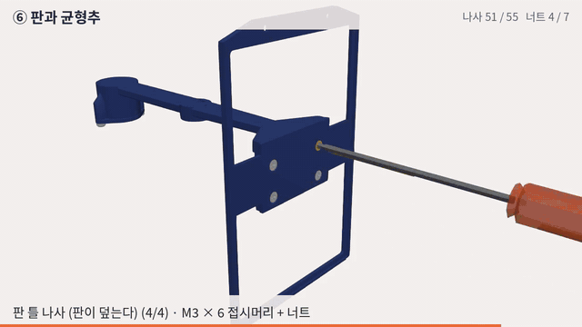

| 영상 안의 시각 | 단계 |
|---|---|
| 0:04 | ① 받침 — 받침 통에 랜선 홈 마개를 끼우고 덮개를 덮는다. 배터리는 옆 창으로 |
| 0:20 | ② 요크 — 모터 1과 작은 기어를 달고, 요크를 받침에 끼워 고리로 잠근다 |
| 0:36 | ③ 머리 속 — 파이와 드라이버 3장을 기둥에 조이고, 젠더·버튼·동글을 꽂는다 |
| 1:26 | ④ 머리 겉 — 모터 3을 넣은 모터 자리를 얹고, 부채꼴 기어와 마커 틀을 단다. 뚜껑은 아직 |
| 2:07 | ⑤ 머리 올리기 — 모터 2를 오른쪽 팔에 달고, 머리를 내려 핀으로 잇는다. 마지막에 뚜껑 |
| 3:01 | ⑥ 판과 균형추 — 동전 12개를 넣고, 판 틀·알루미늄 판·누름쇠를 단 뒤 모터 3 축에 끼운다 |
| 3:52 | 다 됐다 — 재는 자세 |

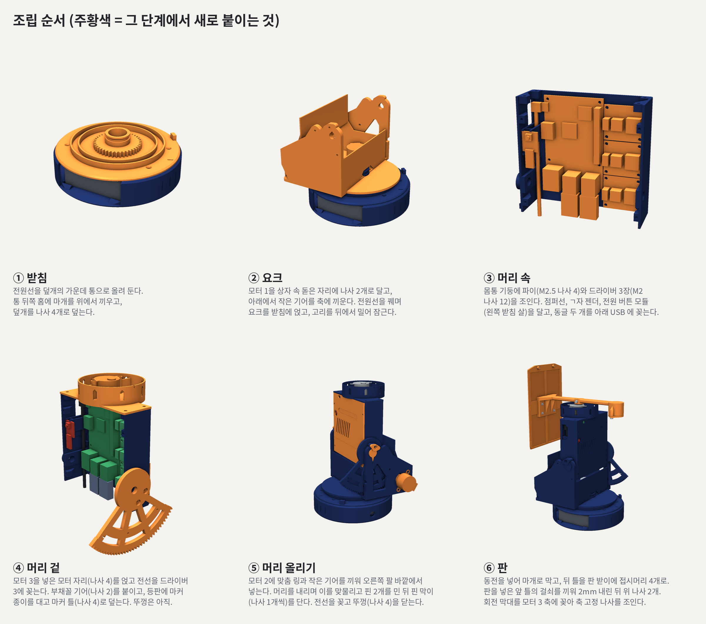

그림의 번호와 같다. 왼쪽·오른쪽은 장치를 앞(받침 덮개의 세모 표시 쪽)에서 마주 볼 때 기준이다. 부채꼴 기어와 모터 2가 오른쪽이다. 조립 47단계를 모델에서 하나씩 밀어 넣어 걸리는 곳이 없는지 확인했다 (`cad/checks/audit_assembly.py`).

나사 길이를 꼭 지킨다.

- **모터 귀 나사는 전부 6mm.** 8mm를 쓰면 회전판 아래나 팔 안쪽으로 나와서 도는 부품을 긁는다.
- **멈춤 나사 3개와 고정 나사는 꼭 10mm.** 12mm면 머리 옆벽이나 받침 덮개를 긁는다.
- **마커 틀과 핀 막이도 6mm.** 마커 틀에 8mm를 쓰면 안쪽의 드라이버 보드에 닿는다.

**뚜껑은 ⑤의 끝에 닫는다.**

**먼저 정할 것: 랜선을 안에 넣을까.** 랜선은 조립할 때만 넣을 수 있다 (머리 아래 단자는 조립하면 손이 안 닿는다).

- **권하는 순서:** 조립하기 전에 파이만 책상에 놓고 랜선으로 10절의 설치를 끝낸다. 무선 동글로 폰과 노트북이 붙는 것까지 확인한 다음, 랜선 없이 조립하고 받침 뒤 홈은 마개(`17`)로 막는다. 그 뒤 개발은 무선으로 한다.
- 무선이 아직 안 되면 랜선을 넣고 조립한다. 그때는 마개를 끼우지 않고 ①-2와 ⑤-8의 괄호 안을 따른다.

**① 받침**

1. 전원선의 마이크로 5핀 쪽을 덮개 아래에서 가운데 통으로 밀어 올린다. 배터리 쪽 ㄱ자 플러그(USB-A 나 USB-C)는 통을 못 지나갈 수 있으니 꼭 이 방향으로 한다.
2. 받침 통 뒤쪽 홈에 마개(`17`. 큰 받침이면 `17_lan_cap_L`)를 위에서 끼워 내린다. 벽을 사이에 무는 모양이다. (랜선을 넣을 때: 마개 대신, 랜선 플러그를 덮개 아래에서 가운데 통으로 올리고 선을 홈에 눌러 넣는다.)
3. 덮개의 둥근 테에 파인 홈에 6mm 비비탄을 한 줄로 45개쯤 넣는다. **두세 개 자리는 비워 둔다**: 꽉 차면 구슬끼리 밀려 구르지 못한다. 요크는 이 구슬 위에 얹혀 굴러 돈다 (베어링 속 쇠구슬과 같다). 기름은 넣지 않는다 (PLA 를 상하게 하고 먼지가 붙는다). ②-4 에서 요크를 얹은 뒤 손으로 돌려 보아 덜컥거림 없이 부드럽게 돌면 된다. 비비탄이 없으면 테 윗면에 양초를 넉넉히 문지른다.
4. 덮개의 세모 표시를 통의 눈금 쪽에 맞춰 얹고 10mm 나사 4개로 조인다.
5. 배터리는 맨 나중에 옆 창으로 밀어 넣는다. 통 바닥의 낮은 턱을 넘어가면 걸려서 저절로 밀려 나오지 않는다. 배터리가 자리보다 작아 흔들리면 배터리 채움 조각(`20`)을 배터리 뒤나 옆 틈에 세워 끼운다 (여러 개 겹쳐도 된다). 창으로 손을 넣어 ㄱ자 플러그를 배터리 단자에 꽂는다. 플러그는 창 안쪽으로 8mm 들어가 있어 겉으로 나오지 않는다.

**② 요크**

1. 모터 1을 요크의 전선 상자 속 돋은 자리에 놓는다. 축이 아래 구멍으로 내려가고, 귀 두 개가 구멍에 맞는 방향은 하나뿐이다. 6mm 나사 2개.
2. 요크를 뒤집어 작은 기어를 모터 1 축에 끼운다. 회전판에 닿을 때까지 민 다음 종이 한 장 두께만큼만 도로 뺀다.
3. 회전판 뒤쪽 왼쪽 구석(모터 1의 반대편)의 작은 구멍에 10mm 나사를 위에서 끝까지 조인다. 아래로 6mm 나온다. 받침 회전 멈춤 나사다.
4. 가운데 통에서 올라온 전원선을 요크 가운데 구멍으로 꿰면서, 요크를 받침의 가운데 통에 끼워 내린다. 작은 기어의 이가 가운데 기어에 물리도록 조금 돌려 가며 앉힌다. 요크 앞(팔이 없는 쪽)을 덮개의 세모 표시 쪽에 둔다.
5. 고리(`03`)를 상자 안에서, 통의 홈에 뒤에서 앞으로 밀어 끼운다. 입구가 홈보다 1.5mm 좁아서 조금 벌어졌다가 딸깍 하고 들어간다. 요크가 위로 빠지지 않게 잡는다.

**③ 머리 속**


1. 파이에 SD카드를 꽂아 둔다. 조립하면 SD카드는 뚜껑을 열고 파이의 나사 4개를 풀어야 바꿀 수 있다.
2. 파이를 머리 몸통(`07`) 뒷벽의 기둥 네 개에 얹고 **M2.5 나사 4개**로 조인다. 부품 면이 앞, SD카드 쪽이 위, USB·랜 단자가 아래다.
3. 드라이버 3장을 파이 오른쪽의 기둥에 얹고 **한 장에 M2 나사 4개씩**(모두 12개) 조인다. 위에서부터 3번, 2번, 1번. 흰 소켓이 아래를 보게 한다. 구멍이 기둥과 조금 어긋나 보여도 가는 나사라 들어간다.
4. 5절의 표대로 점퍼선 18가닥을 꽂는다.
5. ㄱ자 젠더를 파이 전원 단자에 꽂아 둔다. 선을 꽂는 구멍이 아래를 보는 쪽이다.
6. 전원 버튼 모듈(KY-004)을 머리 왼쪽의 받침 살에 끼운다. 버튼이 앞을 본다. 20cm 점퍼선 2가닥으로 `S`를 5번 핀, `−`를 6번 핀에 잇는다. 가운데 핀은 비워 둔다. 뚜껑을 닫으면 뚜껑 안쪽의 살이 기판을 눌러 잡는다.
7. 무선 동글(폰과 통신)을 파이의 USB에 꽂는다. 랜 단자에서 먼 쪽(GPIO 쪽)의 위 칸이다. 탐지 동글은 그 옆 가운데 USB의 위 칸에 꽂는다. 조립한 뒤에는 꽂고 빼기가 번거로우니 지금 꽂는다.

**④ 머리 겉** (뚜껑은 아직 닫지 않는다)

1. 모터 3의 흰 플러그와 전선을 모터 자리(`09`)의 네모 구멍으로 먼저 내려보낸다. 그다음 모터를 넣는다. 귀를 기둥 두 개에 얹고 6mm 나사 2개.
2. **ESP32 안테나.** 모터 자리를 뒤집어 놓고, 밑면 가운데의 얕은 홈(45 × 10.4mm)에 FPC 안테나를 붙인다. 동축선이 왼쪽 끝 홈 쪽으로 나오게 한다. 안테나 누름판(`21`)을 덮고 M2 × 6 나사 2개로 조인다. 동축선 끝은 아직 비워 둔다.
3. 모터 자리를 머리 몸통 위에 얹고 8mm 나사 4개. 내려온 모터 3 전선을 드라이버 3의 흰 소켓에 꽂는다. 안테나 동축선은 머리 안 왼쪽 앞으로 늘어뜨려 둔다.
4. 부채꼴 기어(`06`)를 머리 오른쪽 옆면(드라이버 쪽)에 6mm 나사 2개로 붙인다. 나사 머리 자리가 파인 면이 바깥이다.
5. **AR 마커.** `marker/AR_마커.pdf` 를 실제 크기(100%)로 인쇄해 바깥 선대로 오리고, 네 귀의 표시대로 나사가 지나갈 자리를 따 낸다. 종이를 머리 등판 아래쪽에 ▲ 표시가 위를 보게 대고, 마커 틀(`15`)로 덮어 6mm 나사 4개로 조인다. 머리를 요크에 올리기 전인 지금이 드라이버를 대기 쉽다.

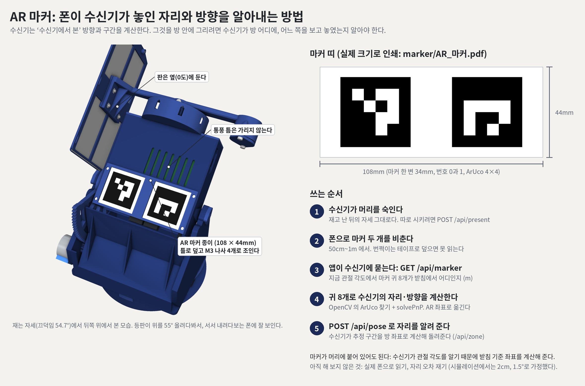

**⑤ 머리 올리기**

1. 모터 2의 축 둘레 턱에 맞춤 링(`16`)을 씌운다. 넓은 구멍이 모터 쪽이다. 그다음 작은 기어를 축 끝에서 턱까지 민다.
2. 모터 2를 링과 기어가 달린 채로 **오른쪽 팔** 바깥에서 구멍(지름 16.5mm)에 넣는다. 모터 몸통이 축보다 위로 오는 방향이다. 6mm 나사 2개. 링이 구멍을 채워 모터 자리를 잡는다.
3. 모터 2의 흰 플러그를 세워서 팔 뒤 아래 틈으로 넣고, 칸막이 구멍을 지나 전선 상자 안으로 보낸다.
4. 머리를 두 팔 사이로 위에서 내린다. 부채꼴 기어의 이가 작은 기어에 닿으면 머리를 앞뒤로 조금 끄덕여 이를 맞물리며 끝까지 내린다.
5. 축 구멍이 맞으면 핀 2개를 양쪽 팔 바깥에서 밀어 넣는다. 머리를 똑바로 세운 채, 핀의 바늘이 아래를 가리키게 꽂는다. 오른쪽 팔에 0°, 54.7°, 90° 눈금이 있다. 그다음 **핀 막이**(`14`)를 핀 머리 위에 덮고 6mm 나사 1개씩으로 팔에 조인다. 핀이 빠져나오지 못하게 막는다.
6. 왼쪽 팔 바깥의 작은 구멍 두 개에 10mm 나사를 조인다. 끄덕임 멈춤 나사다. 머리 옆의 돌기가 두 나사 **사이**에 있어야 한다.
7. 모터 1, 2의 전선을 상자 속에서 머리 아래로 올려 드라이버 1, 2의 흰 소켓에 꽂는다. 남는 선은 상자 속에 접어 둔다.
8. 가운데 통에서 올라온 전원선을 머리 아래로 올려 ㄱ자 젠더에 꽂는다. (랜선을 넣었으면 랜 단자에 꽂는다.)
9. 머리 아래로 올라온 전선 셋(모터 1, 모터 2, 전원)을 머리 아래 가운데에서 케이블 타이로 한데 묶는다. 왼쪽 팔과 머리 사이의 5mm 틈(멈춤 돌기가 지나는 길)과 오른쪽 기어 쪽으로 늘어지지 않게 한다. 머리가 −5°에서 85°까지 움직이면 전선이 지나는 길이가 24~40mm 달라지니, 팽팽하게 당겨 묶지 않는다.
10. **ESP32.** 뚜껑(`08`)을 떼어 엎어 놓고, 안쪽 왼쪽의 홈 받침 2개에 XIAO 를 세워 끼운다. 부품 면(쇠 덮개)이 왼쪽, 핀 머리가 오른쪽(파이 GPIO 쪽), USB-C 가 아래다. 막음쇠(`22`)를 위에 대고 M2 × 6 나사 2개. 안테나 동축선 끝을 XIAO 의 안테나 단자(U.FL)에 꾹 눌러 끼운다.
11. ESP32 점퍼선 4가닥(20cm): 5V 는 파이 2번 핀에 꽂은 Y 케이블의 남은 끝, GND 는 9번, D6(TX) 는 10번, D7(RX) 는 8번 핀 (5절).
12. 뚜껑을 덮고 6mm 나사 4개. 뚜껑의 구멍으로 버튼이 눌리는지 본다.

**⑥ 알루미늄 판, 판 틀, 균형추**

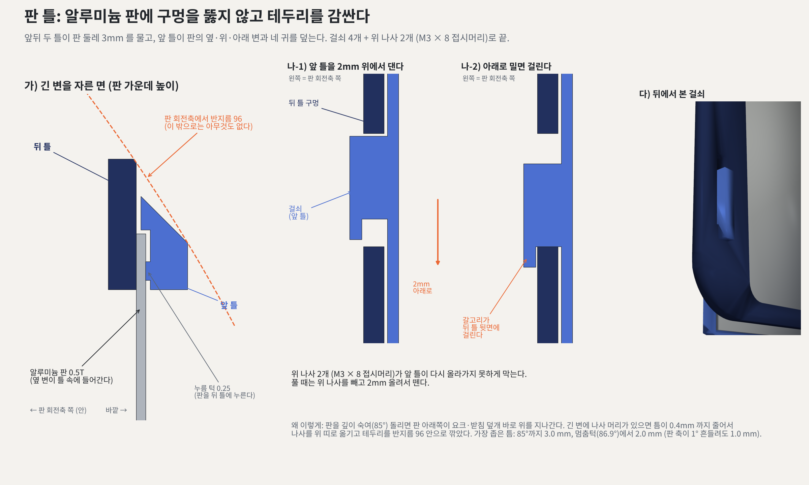

알루미늄 판(1T)에는 구멍을 뚫지 않는다. 판 틀(`18`)은 한 장짜리 받침판이고, 판 크기만 한 홈(둘레 틈 0.2mm, 깊이 1.15mm)에 판이 쏙 들어가 판 앞면이 테두리보다 0.15mm 낮게 앉는다. 판 아래 변은 45° 아래 턱 밑에 들어가고, 위 변은 누름쇠(`19`)가 누른다.

1. **균형추.** 회전 막대(`10`)를 뒤집어 통의 입구가 위를 보게 한다. 100원 동전 12개를 넣어 통을 채운다 (채움 조각은 쓰지 않는다). 마개(`11`)를 덮고 8mm 나사 2개로 조인다. 동전 두께에 따라 통 입구와 마개 사이에 0.4~1.6mm 틈이 남는 것이 정상이다 (나사가 동전을 눌러 잡는다). 흔들어서 소리가 나지 않으면 된다.
2. **판 틀 달기.** 판 받이 안쪽 육각 자리 네 곳에 M3 너트를 끼운다. 판 틀(`18`)의 평평한 뒷면을 판 받이에 대고, 홈 바닥 쪽에서 **접시머리 6mm 나사 4개**를 꽂아 조인다. 머리가 홈 바닥보다 조금(0.35mm) 낮게 묻혀야 판이 평평하게 앉는다.
3. **판 넣기.** 판을 20°쯤 세워 아래 변을 판 틀의 아래 턱 밑으로 밀어 넣고, 아래 변을 축으로 판을 눕혀 홈에 넣는다. 판의 네 변이 홈 안에 들어가야 한다.
4. **누름쇠.** 판 틀 뒷면 위쪽의 육각 자리 두 곳에 M3 너트를 끼운다 (너트가 1.2mm 나온다). 누름쇠(`19`)를 판 위 변에 대고 **접시머리 8mm 나사 2개**로 조인다. 누름쇠가 판에 닿아 멈추면 그만 조인다 (더 세게 조이면 너트 자리가 눌린다). 판을 뺄 때는 이 나사 2개를 풀고, 판 틀 위쪽 창으로 판 뒷면을 밀어 위 변을 든 다음 아래로 빼낸다. 조인 뒤 회전부를 뒤집어 가볍게 흔들어 본다: 판이 빠지거나 크게 흔들리지 않으면 된다. 아래 턱 쪽의 아주 작은 달그락거림은 정상이다 (9절).
5. **막대 끼우기.** 막대를 바로 놓고 가운데 구멍을 모터 3 축에 끼운다. 구멍의 납작한 면을 축의 납작한 면에 맞추고, 막대 가운데(축 바로 위)를 눌러 끝까지 끼운다. 판을 잡고 누르지 않는다. 막대 밑과 모터 사이에 종이 한 장이 들어갈 틈(0.5mm)이 남아야 한다. 틈이 없으면(축이 조금 짧은 모터) 명함 한 장을 사이에 끼운 채 6번처럼 나사를 조이고 명함을 뺀다.
6. **축 고정.** 막대 윗면의 네모 홈에 M3 너트를 떨어뜨려 넣고, 옆의 구멍으로 8mm 나사를 돌려 넣는다. 나사 끝이 축의 납작한 면을 누른다. 손끝에 걸리는 느낌이 올 때까지만 조인다.

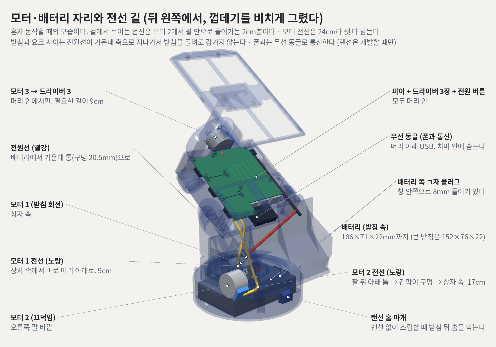

들 때는 받침을 잡는다. **판이나 회전 막대를 잡고 들지 않는다**: 판 끝을 5N(500g의 무게)으로 밀면 막대가 휘어 판 끝이 5mm 밀리고, 더 세게 밀면 모터가 억지로 돌아가 모터 속 기어가 상한다. 옮길 때는 오른쪽 팔의 고정 나사 구멍에 10mm 나사를 꽂아 머리를 0°에 묶어 둘 수 있다. 재기 전에 꼭 뺀다.

### 시험장에서 쓸 때: 스탠드 받이 달기 (선택)

교실처럼 사람이 많이 앉아 있는 곳에서는 수신기를 사람 머리 위(안테나 높이 2.0~2.4m)로 올려야 한다. 책상 위에서만 쓸 때는 건너뛴다.

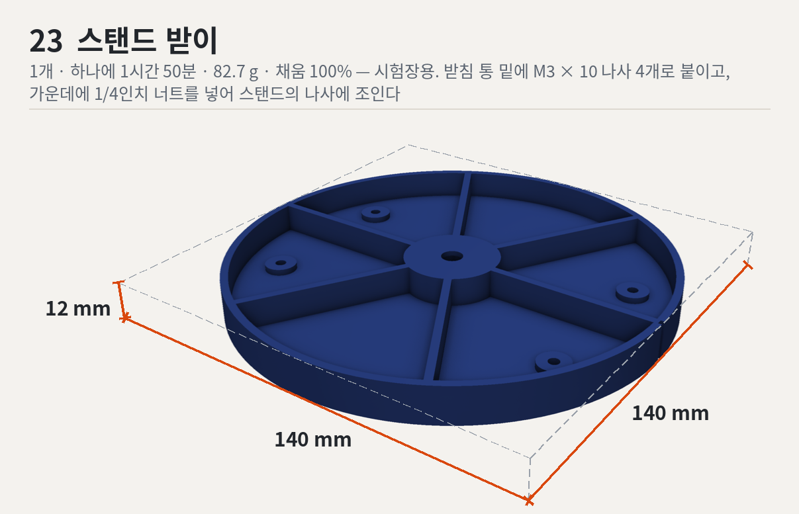

1. 스탠드 받이(`23`) 가운데의 육각 자리에 1/4인치 너트를 위에서 넣는다.
2. 수신기를 눕히고, 받이를 받침 통 밑에 댄다. 받이의 옆 홈이 받침 통의 뒤쪽을 보게 한다.
3. 아래에서 M3 × 10 나사 4개를 받침 통 밑면의 길잡이 구멍에 조인다. 플라스틱에 직접 물리므로 끝까지 가면 멈춘다 (더 돌리면 나사산이 뭉개진다).
4. 스탠드를 낮춘 채로 꼭대기 나사에 수신기를 통째로 돌려 끼운다. 손으로 꽉 조인다.
5. 스탠드 다리 하나가 학생 쪽을 보게 벌리고, 다리에 모래주머니(3kg 이상)를 올린 뒤 높이를 올린다. 안테나(머리 가운데)가 바닥에서 2.0~2.4m 가 되게 한다. 낮을수록 덜 흔들린다.

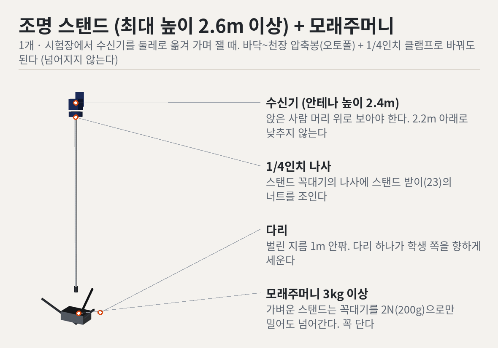

떼어 낼 때는 거꾸로 한다. 받이를 단 채로 책상에 놓아도 된다 (바닥이 평평하다).

## 5. 배선

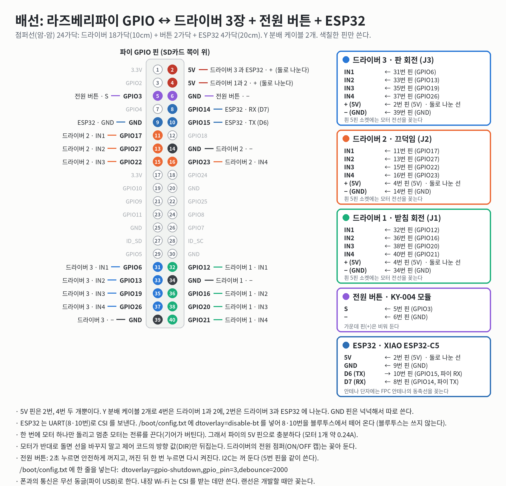

| 꽂는 곳 | IN1 | IN2 | IN3 | IN4 | + (5V) | − (GND) |
|---|---|---|---|---|---|---|
| 드라이버 3 · 판 회전 (J3) | 31번 (GPIO6) | 33번 (GPIO13) | 35번 (GPIO19) | 37번 (GPIO26) | 2번 (Y 케이블) | 39번 |
| 드라이버 2 · 끄덕임 (J2) | 11번 (GPIO17) | 13번 (GPIO27) | 15번 (GPIO22) | 16번 (GPIO23) | 4번 (Y 케이블) | 14번 |
| 드라이버 1 · 받침 회전 (J1) | 32번 (GPIO12) | 36번 (GPIO16) | 38번 (GPIO20) | 40번 (GPIO21) | 4번 (Y 케이블) | 34번 |

| 전원 버튼 (KY-004) | 파이 핀 |
|---|---|
| S | 5번 (GPIO3) |
| − | 6번 (GND) |
| 가운데 (+) | 비워 둔다 |

| ESP32 (XIAO ESP32-C5) | 파이 핀 |
|---|---|
| 5V | 2번 (Y 케이블: 드라이버 3 과 나눈다) |
| GND | 9번 |
| D6 (TX) | 10번 (GPIO15, 파이 RX) |
| D7 (RX) | 8번 (GPIO14, 파이 TX) |

ESP32 는 응답 프레임(ACK)의 CSI 를 UART 로 파이에 보낸다. 파이의 8·10번 핀은 원래 블루투스가 쓰므로 `/boot/config.txt` 에 `dtoverlay=disable-bt` 를 넣고, `raspi-config` 의 Serial Port 에서 '로그인 셸은 끄고 하드웨어 포트는 켠다' (켜 두면 부팅 글자가 ESP32 로 들어간다). 둘 다 3.3V 신호라 그대로 잇는다. 빠르기는 921600 baud 로 잡는다: ACK 가 1초에 100개 와도 CSI 를 바이너리로 보내면 1초에 16KB 쯤이라 넉넉하다 (글자로 보내면 60KB 쯤이라 빠듯하다).
**ESP32 에 펌웨어를 올릴 때는 5V 점퍼를 먼저 뺀다.** XIAO 의 5V 핀은 USB-C 의 5V 와 바로 이어져 있어서, 파이 5V 와 노트북 USB 가 맞물린다 (Seeed 는 5V 핀에 전원을 넣을 때 다이오드를 사이에 두라고 한다). 펌웨어는 머리에 넣기 전에 올리고, 다시 올릴 때는 뚜껑을 연다.

판 회전은 DiffLoc 공개 코드와 같은 핀이다. 모터가 반대로 돌아도 선은 바꾸지 않는다. `firmware/pi/rx3.py` 맨 위의 `DIR` 값만 뒤집는다. I2C는 꺼 둔다 (5번 핀을 버튼이 쓴다).

## 6. 전원 켜고 끄기

- **켜기:** 보조배터리가 켜져 있으면 버튼을 한 번 누른다. 약 40초 뒤 초록 불이 천천히 깜빡이면 준비된 것이다.
- **끄기:** 버튼을 **2초** 누른다. 폰 화면의 '끄기'로도 꺼진다. 초록 불이 꺼지면 다 꺼진 것이다. 그 전에 배터리를 뽑지 않는다 (SD카드가 상할 수 있다).
- 짧게 누르면 그 자리에서 한 번 잰다.
- 보조배터리에 따라서는 파이가 꺼진 뒤 전기를 스스로 끊는다. 그러면 다시 켤 때 보조배터리의 버튼을 먼저 눌러야 한다.

## 7. 처음 켜기 (모터 맞추기)

10절의 설치를 먼저 한다. 그다음은 **폰 화면의 '장치 · 손으로 움직이기'** 에서 다 할 수 있다. 괄호 안은 같은 일을 파이에서(SSH로) 하는 명령이다.

1. **모터 시험** (`python3 ~/detecam/rx3.py test`). 세 관절이 하나씩 조금 갔다가 돌아온다. + 방향이 아래와 같은지 본다. 다르면 `rx3.py`의 `DIR`에서 그 관절을 `-1`로 바꾼다.
   - spin: 머리 위에서 볼 때 판이 반시계로
   - yaw: 위에서 볼 때 요크가 반시계로
   - pitch: 머리가 앞으로(팔이 없는 쪽으로) 숙는다
2. 멈춤 나사 3개(받침 회전 1, 끄덕임 2)가 달려 있는지 다시 본다. 없으면 원점을 잡다가 머리가 뒤로 넘어간다.
3. **원점 다시 잡기** (`rx3.py home`). 끄덕임과 받침을 멈춤턱까지 밀었다가 0°로 돌아온다. 약 90초. 턱에 닿으면 모터가 드르륵 소리를 내며 헛도는데, 이 모터는 그래도 괜찮다. 다음부터는 빠른 방법(약 41초)을 쓴다.
4. **판 0° 맞추기.** 판 단추(±5°, ±90°)로 조금씩 돌려, 회전 막대 윗면의 줄 표시를 모터 자리 벽의 홈(부채꼴 기어 쪽)에 맞춘다. 맞으면 '지금 판 자리를 0°로' (`rx3.py zero spin`). 5°보다 잘게 맞추려면 `rx3.py jog spin 1`.
5. **재는 자세로** (`rx3.py goto --pitch 54.74`). 핀의 바늘이 54.7° 눈금을 가리키는지 본다. 약 21초.
6. **판 한 바퀴**를 열 번 누른다 (`rx3.py spin --turns 10`). 열 바퀴 뒤에 줄 표시가 제자리에 오는지 본다. 어긋나면 `HALF_STEPS_PER_REV`를 4076에서 4096으로 바꿔 다시 해 본다.
7. 끄덕임 +10° 단추로 85°까지 숙인 뒤 판을 한 바퀴 돌린다. 판 틀 모서리가 회전판과 고리 위를 지나갈 때 틈이 3mm쯤 보여야 한다. 끝나면 '머리 세우기' (`rx3.py park`).

위치는 파이의 `~/.detecam_rx3.json`에 적어 둔다. 전원을 끄고 손으로 관절을 돌렸다면 원점을 다시 잡는다.

## 8. 재기 (폰으로)

폰을 수신기의 Wi-Fi(`DeteCam-RX`)에 붙이고 브라우저에서 `http://192.168.4.1` 을 연다. '홈 화면에 추가'를 하면 앱처럼 열린다. **수신기의 모든 동작이 이 화면에 있다.**


**놓기 전에: 수신기 가운데에서 23cm 안에는 벽이나 물건이 없게 한다.** 판과 균형추가 가운데에서 19cm까지 돈다 (9절).

1. **탐지.** '둘레 기기 찾기'를 누른다 (약 30초). '카메라 후보' 표시가 붙은 줄을 눌러 고른다.
2. **판별.** '걸으며 확인'을 누르고 화면·소리·진동이 시키는 대로 멈췄다 움직였다 한다 (55초). '카메라로 보임'이 나오면 이 방을 찍는 카메라다. '의심 기기'로 나와도 다음으로 간다.
3. **위치 측정.** 수신기를 놓고, 놓은 자리(x, y, 높이, 앞 표시가 향한 쪽)를 적고 '이 자리에서 재기'를 누른다. 약 1분 20초. 화면의 초록 동그라미(다음에 놓으면 좋은 자리)로 옮겨 또 잰다. 보통 3자리.
4. **표시.** 주황색 추정 구간이 1m 아래로 줄면 그 안의 물건을 살펴본다.

| 화면에서 할 수 있는 것 | |
|---|---|
| 멈춤 | 무엇을 하는 중이든 맨 위에 뜬다. 누르면 모터 전류까지 끄고 선다 |
| 손으로 움직이기 | 받침 ±5°·±30°, 끄덕임 ±2°·±10°, 판 ±5°·±90°·한 바퀴, 머리 세우기, 재는 자세로, 마커 보여 주기 |
| 맞추기 | 지금 판 자리를 0°로, 원점 다시 잡기, 모터 시험, 모터 전류 끄기 |
| 관리 | 채널과 기기 저장, 방 크기 저장, 모두 지우고 새로, 결과 내려받기, 다시 켜기, 끄기 |

- 재는 동안 사람은 수신기에서 1m 넘게 떨어져 가만히 있는다. **카메라와 수신기 사이에 서 있으면 못 잰다** (오차 가운데값이 20~40°로 커진다).
- 변기 칸처럼 좁은 곳(가로나 세로가 2m 아래)에서는 재는 방법을 **여섯 번**으로 바꾼다 (약 111초). 크게 틀리는 일이 반쯤으로 준다. 칸막이가 철판인 칸은 반사가 너무 세서 위치를 믿기 어렵다.
- 단계마다의 자세한 설명과 곳별 결과는 [네 단계 검토](네%20단계%20검토.md)에, 화면과 주소 목록은 [혼자 동작](혼자%20동작.md)에 있다.
- 결과의 방위각은 받침 덮개의 세모 표시가 0°이고 위에서 볼 때 반시계가 +다. 높이각은 수평이 0°, 바닥 쪽이 −다.
- 자료는 파이의 `~/detecam/data/pos_날짜_시각/` 에 남는다 (`csi.pcap`, `motion.jsonl`, `result.json`). 화면의 '결과 내려받기'는 잰 곡선까지 한 파일로 준다.

**개발할 때 (노트북에서).** `firmware/host/scan3.py` 가 SSH로 파이를 움직이고 그림까지 그려 준다.

| 계획 | 하는 일 | 걸리는 시간 |
|---|---|---|
| `tilt3` (기본) | 54.7° 기울여 받침 −120°, 0°, +120°에서 세 번. 한 스캔에서만 골이 보이면 한 번 더 | 처음 약 79초, 기울인 채 이어서 재면 약 47초 |
| `tilt6` | 54.7° 기울여 받침을 60°씩 돌려 여섯 번 (좁은 방) | 약 111초 |
| `up+tilt3` | 세워서 한 번(논문 방식) + 기울여 세 번 | 약 86초 |
| `tilt4` | 60° 기울여 네 번 | 약 93초 |
| `up` | 세워서 한 번만 (높이는 못 잰다) | 약 8초 |

## 9. 알아 둘 것

- **둘레 23cm 를 비운다.** 탁 트인 곳에서는 스스로 넘어지지 않는다 (가장 나쁜 자세에서도 무게중심이 받침 가장자리에서 5cm 안쪽). 하지만 벽이나 물건이 가까우면 머리를 숙이다가 판이 그것을 밀어 수신기가 넘어갈 수 있다. 작은 받침(S)은 꼭대기를 3.2N(약 324g의 힘)으로 밀면 넘어가고, 큰 받침(L)은 6.3N이 든다. 좁은 선반 끝에는 두지 않는다. 자세한 것은 [설계 검토](설계%20검토.md) 10절.
- **배터리를 넣고 쓴다.** 배터리가 받침의 무게추 노릇을 한다. 빼면 넘어가는 기울기가 31°에서 24°로 준다.
- **판은 1T(100 × 150)다.** 판(약 40g)과 동전 12개 때문에 머리가 무거워서, 재는 자세에서 끄덕임 모터 힘의 60%, 85°에서 87%를 쓴다. 85°를 자주 쓰거나 모터가 드르륵거리며 못 따라가면 고무줄로 거들거나 끄덕임 반 스텝 시간(`STEP_S`)을 늘린다.
- **모터 2 없이 시작하기.** 모터가 두 세트뿐이면 모터 3(판)과 모터 1(받침)만 달고, 머리는 손으로 54.7°에 맞춘 뒤 고정 나사로 묶는다. 코드는 그대로 써도 된다.
- **받침이 뻑뻑하면.** 비비탄을 넣는다. 그냥 PLA끼리 닿으면 모터 힘의 101%를 마찰이 먹는다. 양초를 문지르면 51%, 비비탄이면 7%다 (어림값).
- **속도와 힘.** 이 모터는 느리게 돌릴수록 힘이 세다. 끄덕임은 반 스텝 3ms, 받침은 2ms, 판은 1.5ms로 맞춰 두었다. 모터가 드르륵거리며 못 따라가면 `rx3.py`의 `STEP_S`에서 그 관절의 숫자를 키운다.
- **85°보다 더 숙이지 않는다.** 판 틀과 요크·받침 사이 틈이 85°에서 3.0mm, 멈춤턱(86.9°)에서는 1.9mm다 (판 축이 1° 흔들리면 1.8mm, 0.7mm). 모터로는 85°까지만 간다. 재는 자세(54.7°)는 6.1mm, 뒤로 젖힌 끝(−5.3°)은 2.2mm 남는다.
- **플라스틱에 직접 물린 나사를 다시 넣을 때.** 거꾸로 돌려 '딸깍' 하고 원래 나사산에 걸린 뒤에 조인다. 새 나사산을 내면 구멍이 금방 뭉개진다. 자주 여는 머리 뚜껑 나사가 특히 그렇다.
- **판은 아래 턱 쪽에 0.27mm 틈이 있다.** 판을 비스듬히 끼우려고 둔 틈이다. 옆과 위아래로는 홈 벽이 0.2mm 안으로 잡고, 옆 변이나 판 전체가 앞으로 나오려 하면 누름쇠에 바로 막힌다. 다만 누름쇠는 판 위 끝을 누르는 것이라, 판이 그 끝을 경첩처럼 해서 아래 끝이 앞으로 0.27mm 까지 들릴 수는 있다. 머리를 기울여 판이 아래를 볼 때 아주 작게 달그락거릴 수 있지만 측정에는 영향이 없다 (판 각도로 0.1°쯤).
- **손으로 억지로 돌리지 않는다.** 기어가 물린 뒤에는 머리와 요크를 손으로 밀어 돌리면 모터 속 기어가 상한다. 움직일 때는 폰 화면의 단추를 쓴다.
- **모터 열.** 움직이지 않는 모터는 코드가 전류를 끈다. 기어가 버티므로 자세는 그대로다.
- **유격.** 받침은 늘 + 방향으로 마무리하게 해 두었다 (− 방향으로 갈 때는 3° 지나쳤다가 돌아온다).

## 10. 혼자 동작하게 설치하기

코드는 저장소의 `firmware/` 폴더에 있다. 자세한 것은 [혼자 동작](혼자%20동작.md).

1. (노트북에서, 파이에 랜선을 꽂은 채) `firmware/pi/install.sh pi@raspberrypi.local` — 파일을 파이의 `~/detecam` 에 넣고, 파이에서 계산 검사를 돌리고, 켜지면 저절로 뜨게 등록하고, `/boot/config.txt` 에 버튼 줄과 모터 핀 줄을 넣는다.
2. (파이에서) `cd ~/detecam && sudo ./link_setup.sh check` — 동글 두 개가 잡혔는지, 어느 것을 어디에 쓸지 본다.
3. 폰과 통신: `sudo ./link_setup.sh ap`. '자기 Wi-Fi 만들기'가 안 된다고 나오면 `sudo ./link_setup.sh client 핫스팟이름 비밀번호` (폰 핫스팟을 2.4GHz로 켠다).
4. 탐지 동글이 있으면 `sudo ./link_setup.sh mon` — 이름을 고정하고 모니터 모드를 시험한다.
5. `sudo reboot`. 폰에서 `DeteCam-RX` 에 붙어 `http://192.168.4.1`. 비밀번호는 3번에서 화면에 나온 것이다 (장치마다 무작위로 만든다. 다시 보기: `sudo cat /etc/detecam/ap_password`).

`apt upgrade` 는 하지 않는다 (nexmon 이 깨진다). 스크립트도 하지 않는다.

## 11. 치수를 고쳐 다시 내보내기

저장소의 `cad/` 폴더에서 한다. 처음 한 번 `pip install manifold3d trimesh numpy shapely` (그림까지 다시 그리려면 `pyvista pillow matplotlib`도).

```
python3 export/export2.py        # ../stl 에 STL 33개. 다시 읽어 닫힌 형상인지 검사한다
python3 checks/check2.py         # 전 범위 겹침 검사 (5분쯤)
python3 checks/check_extra.py    # 나사 머리, 볼트, 동전, 크기가 다른 부품까지 넣은 검사
python3 checks/audit_screws.py   # 나사 59개: 구멍, 깊이, 물리는 길이, 드라이버가 들어갈 길
python3 checks/audit_assembly.py # 조립 순서대로 부품을 밀어 넣는 길
python3 checks/audit_motion.py   # 기어 물림, 멈춤턱, 자세별 틈
python3 checks/audit_sweep.py    # 판을 돌리며 촘촘히 훑은 틈 (30분~1시간)
python3 checks/audit_holes.py    # 나사가 스스로 나사산을 내는 구멍의 둘레 살, 0판 G코드의 시험 구멍 지름 (몇 분)
python3 checks/plate_play.py     # 판 틀 속에서 알루미늄 판이 움직이는 양 (1분)
python3 analysis/mass.py         # 무게, 동전 수, 끄덕임에 걸리는 힘, 받침 마찰
python3 analysis/strength.py     # 튼튼함 (손계산)
python3 analysis/tipover.py      # 넘어짐 (무게중심 계산).  analysis/tip_mujoco.py 는 물리 엔진으로 움직여 본다
python3 checks/room_check.py     # 부품 자리와 전선 길이
python3 slicing/slice_bambu.py ../stl ../print --parts      # Bambu Studio 로 다시 슬라이싱 (자리 알려 주기는 cad/README.md)
python3 slicing/print_check.py ../stl ../print              # 슬라이싱한 파일을 다시 읽어 검사
```

치수는 `cad/model/p2.py` 한 곳에 있다. 파이와 모터 치수는 `cad/model/params.py`에 있다. 스크립트마다 하는 일은 `cad/README.md` 와 [폴더와 파일](폴더와%20파일.md).
