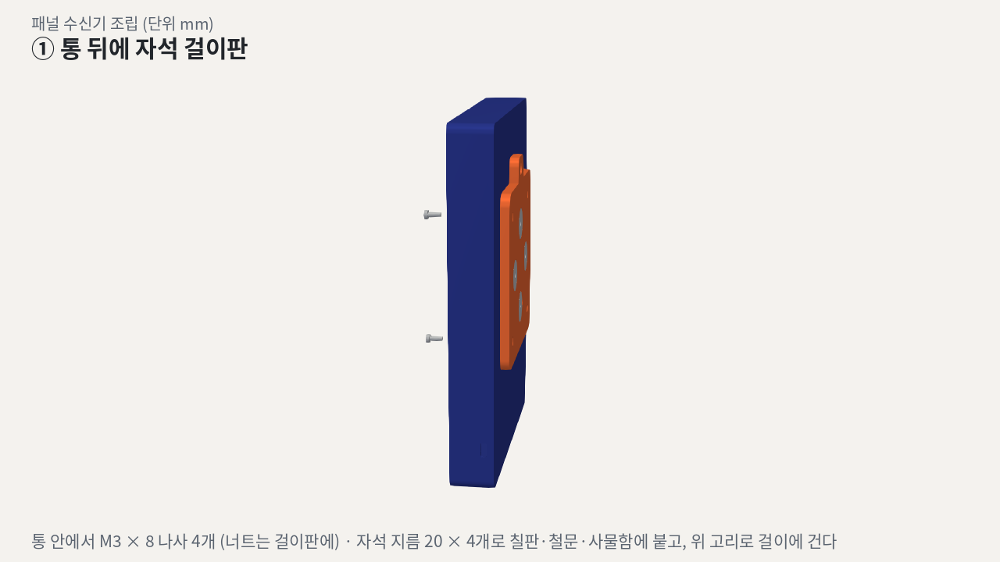
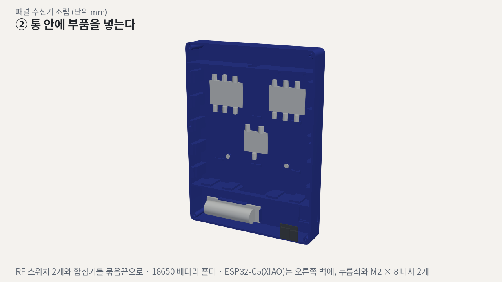
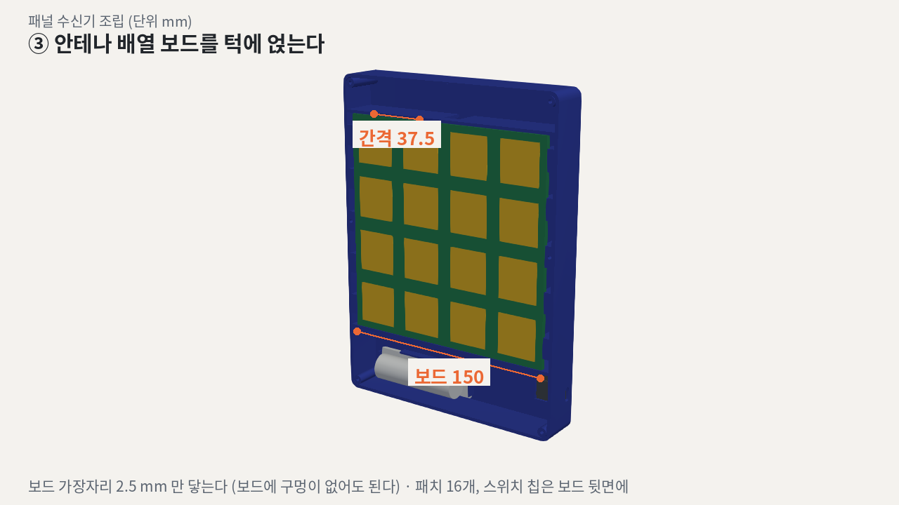
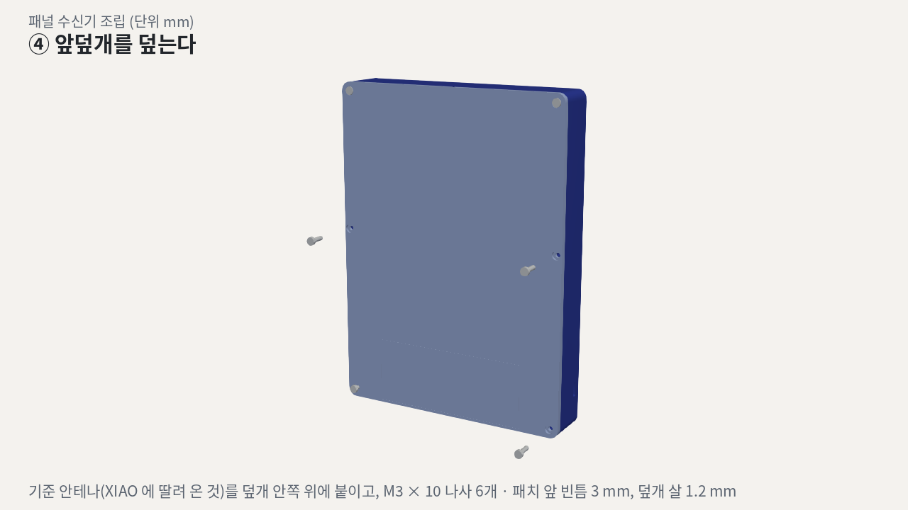
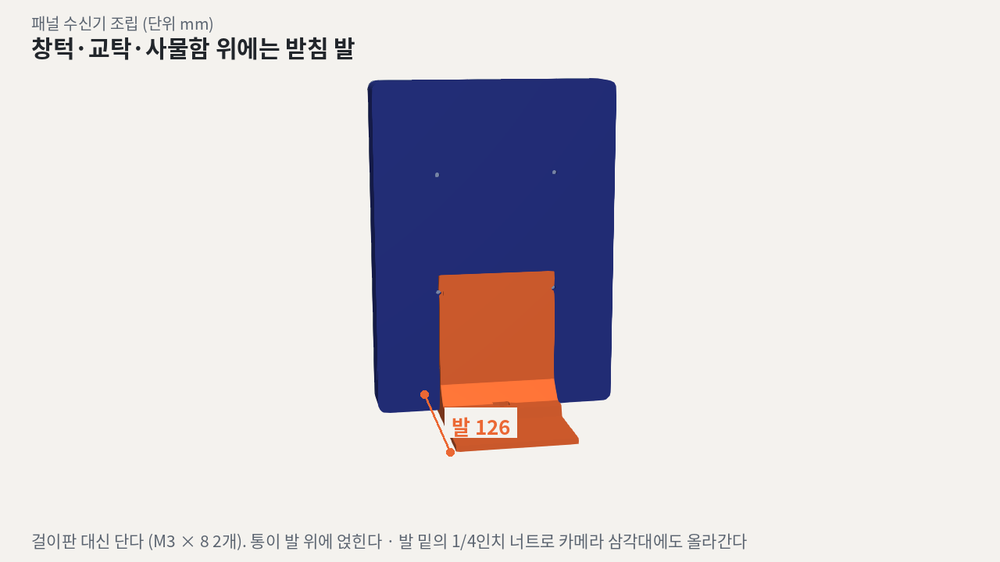
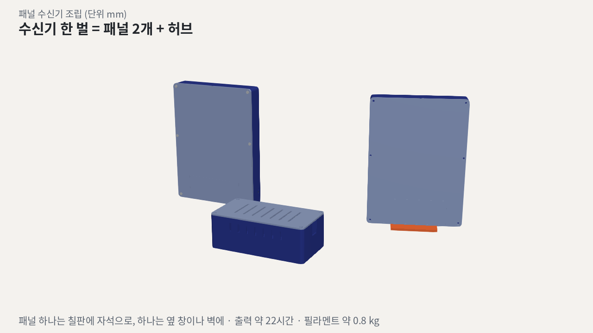

---
tags:
  - DeteCam
  - 조립
고친날: 2026-11-17
---

# 조립 안내 (패널 수신기)

패널 하나를 만드는 순서다. 둘째 패널도 같다. 끝에 허브가 있다. 움직이는 그림은 [조립 영상](videos/조립_시뮬레이션.mp4) (56초), 부품은 [부품표](부품표.md).

> 먼저 [체크리스트](체크리스트.md)의 0단계 실험을 한다. 그 실험은 통 없이 책상 위에서 한다.

## 준비

| 뽑는 것 | 사는 것 | 연장 |
|---|---|---|
| 통, 앞덮개, 자석 걸이판(또는 받침 발), ESP32 누름쇠 | 안테나 배열 보드, XIAO ESP32-C5, RF 스위치 2, 합침기, 선, 18650 홀더, 자석 4, 나사 | 십자드라이버 (M2, M3), 납땜인두 (XIAO 의 핀 헤더), 묶음끈 |

XIAO 의 핀 헤더는 **윗면으로** 납땜한다 (부품이 있는 쪽으로 핀이 선다). 점퍼선을 위에서 꽂는다.

## 1. 통 뒤에 자석 걸이판

1. 걸이판의 둥근 자리 넷에 자석을 넣고 M3 × 6 접시머리 나사로 조인다.
2. 걸이판의 육각 자리 넷에 M3 너트를 넣는다.
3. 통 안에서 M3 × 8 나사 넷을 뒤로 넣어 걸이판에 조인다. 나사 간격은 80 × 80 이다.

창턱이나 교탁 위에 세울 패널은 걸이판 대신 받침 발을 단다 (5번).

## 2. 통 안에 부품

1. RF 스위치 둘과 합침기를 통 바닥의 고리에 묶음끈으로 묶는다. 자리는 그림과 달라도 된다.
2. 두 스위치의 1~4번 단자끼리 길이가 다른 SMA 선 넷으로 잇는다 (짧은 것부터 1, 2, 3, 4).
3. 18650 홀더를 아래 칸 왼쪽에 양면테이프로 붙인다.
4. XIAO 를 아래 칸 오른쪽 받침에 눕힌다. USB-C 가 오른쪽 벽의 창으로 나온다. 누름쇠를 USB-C 단자 위에 걸치고 M2 × 8 나사 둘로 조인다.

잇는 순서: 기준 안테나 → 스위치 A → (선 넷) → 스위치 B → 합침기의 한쪽. 보드의 RF 단자 → 합침기의 다른 쪽. 합침기의 합쳐진 쪽 → XIAO 의 U.FL.

| XIAO 의 핀 | 가는 곳 |
|---|---|
| 넷 | 보드의 안테나 고르기 (ANT_SEL0~3) |
| 둘 | 보드의 켜기(EN), 제어(D0) |
| 둘 | 스위치 A·B 의 제어 (V1, V2. 둘을 같이 묶는다) |
| 3V3, GND | 보드(VBAT), 스위치 모듈 |
| BAT+, BAT− | 18650 홀더 |

핀 번호는 장치 코드를 쓸 때 정한다.

## 3. 안테나 배열 보드

1. FPC 케이블과 동축선을 보드 뒷면에 꽂고, 아래 칸막이의 굴로 내려보낸다.
2. 보드를 턱 위에 얹는다. 패치가 앞을 본다. 턱은 보드 끝 2.5 mm 만 받친다.

## 4. 앞덮개

1. 기준 안테나(XIAO 에 딸려 온 FPC 안테나)를 앞덮개 안쪽의 위 띠에 붙인다. 선은 위 칸막이의 굴로.
2. 앞덮개를 덮고 M3 × 10 나사 여섯으로 조인다. 덮개의 테두리 턱이 보드를 누른다.
3. 아래쪽 네모 표시선 안에 AR 마커(44 mm)를 붙인다.

## 5. 받침 발 (걸이판 대신)

1. 발의 두꺼운 곳에 1/4인치 너트를 위에서 넣는다 (삼각대에 올릴 때만).
2. 발의 육각 자리 둘에 M3 너트를 넣고, 통을 발 위에 얹어 통 안에서 M3 × 8 나사 둘로 조인다 (아래쪽 구멍 둘).

## 6. 허브

1. 보조배터리를 통 바닥에 넣는다. 선은 왼쪽 끝으로 올린다.
2. 선반을 양 끝 턱에 얹는다.
3. 파이를 선반 기둥에 M2.5 × 6 나사 넷으로 조인다. 동글 둘을 USB 에 꽂는다.
4. 패널로 가는 USB 선을 오른쪽 끝 홈으로 내고, 뚜껑을 M3 × 10 나사 넷으로 조인다.

## 7. 걸기

| 거는 곳 | 방법 |
|---|---|
| 칠판 | 자석 걸이판을 칠판 윗변 가까이에 붙인다 |
| 창 유리 | 흡착 걸이를 2 m 높이에 붙이고 걸이판의 고리를 건다 |
| 복도 쪽 창턱, 사물함 위, 교탁 | 받침 발로 세운다 |
| 삼각대 | 받침 발 밑의 1/4인치 너트에 조인다 |

걸고 나서 폰으로 패널의 AR 마커를 비춘다. 어디에 걸지는 [설계 검토 5절](설계%20검토.md#5-어디에-거나).

## 틀리기 쉬운 것

- 보드를 뒤집어 넣는다. 패치(금빛 네모 16개)가 앞덮개 쪽이다.
- 두 스위치 사이의 선을 엇갈려 꽂는다. 1번끼리, 2번끼리 잇는다.
- 앞덮개 나사를 세게 조여 보드를 휜다. 덮개가 통에 닿으면 멈춘다.
- 자석을 다는 나사가 걸이판 뒤로 튀어나온다. M3 × 6 을 쓴다.
