---
tags:
  - DeteCam
  - 조립
고친날: 2026-11-14
---

# DeteCam 수신기 v2 (관절 3개): 출력과 조립 안내

2026-11-14 기준. 계산과 시뮬레이션으로만 확인했고, 아직 출력해서 맞춰 보지 않은 첫 판이다. 맞지 않는 곳이 나오면 `cad/p2.py`의 숫자를 고쳐 다시 내보낸다.

**테이프와 풀은 쓰지 않는다. 알루미늄 판, 균형추, 보드, AR 마커까지 전부 나사로 조인다.**


| 관절 | 하는 일 | 모터 | 기어 | 범위 |
|---|---|---|---|---|
| J1 받침 회전 | 요크와 머리를 수평으로 돌린다 | 모터 1 (요크의 전선 상자 속) | 4 : 1 | −174° ~ +174° |
| J2 끄덕임 | 머리를 세우거나 기울인다 | 모터 2 (오른쪽 팔 바깥) | 11.2 : 1 | −5° ~ 85° (멈춤턱은 −5.3°와 86.9°) |
| J3 판 회전 | 알루미늄 판을 안테나 둘레로 돌린다 (재는 동작) | 모터 3 (머리 위) | 없음 | 계속 돈다 |

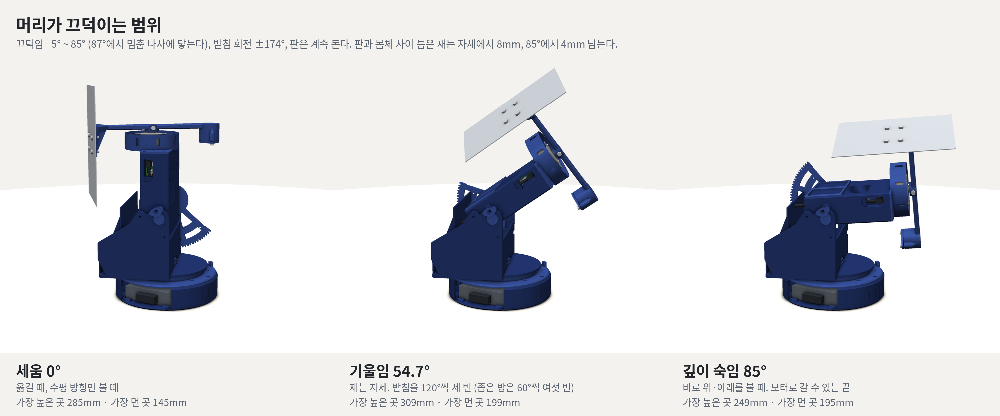

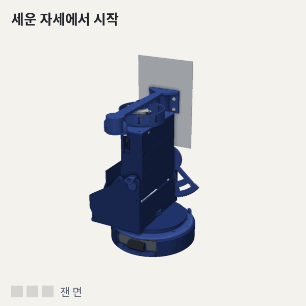

수신기는 노트북 없이 혼자 동작하고, 모든 동작을 폰 화면에서 조종한다 (8절, 10절).

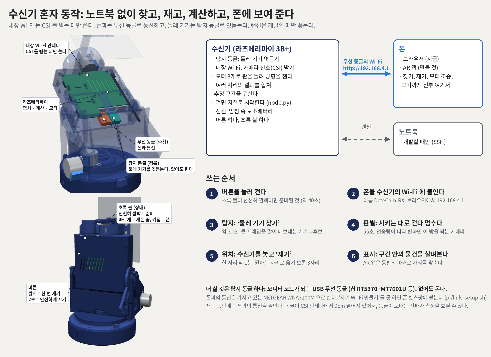

## 1. 출력하기 전에 재 볼 것 (8가지)

모델에 넣은 값 가운데 실물을 재 보지 못한 것들이다. 다르면 출력 전에 고쳐야 한다.

1. **파이 안테나 위치.** 모델은 안테나 중심이 SD카드 쪽 짧은 변에서 5mm, GPIO 쪽 긴 변에서 14mm라고 잡았다. 3mm 넘게 다르면 `cad/params.py`의 `ANT_A`, `ANT_B`를 고친다.
2. **드라이버 보드의 크기와 구멍 간격.** 자리 폭은 37mm, 들어가는 입구는 36mm다 (흔한 보드는 35×32mm). 구멍 4개의 간격은 30 × 26.5mm로 잡았는데, 보드를 만든 곳마다 조금씩 다르다. 0판의 **보드 구멍 맞춤 판**(`91`)에 보드를 얹어 구멍 네 개가 다 맞는지 본다. 안 맞으면 간격을 재서 `cad/p2.py`의 `DRV_HOLE`을 고치고 머리 몸통을 다시 내보낸다.
3. **배터리 크기.** 106×71×18mm 이하면 작은 받침(S, 지름 14cm), 152×76×18mm 이하면 큰 받침(L, 지름 19cm). 통과 덮개는 같은 글자로 뽑는다. 잘 안 넘어지는 쪽은 L이다 (9절).
4. **전원 플러그 두 개.** 파이 쪽은 ㄱ자 마이크로 5핀(옆 자리가 12mm뿐), 배터리 쪽은 ㄱ자 USB-A다. 배터리 쪽이 ㄱ자여야 플러그가 받침 창 안쪽으로 8mm 들어가 겉으로 안 나온다.
5. **무선 동글 크기.** 모델은 NETGEAR WNA3100M(34×16×8mm, 꽂으면 22mm 나옴)으로 잡았다. 파이의 USB에 꽂으면 머리 치마 안에 거의 다 숨고(4mm만 나옴), 어느 자세에서도 요크와 10mm 넘게 떨어진다. 더 긴 동글을 쓰려면 `cad/p2.py`의 `DONGLE`을 고치고 `check2.py`를 돌려 본다.
6. **탐지 동글 크기.** 가운데 USB의 위 칸에 꽂는다. 모델은 34×16×8mm로 잡았고, 그때 옆의 무선 동글과 2.0mm, 요크와 10.9mm 떨어진다. 몸통이 45×18×8mm보다 크면 옆 동글이나 요크에 닿는다 (`cad/p2.py`의 `DONGLE2`).
7. **전원 버튼 모듈(KY-004).** 기판 18.5×15mm, 버튼 중심이 기판 윗변에서 4.5mm라고 잡았다. 다르면 `cad/p2.py`의 `BTN_W`, `BTN_L`, `BTN_TOP`을 고친다 (뚜껑의 구멍과 누르는 살의 자리가 여기서 나온다).
8. **알루미늄 판의 두께와 무게.** 100 × 150mm, 1T를 기준으로 했다. 판 무게에 따라 균형추 동전 수가 달라진다. 저울이 있으면 재 본다: 약 40g이면 동전 8개, 약 20g(0.5T)이면 4개다.

## 2. 살 것

| 품목 | 수량 | 메모 |
|---|---|---|
| 28BYJ-48 (5V) 스텝모터 + ULN2003 드라이버 보드 | 3세트 | 관절마다 한 세트. 라벨이 5V인지 본다. 보드는 35×32mm 안팎, 구멍 4개 간격은 30 × 26.5mm로 잡았다 (0판의 맞춤 판으로 확인) |
| 알루미늄 판 100 × 150mm, 두께 1T (1mm) | 1장 | 재질은 A1050, A5052 아무거나. 구멍 4개(지름 3.2~3.5)를 직접 뚫는다. 0.5T도 쓸 수 있지만 손으로 건드리면 휜다. 무게는 1T가 약 40g, 0.5T가 약 20g |
| 100원 동전 | 8개 | 균형추. 판이 1T면 8개, 0.5T면 4개 (판 무게 5g마다 1개쯤). 지름 24mm, 5.42g. 구멍 없는 M12 와셔(바깥지름 24)로 대신할 수 있지만 무게를 재서 맞춰야 한다 |
| 보조배터리 (5V 2A 이상) | 1개 | 106×71×18mm 이하면 작은 받침(S), 152×76×18mm 이하면 큰 받침(L). 파이 + 모터 1개 + 동글 2개가 같이 쓰는 전류는 많아야 1.7A쯤이다. 배터리의 2A 넘는 단자에 꽂는다 |
| USB-A → 마이크로 5핀 케이블 50cm (A 쪽이 ㄱ자, 또는 ㄱ자 USB-A 젠더) | 1개 | 받침에서 머리까지 약 34cm. 배터리 쪽 플러그가 ㄱ자여야 받침 창 안으로 8mm 들어가 겉으로 안 나온다. 아주 가는 선은 파이 전압이 떨어지니 피한다 |
| 마이크로 5핀 ㄱ자 젠더 (좌·우 꺾임 세트) | 1세트 | 파이 전원 단자 옆 자리가 12mm뿐이다. 선이 아래(USB 단자 쪽)로 가는 것을 쓴다. ㄱ자 플러그 케이블이면 젠더는 필요 없다 |
| 전원 버튼 모듈 KY-004 | 1개 | 머리 앞의 전원 버튼. 2초 누르면 안전하게 꺼지고, 짧게 누르면 한 번 잰다. 기판 18.5×15mm로 잡았다 |
| 점퍼선 암-암 10cm | 20가닥 | 드라이버에 18가닥을 쓴다. 20cm짜리는 머리 안에 접어 넣기 빠듯하다 |
| 점퍼선 암-암 20cm | 2가닥 | 전원 버튼에서 파이 5번·6번 핀까지 |
| 무선 동글 (가지고 있는 NETGEAR WNA3100M) | 1개 | 폰과 통신하는 둘째 Wi-Fi. 새로 살 필요 없다. 34×16×8mm, 2.4GHz |
| 탐지 동글: 모니터 모드가 되는 USB 무선 동글 (칩이 RT5370, MT7601U, AR9271 가운데 하나) | 1개 (권함) | 둘레 기기를 엿들어 카메라 후보를 추린다. 2.4GHz, 안테나가 몸통 안에 든 작은 것. 몸통이 45×18×8mm 안쪽이어야 한다. 없어도 수신기는 돈다 (그때는 초당 개수만으로 고른다) |
| 케이블 타이 (폭 2.5mm, 길이 10cm) | 3~4개 | 머리 아래에서 전선 셋을 한데 묶는다 |
| AR 마커 종이 (`마커/AR_마커.pdf` 를 A4에 인쇄) | 1장 | 폰이 수신기가 놓인 자리를 알아내는 데 쓴다. 조금 두꺼운 종이(명함지, 160~200g)에 실제 크기(100%)로 인쇄한다. 풀이나 테이프 없이 틀로 덮어 나사로 조인다 |
| M3 나사 둥근머리 6mm | 18개 + 예비 | 모터 귀 6, 뚜껑 4, 부채꼴 기어 2, 마커 틀 4, 핀 막이 2. 이 자리에는 꼭 6mm만 쓴다 |
| M3 나사 둥근머리 8mm | 11개 + 예비 | 모터 자리 4, 균형추 마개 2, 알루미늄 판 4, 모터 축 고정 1 |
| M3 너트 | 5개 + 예비 | 알루미늄 판 볼트 4개와 축 고정 나사 1개에만 쓴다 |
| M3 나사 둥근머리 10mm | 8개 + 예비 | 받침 덮개 4(접시머리도 됨), 끄덕임 멈춤 2, 받침 회전 멈춤 1, 고정 나사 1. 멈춤 나사와 고정 나사는 꼭 10mm |
| M2.5 나사 둥근머리 6mm | 16개 + 예비 | 파이 4, 드라이버 보드 12 (한 장에 4개) |
| 6mm 비비탄 45개 (없으면 양초) | 택1 | 받침 회전이 미끄러지게. 비비탄을 권한다 |
| 얇은 랜선 (선택) | 1개 | 개발할 때 랜선을 장치 안에 넣어 두고 싶을 때만. 혼자 동작할 때는 쓰지 않는다 |
| 고무줄 (선택) | 1개 | 85° 가까이 깊이 숙이는 자세를 자주 쓸 때 끄덕임 모터를 거든다 |

나사는 모두 **53개**다: M3 6mm 18개, M3 8mm 11개(그 가운데 5개는 너트와 함께), M3 10mm 8개, M2.5 6mm 16개. 너트를 쓰는 5곳(알루미늄 판 4, 모터 축 고정 1)을 빼면 플라스틱 구멍에 그대로 돌려 넣는다. 걸리는 느낌이 오면 멈춘다. 더 조이면 구멍이 뭉개진다.


| 연장 | 어디에 쓰나 |
|---|---|
| 십자드라이버 (M3용 하나, M2.5용 작은 것 하나. 축 길이 6cm 이상) | 나사 53개를 전부 이 둘로 조인다 |
| 전동 드릴 + 금속용 날 3.2~3.5mm | 알루미늄 판에 구멍 4개를 뚫는다. 판 밑에 나무토막을 받친다 |
| 송곳이나 센터 펀치 (없으면 못과 망치) | 구멍 뚫기 틀의 구멍으로 판에 자리를 찍는다. 자리를 찍어야 드릴 날이 미끄러지지 않는다 |
| 줄이나 사포, 니퍼나 칼 | 뚫은 구멍의 거스러미를 다듬고, 출력물 가장자리를 다듬는다 |
| 납땜인두 (없으면 절연테이프) | 5V 선을 둘로 가르는 Y자 선을 하나 만든다 |
| 자, 각도기, (있으면) 주방 저울 | 출력 전에 안테나 위치와 보드 구멍 간격을 재고, 잴 때 카메라의 실제 방향을 적어 둔다. 저울로는 알루미늄 판 무게를 본다 |
| 순간접착제 (필요할 때만) | 작은 기어나 핀이 헐겁게 나왔을 때 한 방울 |

5V 선을 둘로 나누는 **Y자 선**이 하나 필요하다. 암-암 점퍼선 한 가닥의 가운데 피복을 5mm 벗기고, 다른 점퍼선을 반으로 잘라 그 끝을 감아 납땜한 뒤 수축튜브로 감싼다 (없으면 절연테이프).

## 3. 출력

### 바로 뽑기

`슬라이스/바로출력/` 의 파일은 Bambu Studio로 슬라이싱까지 끝낸 것이다. Bambu Studio에서 열어 **출력** 을 누르거나, SD카드에 넣어 프린터에서 고른다. 자리나 설정을 바꾸고 싶으면 `슬라이스/프로젝트/` 의 같은 이름 파일을 열어 다시 슬라이싱한다.

- 프린터 Bambu X1 Carbon, 노즐 0.4mm, Textured PEI 판. 필라멘트는 Generic PLA 값(노즐 220°C, 판 55°C)으로 잡았다. CaiLab PLA Matte 라벨 값이 다르면 프로젝트 파일에서 고친다.
- 0.20mm 층, 벽 3겹, 채움 15%, **서포트 없음**. 4판(회전 막대, 균형추 마개, 채움 조각)만 **채움 100%**: 판과 동전의 무게를 받는 부품이다.
- **PLA는 앞문을 열어 두거나 윗덮개를 떼고 뽑는다.** 닫아 두면 안이 더워져 노즐이 막힐 수 있다 (Bambu Studio도 같은 안내를 띄운다).
- 부품은 판에 놓는 방향으로 저장했다. 돌리지 않는다. 자동 방향 잡기는 누르지 않는다.
- 랜선 홈 마개(17)는 바닥에 닿는 곳이 좁다. 뽑다가 떨어지면 프로젝트 파일에서 그 부품에 챙(Brim)을 켠다.

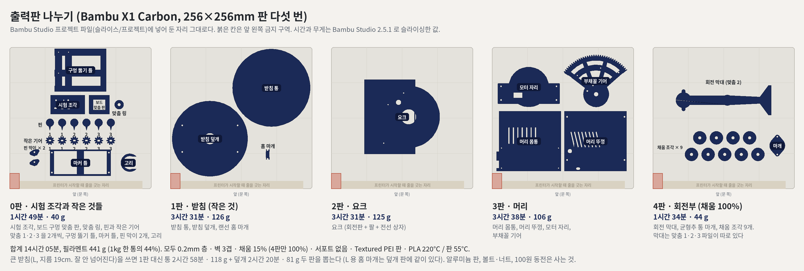

| 판 | 파일 (`슬라이스/바로출력/`) | 올리는 것 | 시간 | 무게 |
|---|---|---|---:|---:|
| 0판 | `0판_시험조각` | 시험 조각(90), 보드 구멍 맞춤 판(91), 맞춤 링(16), 핀(13)과 작은 기어(05) 맞춤 1·2·3을 2개씩, 구멍 뚫기 틀(18), 마커 틀(15), 핀 막이(14) 2개, 고리(03) | 1시간 49분 | 40 g |
| 1판 | `1판_받침_S` | 받침 통(01), 받침 덮개(02), 랜선 홈 마개(17) | 3시간 31분 | 126 g |
| 2판 | `2판_요크` | 요크(04) | 3시간 31분 | 125 g |
| 3판 | `3판_머리` | 머리 몸통(07), 뚜껑(08), 모터 자리(09), 부채꼴 기어(06) | 3시간 38분 | 106 g |
| 4판 | `4판_회전부_맞춤1 · 2 · 3 중 하나` | 회전 막대(10), 균형추 마개(11), 채움 조각(12) 9개. 막대의 맞춤 번호별로 파일이 셋 있다 | 1시간 34분 | 44 g |

합쳐서 **14시간 05분, 필라멘트 441g** 이다 (1kg 한 통의 44%). Bambu Studio 2.5.1로 슬라이싱한 값이고, 판마다 프린터가 준비하는 약 10분이 들어 있다. 큰 받침(L)을 쓰면 1판 대신 `선택_받침통_L`과 `선택_받침덮개_L` 두 판을 뽑는다 (5시간 19분, 198g). 큰 받침에 맞는 홈 마개(`17_lan_cap_L`)는 덮개 판에 같이 있다. 구멍 뚫기 틀, 마커 틀, 핀 막이처럼 받침 크기와 상관없는 작은 부품은 0판에 같이 있다.

### 0판으로 맞춤 고르기

프린터마다 구멍이 조금씩 다르게 나온다. 그래서 축 구멍과 핀은 세 가지 크기로 넣어 두었다. 0판에 핀과 작은 기어가 세 가지 다 들어 있으니, 맞는 것을 골라 쓰면 된다.

1. 모터 축을 시험 조각의 D자 구멍 세 개에 차례로 끼워 본다. 손으로 눌러 들어가고, 끼운 채 비틀어도 헛돌지 않는 구멍을 고른다. 구멍 옆 점의 개수(1~3)가 맞춤 번호다. 1번이 가장 빡빡하다.
2. 작은 기어는 그 번호의 것 2개를 쓴다. 4판은 그 번호의 파일(`4판_회전부_맞춤N`)을 뽑는다.
3. 핀 세 종류(지름 8.0, 7.9, 7.8)를 세운 벽의 두 구멍에 꽂아 본다. 윗면에 줄 표시가 **없는** 구멍에는 빡빡하게 들어가고, 줄 표시가 **있는** 구멍에서는 헐겁게 도는 핀 2개를 고른다.
4. M3 나사를 작은 구멍 두 개에 돌려 본다. 좁은 구멍(2.6)은 나사산이 파이며 들어가고, 넓은 구멍(3.4)은 그냥 지나가야 한다.
5. M2.5 나사를 더 작은 구멍 두 개에 돌려 본다. 점이 없는 구멍(2.1)이 머리 몸통의 기둥과 같은 것이다. 힘껏 돌려야 겨우 들어가면 점이 있는 구멍(2.3)에도 돌려 보고, 그쪽이 알맞으면 `cad/p2.py`의 `PILOT25`를 1.15로 바꿔 머리 몸통을 다시 내보낸다.
6. 육각 자리에 M3 너트를 끼워 본다. 손으로 눌러 들어가고 돌지 않아야 한다 (회전 막대의 판 받이와 같은 자리다).
7. 보드 구멍 맞춤 판(`91`)에 드라이버 보드를 얹어 구멍 네 개가 맞는지 본다 (1절의 2번).

### 부품표

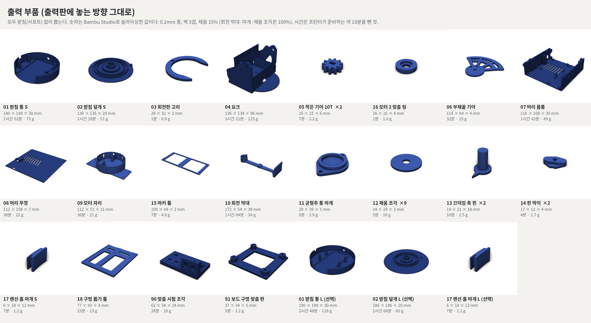

| 파일 | 이름 | 수량 | 크기 (mm) | 시간 | 무게 | |
|---|---|---:|---|---:|---:|---|
| `01_base_tub_S.stl` | 받침 통 (작은 것, 지름 140) | 1 | 140 × 140 × 30 | 1시간 52분 | 75 g | |
| `01_base_tub_L.stl` | 받침 통 (큰 것, 지름 190) | 1 | 190 × 190 × 30 | 2시간 48분 | 118 g | |
| `02_base_cover_S.stl` | 받침 덮개 (작은 것) | 1 | 136 × 136 × 20 | 1시간 29분 | 51 g | |
| `02_base_cover_L.stl` | 받침 덮개 (큰 것) | 1 | 186 × 186 × 20 | 2시간 08분 | 80 g | |
| `03_clip.stl` | 회전판 고리 | 1 | 28 × 32 × 2 | 1분 | 1 g | |
| `04_yoke.stl` | 요크 (회전판 + 팔 + 전선 상자) | 1 | 136 × 134 × 96 | 3시간 21분 | 125 g | |
| `05_pinion_fit1.stl` | 작은 기어 10T (맞춤 1) | 2 | 16 × 15 × 6 | 3분 | 1 g | |
| `05_pinion_fit2.stl` | 작은 기어 10T (맞춤 2) | 2 | 16 × 15 × 6 | 3분 | 1 g | |
| `05_pinion_fit3.stl` | 작은 기어 10T (맞춤 3) | 2 | 16 × 15 × 6 | 3분 | 1 g | |
| `06_sector_gear.stl` | 부채꼴 기어 | 1 | 114 × 94 × 4 | 31분 | 15 g | |
| `07_head_shell.stl` | 머리 몸통 | 1 | 116 × 108 × 35 | 1시간 42분 | 49 g | |
| `08_head_lid.stl` | 머리 뚜껑 | 1 | 112 × 108 × 7 | 38분 | 22 g | |
| `09_crown.stl` | 모터 자리 | 1 | 112 × 72 × 21 | 35분 | 21 g | |
| `10_rotor_bar_fit1.stl` | 회전 막대 (판 받이 + 균형추 통, 맞춤 1) | 1 | 172 × 54 × 38 | 1시간 04분 | 34 g | 채움 100% |
| `10_rotor_bar_fit2.stl` | 회전 막대 (판 받이 + 균형추 통, 맞춤 2) | 1 | 172 × 54 × 38 | 1시간 04분 | 34 g | 채움 100% |
| `10_rotor_bar_fit3.stl` | 회전 막대 (판 받이 + 균형추 통, 맞춤 3) | 1 | 172 × 54 × 38 | 1시간 04분 | 34 g | 채움 100% |
| `11_coin_cap.stl` | 균형추 통 마개 | 1 | 28 × 39 × 5 | 4분 | 3 g | 채움 100% |
| `12_coin_spacer.stl` | 채움 조각 (동전 1개 자리) | 9 | 24 × 24 × 2 | 1분 | 1 g | 채움 100% |
| `13_pin_fit1.stl` | 끄덕임 축 핀 (지름 8.0) | 2 | 14 × 21 × 18 | 5분 | 1 g | |
| `13_pin_fit2.stl` | 끄덕임 축 핀 (지름 7.9) | 2 | 14 × 21 × 18 | 5분 | 1 g | |
| `13_pin_fit3.stl` | 끄덕임 축 핀 (지름 7.8) | 2 | 14 × 21 × 18 | 5분 | 1 g | |
| `14_pin_keeper.stl` | 핀 막이 | 2 | 17 × 12 × 4 | 1분 | 1 g | |
| `15_marker_frame.stl` | 마커 틀 | 1 | 109 × 48 × 2 | 7분 | 4 g | |
| `16_m2_ring.stl` | 모터 2 맞춤 링 | 1 | 16 × 16 × 4 | 1분 | 1 g | |
| `17_lan_cap.stl` | 랜선 홈 마개 (작은 받침용) | 1 | 6 × 18 × 12 | 6분 | 1 g | |
| `17_lan_cap_L.stl` | 랜선 홈 마개 (큰 받침용) | 1 | 6 × 18 × 12 | 6분 | 1 g | |
| `18_drill_jig.stl` | 구멍 뚫기 틀 | 1 | 77 × 93 × 4 | 22분 | 13 g | |
| `90_test_coupon.stl` | 맞춤 시험 조각 | 1 | 62 × 34 × 24 | 28분 | 10 g | |
| `91_driver_check.stl` | 보드 구멍 맞춤 판 | 1 | 37 × 34 × 5 | 5분 | 2 g | |

시간은 부품 하나만 뽑을 때의 값이고 프린터 준비 시간은 뺀 것이다.

## 4. 조립

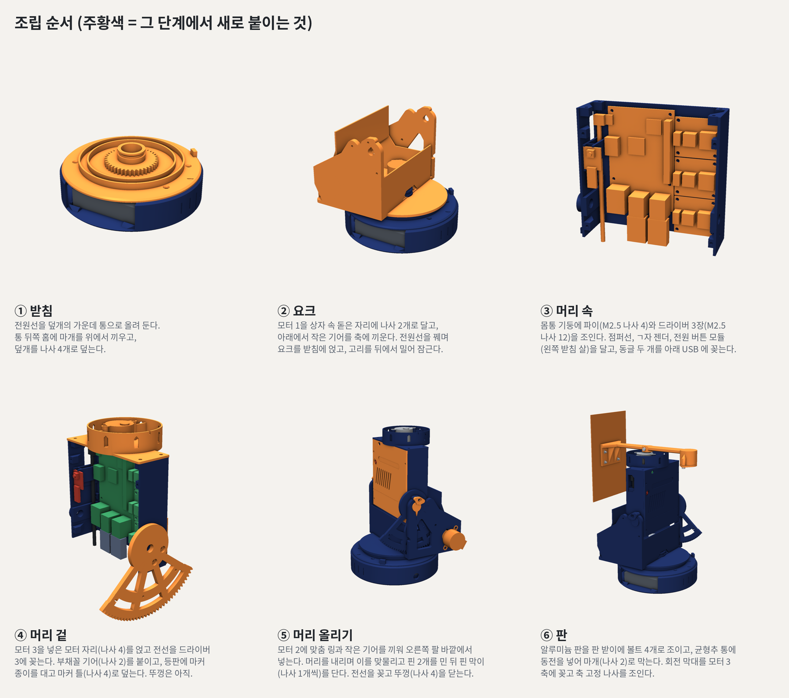

그림의 번호와 같다. 왼쪽·오른쪽은 장치를 앞(받침 덮개의 세모 표시 쪽)에서 마주 볼 때 기준이다. 부채꼴 기어와 모터 2가 오른쪽이다. 조립 43단계를 모델에서 하나씩 밀어 넣어 걸리는 곳이 없는지 확인했다 (`cad/audit_assembly.py`).

나사 길이를 꼭 지킨다.

- **모터 귀 나사는 전부 6mm.** 8mm를 쓰면 회전판 아래나 팔 안쪽으로 나와서 도는 부품을 긁는다.
- **멈춤 나사 3개와 고정 나사는 꼭 10mm.** 12mm면 머리 옆벽이나 받침 덮개를 긁는다.
- **마커 틀과 핀 막이도 6mm.** 마커 틀에 8mm를 쓰면 안쪽의 드라이버 보드에 닿는다.

**뚜껑은 ⑤의 끝에 닫는다.**

**먼저 정할 것: 랜선을 안에 넣을까.** 랜선은 조립할 때만 넣을 수 있다 (머리 아래 단자는 조립하면 손이 안 닿는다).

- **권하는 순서:** 조립하기 전에 파이만 책상에 놓고 랜선으로 10절의 설치를 끝낸다. 무선 동글로 폰과 노트북이 붙는 것까지 확인한 다음, 랜선 없이 조립하고 받침 뒤 홈은 마개(`17`)로 막는다. 그 뒤 개발은 무선으로 한다.
- 무선이 아직 안 되면 랜선을 넣고 조립한다. 그때는 마개를 끼우지 않고 ①-2와 ⑤-8의 괄호 안을 따른다.

**① 받침**

1. 전원선의 마이크로 5핀 쪽을 덮개 아래에서 가운데 통으로 밀어 올린다. USB-A 쪽은 통을 못 지나가니 꼭 이 방향으로 한다.
2. 받침 통 뒤쪽 홈에 마개(`17`. 큰 받침이면 `17_lan_cap_L`)를 위에서 끼워 내린다. 벽을 사이에 무는 모양이다. (랜선을 넣을 때: 마개 대신, 랜선 플러그를 덮개 아래에서 가운데 통으로 올리고 선을 홈에 눌러 넣는다.)
3. 덮개의 둥근 테에 파인 홈에 비비탄을 45개쯤 넣는다 (두세 개 빈자리를 둔다). 비비탄이 없으면 테 윗면에 양초를 넉넉히 문지른다.
4. 덮개의 세모 표시를 통의 눈금 쪽에 맞춰 얹고 10mm 나사 4개로 조인다.
5. 배터리는 맨 나중에 옆 창으로 밀어 넣는다. 통 바닥의 낮은 턱을 넘어가면 걸려서 저절로 밀려 나오지 않는다. 창으로 손을 넣어 ㄱ자 USB-A 플러그를 배터리에 꽂는다. 플러그는 창 안쪽으로 8mm 들어가 있어 겉으로 나오지 않는다.

**② 요크**

1. 모터 1을 요크의 전선 상자 속 돋은 자리에 놓는다. 축이 아래 구멍으로 내려가고, 귀 두 개가 구멍에 맞는 방향은 하나뿐이다. 6mm 나사 2개.
2. 요크를 뒤집어 작은 기어를 모터 1 축에 끼운다. 회전판에 닿을 때까지 민 다음 종이 한 장 두께만큼만 도로 뺀다.
3. 회전판 뒤쪽 왼쪽 구석(모터 1의 반대편)의 작은 구멍에 10mm 나사를 위에서 끝까지 조인다. 아래로 6mm 나온다. 받침 회전 멈춤 나사다.
4. 가운데 통에서 올라온 전원선을 요크 가운데 구멍으로 꿰면서, 요크를 받침의 가운데 통에 끼워 내린다. 작은 기어의 이가 가운데 기어에 물리도록 조금 돌려 가며 앉힌다. 요크 앞(팔이 없는 쪽)을 덮개의 세모 표시 쪽에 둔다.
5. 고리(`03`)를 상자 안에서, 통의 홈에 뒤에서 앞으로 밀어 끼운다. 입구가 홈보다 1.5mm 좁아서 조금 벌어졌다가 딸깍 하고 들어간다. 요크가 위로 빠지지 않게 잡는다.

**③ 머리 속**

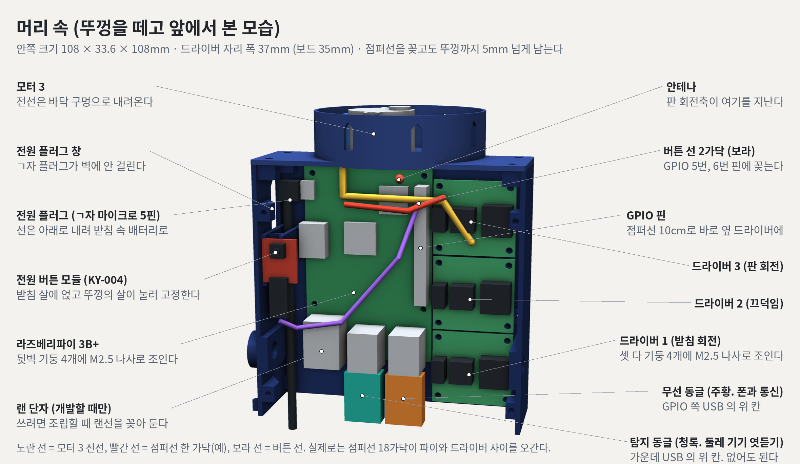

1. 파이에 SD카드를 꽂아 둔다. 조립하면 SD카드는 뚜껑을 열고 파이의 나사 4개를 풀어야 바꿀 수 있다.
2. 파이를 머리 몸통(`07`) 뒷벽의 기둥 네 개에 얹고 **M2.5 나사 4개**로 조인다. 부품 면이 앞, SD카드 쪽이 위, USB·랜 단자가 아래다.
3. 드라이버 3장을 파이 오른쪽의 기둥에 얹고 **한 장에 M2.5 나사 4개씩**(모두 12개) 조인다. 위에서부터 3번, 2번, 1번. 흰 소켓이 아래를 보게 한다.
4. 5절의 표대로 점퍼선 18가닥을 꽂는다.
5. ㄱ자 젠더를 파이 전원 단자에 꽂아 둔다. 선을 꽂는 구멍이 아래를 보는 쪽이다.
6. 전원 버튼 모듈(KY-004)을 머리 왼쪽의 받침 살에 끼운다. 버튼이 앞을 본다. 20cm 점퍼선 2가닥으로 `S`를 5번 핀, `−`를 6번 핀에 잇는다. 가운데 핀은 비워 둔다. 뚜껑을 닫으면 뚜껑 안쪽의 살이 기판을 눌러 잡는다.
7. 무선 동글(폰과 통신)을 파이의 USB에 꽂는다. 랜 단자에서 먼 쪽(GPIO 쪽)의 위 칸이다. 탐지 동글은 그 옆 가운데 USB의 위 칸에 꽂는다. 조립한 뒤에는 꽂고 빼기가 번거로우니 지금 꽂는다.

**④ 머리 겉** (뚜껑은 아직 닫지 않는다)

1. 모터 3의 흰 플러그와 전선을 모터 자리(`09`)의 네모 구멍으로 먼저 내려보낸다. 그다음 모터를 넣는다. 귀를 기둥 두 개에 얹고 6mm 나사 2개.
2. 모터 자리를 머리 몸통 위에 얹고 8mm 나사 4개. 내려온 모터 3 전선을 드라이버 3의 흰 소켓에 꽂는다.
3. 부채꼴 기어(`06`)를 머리 오른쪽 옆면(드라이버 쪽)에 6mm 나사 2개로 붙인다. 나사 머리 자리가 파인 면이 바깥이다.
4. **AR 마커.** `마커/AR_마커.pdf` 를 실제 크기(100%)로 인쇄해 바깥 선대로 오리고, 네 귀의 표시대로 나사가 지나갈 자리를 따 낸다. 종이를 머리 등판 아래쪽에 ▲ 표시가 위를 보게 대고, 마커 틀(`15`)로 덮어 6mm 나사 4개로 조인다. 머리를 요크에 올리기 전인 지금이 드라이버를 대기 쉽다.

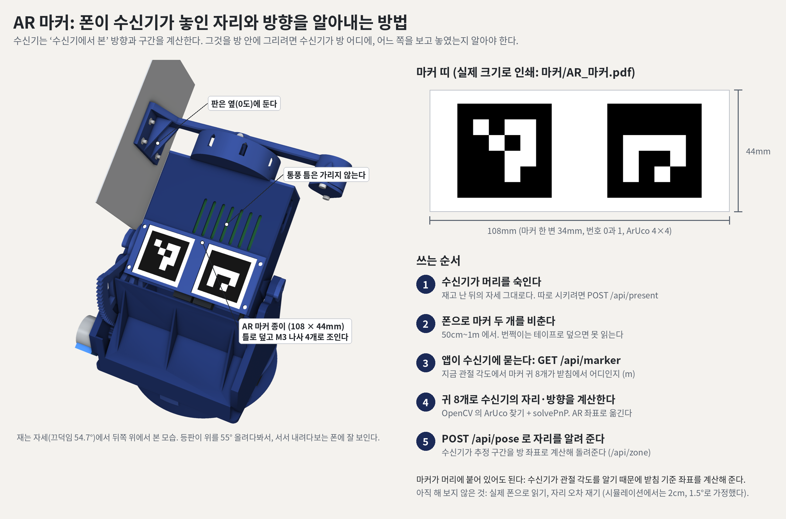

**⑤ 머리 올리기**

1. 모터 2의 축 둘레 턱에 맞춤 링(`16`)을 씌운다. 넓은 구멍이 모터 쪽이다. 그다음 작은 기어를 축 끝에서 턱까지 민다.
2. 모터 2를 링과 기어가 달린 채로 **오른쪽 팔** 바깥에서 구멍(지름 16.5mm)에 넣는다. 모터 몸통이 축보다 위로 오는 방향이다. 6mm 나사 2개. 링이 구멍을 채워 모터 자리를 잡는다.
3. 모터 2의 흰 플러그를 세워서 팔 뒤 아래 틈으로 넣고, 칸막이 구멍을 지나 전선 상자 안으로 보낸다.
4. 머리를 두 팔 사이로 위에서 내린다. 부채꼴 기어의 이가 작은 기어에 닿으면 머리를 앞뒤로 조금 끄덕여 이를 맞물리며 끝까지 내린다.
5. 축 구멍이 맞으면 핀 2개를 양쪽 팔 바깥에서 밀어 넣는다. 머리를 똑바로 세운 채, 핀의 바늘이 아래를 가리키게 꽂는다. 오른쪽 팔에 0°, 54.7°, 90° 눈금이 있다. 그다음 **핀 막이**(`14`)를 핀 머리 위에 덮고 6mm 나사 1개씩으로 팔에 조인다. 핀이 빠져나오지 못하게 막는다.
6. 왼쪽 팔 바깥의 작은 구멍 두 개에 10mm 나사를 조인다. 끄덕임 멈춤 나사다. 머리 옆의 돌기가 두 나사 **사이**에 있어야 한다.
7. 모터 1, 2의 전선을 상자 속에서 머리 아래로 올려 드라이버 1, 2의 흰 소켓에 꽂는다. 남는 선은 상자 속에 접어 둔다.
8. 가운데 통에서 올라온 전원선을 머리 아래로 올려 ㄱ자 젠더에 꽂는다. (랜선을 넣었으면 랜 단자에 꽂는다.)
9. 머리 아래로 올라온 전선 셋(모터 1, 모터 2, 전원)을 머리 아래 가운데에서 케이블 타이로 한데 묶는다. 왼쪽 팔과 머리 사이의 5mm 틈(멈춤 돌기가 지나는 길)과 오른쪽 기어 쪽으로 늘어지지 않게 한다. 머리가 −5°에서 85°까지 움직이면 전선이 지나는 길이가 24~40mm 달라지니, 팽팽하게 당겨 묶지 않는다.
10. 뚜껑(`08`)을 덮고 6mm 나사 4개. 뚜껑의 구멍으로 버튼이 눌리는지 본다.

**⑥ 알루미늄 판과 균형추**

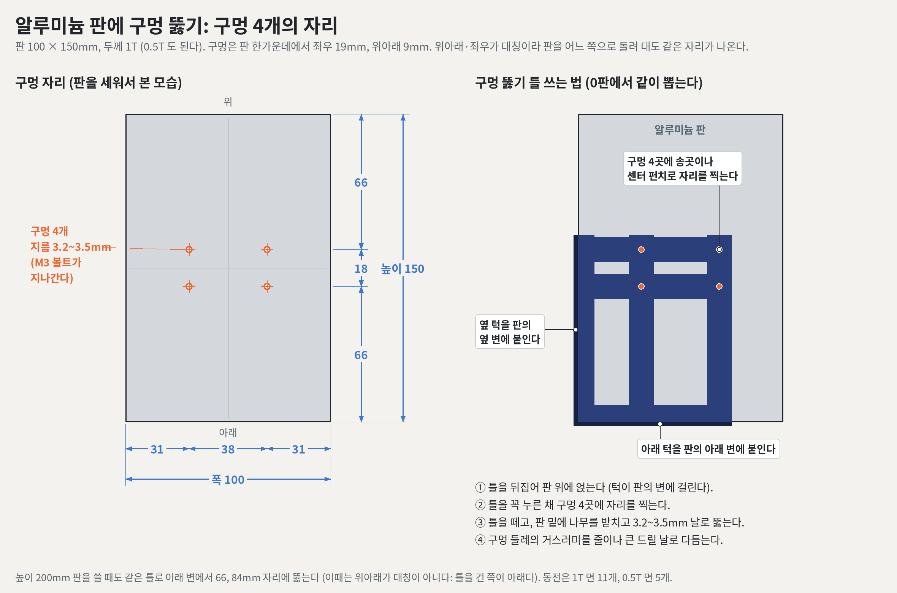

1. **판에 구멍 뚫기.** 구멍 뚫기 틀(`18`)을 뒤집어 판 위에 얹고, 틀의 두 턱을 판의 아래 변과 옆 변에 붙인다. 구멍 4곳에 송곳이나 센터 펀치로 자리를 찍는다. 틀을 떼고, 판 밑에 나무토막을 받치고 3.2~3.5mm 날로 뚫는다. 거스러미는 줄로 다듬는다. 자리는 판 한가운데에서 좌우 19mm, 위아래 9mm다 (옆 변에서 31·69mm, 아래 변에서 66·84mm).
2. **판 달기.** 회전 막대(`10`)의 판 받이 안쪽 육각 자리 네 곳에 M3 너트를 끼운다. 판을 판 받이 바깥면에 대고, 판 바깥쪽에서 8mm 볼트 4개를 꽂아 조인다. 너트가 자리에 물려 돌지 않으니 드라이버 하나로 조일 수 있다.
3. **균형추.** 막대를 뒤집어 통의 입구가 위를 보게 한다. 100원 동전 8개를 먼저 넣고 그 위에 채움 조각(`12`) 4개를 넣는다. **동전과 채움 조각을 합쳐 늘 12장이다** (0.5T 판이면 동전 4개 + 채움 조각 8개). 마개(`11`)를 덮고 8mm 나사 2개로 조인다. 통 입구와 마개 사이에 1mm쯤 틈이 남는 것이 정상이다 (나사가 동전을 눌러 잡는다). 흔들어서 소리가 나지 않으면 된다.
4. **막대 끼우기.** 막대를 바로 놓고 가운데 구멍을 모터 3 축에 끼운다. 구멍의 납작한 면을 축의 납작한 면에 맞추고, 막대 가운데(축 바로 위)를 눌러 끝까지 끼운다. 판을 잡고 누르지 않는다.
5. **축 고정.** 막대 윗면의 네모 홈에 M3 너트를 떨어뜨려 넣고, 옆의 구멍으로 8mm 나사를 돌려 넣는다. 나사 끝이 축의 납작한 면을 누른다. 손끝에 걸리는 느낌이 올 때까지만 조인다.


들 때는 받침을 잡는다. **판이나 회전 막대를 잡고 들지 않는다**: 판 끝을 5N(500g의 무게)으로 밀면 막대가 휘어 판 끝이 5mm 밀리고, 더 세게 밀면 모터가 억지로 돌아가 모터 속 기어가 상한다. 옮길 때는 오른쪽 팔의 고정 나사 구멍에 10mm 나사를 꽂아 머리를 0°에 묶어 둘 수 있다. 재기 전에 꼭 뺀다.

## 5. 배선


| 꽂는 곳 | IN1 | IN2 | IN3 | IN4 | + (5V) | − (GND) |
|---|---|---|---|---|---|---|
| 드라이버 3 · 판 회전 (J3) | 31번 (GPIO6) | 33번 (GPIO13) | 35번 (GPIO19) | 37번 (GPIO26) | 2번 | 39번 |
| 드라이버 2 · 끄덕임 (J2) | 11번 (GPIO17) | 13번 (GPIO27) | 15번 (GPIO22) | 16번 (GPIO23) | 4번 (Y자 선) | 14번 |
| 드라이버 1 · 받침 회전 (J1) | 32번 (GPIO12) | 36번 (GPIO16) | 38번 (GPIO20) | 40번 (GPIO21) | 4번 (Y자 선) | 34번 |

| 전원 버튼 (KY-004) | 파이 핀 |
|---|---|
| S | 5번 (GPIO3) |
| − | 6번 (GND) |
| 가운데 (+) | 비워 둔다 |

판 회전은 DiffLoc 공개 코드와 같은 핀이다. 모터가 반대로 돌아도 선은 바꾸지 않는다. `firmware/pi/rx3.py` 맨 위의 `DIR` 값만 뒤집는다. I2C는 꺼 둔다 (5번 핀을 버튼이 쓴다).

## 6. 전원 켜고 끄기

- **켜기:** 보조배터리가 켜져 있으면 버튼을 한 번 누른다. 약 40초 뒤 초록 불이 천천히 깜빡이면 준비된 것이다.
- **끄기:** 버튼을 **2초** 누른다. 폰 화면의 '끄기'로도 꺼진다. 초록 불이 꺼지면 다 꺼진 것이다. 그 전에 배터리를 뽑지 않는다 (SD카드가 상할 수 있다).
- 짧게 누르면 그 자리에서 한 번 잰다.
- 보조배터리에 따라서는 파이가 꺼진 뒤 전기를 스스로 끊는다. 그러면 다시 켤 때 보조배터리의 버튼을 먼저 눌러야 한다.

## 7. 처음 켜기 (모터 맞추기)

10절의 설치를 먼저 한다. 그다음은 **폰 화면의 '장치 · 손으로 움직이기'** 에서 다 할 수 있다. 괄호 안은 같은 일을 파이에서(SSH로) 하는 명령이다.

1. **모터 시험** (`python3 ~/detecam/rx3.py test`). 세 관절이 하나씩 조금 갔다가 돌아온다. + 방향이 아래와 같은지 본다. 다르면 `rx3.py`의 `DIR`에서 그 관절을 `-1`로 바꾼다.
   - spin: 머리 위에서 볼 때 판이 반시계로
   - yaw: 위에서 볼 때 요크가 반시계로
   - pitch: 머리가 앞으로(팔이 없는 쪽으로) 숙는다
2. 멈춤 나사 3개(받침 회전 1, 끄덕임 2)가 달려 있는지 다시 본다. 없으면 원점을 잡다가 머리가 뒤로 넘어간다.
3. **원점 다시 잡기** (`rx3.py home`). 끄덕임과 받침을 멈춤턱까지 밀었다가 0°로 돌아온다. 약 90초. 턱에 닿으면 모터가 드르륵 소리를 내며 헛도는데, 이 모터는 그래도 괜찮다. 다음부터는 빠른 방법(약 41초)을 쓴다.
4. **판 0° 맞추기.** 판 단추(±5°, ±90°)로 조금씩 돌려, 회전 막대 윗면의 줄 표시를 모터 자리 벽의 홈(부채꼴 기어 쪽)에 맞춘다. 맞으면 '지금 판 자리를 0°로' (`rx3.py zero spin`). 5°보다 잘게 맞추려면 `rx3.py jog spin 1`.
5. **재는 자세로** (`rx3.py goto --pitch 54.74`). 핀의 바늘이 54.7° 눈금을 가리키는지 본다. 약 21초.
6. **판 한 바퀴**를 열 번 누른다 (`rx3.py spin --turns 10`). 열 바퀴 뒤에 줄 표시가 제자리에 오는지 본다. 어긋나면 `HALF_STEPS_PER_REV`를 4076에서 4096으로 바꿔 다시 해 본다.
7. 끄덕임 +10° 단추로 85°까지 숙인 뒤 판을 한 바퀴 돌린다. 판 모서리가 회전판과 고리 위를 지나갈 때 틈이 4mm쯤 보여야 한다. 끝나면 '머리 세우기' (`rx3.py park`).

위치는 파이의 `~/.detecam_rx3.json`에 적어 둔다. 전원을 끄고 손으로 관절을 돌렸다면 원점을 다시 잡는다.

## 8. 재기 (폰으로)

폰을 수신기의 Wi-Fi(`DeteCam-RX`)에 붙이고 브라우저에서 `http://192.168.4.1` 을 연다. '홈 화면에 추가'를 하면 앱처럼 열린다. **수신기의 모든 동작이 이 화면에 있다.**

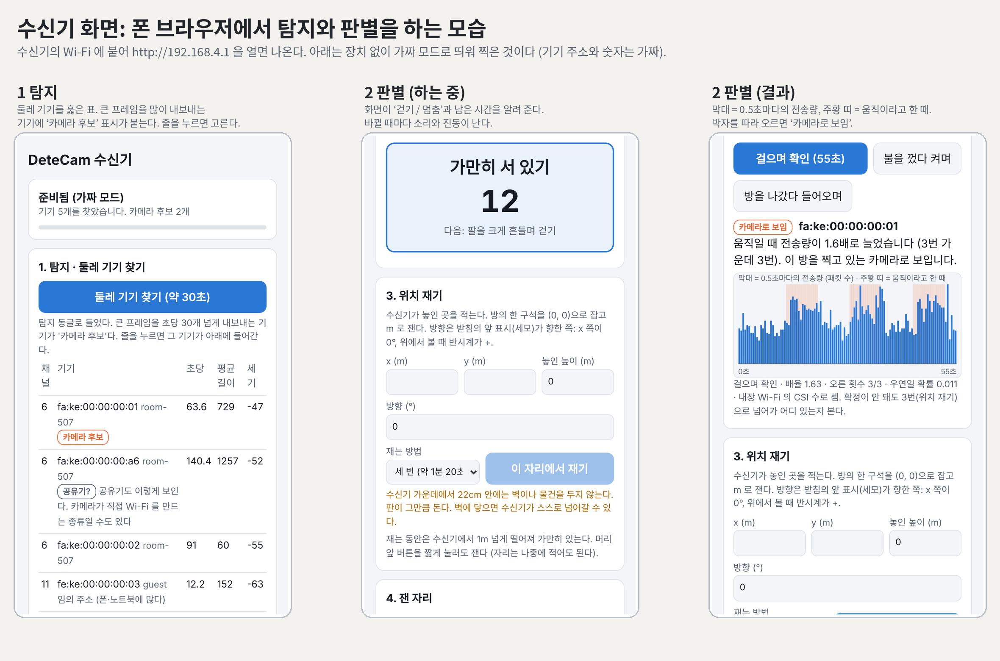

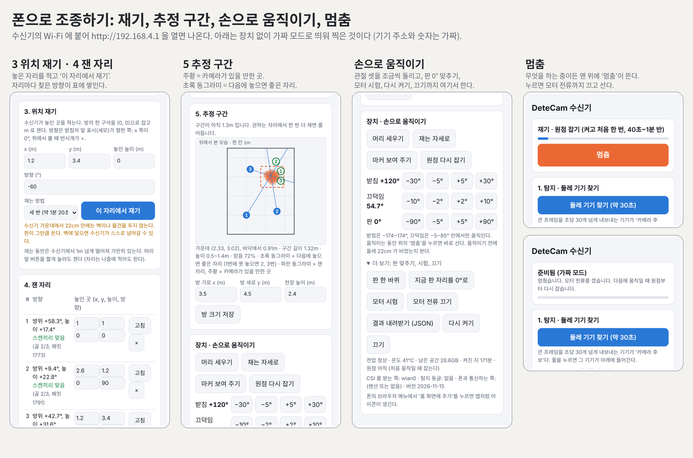

**놓기 전에: 수신기 가운데에서 22cm 안에는 벽이나 물건이 없게 한다.** 판과 균형추가 가운데에서 19cm까지 돈다 (9절).

1. **탐지.** '둘레 기기 찾기'를 누른다 (약 30초). '카메라 후보' 표시가 붙은 줄을 눌러 고른다.
2. **판별.** '걸으며 확인'을 누르고 화면·소리·진동이 시키는 대로 멈췄다 움직였다 한다 (55초). '카메라로 보임'이 나오면 이 방을 찍는 카메라다. '의심 기기'로 나와도 다음으로 간다.
3. **위치 측정.** 수신기를 놓고, 놓은 자리(x, y, 높이, 앞 표시가 향한 쪽)를 적고 '이 자리에서 재기'를 누른다. 약 1분 20초. 화면의 초록 동그라미(다음에 놓으면 좋은 자리)로 옮겨 또 잰다. 보통 3자리.
4. **표시.** 주황색 추정 구간이 1m 아래로 줄면 그 안의 물건을 살펴본다.

| 화면에서 할 수 있는 것 | |
|---|---|
| 멈춤 | 무엇을 하는 중이든 맨 위에 뜬다. 누르면 모터 전류까지 끄고 선다 |
| 손으로 움직이기 | 받침 ±5°·±30°, 끄덕임 ±2°·±10°, 판 ±5°·±90°·한 바퀴, 머리 세우기, 재는 자세로, 마커 보여 주기 |
| 맞추기 | 지금 판 자리를 0°로, 원점 다시 잡기, 모터 시험, 모터 전류 끄기 |
| 관리 | 채널과 기기 저장, 방 크기 저장, 모두 지우고 새로, 결과 내려받기, 다시 켜기, 끄기 |

- 재는 동안 사람은 수신기에서 1m 넘게 떨어져 가만히 있는다. **카메라와 수신기 사이에 서 있으면 못 잰다** (오차 가운데값이 20~40°로 커진다).
- 변기 칸처럼 좁은 곳(가로나 세로가 2m 아래)에서는 재는 방법을 **여섯 번**으로 바꾼다 (약 111초). 크게 틀리는 일이 반쯤으로 준다. 칸막이가 철판인 칸은 반사가 너무 세서 위치를 믿기 어렵다.
- 단계마다의 자세한 설명과 곳별 결과는 [네 단계 검토](네%20단계%20검토.md)에, 화면과 주소 목록은 [혼자 동작](혼자%20동작.md)에 있다.
- 결과의 방위각은 받침 덮개의 세모 표시가 0°이고 위에서 볼 때 반시계가 +다. 높이각은 수평이 0°, 바닥 쪽이 −다.
- 자료는 파이의 `~/detecam/data/pos_날짜_시각/` 에 남는다 (`csi.pcap`, `motion.jsonl`, `result.json`). 화면의 '결과 내려받기'는 잰 곡선까지 한 파일로 준다.

**개발할 때 (노트북에서).** `firmware/host/scan3.py` 가 SSH로 파이를 움직이고 그림까지 그려 준다.

| 계획 | 하는 일 | 걸리는 시간 |
|---|---|---|
| `tilt3` (기본) | 54.7° 기울여 받침 −120°, 0°, +120°에서 세 번. 한 스캔에서만 골이 보이면 한 번 더 | 처음 약 79초, 기울인 채 이어서 재면 약 47초 |
| `tilt6` | 54.7° 기울여 받침을 60°씩 돌려 여섯 번 (좁은 방) | 약 111초 |
| `up+tilt3` | 세워서 한 번(논문 방식) + 기울여 세 번 | 약 86초 |
| `tilt4` | 60° 기울여 네 번 | 약 93초 |
| `up` | 세워서 한 번만 (높이는 못 잰다) | 약 8초 |

## 9. 알아 둘 것

- **둘레 22cm 를 비운다.** 탁 트인 곳에서는 스스로 넘어지지 않는다 (가장 나쁜 자세에서도 무게중심이 받침 가장자리에서 5cm 안쪽). 하지만 벽이나 물건이 가까우면 머리를 숙이다가 판이 그것을 밀어 수신기가 넘어갈 수 있다. 작은 받침(S)은 꼭대기를 1.8N(약 183g의 힘)으로 밀면 넘어가고, 큰 받침(L)은 3.5N이 든다. 좁은 선반 끝에는 두지 않는다. 자세한 것은 [설계 검토](설계%20검토.md) 10절.
- **배터리를 넣고 쓴다.** 배터리가 받침의 무게추 노릇을 한다. 빼면 넘어가는 기울기가 29°에서 22°로 준다.
- **판은 1T를 권한다.** 0.5T는 가볍지만(끄덕임 모터 힘의 41%만 쓴다) 손으로 건드리면 휜다. 1T는 재는 자세에서 모터 힘의 50%, 85°에서 73%를 쓴다.
- **모터 2 없이 시작하기.** 모터가 두 세트뿐이면 모터 3(판)과 모터 1(받침)만 달고, 머리는 손으로 54.7°에 맞춘 뒤 고정 나사로 묶는다. 코드는 그대로 써도 된다.
- **받침이 뻑뻑하면.** 비비탄을 넣는다. 그냥 PLA끼리 닿으면 모터 힘의 94%를 마찰이 먹는다. 양초를 문지르면 47%, 비비탄이면 6%다 (어림값).
- **속도와 힘.** 이 모터는 느리게 돌릴수록 힘이 세다. 끄덕임은 반 스텝 3ms, 받침은 2ms, 판은 1.5ms로 맞춰 두었다. 모터가 드르륵거리며 못 따라가면 `rx3.py`의 `STEP_S`에서 그 관절의 숫자를 키운다.
- **85°보다 더 숙이지 않는다.** 85°에서 판 모서리와 받침 사이 틈이 4.2mm, 멈춤턱(86.9°)에서는 2.9mm다. 모터로는 85°까지만 간다. 재는 자세(54.7°)는 8.3mm 남는다.
- **손으로 억지로 돌리지 않는다.** 기어가 물린 뒤에는 머리와 요크를 손으로 밀어 돌리면 모터 속 기어가 상한다. 움직일 때는 폰 화면의 단추를 쓴다.
- **모터 열.** 움직이지 않는 모터는 코드가 전류를 끈다. 기어가 버티므로 자세는 그대로다.
- **유격.** 받침은 늘 + 방향으로 마무리하게 해 두었다 (− 방향으로 갈 때는 3° 지나쳤다가 돌아온다).

## 10. 혼자 동작하게 설치하기

코드는 저장소의 `firmware/` 폴더에 있다. 자세한 것은 [혼자 동작](혼자%20동작.md).

1. (노트북에서, 파이에 랜선을 꽂은 채) `firmware/pi/install.sh pi@raspberrypi.local` — 파일을 파이의 `~/detecam` 에 넣고, 파이에서 계산 검사를 돌리고, 켜지면 저절로 뜨게 등록하고, `/boot/config.txt` 에 버튼 줄과 모터 핀 줄을 넣는다.
2. (파이에서) `cd ~/detecam && sudo ./link_setup.sh check` — 동글 두 개가 잡혔는지, 어느 것을 어디에 쓸지 본다.
3. 폰과 통신: `sudo ./link_setup.sh ap`. '자기 Wi-Fi 만들기'가 안 된다고 나오면 `sudo ./link_setup.sh client 핫스팟이름 비밀번호` (폰 핫스팟을 2.4GHz로 켠다).
4. 탐지 동글이 있으면 `sudo ./link_setup.sh mon` — 이름을 고정하고 모니터 모드를 시험한다.
5. `sudo reboot`. 폰에서 `DeteCam-RX` (비밀번호 `detecam1234`)에 붙어 `http://192.168.4.1`.

`apt upgrade` 는 하지 않는다 (nexmon 이 깨진다). 스크립트도 하지 않는다.

## 11. 치수를 고쳐 다시 내보내기

저장소의 `cad/` 폴더에서 한다. 처음 한 번 `pip install manifold3d trimesh numpy shapely` (그림까지 다시 그리려면 `pyvista pillow matplotlib`도).

```
python3 export2.py        # ../stl 에 STL 29개. 다시 읽어 닫힌 형상인지 검사한다
python3 check2.py         # 전 범위 겹침 검사 (3~4분)
python3 check_extra.py    # 나사 머리, 볼트, 동전까지 넣은 검사
python3 audit_screws.py   # 나사 53개: 구멍, 깊이, 물리는 길이, 드라이버가 들어갈 길
python3 audit_assembly.py # 조립 순서대로 부품을 밀어 넣는 길
python3 audit_motion.py   # 기어 물림, 멈춤턱, 자세별 틈
python3 audit_sweep.py    # 판을 돌리며 촘촘히 훑은 틈 (15분쯤)
python3 mass.py           # 무게, 동전 수, 끄덕임에 걸리는 힘, 받침 마찰
python3 strength.py       # 튼튼함 (손계산)
python3 tipover.py        # 넘어짐 (무게중심 계산).  tip_mujoco.py 는 물리 엔진으로 움직여 본다
python3 room_check.py     # 부품 자리와 전선 길이
python3 slicing/slice_bambu.py ../stl ../슬라이스 --parts      # Bambu Studio 로 다시 슬라이싱 (자리 알려 주기는 cad/README.md)
python3 slicing/print_check.py ../stl ../슬라이스              # 슬라이싱한 파일을 다시 읽어 검사
```

치수는 `p2.py` 한 곳에 있다. 파이와 모터 치수는 `params.py`에 있다. 스크립트마다 하는 일은 `cad/README.md`.
