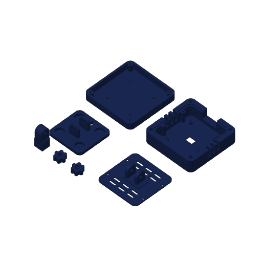
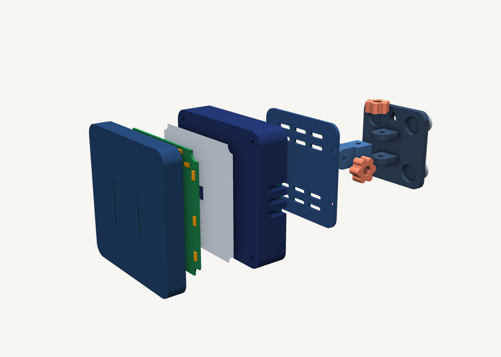

# DeteCam 6.0 (`Nano-2 AI`) 3D 출력 및 조립 안내

> **Bambu Lab X1 Carbon (0.4 mm 노즐, PLA, Textured PEI 55°C, 노즐 220°C)** 공식 `Bambu Studio 2.9.1` 실측 슬라이싱 완료.
> **노드 1기 = 단 1판 (`4시간 00분`, `124.9 g`, 서포트 `0%`, 처짐 `0.0 mm²`, `print_check.py` 문제 `0개`)** — 2기 전체 제작 시 이 파일을 **단 2번** 출력하면 끝입니다!

## 1. 바로 출력 파일 (`print/`)
- **프린터 바로 전송**: [`print/gcode/1판_포켓노드_1기전체.gcode.3mf`](../print/gcode/1판_포켓노드_1기전체.gcode.3mf) (`MD5` 검증 완료, `BL-P001`)
- **Bambu Studio 편집용**: [`print/project/1판_포켓노드_1기전체.3mf`](../print/project/1판_포켓노드_1기전체.3mf)

## 2. 부품별 실측 제원 (노드 1기 = 7개 부품, 2기 전체 = 14개 부품)

| 파일 (`stl/`) | 한글 이름 | 크기 (mm) | 노드당 수량 | 2기 수량 | 단독 출력시간 | 무게 (g) | 처짐 (mm²) |
|---|---|---|---:|---:|---:|---:|---:|
| `01_rf_shell.stl` | 전면 RF 레이돔 쉘 | 96.0 × 96.0 × 12.8 | 1 | 2 | 55분 | 30.1 | 0.0 |
| `02_sbc_chassis.stl` | 중앙 NanoPi·차폐 섀시 | 96.0 × 96.0 × 23.2 | 1 | 2 | 1시간 45분 | 53.9 | 0.0 |
| `03_rear_cover.stl` | 후면 방열·틸트 커버 | 80.0 × 80.0 × 24.0 | 1 | 2 | 49분 | 16.8 | 0.0 |
| `04_swivel_yoke.stl` | 2축 스위블 짐벌 요크 | 16.8 × 16.8 × 39.0 | 1 | 2 | 35분 | 5.6 | 0.0 |
| `05_wall_base.stl` | 벽면 부착 마운트 판 | 66.0 × 66.0 × 26.4 | 1 | 2 | 44분 | 16.4 | 0.0 |
| `06_thumb_knob.stl` | M4 손조임 잠금 노브 | 20.2 × 18.3 × 8.6 | 2 | 4 | 14분 | 2.0 × 2 | 0.0 |
| **1기 일괄 판 합계** | **1판_포켓노드_1기전체** | **256×256 베드 (여백 12mm+)** | **7개** | **14개** | **4시간 00분** | **124.9 g** | **0.0 (서포트 0%)** |

> **2기 시스템 전체 합계**: 단 2판, **총 8시간 00분**, **PLA 249.8 g** (v5.0 3기 14시간 36분 / 495 g 대비 시간 `-45%`, 재료 `-50%`!).

## 3. 4단계 무공구 조립 순서 (`docs/videos/조립_시뮬레이션.mp4`)

1. **후면 AI 엣지부 조립**: `Intel AX210NGW`를 무개조 `NanoPi R5C` 바닥면 M.2 E-Key 슬롯에 꽂고 `02_sbc_chassis` 내부 4 mm 스탠드오프에 M2.5 볼트 4개로 고정 → `03_rear_cover`를 M3 볼트 4개로 체결.
2. **전면 RF 공극·차폐 조립**: 격벽 전면(`z=0`)에 `82×82 mm Ni-Cu` 차폐 시트를 부착하고, 중앙 슬롯으로 MHF4 RF 동축 2선과 `RP2040` USB 선을 통과시킨 뒤 `84×84 mm` 4층 통합 RF PCB를 안착 → `01_rf_shell`을 4코너 M3 볼트로 결합.
3. **무타공 벽면 마운트**: `05_wall_base` 4코너 포켓에 `Ø15×3 mm` 네오디뮴 자석 4개를 넣고 뒷면에 재사용 나노겔 패드 부착.
4. **직교 2축 스위블 체결**: `04_swivel_yoke`를 후면 Pan 귀(Y축, ±30°)와 커버 Tilt 귀(X축, 0°/-15°/-25°)에 `06_thumb_knob`(M4 볼트·너트) 2개로 체결. **9개 극한 각도 조합에서 부품·벽면 간섭 `0.0 mm³` 검증 완료!**
