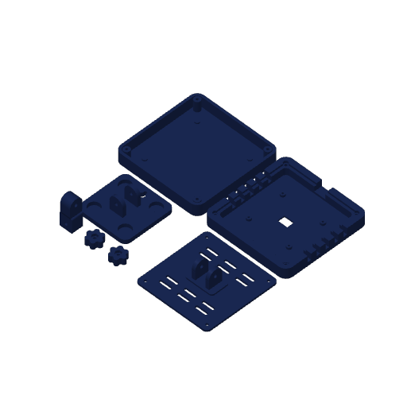
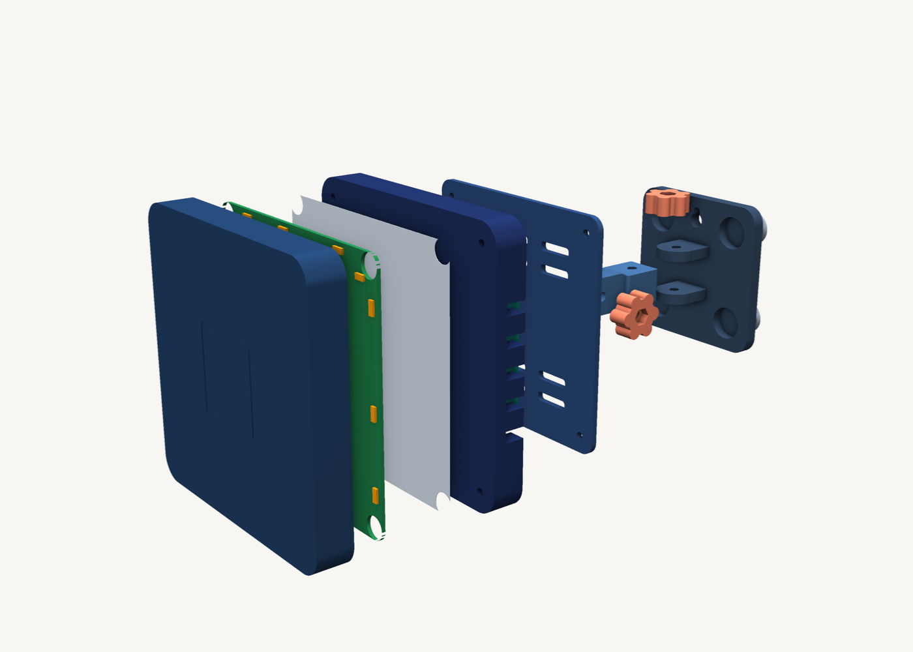

# DeteCam 5.0 (Palm-12) 3D 출력 및 조립 안내

> **출력 요약 (`Bambu Lab X1 Carbon`, 공식 Bambu Studio 2.9.1 실측 슬라이싱)**:  
> 노드 1기 전체(7개 부품)가 **단 1판(`256 × 256 mm`)**에 수납됩니다. **4시간 52분 · PLA `165.0 g` · 서포트 0% · 층별 G코드 검사 문제 0개!**

## 1. 바로 출력 파일 (`print/`)

| 파일 | 용도 | 출력 시간 | 필라멘트 | 부품 수 | 서포트 |
|---|---|---:|---:|---:|---|
| [`print/gcode/1판_손바닥노드_1기전체.gcode.3mf`](../print/gcode/1판_손바닥노드_1기전체.gcode.3mf) | **Bambu X1C 바로 출력** (3기 제작 시 3번 출력) | **4시간 52분** | **165.0 g** | 7개 (6종) | **0 (없음)** |
| [`print/project/1판_손바닥노드_1기전체.3mf`](../print/project/1판_손바닥노드_1기전체.3mf) | Bambu Studio 편집용 프로젝트 | — | — | 7개 | 0 |

- **공통 출력 설정**: 노즐 `0.4 mm`, 층높이 `0.20 mm`, 외벽 `3줄`, 채움 `15%` (Gyroid), 소재 `Generic PLA` (노즐 `220 ℃`, `Textured PEI Plate` `55 ℃`).
- **G코드 자동 무결성 검사 (`print/print_check.json`)**: MD5 일치, 기종 `BL-P001`, 216층(높이 `43.2 mm`), 섬 `0`, 외팔 `0`, 다리 `0`, 허공 압출 `0 mm²`, 최대 유량 `11.8 mm³/s` (한계 12), 금지 구역 회피 `OK`, **문제 0개**.

## 2. 노드당 7개 출력 부품 명세 (`stl/`)

| STL 파일 | 한글 이름 | 노드당 수량 | 크기 (mm) | 단독 시간 | 무게 (g) | 처짐 (mm²) |
|---|---|---:|---|---:|---:|---:|
| [`01_rf_shell.stl`](../stl/01_rf_shell.stl) | 전면 RF 레이돔 쉘 (1.4 mm 투과면 + 11.4 mm 공극) | 1 | `120.0 × 120.0 × 16.0` | 1시간 24분 | 51.3 | `0.0` |
| [`02_sbc_chassis.stl`](../stl/02_sbc_chassis.stl) | 중앙 SBC·차폐 섀시 (Ni-Cu 격벽 + 방열 U-슬롯) | 1 | `120.0 × 120.0 × 14.6` | 1시간 43분 | 57.2 | `0.0` |
| [`03_rear_cover.stl`](../stl/03_rear_cover.stl) | 후면 방열·틸트 커버 (`104×104` 인셋 + X축 귀) | 1 | `104.0 × 104.0 × 27.1` | 1시간 07분 | 27.9 | `0.0` |
| [`04_swivel_yoke.stl`](../stl/04_swivel_yoke.stl) | 직교 2축 스위블 요크 (좌우 Pan + 상하 Tilt) | 1 | `18.0 × 18.0 × 43.2` | 38분 | 6.4 | `0.0` |
| [`05_wall_base.stl`](../stl/05_wall_base.stl) | 벽면 부착 마운트 판 (자석 4포켓 + 나노겔 + 키홀) | 1 | `72.0 × 72.0 × 28.5` | 49분 | 19.6 | `0.0` |
| [`06_thumb_knob.stl`](../stl/06_thumb_knob.stl) | M4 손조임 6엽 잠금 노브 (공구 불필요) | 2 | `21.4 × 19.4 × 9.0` | 15분 | 2.2 × 2 | `0.0` |

> **완제품 1기 총중량**: 출력물 `165.0 g` + 전자부·자석·체결물 `124.0 g` = **`289.0 g`** (벽면 마운트 포함; 본체 퍽 단독 약 `250 g`).

## 3. 4단계 조립 순서 (약 10분/기)

1. **① 후면 전자부 장착**: `02_sbc_chassis` 내부 `58×49 mm` 스탠드오프에 `Radxa ROCK 3A` (AX210 장착 완료)를 M2.5 나사 4개로 고정합니다.
2. **② 벽면 차폐판 & 통합 RF PCB 결합**:
   - `02_sbc_chassis` 전면 평탄 격벽에 `110×110 mm` **Ni-Cu 전도성 차폐 시트**를 부착합니다 (중앙 14×10 mm 슬롯만 절개).
   - 2개의 50 mm MHF4 점퍼와 6핀 GPIO 리본을 중앙 슬롯으로 통과시켜 `112×112 mm` 4층 통합 RF PCB에 연결합니다.
   - `01_rf_shell`을 씌우고 4코너 M3 볼트(후면 카운터보어)로 체결한 뒤, `03_rear_cover`를 인셋 홈에 끼워 M3 나사 4개로 닫습니다. 전면 중앙 사각 홈에 `34×34 mm` ArUco 마커를 붙입니다.
3. **③ 벽면 마운트 & 2축 스위블 짐벌 체결**:
   - `05_wall_base` 상단 4코너 포켓에 `Ø15×3 mm` 네오디뮴 자석 4개를 에폭시/순간접착제로 넣고, 뒷면 평탄부에 `65×65 mm` 재사용 나노겔 패드를 붙입니다.
   - `06_thumb_knob` 2개 상단 육각홈에 M4 너트를 압입합니다.
   - `05_wall_base` ↔ `04_swivel_yoke` (Y축 좌우 Pan), `04_swivel_yoke` ↔ `03_rear_cover` (X축 상하 Tilt)를 M4×30 볼트와 손조임 노브 2개로 결합합니다.
4. **④ 9개 극한 자세 간섭 검증 완료**: `cad/checks/check_palm.py`에서 `Pan ∈ {-30°, 0°, +30°} × Tilt ∈ {0°, -15°, -25°}` 전 9개 자세에 대해 부품 간 겹침 `0.0 mm³` 및 벽면 충돌 `0.0 mm³`을 확인했습니다.

🎬 **[3D 조립 & 벽면 각도 조절 영상 보기](videos/index.html)**
