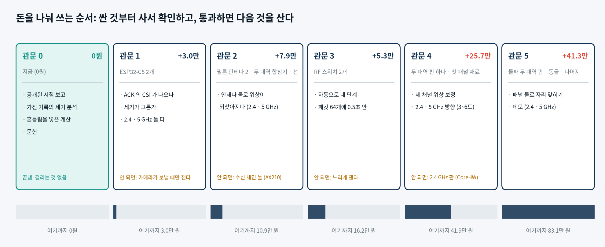

---
tags:
  - DeteCam
  - 체크리스트
고친날: 2026-11-18
---

# 체크리스트 (패널 수신기)

위에서부터 한다. **앞 관문이 안 되면 다음 것을 사지 않는다.** 까닭과 기준은 [사전 검증](사전%20검증.md)과 [설계 검토](설계%20검토.md), 부품은 [부품표](부품표.md), 조립은 [조립 안내](조립%20안내.md), 데모는 [데모 환경](데모%20환경.md).

## 관문 0: 돈을 쓰기 전에 (끝냄)

- [x] 공개된 시험 보고에서 ESP32-C5 가 ACK 의 CSI 를 내는 것을 확인했다
- [x] 가진 기록으로 내 카메라의 신호 세기가 얼마나 고른지 봤다
- [x] 세기 재기에 흔들림을 넣어 자리를 맞히는지 계산했다
- [x] 더 싼 구성(패널 하나, 안테나 4개, 세기만 재는 수신기)을 견줬다
- [x] 숙소 방에서 숨긴 카메라의 자리를 찾는 것을 계산했다

## 관문 1: ESP32-C5 두 개 (3.0만 원)

- [ ] XIAO ESP32-C5 두 개를 산다. ESP-IDF 를 깔고 CSI 예제를 올린다
- [ ] 1-1. 다른 기기(둘째 ESP32-C5, 내 카메라, 폰 핫스팟)에 6 Mbps 빈 프레임을 보내고 응답(ACK)의 CSI 를 받는다 (`dump_ack_en`). 보낸 것의 80% 이상
- [ ] 1-2. 같은 자리에서 1,000개를 받는다. 이득 값을 되돌린 뒤 이어진 패킷의 진폭 차가 0.5 dB 안
- [ ] 1-3. 내 카메라가 보내는 데이터 프레임의 CSI 도 받는다 (ACK 가 안 될 때의 길)
- [ ] 1-4. 5 GHz 채널의 프레임도 엿듣는다 (동글이 고장 났을 때의 대안. 동글은 관문 5 에서 꼭 산다)
- [ ] 쓸 핀 여덟 개를 정한다 (안테나 고르기 4, 켜기·제어 2, 위상 고르기 2)
- [ ] 안 되면: 카메라가 보내는 프레임만으로 잰다. 1-3 이 되면 다음으로 간다

## 관문 2: 합침기와 선 (3.6만 원)

- [ ] 합침기 1, SMA 선 한 벌(길이 넷), 변환선 1, 변환 단자 2(U.FL 잭 → SMA 수), SMA 암-암 젠더 1 을 산다. 암수를 맞춘다
- [ ] 2-1. 안테나 둘을 6 cm 띄우고 선을 손으로 바꿔 가며 세기 넷을 잰다. 위상이 나온다
- [ ] 2-2. 송신기를 20도씩 옮긴다. 위상이 따라온다 (가운데값 오차 15도 안)
- [ ] 2-3. 같은 자리에서 열 번 잰다. 흩어짐 10도 안
- [ ] 안 되면: 이득 고정(`esp_csi_gain_ctrl`), 단계마다 세 번 재기, 뛴 묶음 버리기를 넣어 다시 본다. 그래도 안 되면 받는 쪽을 AX210(수신 체인 둘)으로 바꾼다. 패널·스위치·선은 그대로 쓴다 ([되는지 근거와 대안](되는지%20근거와%20대안.md))

## 관문 3: RF 스위치 (5.3만 원)

- [ ] RF 스위치 2, 짧은 SMA 선(수-수) 1, 점퍼선을 산다. 짧은 선은 스위치 B 와 합침기를 잇는다 (둘 다 SMA 암)
- [ ] 스위치 둘을 달고 ESP32 가 패킷마다 위상 단계를 바꾼다
- [ ] 3-1. 손으로 잰 위상과 10도 안에서 같다
- [ ] 3-2. 패킷 64개가 0.5초 안에 끝난다
- [ ] 3-3. 위상 단계의 실제 값을 장치가 스스로 잰다. 선 길이로 어림한 값과 견준다. 세기만으로는 하나로 정해지지 않으므로 아는 자리의 송신기로 잰다 (다른 방법 검토 5.5절)
- [ ] (고를 수 있다) 보드를 사기 전에 안테나 4개로 방향을 재 본다: 스위치 1, 2.4 GHz 패치 안테나 4, 약 3.7만 원

## 관문 4: 패널 하나 (15.4만 원)

- [ ] 안테나 보드 1 과 첫 패널의 재료(필라멘트, 자석, 나사)를 산다
- [ ] 보드의 패치 간격, 뒷면 부품 높이, RF 단자를 재서 `cad/model/panel.py` 를 고친다
- [ ] 1판(통), 2판(앞덮개)을 뽑는다. 보드가 턱에 헐겁지 않게 얹히는지 본다
- [ ] 4-1. 방 한가운데의 송신기 방향을 잰다. 직접 보일 때 6도 안 (계산은 3.6도)
- [ ] 4-2. 탁상 데모: 상자 셋 가운데 카메라가 든 상자를 열 번에 아홉 번 맞힌다
- [ ] 4-3. 숙소 방 데모: 가운데값 0.5 m 이하
- [ ] 4-4. 교실에 패널 하나를 걸고: 옆자리까지 70% 이상
- [ ] 자석 걸이판으로 칠판에 붙여 하루 둔다. 미끄러지지 않는다

## 관문 5: 패널 둘과 허브 (26.7만 원)

- [ ] 둘째 패널을 만든다
- [ ] 패널끼리 서로를 재서 방향을 맞춘다. 마커로 잡은 방향과 2도 안에서 맞는다
- [ ] 허브가 두 패널의 결과를 모아 자리 후보 셋을 낸다
- [ ] 빈 교실에서, 그다음 사람이 앉은 교실에서 잰다. 계산(한 번 70%, 여덟 번 84%)과 견준다
- [ ] 30초마다 0.5초만 보내는 송신기로 한다. 전송마다 한 번씩 재지는지 본다
- [ ] 강의실 데모의 기준을 넘는다

## 관문 6 (권장): 휴대폰 송신 경보 (6만 원)

관문 5 가 된 뒤에 한다. 교실 밖 휴대폰과 가르기가 끝내 어려우면 뺀다 (지도교수 확인). 방법은 [스펙 007](../specs/007-phone-uplink-alarm/spec.md), 까닭은 [작품 범위](작품%20범위.md).

- [ ] RTL-SDR(Blog V3 또는 V4)과 안테나를 산다
- [ ] 허브에서 `rtl_power` 로 850 · 900 MHz 와 1710~1766 MHz 를 훑는다. Wi-Fi 엿듣기가 느려지지 않는지 본다
- [ ] 빈 교실에서 시험 전 몇 분으로 바탕 세기와 문턱을 잡는다
- [ ] 교실 안 폰이 30초마다 사진을 올릴 때 1분 안에 경보가 뜨는지 본다 (10번 가운데 9번)
- [ ] 복도와 옆 교실의 폰으로 같은 일을 하고, 잘못 울리는 비율을 적는다
- [ ] Wi-Fi 카메라의 전송과 같은 박자인지 맞춰 본다

## 관문 7 (필수 2단계): 두 대역 판 하나 (29.7만 원)

관문 5 가 된 뒤에 한다. 방법은 [스펙 008](../specs/008-dual-band-panel/spec.md), 까닭은 [작품 범위](작품%20범위.md) 6절.

- [ ] 두 대역 필름 안테나 17, SP4T 모듈 5, 두 대역 합침기, 위상 선(0 · 11 · 30 · 58 mm)을 산다
- [ ] 판을 만든다: 33 mm 간격, 45도, 반사판 15~20 mm (거리는 재 보고 정한다)
- [ ] 아는 자리의 송신기로 2.4 GHz 한 채널과 5 GHz 두 채널을 묶어 위상 단계를 잰다. 모든 채널에서 2도 안
- [ ] 직접 보이는 송신기의 방향이 2.4 · 5 GHz 모두 가운데값 6도 안

## 관문 8 (필수 2단계): 두 대역 판 둘 (29.7만 원)

- [ ] 둘째 판을 만들고, `panel.BAND` 를 두 대역으로 바꿔 5 GHz 위치 막음을 푼다
- [ ] 5 GHz 로만 보내는 카메라로 관문 5 와 같은 교실 시험을 한다: 사진 4장이면 의심 좌석 3곳 안 90% 이상, 16장이면 95% 이상
- [ ] 2.4 GHz 결과가 지금 판보다 나빠지지 않는지 견준다

## 블루투스 (필수, 0원)

- [ ] 허브의 내장 블루투스로 BLE 광고를 듣는다 (nexmon 을 올린 채로 되는지). 안 되면 USB 블루투스 동글
- [ ] 광고하는 기기 다섯 대를 켜고 끄며 1분 안에 대수가 따라 바뀌는지 본다 ([스펙 004](../specs/004-detection/spec.md) FR-8)

## 쓰기 전

- [ ] 다른 사람의 기기에 빈 프레임을 보내도 되는지 확인한다
- [ ] 시험장에서 쓰는 순서를 적는다: 시험 전에 걸고, 마커를 비추고, 끝나면 뗀다
- [ ] 패널 뒷면에도 마커를 붙인다 (손에 들고 잴 때 폰이 뒤에서 자세를 안다)
- [ ] 허브 없이 패널과 폰만으로 돌린다
