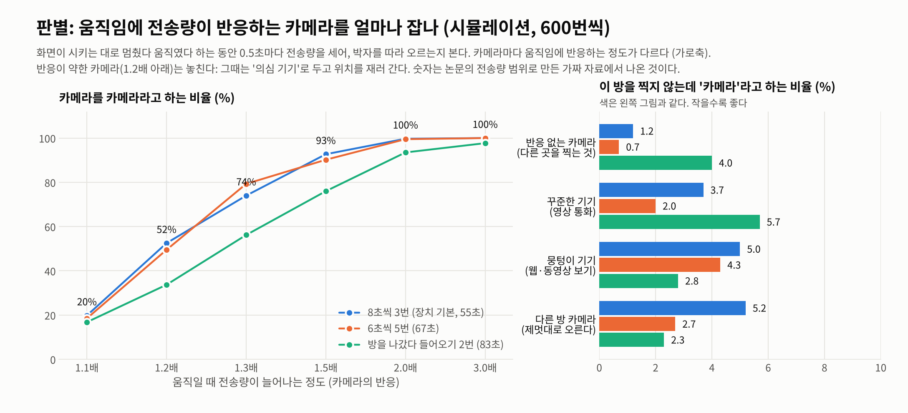

---
tags:
  - DeteCam
  - 검토
고친날: 2026-11-18
---

# 탐지와 판별: 둘레에서 카메라 후보를 찾고, 이 방을 찍는지 가린다

패널이 방향을 재기 전의 두 단계다. 허브(또는 패널의 ESP32-C5)가 둘레의 Wi-Fi 를 엿들어 카메라 후보를 고르고(탐지), 사람이 움직일 때 그 기기가 보내는 양이 따라오는지 봐서 이 방을 찍는 카메라인지 가린다(판별). 이 두 단계는 돌판 수신기 때 만든 것을 그대로 쓴다 (코드: `firmware/pi/detect.py`, `firmware/core/identify.py`, `firmware/core/score.py`). 돌판 때의 원래 글(네 단계 검토)은 [receiver-legacy](https://github.com/DeteCam/receiver-legacy) 에 있다. 의심 점수는 [ai/docs/의심 점수](https://github.com/DeteCam/ai/blob/main/docs/의심%20점수.md)에 있다.

## 1. 탐지: 둘레에서 카메라 후보 찾기

**무엇으로 듣나.** 남의 프레임을 엿들으려면 모니터 모드가 되는 무선 동글이 있어야 한다. 이 동글은 듣기만 하고 아무것도 보내지 않는다. 패널의 ESP32-C5 가 엿듣기(promiscuous 모드)로 프레임의 길이와 세기를 낼 수 있으면 동글을 사지 않는다 (관문 1 에서 확인).

**어떻게 하나** (약 30초).

1. 채널 1~13을 0.6초씩 한 번 훑는다.
2. 데이터가 많은 채널 3개를 골라 5초씩 자세히 듣는다. 이웃 채널로 새어 들린 것은 공유기가 알리는 진짜 채널로 센다.
3. 기기마다 '초당 프레임 수'와 '평균 길이'를 낸다. **초당 30개 이상이고 평균 300바이트 이상**이면 카메라 후보다 (DiffLoc+ 논문의 기준).

| 기기 | 초당 | 평균 길이 | 판정 |
|---|---|---|---|
| 영상을 올려 보내는 카메라 | 30~110개 | 400~1,000바이트 | 후보 |
| 영상을 받아 보는 폰·노트북 (응답만 보냄) | 많음 | 60바이트쯤 | 빠짐 |
| 가끔 통신하는 기기 (플러그, 스피커) | 적음 | — | 빠짐 |
| 공유기 (내려보내는 쪽) | 많음 | 큼 | '공유기?' 표시. 카메라가 직접 Wi-Fi를 만드는 종류도 이렇게 보인다 |
| 신호가 약한 후보 (−75dBm 아래) | | | '후보 (약함)': 다른 방일 수 있다 |

사진만 가끔 보내는 카메라(시험장)는 위 기준에 들지 않을 수 있다. 그런 기기는 새로 나타남, 핫스팟, 몰아서 보내는 박자 같은 다른 증거를 의심 점수로 쌓는다 (의심 점수 4절).

**탐지 동글 고르기.** 모니터 모드가 되고 안테나가 몸통 안에 든 작은 것. **듀얼밴드(2.4·5GHz)를 권한다**: 5GHz 카메라와 5GHz 로 연 핫스팟도 듣는다. 칩이 아래 가운데 하나면 파이의 커널(5.4)에 드라이버가 들어 있어 따로 설치할 것이 없다.

| 칩 | 드라이버 | 듣는 대역 | 메모 |
|---|---|---|---|
| **MediaTek MT7610U** | mt76x0u | 2.4·5GHz | **권함.** 작은 제품: ASUS USB-AC51 (31 × 16 × 9mm, 안테나 내장). 모니터 모드가 된다고 알려져 있다 |
| MediaTek MT7612U | mt76x2u | 2.4·5GHz | 모니터 모드가 가장 잘 된다고 알려졌지만 작은 제품이 드물다 (ALFA AWUS036ACM 은 커서 USB 연장선으로 밖에 단다) |
| Ralink RT5370 | rt2800usb | 2.4GHz | 가장 흔하고 싸다. 5GHz 를 못 듣는다 |
| MediaTek MT7601U | mt7601u | 2.4GHz | 흔하다. 5GHz 를 못 듣는다 |
| Atheros AR9271 | ath9k_htc | 2.4GHz | 모니터 모드로 오래 쓰인 칩. 안테나가 밖에 달린 제품이 많으니 작은 것을 고른다 |

- 꽂은 뒤 `python3 detect.py --check` 가 '들을 수 있는 채널'에 36·149 같은 5GHz 채널을 보여 주면 된다. mt76 드라이버는 커널에 따라 모니터 모드가 안 되는 일이 있다고 알려져 있으니, 사기 전에 받을 수 있으면 먼저 꽂아 본다.
- 5GHz 까지 들으면 처음 한 바퀴가 약 20초 길어진다. 그 뒤로는 AP 가 들린 5GHz 채널만 돌아 몇 초만 늘어난다.

**한계.**

- 5GHz 로만 보내는 카메라는 탐지만 된다. 패널의 안테나 보드가 2.4 GHz 용이라 방향은 못 잰다 ([사각지대](사각지대.md) 5절).
- 안테나 두 개로 한꺼번에 보내는 프레임은 2.4GHz 전용 동글로 못 읽는다. 몰래카메라는 거의 2.4GHz, 안테나 하나다.
- 영상 통화나 화면 공유도 후보로 뜬다. 그것은 판별 단계가 가린다.
- 녹화만 하고 전파로 내보내지 않는 카메라는 이 방법 전체가 못 찾는다.

**검사.** 진짜와 같은 모양의 프레임 2,109개를 만들어 읽혔다. 읽은 값(주소, 종류, 길이, 세기, 주파수, 이름)이 다른 프로그램(scapy)이 읽은 값과 398개 모두 같았고, 후보도 맞게 골랐다 (`firmware/tests/test_detect.py`, `test_band.py`). 동글과 드라이버가 실제로 그렇게 도는지는 실물에서 봐야 한다.

## 2. 판별: 이 방을 찍는 카메라가 맞나

카메라는 화면이 변하면 보내는 양이 늘어난다. 사람이 멈췄다 움직였다 하는 박자를 전송량이 따라오면 '이 방을 찍고 있는 카메라'다. 숙소 방(몰카)에서 쓴다. 시험장에서는 감독관이 걸어 다니기 어려우므로 의심 점수의 다른 증거를 쓴다.

- **걸으며 확인 (기본, 55초).** 4초 기다린 뒤 '8초 멈춤, 8초 움직임'을 3번. 폰 화면에 할 일과 남은 초가 크게 뜨고, 바뀔 때마다 소리(움직임 = 높게 두 번, 멈춤 = 낮게 한 번)와 진동이 난다.
- **불을 껐다 켜며 (55초).** 카메라가 사람을 못 보는 자리에 있을 때. 움직임 구간에 불을 1초에 한 번씩 껐다 켠다.
- **방을 나갔다 들어오며 (83초).** 밖에서 20초, 안에서 15초 걷기를 2번. 걷는 것만으로는 반응이 약할 때.
- 전송량은 엿듣는 쪽(동글 또는 ESP32-C5)이 센 바이트로 잰다.
- 판정: 0.5초 칸으로 세고, 박자가 바뀐 직후 1.5초는 버린다. 움직임 구간의 평균이 멈춤 구간의 1.12배 이상이고, 박자를 엇갈리게 옮겼을 때보다 뚜렷하고(우연일 확률 3% 아래), 3번 가운데 2번 이상 올랐으면 '카메라'.

| 움직일 때 전송량이 늘어나는 정도 | 1.1배 | 1.2배 | 1.3배 | 1.5배 | 2배 | 3배 |
|---|---|---|---|---|---|---|
| 걸으며 8초씩 3번 (55초) | 20% | 52% | 74% | 93% | 100% | 100% |
| 6초씩 5번 (67초) | 18% | 50% | 79% | 90% | 100% | 100% |
| 방을 나갔다 들어오기 2번 (83초) | 17% | 34% | 56% | 76% | 94% | 98% |

카메라가 아닌 기기를 '카메라'라고 하는 비율 (걸으며 8초씩 3번): 꾸준히 보내는 기기 3.7%, 뭉텅이로 보내는 기기 5.0%, 다른 방의 카메라 5.2%, 반응 없는 카메라 1.2%.

- 가짜 자료 600번씩의 결과다 (`sim/identify/identify_sim.py`). 카메라의 전송량 범위(초당 35~110개), 반응이 1초쯤 늦는 것, 2~4초마다 튀는 큰 프레임을 논문에서 가져와 넣었다. 실제 카메라가 몇 배로 반응하는지는 재 봐야 안다.
- **놓치는 것.** 전송량을 고정해 둔 카메라, 움직임이 화면에 작게 잡히는 카메라. 그래서 확정이 안 되면 '의심 기기'로 두고 위치를 재러 간다. 위치가 나오면 눈으로 확인할 수 있다.
- '6초씩 5번'이 잘못 잡는 일이 조금 적지만 12초 더 걸린다. 기본은 55초짜리로 두었다.
- 그림은 돌판 때 그린 것이다 (그린 코드는 receiver-legacy 의 `sim/location/fig_places.py`). 숫자는 위 표와 같다.

## 3. 실물에서 확인할 것

1. 탐지 동글: `sudo ./link_setup.sh mon` 이 모니터 모드로 바꾸고 프레임을 듣는지. ESP32-C5 의 엿듣기가 프레임 길이를 내는지 (관문 1).
2. 탐지: 실제 카메라가 후보로 뜨는지, 기준(초당 30개, 300바이트)이 맞는지.
3. 판별: 실제 카메라가 걸을 때 몇 배로 반응하는지. 1.2배 아래면 '불을 껐다 켜며'나 '나갔다 들어오며'로.

## 4. 여러 기기 가운데 카메라만 고르기: 사진만 가끔 보내는 카메라, 작은 시험

수능처럼 전자기기를 모두 거두는 시험이면 교실 안에서 Wi-Fi 를 내는 기기 자체가 의심이다. 학교의 작은 시험에서는 가방 속 폰, 허락된 노트북·태블릿, 스마트워치, 옆 교실의 공유기까지 들린다. 그리고 부정행위용 카메라는 영상을 계속 보내지 않고 사진을 한 장씩 보낸다. 그래서 '전송량이 많은 기기' 하나로는 고를 수 없다. 증거를 여러 겹으로 쌓는다. 하나하나는 약해도 겹치면 카메라만 남는다.

| 증거 | 무엇을 보나 | 빠지는 것 | 약점 |
|---|---|---|---|
| ① 자리 | 패널이 잰 자리가 교실 안, 수험생 자리인가 | 옆 교실·복도의 기기, 교탁의 감독관 기기 | 패널이 잴 만큼 보내야 한다 (사진 한 장이면 된다) |
| ② 짝 | 카메라는 사진을 받을 곳이 있어야 한다. 시험 중에 교실 안에서 열린 핫스팟(또는 Wi-Fi Direct)과, 거기에 붙은 기기. 프레임 머리의 주소로 누가 누구에게 붙었는지 안다. 둘의 자리가 같은 책상인가 | 학교 공유기에 붙은 기기, 혼자 노는 기기 | 카메라가 LTE 로 바로 보내면 Wi-Fi 짝이 없다 ([전파 넓히기 검토](https://github.com/DeteCam/docs/blob/main/research/전파%20넓히기%20검토.md)) |
| ③ 박자 | 사진 한 장 = 수십~수백 KB 를 0.5~2초에 몰아 올리고 조용해진다. 몇십 초~몇 분마다 되풀이. 올리는 쪽이 내려받는 쪽보다 훨씬 많다 | 영상을 보는 폰(내려받기), 가끔 짧게 통신하는 시계·플러그 | 노트북의 사진 동기화도 비슷한 모양이다. 그래서 ①②와 함께 본다 |
| ④ 새로 나타남 | 시험 시작 전 몇 분 동안 들린 기기 목록과 견준다. 시험 중에 처음 나타난 핫스팟·기기 | 처음부터 있던 교실·이웃의 기기 | 처음부터 켜 둔 카메라. 폰은 주소를 가끔 바꾸지만 붙어 있는 동안은 같은 주소를 쓴다 |
| ⑤ 이름·제조사 | 주소 앞자리(OUI)의 칩 회사, 핫스팟 이름 | - | 숨기거나 바꿀 수 있다. 가산점만 준다 |
| ⑥ 사람 | 앱이 의심 자리 셋과 그 이유(①~⑤ 중 무엇이 맞았나)를 보여 주고, 감독관이 그 셋만 확인한다 ([다른 방법 검토](다른%20방법%20검토.md) 3절) | - | 자동으로 단정하지 않는다 |

- 점수로 묶는 법은 [의심 점수](https://github.com/DeteCam/ai/blob/main/docs/의심%20점수.md) 4절에 있다.
- **쉬는 동안에도 잰다.** 사진과 사진 사이에 카메라가 핫스팟에 붙어만 있으면 빈 프레임으로 ACK 를 받아 잰다 ([사전 검증](사전%20검증.md) 2절). 그러면 '보낼 때만' 이 아니라 원할 때 잴 수 있다. 다만 사람 자세가 그대로면 같은 값이 되풀이되므로, 사진 16장의 효과는 사람이 움직이며 사진을 찍는 데서 나온다.
- **사진을 모았다가 끝에 한꺼번에 보내면.** 시험 중에는 보낼 것이 없다. 붙어만 있으면 ACK 로 재고 (자세가 바뀔 때마다 다시), 붙어 있지도 않으면 찾지 못한다. 녹화만 하는 카메라와 같다. 이것은 Wi-Fi 로 찾는 방법 전체의 한계다.
- **논문들.** 암호를 풀지 않고 전송의 모양만으로 기기 종류를 가린 연구가 많다: 기기 종류 90% 넘게 (Peek-a-boo, WiSec 2020), 95% (Lumos, USENIX Security 2022). 카메라 전송의 특징으로 카메라를 가린 것: DeWiCam (AsiaCCS 2018), Cheng 외 (IEEE TMC 2020), 움직임에 반응하는 전송량과 칩 회사로 가린 MotionCompass (MobiSys 2021). 다만 이것들은 대부분 영상을 계속 보내는 카메라다. **사진을 가끔 보내는 카메라를 따로 다룬 연구는 찾지 못했다.** 그래서 ③의 기준(크기, 간격)은 실제 카메라로 사진을 보내 보고 정한다 (관문 1 과 함께).

## 5. 바탕 자료

- DiffLoc+ (탐지 기준), DeWiCam (움직임에 반응하는 전송량), LocCams (패킷 수 비율), CSI:DeSpy (큰 프레임이 튀는 것 걸러 내기). 프로젝트에 올려 둔 논문들이다.
- 기기 가리기: Peek-a-boo ([Acar 외, WiSec 2020](https://doi.org/10.1145/3395351.3399421)), Lumos (Sharma 외, USENIX Security 2022), MotionCompass ([He 외, MobiSys 2021](https://doi.org/10.1145/3458864.3467683)), Cheng 외 *On detecting hidden wireless cameras: a traffic pattern-based approach* (IEEE TMC 19(4), 2020)
- [라즈베리파이 커널 rpi-5.4.y](https://github.com/raspberrypi/linux): `bcm2709_defconfig` 에 rt2800usb, mt7601u, ath9k_htc 가 모듈로 들어 있다
- [ESP-IDF 의 Wi-Fi 엿듣기 모드 (ESP32-C5)](https://docs.espressif.com/projects/esp-idf/en/stable/esp32c5/api-guides/wifi-driver/wifi-modes.html#wi-fi-sniffer-mode): 관리·데이터·제어 프레임을 앱에 넘겨준다. 프레임 길이와 세기가 쓸 만한지는 관문 1 에서 본다
