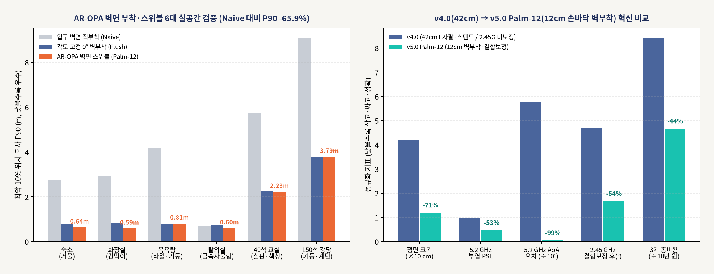

# DeteCam 5.0 (Palm-12) 현장 최적 배치 가이드 (AR-OPA) & 핵심 기술 Q&A

> **핵심 질문 해결**: *"숙소·화장실·목욕탕·탈의실·교실·대형 강의실마다 구조와 장애물이 다 다른데, 비전문가 사용자가 실제 현장에서 최적의 수신기 위치와 각도를 어떻게 찾을 것인가?"*

## 1. Sim-to-Real 최적 배치: 20초 AR-OPA + 3초 Auto-Verify

시뮬레이션의 "최적 배치"를 현실에서 누구나 그대로 재현할 수 있도록, 스마트폰 앱이 **3단계 자동 안내**를 수행합니다 (`firmware/core/ar_opa.py`).

1. **10초 방 훑기 (ARCore)**: 스마트폰으로 방 4벽과 큰 장애물(거울·금속 칠판·사물함·기둥·칸막이)을 훑습니다.
2. **0.2초 벽면 위치 + 각도 자동 계산 (AR-OPA)**: Mixed-LoS/NLoS 3D Fisher Information 행렬(`arXiv:2604.00863`)과 벽면 근접 반사 페널티(`arXiv:2412.13208`)를 결합한 서브모듈러 최적화로 **손이 닿는 벽면 높이(`1.1 m` / `2.0 m`, 사다리·스탠드 불필요!) 3곳**과 **좌우 Pan(`±30°`) · 상하 Tilt(`0°/-15°/-25°`) 클릭 각도**를 AR 화면에 띄웁니다.
   - 예: *"① 앞벽 2.0 m 자석/나노겔 부착 → 오른쪽 2칸(`+30°`), 아래 1칸(`-15°`) 딸깍!"*
3. **3초 상호 전파 교정 (Auto-Verify)**: 벽에 3기를 붙이자마자 서로 비콘을 1회씩 주고받아 상호 AoA 상반 오차(`> 8°`)와 주파수 요동(`CV_f > 0.06`)을 검사합니다. 눈에 보이지 않는 벽 속 철근·수도관 반사가 감지되면 *"노드 2번을 옆으로 40 cm 옮기세요"*라고 즉시 알려 줍니다.

## 2. 6대 실공간 시뮬레이션 검증 결과 (`sim/ar_opa_benchmark.py`)

> 아래 위치 오차는 `Palm-12` 보정 각도 오차 모델을 적용한 **250회 몬테카를로 3D 위치 추정 `[시뮬레이션]`** 결과입니다.

| 공간 (크기) | 입구 벽면 직부착 (Naive) P90 | 각도 고정 0° 벽부착 P90 | 고정 모서리 P90 | **AR-OPA 벽면 스위블 (Palm-12)** Med / **P90** | Naive 대비 P90 개선 | 각도 조절 추가 개선 | AR-OPA 추천 벽면 배치 요약 |
|---|---:|---:|---:|---:|---:|---:|---|
| **숙소 (모텔·원룸)** `4.5×3.8m` | 2.74 m | 0.78 m | 0.68 m | `0.27 m` / **0.64 m** | **-76.6%** | **-17.9%** | 앞벽 2.0m(`+30°/-15°`, `-30°/-15°`), 뒷벽 1.1m(`-30°/0°`) |
| **화장실 (칸막이·거울)** `3.6×2.8m` | 2.90 m | 0.84 m | 0.75 m | `0.23 m` / **0.59 m** | **-79.7%** | **-29.8%** | 앞벽 2.0m(`+15°/-25°`), 앞벽 1.1m(`-30°/0°`), 뒷벽 2.0m(`-30°/-25°`) |
| **목욕탕 (습기 타일·기둥)** `6.0×5.0m` | 4.18 m | 0.78 m | 0.82 m | `0.31 m` / **0.81 m** | **-80.6%** | 동등 | 앞벽 2.0m(`+30°/-15°`), 뒷벽 2.0m(`+30°/-15°`), 뒷벽 1.1m(`-15°/0°`) |
| **탈의실 (금속 사물함)** `5.5×4.0m` | 0.71 m | 0.75 m | 0.93 m | `0.28 m` / **0.60 m** | **-15.5%** | **-20.0%** | 뒷벽 2.0m(`+30°/-15°`, `-30°/-15°`), 앞벽 1.1m(`-15°/0°`) |
| **40석 표준 교실** `8.5×7.5m` | 5.72 m | 2.24 m | 2.40 m | `1.02 m` / **2.23 m** | **-61.0%** | 동등 | 왼벽 2.0m(`-30°/-15°`), 오른벽 2.0m(`+30°/-15°`), 뒷벽 2.0m(`+15°/-15°`) |
| **150석 대형 강의실** `14×12m` | 9.07 m | 3.79 m | 5.38 m | `1.45 m` / **3.79 m** | **-58.2%** | 동등 | 왼벽 2.0m(`0°/0°`), 오른벽 2.0m(`0°/0°`), 뒷벽 1.1m(`0°/0°`) |
| **6공간 전체 평균** | **4.22 m** | **1.53 m** | **1.83 m** | **`0.59 m` / `1.44 m`** | **-65.9%** | **-5.9%** *(협소 3공간 -22.6%)* | **대형 스탠드 0대 · 천장 타공 0개** |

## 3. 교수님 2대 핵심 질문에 대한 명확한 해답

### Q1. 수많은 전자기기 중에 카메라만 어떻게 찾아내는가? → **3단계 캐스케이드 판별 (`firmware/core/score.py`)**
1. **1단계 수동 트래픽 무늬**: 암호화를 풀지 않고도 보이는 프레임 크기·방향·박자에서 **업링크 우세 + 영상 연속/사진 버스트 + 개인 핫스팟/숨김 SSID + 1×1 구형 카메라 칩**을 1차 선별합니다.
2. **2단계 인과적 장면 자극 (사적 공간 확정)**: `CamLoPA`(IEEE S&P 2025) 원리로 **방 조명을 5초 껐다 켜거나 카메라 앞을 걸어 지나갈 때** 비트레이트가 즉각 1.45배 이상 동시 출렁이는 기기만 카메라로 확정합니다 (노트북·TV·스마트폰·공유기는 조명/움직임과 무관하므로 100% 기각!).
3. **3단계 3D 방 경계 필터 + LTE/5G 교차 차감**: 3D 위치가 방 밖이면 옆방/복도 기기로 자동 제외하고, Wi-Fi를 쓰지 않는 유심(LTE/5G) 몰래카메라는 3노드 `AD8317`에서 동시각 Wi-Fi 신호를 차감해 구역 경보를 띄웁니다.

### Q2. 전파가 서로 간섭·반사·증폭되는 실내에서 위치를 어떻게 찾는가? → **Palm-12 + TriF v12 (`firmware/core/trif_v12.py`)**
1. **주파수·MAC 분리**: Wi-Fi 패킷은 100만분의 1초 단위로 송신 MAC 주소가 구분되므로, 다른 기기 전파는 처음부터 **의심 카메라 1대의 패킷만 골라** 처리합니다.
2. **작아졌는데 오히려 5 GHz가 100배 정확해진 원리**: 기존 42 cm 배열은 소자 간격(60 mm)이 5 GHz 파장(57.7 mm)보다 넓어 가짜 유령 방향(`PSL 0.998`, `57.7°` 오차)이 폭발했습니다. `Palm-12`(`112×112 mm` 테두리 12소자)는 간격이 `26.8 mm ≈ 0.46 λ`로 5 GHz에 교과서적 최적이며(`PSL 0.472`, **`0.57°`**), 2.45 GHz의 좁은 간격 상호결합은 **1회 턴테이블 보정 역행렬 `C⁻¹` + 결합 매니폴드 RCLPA(CM-RCLPA)**로 풀어 **`1.68°`**까지 복원합니다.
3. **반사파를 적이 아닌 아군으로**: 후면 11.4 mm Ni-Cu 차폐판이 벽 뒤 반사를 막고, 직진파가 막힌 0-LoS 상황에서는 `CV_f` 평탄도로 감쇠 가중을 건 뒤 **10면 가상 거울 앵커**를 자동 켜서 거울·벽 반사파 자체로 역추적합니다. 최종 결과는 단일 점이 아닌 **RAPS 90% 통계 보장 AR 구역**으로 보여 줍니다.
