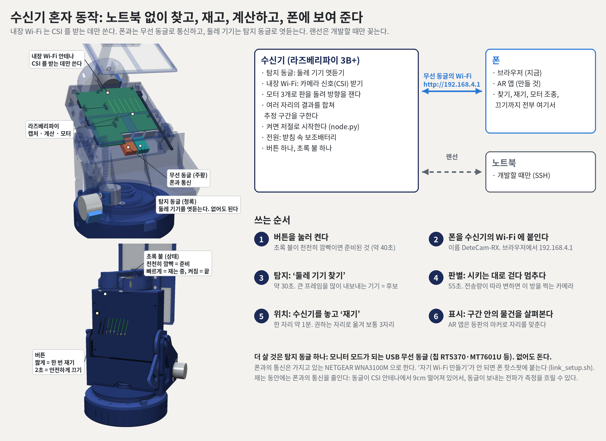
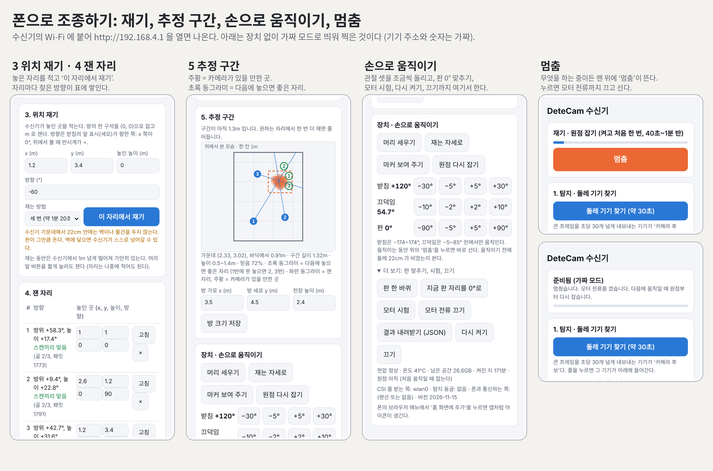

---
tags:
  - DeteCam
  - 코드
고친날: 2026-11-15
---

# 혼자 동작: 수신기 코드와 폰 조종

2026-11-15 기준. 수신기(라즈베리파이 3B+)는 노트북 없이 혼자 카메라를 찾고, 재고, 계산해서 폰에 보여 준다. 사용자는 폰 화면에서 모든 동작을 무선으로 조종한다. 코드는 저장소의 `firmware/` 폴더에 있다.

장치 없이 도는 검사는 모두 통과했지만, **실물(파이, 모터, 동글)에서는 아직 돌려 보지 못했다.**



## 1. 네 단계

| 단계 | 하는 일 | 파일 | 걸리는 시간 |
|---|---|---|---|
| 1 탐지 | 둘레의 Wi-Fi 기기를 훑어 영상을 내보내는 것처럼 보이는 기기를 추린다 | `pi/detect.py` | 약 30초 |
| 2 판별 | 사람이 멈췄다 움직였다 할 때 그 기기의 전송량이 따라 변하는지 본다 | `core/identify.py` | 55초 |
| 3 위치 측정 | 판을 돌려 한 자리의 방향을 재고, 여러 자리를 합쳐 추정 구간을 낸다 | `pi/rx3.py`, `core/analyze3.py`, `core/locate.py` | 한 자리 47~79초 |
| 4 표시 | 폰 브라우저에 보여 준다. AR 앱에는 마커 좌표와 추정 구간을 준다 | `pi/node.py`, `pi/web.html` | |

```
폰 (브라우저 / AR 앱) ⇄ 무선 동글 ⇄ 파이: node.py ─┬─ detect.py   탐지 동글로 둘레 기기 엿듣기
                                                 ├─ identify    움직임에 전송량이 반응하는지
                                                 ├─ rx3.py      모터 3개
                                                 ├─ csi.py      내장 Wi-Fi 로 CSI 받기
                                                 ├─ analyze3    한 자리의 방향
                                                 └─ locate      여러 자리를 합친 추정 구간
```

| 폴더 | 내용 |
|---|---|
| `firmware/pi/` | 수신기에서 도는 것: `node.py`(전체를 묶는 프로그램), `rx3.py`(모터), `csi.py`, `detect.py`, `web.html`(폰 화면), `marker.json`(마커 자리), 설치 스크립트 |
| `firmware/core/` | 계산 코드. 수신기와 시뮬레이션(`sim/`)이 같이 쓴다: `estimator`, `model`, `fusion`, `locate`, `identify`, `analyze3`, `world` |
| `firmware/host/` | 개발할 때 노트북에서 쓰는 것 (SSH로 파이를 움직인다) |
| `firmware/tests/` | 장치 없이 도는 검사 |

## 2. 설치

```
firmware/pi/install.sh pi@raspberrypi.local  # 노트북에서. 파이에 랜선을 꽂은 채로. 파일 복사 + 계산 검사 + 자동 시작 등록
ssh pi@raspberrypi.local
cd ~/detecam && sudo ./link_setup.sh check   # 동글 두 개가 잡혔는지, 어느 것을 어디에 쓸지
sudo ./link_setup.sh ap                      # 폰과 통신: 수신기가 Wi-Fi(DeteCam-RX)를 만든다. 비밀번호는 무작위로 만들어 보여 준다
sudo ./link_setup.sh client 이름 비밀번호      #   (ap 가 안 되면) 폰 핫스팟에 붙는다
sudo ./link_setup.sh mon                     # 탐지 동글 준비 (있을 때)
sudo reboot
```

- 켜면 `node.py` 가 저절로 뜬다. 폰을 수신기의 Wi-Fi에 붙이고 `http://192.168.4.1` 을 연다.
- `apt upgrade` 는 하지 않는다 (nexmon 이 깨진다). 스크립트도 하지 않는다.
- `install.sh` 와 `link_setup.sh` 는 실물에서 돌려 보지 못한 첫 판이다. 랜선 SSH는 건드리지 않으니, 잘못되면 랜선으로 들어가 `sudo ./link_setup.sh off` 로 되돌린다.
- Wi-Fi 이름과 비밀번호를 바꾸려면 `sudo ./link_setup.sh ap 이름 비밀번호`.

| | 폰과 통신하는 동글 | 탐지 동글 |
|---|---|---|
| 하는 일 | 폰이 수신기 화면을 본다 | 둘레 기기의 프레임을 엿듣는다 (보내지는 않는다) |
| 예 | NETGEAR WNA3100M (rtl8192cu) | 칩 RT5370 (rt2800usb), MT7601U (mt7601u), AR9271 (ath9k_htc) |
| 꽂는 곳 | GPIO 쪽 USB의 위 칸 | 가운데 USB의 위 칸 |
| 없으면 | 랜선으로만 쓸 수 있다 | 돈다. 탐지는 CSI 수로, 판별도 CSI 수로 한다 (덜 정확) |

## 3. 폰으로 조종하기

수신기의 모든 동작이 폰 화면에 있다. 앱을 깔 필요 없이 브라우저로 열고, 브라우저 메뉴의 '홈 화면에 추가'를 누르면 앱처럼 아이콘이 생긴다.



| 화면의 칸 | 단추 | 하는 일 |
|---|---|---|
| 맨 위 (움직이는 동안만) | **멈춤** | 하던 일을 바로 끊고 모터 전류를 끈다. 재기, 판별, 손으로 움직이기 어느 때나 된다 |
| 1. 탐지 · 둘레 기기 찾기 | 둘레 기기 찾기 (약 30초), 저장 | 탐지. 표에서 줄을 누르면 그 기기를 고른다 |
| 2. 판별 · 이 방을 찍는 카메라인가 | 걸으며 확인 (55초), 불을 껐다 켜며, 방을 나갔다 들어오며 | 판별. 화면이 할 일과 남은 시간을 알려 주고 소리와 진동을 낸다 |
| 3. 위치 재기 | 이 자리에서 재기 | 놓은 자리(x, y, 높이, 방향)를 적고 잰다. 세 번 또는 여섯 번 |
| 4. 잰 자리 | 적기·고침, ×, 모두 지우고 새로 | 자리마다 찾은 방향. 자리를 고치거나 지운다 |
| 5. 추정 구간 | 방 크기 저장 | 카메라가 있을 만한 곳과 다음에 놓을 자리를 위에서 본 그림으로 |
| 장치 · 손으로 움직이기 | 머리 세우기, 재는 자세로, 마커 보여 주기, 원점 다시 잡기 | 자주 쓰는 자세 |
| | 받침 ±5°·±30°, 끄덕임 ±2°·±10°, 판 ±5°·±90° | 관절 하나를 조금씩 |
| | 판 한 바퀴, 지금 판 자리를 0°로, 모터 시험, 모터 전류 끄기 | 처음 켤 때 맞추기 ([조립 안내](조립%20안내.md) 7절) |
| | 결과 내려받기 (JSON), 다시 켜기, 끄기 | 잰 곡선까지 통째로 받기, 파이 다시 켜기, 안전하게 끄기 |

- **움직이는 범위는 프로그램이 지킨다**: 받침 −174~174°, 끄덕임 −5~85°. 범위 밖으로 가라고 하면 가지 않고 까닭을 알려 준다.
- **한 번에 한 가지만 한다.** 움직이는 중에 다른 단추를 누르면 '지금 … 을(를) 하는 중입니다'라고 답한다. 그때에도 듣는 것은 '멈춤'뿐이다.
- **움직이기 전에 수신기 둘레 23cm 를 비운다.** 판이 그만큼 돈다. 벽에 닿으면 수신기가 스스로 넘어갈 수 있다 ([설계 검토](설계%20검토.md) 10절).
- 머리 앞의 버튼으로도 된다: 짧게 누르면 그 자리에서 한 번 재고, 2초 누르면 안전하게 꺼진다.
- 화면 맨 아래 '장치' 줄에 전압 경고, 온도, 남은 저장 공간, 동글이 잡혔는지가 나온다.
- 안드로이드 AR 앱은 아직 만들지 않았다. 만들면 아래 5절의 주소를 그대로 부르면 된다.

## 4. 장치 없이 먼저 보기

```
python3 firmware/pi/node.py --dry --port 8080        # 가짜 방(3.5 × 4.5m), 가짜 카메라, 가짜 기기 표
```

브라우저에서 `http://localhost:8080`. '둘레 기기 찾기' → 줄 누르기 → '걸으며 확인' → 자리를 적고 '이 자리에서 재기' 순서로 눌러 보면 된다. 가짜 모드의 '재기'는 numpy 1.17 이상이 필요하다 (노트북). 3절 그림의 화면도 이렇게 띄워 찍은 것이다 (`firmware/tests/screens.py`).

## 5. 주소 (AR 앱이 쓸 것)

모두 JSON. 좌표는 z가 위, 각은 위에서 볼 때 +x에서 반시계. 한 번에 한 가지 일만 한다 (하는 중에 다른 일을 시키면 409). `/api/stop` 만 언제나 받는다.

| 주소 | 하는 일 |
|---|---|
| `GET /api/status` | 상태(`status.state` = idle·busy·error, `status.prompt` = 판별 중의 '지금 할 일'), 설정, 기기 표(`survey`), 판별 결과(`ident`, `ident_last`), 잰 자리들 |
| `GET /api/health` | 전압 경고, 온도, 남은 저장 공간, 관절 각도 |
| `POST /api/stop` | **하던 일을 바로 멈춘다** (모터 전류도 끈다) |
| `POST /api/detect` | 탐지. 끝나면 `survey` 에 기기 표: `mac`, `ch`, `per_s`, `mean_len`, `rssi`, `candidate`, `role`(sta·ap), `ssid`, `note` |
| `POST /api/config` `{"ch": 6, "mac": "..."}` | 볼 기기 고르기 |
| `POST /api/identify` `{"mode": "walk"}` | 판별. `walk`(55초) · `light` · `leave`(83초). 결과: `verdict` = camera · unclear · quiet, `ratio`, `p`, `series` |
| `POST /api/measure` `{"plan": "tilt3", "pose": {"x": 1.0, "y": 1.0, "z": 0, "heading": 30}}` | 한 자리 재기. `tilt6` = 여섯 번(좁은 곳). pose 는 받침 바닥 한가운데의 자리(m)와 앞 표시가 향한 각(도) |
| `POST /api/pose` `{"index": 1, "pose": {...}}` | 잰 자리를 나중에 알려 주거나 고치기 (AR 앱이 마커로 구한 값) |
| `POST /api/delete` `{"index": 1}`, `/api/reset` | 잰 자리 하나 지우기, 모두 지우고 새로 시작 |
| `POST /api/room` `{"lo": [0, 0, 0], "hi": [3.5, 4.5, 2.4]}` | 찾을 범위. 안 주면 잰 자리 둘레 4m |
| `GET /api/zone` | 추정 구간: `centre`, `box`, `cells`, `length_m`, `confidence`, `verdict`, `next`(다음에 놓을 자리 3곳) |
| `GET /api/marker` | 등판 마커 귀의 좌표(받침 기준, m). 지금 관절 각도로 계산한다. `markers[].corners`, `yaw`, `pitch`, `normal` |
| `POST /api/present` `{"yaw": 0}` | 등판이 위를 보게 머리를 숙인다 (마커를 보여 주는 자세) |
| `POST /api/goto` `{"yaw": 30, "pitch": 54.7}` | 받침과 끄덕임을 그 각도로 (둘 중 하나만 줘도 된다) |
| `POST /api/jog` `{"joint": "yaw", "deg": 5}` | 관절 하나를 지금 자리에서 그만큼. `joint` = yaw · pitch · spin |
| `POST /api/spin` `{"turns": 1}` | 판만 돌려 본다 (재지는 않는다) |
| `POST /api/zero` `{"joint": "spin"}` | 지금 판 자리를 0°로 정한다 |
| `POST /api/home` `{"quick": false}`, `/api/park` | 원점 다시 잡기 (멈춤턱에 대고 맞춘다), 머리 세우기 |
| `POST /api/test`, `/api/release` | 모터를 하나씩 조금 움직여 보기, 모터 전류 끄기 |
| `GET /api/export` | 지금까지의 결과 전부: 자리, 자리마다의 세기 곡선, 추정 구간, 기기 목록, 판별 결과 |
| `POST /api/reboot`, `/api/off` | 파이 다시 켜기, 안전하게 끄기 |
| `POST /api/time` `{"epoch": 1790000000}` | 파이의 시계를 폰의 시각으로 맞춘다 (화면이 열릴 때 저절로 부른다) |

판별의 숫자: 움직일 때 전송량이 1.5배가 되는 카메라는 93% 잡고, 카메라가 아닌 기기를 잘못 잡는 일은 4~5% (시뮬레이션). 자세한 것은 [네 단계 검토](네%20단계%20검토.md).

## 6. 검사 (장치 없이)

```
cd firmware
python3 tests/test_core.py        # 적어 둔 패킷으로 방향·구간·판별·탐지를 다시 계산해 답과 견준다. 파이에서도 돈다
python3 tests/test_detect.py      # 프레임을 만들어 탐지 코드가 맞게 읽는지 (scapy 필요)
python3 tests/test_node_dry.py    # node.py 를 가짜 모드로 띄워 네 단계를 차례로 불러 본다
python3 tests/test_control.py     # 폰 조종: 움직이기, 범위 지키기, 멈춤 (모터·판별·재기 도중), 내려받기
python3 tests/test_marker.py      # 마커 좌표 파일이 설계(marker/marker.json)와 같은지
```

파이 쪽 코드는 파이썬 3.7 + numpy 1.16 에서 돌아야 한다 (라즈베리파이 OS Buster). 새 문법(`:=`, `match`)과 `numpy.random.default_rng` 는 `pi/` 와 `core/`(가짜 자료를 만드는 `world.py` 는 빼고)에 쓰지 않는다.

## 7. 개발할 때

```
python3 firmware/host/scan3.py --dry --truth 35 -42                 # 장치 없이 흐름만
python3 firmware/host/scan3.py --ch 11 --mac c6:26:06:68:85:83      # 파이를 SSH 로 움직이며 재고 그림까지
python3 firmware/core/analyze3.py --selftest
```

- `firmware/pi/marker.json` 은 `cad/export/marker.py` 가 만드는 `marker/marker.json` 의 복사본이다. 등판이나 마커 자리를 바꾸면 같이 바꾼다.
- 실물로 잰 곡선을 전파 모형과 견주는 도구는 `sim/em/tools/compare_real.py` 다. 폰 화면의 '결과 내려받기'로 받은 파일을 그대로 준다 ([설계 검토](설계%20검토.md) 13절).
