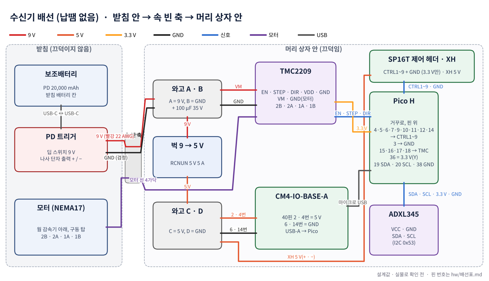

# 배선표 (납땜 없이 꽂아서 잇기)

마지막 수정 2026-11-27. **설계값이며 실물로 잇고 확인한 것이 아니다.** 모든 연결은 듀폰 점퍼, 레버식 커넥터(와고 221), 나사 단자, USB 케이블로 한다. 납땜 · 기판 설계는 없다(AGENTS R5). 부품 자리는 [조립 순서](조립_순서.md), 스위치 진리표는 [SP16T 제어표](SP16T_제어표.md), 무선(SMA) 연결은 [조립 순서 3절](조립_순서.md#3-무선-연결)에 있다.



## 0. 먼저 지킬 것

- **선을 꽂고 뺄 때는 언제나 보조배터리 케이블을 뺀 상태**에서 한다.
- 선 색을 정해 둔다: **빨강 = 9 V 또는 5 V, 주황 = 3.3 V, 검정 = GND**, 나머지 신호선은 다른 색. 9 V 선에는 "9V" 이름표(마스킹 테이프)를 붙인다.
- Pico · SP16T 제어선 · ADXL345 · TMC2209 신호 핀에는 **3.3 V 신호만** 간다. 5 V · 9 V 선이 닿으면 부품이 망가진다.
- **모터 선은 드라이버에 전원이 있을 때 빼거나 꽂지 않는다**(드라이버가 망가질 수 있다).
- 와고 221에는 0.2 mm² 이상 선이 들어간다. 듀폰 점퍼선(약 0.13 mm²)처럼 가는 선은 피복을 22 mm 벗겨 반으로 접어(11 mm) 꽂는다. 꽂은 뒤 살짝 당겨 빠지지 않는지 본다.

## 1. 한눈에 보기

```
[받침 안]                                   [머리 상자 안]
보조배터리 ─USB-C 케이블─ PD 트리거(9 V)     와고 A(9 V) ─┬─ 벅 입력+ ── 벅(5 V) ── 와고 C(5 V) ─┬─ CM4 보드 40핀 2 · 4번
                         │ 출력+ ═빨강 9 V═══════╪══════>│   ├─ TMC2209 VM                        └─ SP16T XH 단자 +
                         │ 출력− ═검정 GND═══════╪══════>│   └─ 100 µF + 다리
                                                 │        와고 B(GND) ─ 벅 입력− · TMC GND(VM 옆) · 100 µF − 다리
               (받침 앞 홈 → 왼쪽 탑 홈 → 속 빈 축)       와고 D(GND) ─ 벅 출력− · CM4 6 · 14번 · SP16T XH 단자 −
모터(탑 아래) ══모터 선 4가닥═══════════════════╪══════> TMC2209 2B · 2A · 1A · 1B
                                                          CM4 보드 USB-A ─마이크로 USB─ Pico H
                                                          Pico H ─ SP16T CTRL1~9 · TMC2209 EN · STEP · DIR · ADXL345 SDA · SCL
```

축을 건너는 선은 **6가닥(9 V, GND, 모터 4)**뿐이다. 왼쪽 속 빈 축 안으로 지나므로 끄덕일 때(±20°) 조금 비틀리기만 한다.

## 2. 핀 표

Pico H는 **거꾸로(핀이 위로)** 상자 바닥에 붙는다. 핀 번호는 Pico 기판에 적힌 번호(1~40)다. USB 단자 쪽 왼쪽 위가 1번, 그 아래로 20번까지, 오른쪽 줄은 아래 21번에서 위 40번까지다. 거꾸로 놓으면 좌우가 바뀌어 보이므로 **기판 뒷면의 GP 이름**으로 확인한다.

### 2.1 Pico H → SP16T 제어 헤더 (듀폰 암–암 10가닥)

SP16T 제어 헤더는 2줄 × 8핀이다. 판매 사진에서 +5V · +3.3V가 적힌 쪽을 1번째 줄로 셌다. 받으면 기판 인쇄 이름으로 다시 확인한다.

| Pico 핀 | 이름 | → SP16T 헤더 | 자리(줄, 왼쪽 L / 오른쪽 R) |
|---|---|---|---|
| 4 | GP2 | CTRL1 | 2줄 L |
| 5 | GP3 | CTRL2 | 4줄 R |
| 6 | GP4 | CTRL3 | 3줄 R |
| 7 | GP5 | CTRL4 | 3줄 L |
| 9 | GP6 | CTRL5 | 2줄 R |
| 10 | GP7 | CTRL6 | 4줄 L |
| 11 | GP8 | CTRL7 | 5줄 R |
| 12 | GP9 | CTRL8 | 5줄 L |
| 14 | GP10 | CTRL9 | 6줄 R |
| 3 | GND | GND | 8줄 L(또는 R) |

- SP16T 헤더의 **+5V · +3.3V 핀에는 아무것도 잇지 않는다**(전원은 XH 단자로만, [SP16T 제어표](SP16T_제어표.md) 4절).
- GP2~GP10이 이어진 번호라 펌웨어는 9개 선을 한 번에 쓴다(`gpio_put_masked`, 마스크 `0x7FC`).

### 2.2 Pico H → TMC2209 (MKS TMC2209 V2.0, 핀 납땜된 판)

| Pico 핀 | 이름 | → TMC2209 | 비고 |
|---|---|---|---|
| 15 | GP11 | EN | 낮음 = 모터 켜짐, 높음 = 꺼짐. 재는 동안에는 높음 |
| 16 | GP12 | STEP | |
| 17 | GP13 | DIR | 모터가 거꾸로 돌면 펌웨어에서 방향을 뒤집는다(선은 그대로) |
| 36 | 3V3(OUT) | VDD(VIO) | Y 갈래 점퍼의 한쪽. 다른 쪽은 ADXL345 VCC |
| 18 | GND | GND(VDD 옆) | 논리 쪽 GND |

- MS1 · MS2 · PDN(UART) · CLK는 **비워 둔다**. 기판 안 풀다운으로 1/8 마이크로스텝, 대기 전류 줄이기가 켜진다(TMC2209 데이터시트).
- 판에 따라 모터 핀 이름이 1A · 1B · 2A · 2B 또는 A1 · A2 · B1 · B2다. 한 코일의 두 선이 1A · 1B(A1 · A2)에, 다른 코일이 2A · 2B(B1 · B2)에 가면 된다.

### 2.3 Pico H → ADXL345 (GY-291, 핀 납땜된 판)

| Pico 핀 | 이름 | → ADXL345 |
|---|---|---|
| 36 | 3V3(OUT) | VCC (Y 갈래의 다른 쪽) |
| 38 | GND | GND |
| 19 | GP14 (I2C1 SDA) | SDA |
| 20 | GP15 (I2C1 SCL) | SCL |

- CS · SDO · INT1 · INT2는 먼저 비워 둔다. 켠 뒤 I2C 검색에서 주소 **0x53**이 보이면 끝이다. 안 보이면 CS를 3.3 V에, SDO를 GND에 잇고 다시 본다.
- 센서는 상자 바닥 자리(사각 턱 안)에 **x축 화살표가 상자 앞(방 쪽)을 보게** 양면 폼테이프로 붙인다. 끄덕이는 축(y) 둘레의 기울기를 읽는다.

### 2.4 전원 (와고 4개)

| 와고 | 꽂는 선 |
|---|---|
| A (9 V, 5구) | ① PD 트리거 출력+ 빨강 22 AWG ② 벅 입력+ ③ TMC2209 VM(듀폰 암–나선) ④ 100 µF 35 V 콘덴서 + 다리 |
| B (GND, 5구) | ① PD 트리거 출력− 검정 22 AWG ② 벅 입력− ③ TMC2209 GND(VM 옆, 듀폰 암–나선) ④ 콘덴서 − 다리(띠 무늬 쪽) |
| C (5 V, 5구) | ① 벅 출력+ ② CM4 보드 40핀 **2번** ③ **4번**(듀폰 암–나선 2가닥) ④ SP16T XH 단자 빨강 |
| D (GND, 5구) | ① 벅 출력− ② CM4 보드 40핀 **6번** ③ **14번** ④ SP16T XH 단자 검정 |

- CM4 보드는 40핀 헤더의 5 V 핀 2개 · GND 핀 2개로 전원을 받는다(전류를 두 가닥에 나눔). **1번 · 17번(3.3 V) 핀에 5 V를 꽂지 않는다.** 이렇게 쓸 때는 CM4 보드의 USB-C 전원 단자에 다른 전원을 함께 꽂지 않는다.
- PD 트리거의 딥 스위치를 **9 V**에 맞춘다(판매 페이지 표대로). 보조배터리와는 짧은 USB-C ↔ USB-C 케이블로 잇는다.
- 콘덴서는 TMC2209 가까이(와고 A · B) 둔다. 모터가 멈추고 돌 때 9 V가 출렁이는 것을 받아 준다.
- Pico는 CM4 보드 USB-A 단자에서 마이크로 USB 케이블로 전원과 명령을 함께 받는다.

### 2.5 모터

- 모터 선(판매 케이블 4가닥, 4핀 커넥터)을 TMC2209의 2B · 2A · 1A · 1B 핀에 그대로 꽂는다.
- 꽂기 전에 멀티미터로 확인: 저항이 몇 Ω(보통 1~5 Ω) 나오는 두 선이 한 코일이다. 이 두 선이 1A · 1B 또는 2A · 2B에 나란히 가야 한다. 모터가 떨기만 하고 돌지 않으면 짝이 어긋난 것이다.
- 전류(Vref): 모터 선을 뺀 채 Pico만 켜고(EN 높음), 드라이버의 작은 가변저항과 GND 사이 전압을 멀티미터로 재며 **1.0 V(약 0.7 A)**에서 시작한다. 웜기어라 큰 힘이 필요 없다. 모터가 미끄러지면 0.1 V씩 올린다(1.4 V 넘기지 않음).

## 3. 선 목록 (자르는 길이 · 꽂는 곳)

| 번호 | 선 | 한쪽 끝 | 다른 쪽 끝 | 길이(셈) |
|---|---|---|---|---|
| P1 | USB-C ↔ USB-C 케이블(한쪽 ㄱ자 권장) | 보조배터리 | PD 트리거 | 20~30 cm(배터리 단자가 문 반대쪽이면 30 cm) |
| P2 | 빨강 실리콘선 22 AWG ("9V" 이름표) | PD 트리거 출력+ 나사 단자 | 와고 A | 45 cm |
| P3 | 검정 실리콘선 22 AWG | PD 트리거 출력− 나사 단자 | 와고 B | 45 cm |
| P4 | 모터 선 4가닥(판매품, 보통 1 m) | 모터 | TMC2209 2B · 2A · 1A · 1B | 약 65 cm 쓰고 남는 것은 받침 안에서 묶음 |
| P5 | 벅 입력선 2가닥(벅에 달려 나옴) | 벅 | 와고 A · B | 그대로 |
| P6 | 벅 출력선 2가닥 | 벅 | 와고 C · D | 그대로 |
| D1~D9 | 듀폰 암–암 15 cm | Pico 4 · 5 · 6 · 7 · 9 · 10 · 11 · 12 · 14 | SP16T CTRL1~9 | 2.1절 |
| D10 | 듀폰 암–암 15 cm(검정) | Pico 3 | SP16T GND | |
| D11~D13 | 듀폰 암–암 10 cm | Pico 15 · 16 · 17 | TMC EN · STEP · DIR | |
| D14 | 듀폰 Y 갈래(암 1 → 암 2, 주황) | Pico 36 | TMC VDD, ADXL345 VCC | |
| D15 | 듀폰 암–암 10 cm(검정) | Pico 18 | TMC GND(VDD 옆) | |
| D16 · D17 | 듀폰 암–암 15 cm | Pico 19 · 20 | ADXL345 SDA · SCL | |
| D18 | 듀폰 암–암 15 cm(검정) | Pico 38 | ADXL345 GND | |
| L1 · L2 | 듀폰 암–나선 15 cm(빨강 · 검정) | TMC VM · GND | 와고 A · B | |
| L3~L6 | 듀폰 암–나선 20 cm(빨강 2 · 검정 2) | CM4 40핀 2 · 4 · 6 · 14번 | 와고 C · C · D · D | |
| X1 | XH2.54 2핀 한쪽 커넥터 선 | SP16T 전원 단자 | 와고 C · D | 15 cm |
| C1 | 전해 콘덴서 100 µF 35 V | 와고 A(+) | 와고 B(−) | 다리 그대로 |
| U1 | 마이크로 USB 케이블(짧은 것) | CM4 보드 USB-A | Pico | 15~25 cm |

축을 건너는 6가닥(P2 · P3 · P4)이 지나는 길: 머리 상자 안 → 왼쪽 속 빈 축(안지름 12.5 mm) → 축 아래 틈(±35°) → 왼쪽 탑 바깥쪽 홈(위에서 아래로) → 탑 아래 가로 홈 → 받침 덮개판의 내림 구멍 → 받침 통 앞쪽 칸. 홈은 바깥으로 열려 있어 선을 **눌러 넣고** 전기 테이프로 덮는다. 모터 선 커넥터는 축 안을 **길게 세워서**(커넥터의 긴 변이 축 방향) 지나게 한다.

## 4. 처음 켜기 (순서대로)

1. 모터 선은 빼 둔다. 보조배터리를 잇기 전에 멀티미터로 와고 A–B, C–D 사이가 붙어 있지 않은지(저항 수백 Ω 이상) 본다.
2. 보조배터리를 잇는다. 와고 A–B가 **8.5~9.5 V**, C–D가 **5.0~5.3 V**인지 잰다. 다르면 바로 뺀다.
3. CM4가 켜지는지(보드 LED), Pico가 USB 장치로 보이는지, SP16T 전류가 판매자 값 근처인지 본다.
4. I2C 검색에서 0x53(ADXL345)이 보이는지 본다.
5. Vref를 맞춘다(2.5절). 전원을 끄고 모터 선을 꽂는다. EN을 낮춰 0° → +5° → 0°만 돌려 보며 소리와 방향을 본다. 그다음 −20° · 0° · +20°.
6. SP16T 17상태 시험([SP16T 제어표](SP16T_제어표.md) 4절).

## 5. 하지 말 것

- 5 V · 9 V를 Pico 핀, SP16T CTRL 핀, ADXL345 신호 핀에 잇지 않는다.
- SP16T의 헤더 +5V와 XH 단자에 동시에 전원을 넣지 않는다.
- 전원이 있을 때 모터 선을 빼거나 꽂지 않는다.
- 선을 고리 판 위나 기둥을 따라 올리지 않는다. 전원 · 모터 선은 상자와 받침 안에만 있다(안테나 케이블 길은 [조립 순서](조립_순서.md) 4절 그대로).
