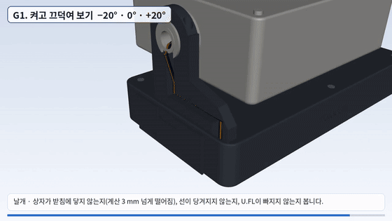

# 조립 순서 (16소자 고리 수신기 1기)

마지막 수정 2026-11-27(외형 바꿈: 받침대 · 구동 탑 · 벽 거치대). **설계값으로 쓴 순서이며 실물을 조립해 본 것이 아니다.** 부품은 아직 사지 않았다. 안테나 · 케이블 치수의 근거는 계산 [`sim/안테나-케이블-배선-결과.md`](../sim/안테나-케이블-배선-결과.md)와 [`sim/위험-점검-결과.md`](../sim/위험-점검-결과.md)(계산값, 실측 아님), 외형이 성능에 주는 영향은 [`sim/외형-변경-점검-결과.md`](../sim/외형-변경-점검-결과.md), 출력 파일은 [`cad/`](cad/), 핀 단위 배선은 [배선표](배선표.md), 부품은 [docs 구매 부품 목록](https://github.com/DeteCam/docs/blob/main/구매_부품_목록.md)이다.



- 전체 영상: [`조립_시뮬레이션.mp4`](조립_시뮬레이션.mp4)(4분 44초, 1280 × 720, 단계 43개). 나사 하나, 선 하나씩 순서대로 보여 준다. 위 그림은 그 끝부분(끄덕이기 · 완성)이다. 영상은 설계값으로 그린 그림이다. 그린 코드는 [`anim/`](anim/)에 있다.

## 0. 준비물

### 0.1 출력 부품 (PLA, [`cad/stl/`](cad/stl/))

| 번호 | 이름 | 수량 | 하는 일 |
|---|---|---|---|
| H1 | 상자 통 | 1 | 전자부를 담는다. 바깥 치수는 계산 모델 상자와 같음(135 × 157.5 × 56.25 mm, 뚜껑 포함) |
| H2 | 상자 뚜껑 | 1 | 기둥 · 레일 · 케이블 묶음 구멍 |
| H3 | SP16T 선반 | 1 | 상자 안 위층. SP16T를 네 모서리 턱에 끼운다 |
| H4 | 오른쪽 허브 | 1 | 감속기 D축(8 mm)을 받아 머리를 끄덕인다 |
| H5 | 왼쪽 속 빈 축 | 1 | 머리의 왼쪽 축. 선 6가닥이 속으로 지난다 |
| H6 | 축 고리 | 1 | 속 빈 축이 빠지지 않게 끝 홈에 끼운다 |
| H7 | 가운데 기둥 | 1 | 지름 18 mm 플라스틱 기둥(계산 모델 그대로) |
| H8 | 레일 | 2 | 케이블 묶음이 내려오는 두 줄(계산 모델 그대로) |
| H9 | 고리 판 | 1 | 지름 140 mm, 날개 17장이 꽂힌다 |
| H10 | 날개 | 17 | 필름 안테나를 붙이는 판(16 + 가운데 1). **매끈한 판(Smooth PEI · Cool Plate)**에 출력해 판에 닿은 면에 필름을 붙인다 |
| H11 | 기둥 덧대 | 1 | 기둥 아래쪽(고리 면에서 50 mm 넘게 아래)만 감싸 튼튼하게 |
| H12 | 레일 받침 | 1 | 레일 아래쪽만 잡아 준다 |
| H14 | 날개 높이 도구 | 1 | 날개 윗끝을 판 위 21 mm로 맞춘다(조립 도구) |
| B1 | 받침 통 | 1 | 보조배터리 칸, 앞쪽 선 칸, 모터 칸 |
| B2 | 덮개판 + 두 탑 | 1 | 오른쪽 구동 탑(감속기 칸), 왼쪽 탑(축받이 아래 반쪽, 선 홈) |
| B3 | 탑 덮개 | 1 | 구동 탑의 열린 쪽을 닫는다 |
| B4 | 배터리 문 | 1 | 받침 왼쪽 끝 문(끼워 닫음) |
| B5 | 축받이 뚜껑 | 1 | 왼쪽 탑 축받이의 위 반쪽 |
| W1 | 벽 거치대 | 1 | 벽에 걸 때만. 흡착판 2개 · 나사 · 접착 띠 중 고름 |

출력 설정과 판 나누기는 [`cad/README.md`](cad/README.md)에 있다(서포트 없이 출력하도록 방향을 잡아 두었다).

### 0.2 나사 · 너트 (M3는 모두 십자 머리)

| 기호 | 나사 | 수량 | 쓰는 곳 |
|---|---|---|---|
| N1 | M3 × 14 **나일론** 둥근머리 + 나일론 너트 | 4 + 4 | 뚜껑(H2) → 상자 통(H1) 네 모서리 |
| N2 | M3 × 10 **나일론** 둥근머리 + 나일론 너트 | 5 + 5 | 기둥 덧대(H11) 3개, 레일 받침(H12) 2개 → 뚜껑 |
| N3 | M3 × 16 **나일론** + 나일론 너트 | 1 + 1 | 기둥(H7) 아래 가로 핀 |
| S1 | M3 × 12 둥근머리 + 너트 | 4 + 4 | 오른쪽 허브(H4) → 상자 오른쪽 벽 |
| S2 | M3 × 10 둥근머리 | 1 | 허브 고정나사(위 구멍에 스스로 나사산을 내며 들어가 감속기 축의 평면을 누름) |
| S3 | M3 × 10 접시머리 + 너트 | 3 + 3 | 왼쪽 속 빈 축(H5) → 상자 왼쪽 벽 |
| S4 | M2.5 × 6 태핑 | 4 | CM4 보드 → 상자 바닥 기둥 |
| S5 | M2 × 5 태핑 | 4 | Pico H → 상자 바닥 기둥 |
| S6 | M3 × 12 접시머리 + 너트 | 6 + 6 | 덮개판(B2) → 받침 통(B1) |
| S7 | M3 × 12 둥근머리 | 4 | 탑 덮개(B3) → 오른쪽 탑(구멍에 스스로 나사산) |
| S8 | M3 × 20 둥근머리 + 너트 | 2 + 2 | 축받이 뚜껑(B5) → 왼쪽 탑 |
| — | 고무발(지름 12 mm, 접착식) | 4 | 받침 바닥 둥근 자리 |

- **고리 판 · 날개 · 기둥 · 레일 · 뚜껑 윗면에는 금속 나사를 쓰지 않는다(N1~N3 나일론).** 강철 나사(S)는 모두 상자 옆면 · 받침에 있고 필름 안테나에서 80 mm 넘게 떨어진다.
- 그 밖: 순간접착제, 양면 폼테이프, 전기 테이프, 케이블 타이, 마스킹 테이프(선 이름표).

### 0.3 전자 부품과 선

[배선표](배선표.md) 3절의 선 목록과 [구매 부품 목록](https://github.com/DeteCam/docs/blob/main/구매_부품_목록.md)을 본다. 납땜이 필요 없도록 **핀이 납땜되어 나오는 판**(Pico H, ADXL345 납땜판, TMC2209 StepStick, 나사 단자 PD 트리거, 선이 달린 벅)으로 고른다.

### 0.4 공구

십자 드라이버(#1, #0), 작은 일자 드라이버(가변저항 · 나사 단자), 니퍼, 와이어 스트리퍼, 멀티미터, 핀셋(너트 넣기), 롱노즈 플라이어.

## 1. 치수 (좌표는 고리 중심이 원점, 앞 = 방 쪽, 뒤 = 벽 쪽)

| 부분 | 값 | 근거 |
|---|---|---|
| 고리 | 지름 120 mm, 필름 안테나 16개를 22.5° 간격으로 세로로 세움 | 16소자 12 cm 고리(기존 결정) |
| 기준 안테나 | **고리 면 가운데**(필름 가운데 높이가 고리 소자와 같음) | 고리 면에서 45 mm 올리면 가까운 카메라의 위치가 나빠짐(계산) |
| 고리 판 | 지름 140 mm, 두께 3 mm. 윗면이 필름 가운데 높이보다 1 mm 아래. 날개는 판 홈을 지나 위아래로 20 mm씩 | 케이블을 고리 면 안에서만 보내기 위함 |
| 케이블 | 필름 → 뒤쪽으로 비스듬히(약 45°) → 등뼈(중심에서 옆으로 11 mm) → 고리 뒤쪽 가장자리 안(중심에서 뒤로 45 mm) → 한 묶음으로 아래로 | 등뼈 배선(계산) |
| 상자(전자부) | 135 × 157.5 × 56.25 mm, 고리 바로 아래 가운데. **윗면이 고리 면에서 89 mm 아래** | 계산 모델과 같은 치수 · 자리(외형 바꿀 때 바꾸지 않음) |
| 가운데 기둥 | 플라스틱 관(지름 18 mm). 아래 39 mm만 덧대(H11)로 감쌈 | 덧대는 고리 면에서 50 mm 넘게 아래 |
| 끄덕이는 축 | 상자 가운데 높이를 지나는 가로축. 고리 중심은 축보다 117 mm 위. 오른쪽은 감속기 D축 + 허브, 왼쪽은 속 빈 축 + 축받이 | ±20°에서 고리 중심이 앞뒤로 40 mm 움직이므로 추정기에 이 값을 넣음 |
| 받침 | 237.5 × 130 mm, 높이(바닥 ~ 덮개판 윗면) 36 mm. 속에 보조배터리 칸(안쪽 79.5 × 173 × 31 mm) | 보조배터리가 밖으로 나오지 않음 |
| 구동 탑 | 받침 오른쪽 끝. 웜 감속기(58 × 40 × 30.8 mm) 위, NEMA17이 아래로 세로. 감속기 윗면이 고리 면에서 97 mm 아래 | 감속기 출력축이 축 자리 |
| 전체 크기 | **가로 23.8 cm × 세로 14 cm(고리 판) × 높이 22.7 cm, 보조배터리 포함** | 옛 그림은 가로 22 × 세로 19 × 높이 21 cm에 배터리가 밖에 따로 있었다. 가로가 R8(20 cm 내외)보다 3.8 cm 크다 |
| 무게 | 약 2.2 kg(추정: 출력물 0.8, 모터 · 감속기 0.55, 20,000 mAh 배터리 0.4, 전자 · 케이블 0.4) | 판매 페이지 · 부피로 셈, 실측 아님 |

## 2. 순서

순서는 **A 출력 → B 고리 → C 머리 상자 → D 뚜껑과 고리 → E 받침 → F 머리 얹기 → G 확인 → H 벽에 걸기**다. 너트는 나사를 넣기 전에 너트 홈에 먼저 밀어 넣는다(핀셋, 안 들어가면 나사를 반대편에서 살짝 돌려 끌어당김).

### A. 출력과 다듬기

1. [`cad/README.md`](cad/README.md)의 판 1~7을 출력한다(벽에 걸지 않으면 판 7은 빼도 됨).
2. 날개 홈 · 레일 홈 · 축 구멍 가장자리의 실밥을 칼로 정리한다. 날개가 고리 판 홈에 손힘으로 들어가는지 하나씩 맞춰 본다.

### B. 고리(안테나 틀)

1. 고리 판(H9)을 평평한 곳에 놓고, 날개(H10) 16장을 바깥 홈에, 가운데 날개를 가운데 홈에 꽂는다. 날개 윗끝 홈(필름 모서리 표시)이 바깥을 보게 한다.
2. 날개 높이 도구(H14)를 판 위에 세우고 날개 윗끝을 도구 홈에 맞춘다(판 위 21 mm). 판 아래에서 홈마다 순간접착제 한 방울로 붙인다.
3. 필름 안테나 17장을 붙인다([안테나 부착과 배선](안테나_부착과_배선.md) 2절): 긴 변을 세로로, 날개의 매끈한 면에, 날개 홈 표시에 모서리를 맞추고, 케이블이 고리 안쪽을 보게. 30초 눌러 준다.
4. 케이블은 아직 묶지 않는다(D단계).

### C. 머리 상자 (전원은 맨 끝까지 잇지 않는다)

1. **너트 넣기.** 상자 통(H1)의 네 모서리 기둥 옆 홈에 나일론 너트 4개(N1용), 오른쪽 벽 둥근 패드 안쪽 육각 홈에 M3 너트 4개(S1용)를 넣는다.
2. **CM4 보드 준비.** CM4-IO-BASE-A 뒷면 M.2 슬롯에 M-key → A-key 어댑터와 AX210을 꽂고 나사로 고정한다. 앞면에 CM4를 꽂고 방열판을 붙인다. AX210의 두 단자에 MHF4–SMA 피그테일을 꽂는다(딸깍 소리).
3. **CM4 보드 고정.** 상자 바닥 왼쪽 뒤의 기둥 4개(9 mm)에 보드를 올리고 S4(M2.5 × 6 태핑) 4개로 고정한다. USB 단자들이 상자 앞(방 쪽)을 본다.
4. **Pico H 고정.** 오른쪽 앞 기둥 4개에 Pico H를 **거꾸로(핀이 위로)** 올리고 S5(M2 × 5 태핑) 4개로 고정한다. 마이크로 USB 케이블(U1)을 꽂아 CM4 보드 USB-A에 잇는다.
5. **TMC2209.** 오른쪽 앞 구석의 받침 틀에 드라이버를 **거꾸로(방열판이 아래 구멍으로, 핀이 위로)** 내려놓고 양면 폼테이프 한 조각으로 붙인다.
6. **ADXL345.** 바닥 가운데 앞의 사각 턱 안에 양면 폼테이프로 붙인다. 판의 x 화살표가 상자 앞(방 쪽)을 보게 한다.
7. **벅 · 와고 · 분배기.** 벅 변환기, 와고 4개(A~D, 이름표), 윌킨슨 분배기 2개를 바닥 빈 곳(SP16T 선반 아래)에 양면 폼테이프로 붙인다.
8. **신호선.** [배선표](배선표.md) 2.1~2.3절대로 듀폰 점퍼 D1~D18을 꽂는다(Pico → SP16T 선은 아직 SP16T에 꽂지 않고 끝을 위로 빼 둠).
9. **전원선(상자 안쪽).** [배선표](배선표.md) 2.4절대로 벅 선(P5 · P6), TMC VM · GND(L1 · L2), CM4 40핀 2 · 4 · 6 · 14번(L3~L6), 콘덴서(C1)를 와고에 꽂는다. SP16T XH 선(X1)은 와고 C · D에 꽂고 끝을 위로 빼 둔다.
10. **SP16T.** 선반(H3)에 SP16T를 놓고 네 모서리 턱에 눌러 끼운다(8포트 긴 변이 뒤쪽 = 벽 쪽). 포트 16개와 공통 포트에 어댑터 · 6 dB 감쇠기를 끼운다. 선반을 상자 양옆 벽의 턱 위에 얹고 양면 폼테이프로 붙인다. 위로 빼 둔 제어선 10가닥과 XH 선을 SP16T에 꽂는다.
11. **무선 점퍼.** [3절](#3-무선-연결) 그림대로 SMA 점퍼 4개와 두 번째 6 dB 감쇠기를 잇는다.
12. **오른쪽 허브.** 허브(H4)를 상자 오른쪽 바깥 패드에 대고 S1(M3 × 12) 4개를 C1에서 넣은 너트에 조인다. 허브 위 구멍에 S2(M3 × 10)를 2~3바퀴만 넣어 둔다(나중에 조임).
13. **왼쪽 속 빈 축.** 축(H5)의 넓은 판을 상자 왼쪽 바깥에 대고 S3(M3 × 10 접시머리) 3개를 바깥에서 넣어 안쪽 너트에 조인다.
14. **축을 건너는 선 6가닥 준비.** 9 V 빨강(P2) · GND 검정(P3) 선의 한쪽 끝을 와고 A · B에 꽂고, 다른 끝을 상자 안에서 **속 빈 축 구멍으로 밖으로 뺀다**. 모터 선(P4)은 드라이버 쪽 4핀 커넥터를 상자 안 TMC2209 옆에 두고(아직 꽂지 않음), 모터 쪽 커넥터를 축 구멍에 **길게 세워** 밀어 내보낸다. 6가닥이 축 끝의 아래 틈(±35°)으로 나오게 정리한다.
15. **뚜껑 닫기 전 첫 전원 시험.** 밖으로 나온 9 V · GND 선 끝을 PD 트리거 출력 나사 단자에 잠시 잇고 보조배터리를 꽂는다. [배선표](배선표.md) 4절 1~4단계(전압, CM4 · Pico · SP16T, ADXL345 0x53)와 2.5절 Vref 맞추기(1.0 V)를 한다. 보조배터리를 뺀 뒤 모터 선 4핀 커넥터를 TMC2209의 2B · 2A · 1A · 1B에 꽂는다. PD 트리거에서 선을 다시 푼다.

### D. 뚜껑과 고리 올리기

1. **기둥.** 뚜껑(H2) 가운데 구멍에 기둥(H7)의 아래 돌기를 위에서 꽂고, 뚜껑 아래로 나온 돌기의 가로 구멍에 N3(M3 × 16 나일론)을 끼워 나일론 너트로 잠근다.
2. **기둥 덧대.** 덧대(H11)를 기둥 위로 씌워 뚜껑까지 내리고 N2(M3 × 10 나일론) 3개를 위에서 넣어 뚜껑 아래 너트에 조인다.
3. **레일.** 레일(H8) 2개를 뚜껑 뒤쪽 홈 2개에 꽂고 레일 받침(H12)을 씌워 N2 2개로 조인다. 레일 아래 끝을 뚜껑 홈에 순간접착제 한 방울로 붙인다.
4. **고리 판 얹기.** 고리 판(B단계 결과)의 가운데 구멍을 기둥 윗 돌기에, 판의 레일 홈을 레일 윗끝에 맞춰 내려 얹는다. 가운데 날개의 아래쪽이 기둥 홈에 들어간다.
5. **안테나 케이블.** 필름 케이블 17가닥을 [안테나 부착과 배선](안테나_부착과_배선.md) 3절과 아래 4절 표대로 고리 판 위에서 **뒤쪽으로 비스듬히** 등뼈에 모아, 판 뒤쪽 묶음 구멍 → 두 레일 사이 → 뚜껑 묶음 구멍으로 내린다. 상자 안에서 4절 표의 포트에 꽂는다. 남는 길이는 상자 안에서 감는다. U.FL은 테이프로 고정한다.
6. **뚜껑 닫기.** 선이 끼지 않았는지 보고 뚜껑을 덮어 N1(M3 × 14 나일론) 4개로 조인다. 이제 머리(상자 + 고리)가 완성이다.

### E. 받침

1. **받침 통(B1).** 바닥 둥근 자리 4곳에 고무발을 붙인다. 안쪽 기둥 6개의 옆 홈에 M3 너트 6개(S6용)를 넣는다.
2. **PD 트리거.** 딥 스위치를 9 V로 맞춘다. 받침 통 앞쪽 칸(배터리 칸과 앞벽 사이)의 왼쪽 끝에 양면 폼테이프로 붙인다. USB-C 케이블(P1)을 꽂고 다른 끝을 배터리 칸 왼쪽 끝 홈으로 넘겨 둔다.
3. **덮개판(B2).** 왼쪽 탑 축받이의 앞쪽 홈 2곳에 M3 너트(S8용)를 밀어 넣는다.
4. **모터 · 감속기 맞춰 보기.** 감속기를 구동 탑 칸에 열린 쪽(+y)에서 밀어 넣어 보고 빡빡하지 않은지 본 뒤 다시 뺀다.
5. 덮개판을 받침 통에 얹고 S6(M3 × 12 접시머리) 6개로 조인다.

### F. 머리 얹기

1. **선 내리기.** 머리를 들고, 속 빈 축에서 나온 6가닥을 왼쪽 탑 바깥쪽 홈 위에 맞춘다.
2. **머리 내려놓기.** 속 빈 축을 왼쪽 탑의 반달 축받이에, 오른쪽 허브를 구동 탑 벽 앞에 오게 머리를 내려놓는다(오른쪽은 아직 받쳐 줄 것이 없으니 손으로 잡고 있는다).
3. **선 눌러 넣기.** 6가닥을 탑 홈(위 → 아래) → 아래 가로 홈 → 덮개판 내림 구멍으로 눌러 넣어 받침 통 앞쪽 칸으로 내린다. 홈 위를 전기 테이프로 덮는다. 끄덕여도(±20°) 축 근처 선이 당겨지지 않게 축 아래에 2 cm쯤 여유를 둔다.
4. **9 V 선.** 받침 앞쪽 칸에서 빨강(P2) · 검정(P3) 선 끝을 PD 트리거 출력 + · − 나사 단자에 끼우고 작은 일자 드라이버로 조인다.
5. **축받이 뚜껑.** 축받이 뚜껑(B5)을 속 빈 축 위에 덮고 S8(M3 × 20) 2개를 위에서 넣어 E3의 너트에 조인다. 축 끝 홈에 축 고리(H6)를 눌러 끼운다.
6. **모터 선.** 모터 선의 모터 쪽 커넥터를 받침 앞쪽 칸 → 모터 칸으로 보내 모터에 꽂는다.
7. **감속기 넣기.** 감속기 + 모터를 구동 탑 칸에 열린 쪽에서 밀어 넣는다(모터는 아래 모터 칸으로). 출력축(D축)이 탑 벽 구멍을 지나 허브의 D 구멍에 들어가도록 **머리를 천천히 앞뒤로 돌려 평면을 맞춘다**. 끝까지 들어가면 머리 오른쪽이 축에 얹힌다.
8. **허브 고정나사.** 상자와 탑 벽 사이 틈으로 드라이버를 넣어 허브 위의 S2를 조인다(축 평면을 누름). 세게 조이지 않는다.
9. **탑 덮개.** 탑 덮개(B3)를 대고 S7(M3 × 12) 4개로 조인다.
10. **배터리.** 배터리 문(B4)을 열고 보조배터리를 배터리 칸에 밀어 넣는다(USB-C 단자가 왼쪽 문 쪽). P1 케이블을 꽂고 문을 끼워 닫는다.

### G. 확인

1. 보조배터리를 꽂고 [배선표](배선표.md) 4절 5~6단계(모터를 0° → +5° → 0°로 조금 돌려 보기, SP16T 17상태 시험)를 한다.
2. 끄덕이기 −20° · 0° · +20°에서 날개 · 고리 판 · 상자가 받침 · 탑에 닿지 않는지, 선이 당겨지지 않는지, U.FL이 빠지지 않는지 본다. U.FL은 뺐다 꽂는 횟수가 적으므로(약 30회) 꽂은 뒤 테이프로 고정한다.
3. ADXL345 각도와 스텝 수로 셈한 각도의 차가 1° 안인지 본다.

### H. 벽에 걸기 (필요할 때만)

기본은 **선반 · 세면대 · 탁자 위에 그대로 세운다**(받침이 넓어 혼자 선다). 벽에 걸 때는 벽 거치대(W1)를 쓴다.

1. 거치대 아래 선반에 받침을 얹는다. 받침 바닥의 둥근 구멍 2개가 선반의 돌기 2개에 끼워진다. 이때 끄덕이는 축은 벽에서 120 mm, −20°에서도 날개 끝이 벽에서 10 mm 떨어진다(계산).
2. 붙이는 법은 벽에 따라 고른다.
   - **매끈한 타일 · 유리 · 거울:** 레버식 흡착판 2개(1/4"-20 또는 M6 볼트)를 거치대 뒤판 위아래 구멍에 너트로 고정하고 벽에 누른 뒤 레버를 내린다. **위쪽 끈 구멍에 안전끈**을 묶어 위 고리 · 수건걸이 등에 건다.
   - **페인트 · 벽지:** 떼어지는 접착 띠(큰 액자용)를 뒤판 평평한 면에 붙인다. 표시 하중의 합이 무게의 2배(약 4.5 kg) 이상이 되게 붙인다.
   - **나사를 박아도 되는 곳(자기 시설):** 키홀 구멍 2개에 나사 머리를 걸고 아래로 내린다.
3. **큰 흡착판 하나는 권하지 않는다.** 무게(약 2.2 kg, 추정)가 벽에서 약 10 cm 떨어져 있어 위쪽이 벽에서 떨어지려는 힘을 받는다. 한 점이면 돌아가거나, 바람이 천천히 빠지면 통째로 떨어진다. 흡착판도 매끈한 면에서만 버틴다.

## 3. 무선 연결

```
기준 안테나 ─(어댑터)─ 윌킨슨 1 ─┬─ 점퍼 ─ AX210 체인 A
                                 └─ 점퍼 ─┐
SP16T 공통 ─ 6 dB 감쇠기 ─ 점퍼 ─────────┴─ 윌킨슨 2 ─ 6 dB 감쇠기 ─ 점퍼 ─ AX210 체인 B
고리 소자 16개 ─(어댑터 16개)─ SP16T 포트 16개
```

## 4. 케이블 길이와 포트 짝 (셈, 실물 전)

소자 번호는 앞(방 쪽)이 0번이고 위에서 볼 때 반시계 방향이다. "등뼈에 닿는 자리"는 그 소자의 케이블이 등뼈와 만나는 곳으로, 고리 중심에서 앞(+) · 뒤(−)로 잰 거리다. 포트 이름은 SP16T를 위에서 볼 때 뒤쪽 긴 변의 8개를 오른쪽부터 B1~B8, 오른쪽 짧은 변을 뒤에서부터 R1~R4, 왼쪽 짧은 변을 L1~L4로 적었다(보드의 CH 번호와의 대응은 실물에서 적는다). 길이는 필름 → 등뼈 → 뒤쪽 → 상자 윗면까지 + 상자 안(곧은 거리 + 여유 30 mm)이다.

| 소자 | 등뼈에 닿는 자리 | 고리 면 + 아래로 | 포트 | 상자 안 | 합 |
|---|---|---|---|---|---|
| 1 | +17 mm | 203 mm | B4 | 39 mm | 242 mm |
| 0 | +45 mm | 199 mm | B3 | 40 mm | 239 mm |
| 15 | +39 mm | 193 mm | B5 | 49 mm | 242 mm |
| 2 | −39 mm | 192 mm | B2 | 50 mm | 243 mm |
| 14 | +11 mm | 189 mm | B6 | 60 mm | 249 mm |
| 3 | −39 mm | 186 mm | B1 | 62 mm | 248 mm |
| 13 | −17 mm | 177 mm | B7 | 72 mm | 249 mm |
| 4 | −45 mm | 174 mm | B8 | 84 mm | **258 mm** |
| 5 | −45 mm | 161 mm | R1 | 95 mm | 256 mm |
| 12 | −45 mm | 157 mm | R2 | 101 mm | **258 mm** |
| 6 | −45 mm | 145 mm | R3 | 108 mm | 253 mm |
| 11 | −45 mm | 141 mm | L1 | 117 mm | 257 mm |
| 7 | −45 mm | 127 mm | R4 | 117 mm | 244 mm |
| 10 | −45 mm | 123 mm | L2 | 121 mm | 244 mm |
| 8 | −45 mm | 109 mm | L3 | 127 mm | 236 mm |
| 9 | −45 mm | 106 mm | L4 | 134 mm | 240 mm |

- 가장 긴 것이 258 mm다. **300 mm 케이블판을 쓰면 여유가 42 mm다.**
- 소자 2의 케이블은 45° 규칙대로 보내면 가운데 기준 안테나를 스치므로 더 뒤쪽 자리(−39 mm)로 보낸다.
- 포트마다 길이 · 손실이 다른 것은 보정표가 흡수한다. 기준 안테나 케이블은 약 21 cm다.
- SP16T는 선반 위(상자 안 바닥에서 약 28 mm)에 있어, 상자 안 길이는 위 표와 같게 잡았다(실물에서 다시 잰다).
- 선반 높이는 SP16T 제어 헤더에 꽂은 듀폰 커넥터(높이 약 16.5 mm) 위로 선을 꺾을 틈(뚜껑까지 약 2 mm)과, 선반 아래 CM4 방열판 높이(**10 mm 이하**)를 같이 맞춘 값이다. 커넥터가 뚜껑에 닿으면 2 × 8 IDC 소켓 리본(높이 약 12 mm)으로 바꾼다.

## 5. 하지 말 것

- 케이블을 필름 바로 안쪽에서 곧장 아래로 내리지 않는다(한 자리 방향 +40~66%, 계산).
- 케이블 묶음을 고리 가운데로 내리지 않는다.
- 케이블을 등뼈와 직각으로(가로로만) 보내지 않는다(5 GHz 한 자리 방향 +14%, 계산).
- 고리 판 · 날개 · 기둥 · 뚜껑 윗면에 금속 나사나 금속 심을 쓰지 않는다.
- 상자를 고리 면에서 9 cm보다 가까이 올리지 않는다. 기둥 덧대 · 레일 받침을 고리 면 50 mm 안으로 늘이지 않는다.
- 전원 · 모터 선을 고리 쪽으로 올리지 않는다. 받침 안 선은 홈 안에만 둔다(계산에 넣은 길과 같게).
- 보조배터리를 받침 밖 머리 가까이에 두지 않는다.
