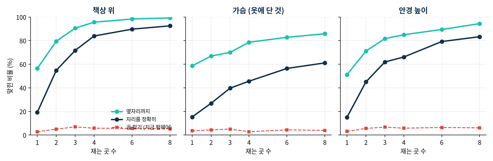
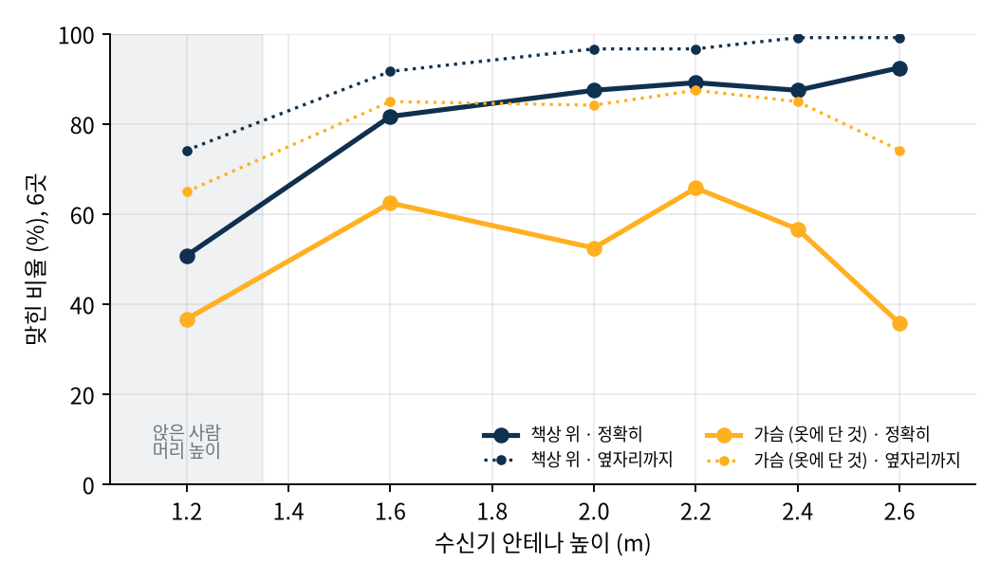
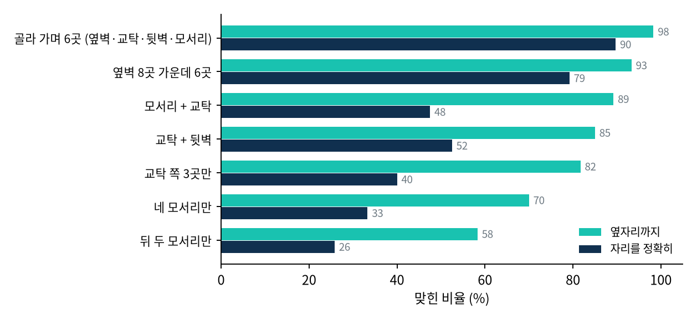

# 교실 전파 계산 (sim/rt)

학생 40명이 책상에 앉아 시험을 보는 교실에서, 수신기 한 대로 Wi-Fi 카메라의 자리를 찾을 수 있는지 전파 경로 계산으로 본 결과입니다. 이 문서의 표와 그림은 `report.py` 가 결과 파일(`rt_eval_result.json`)에서 만듭니다. 손으로 고치지 않습니다.

> **읽기 전에.** 여기의 숫자는 모두 **계산**입니다. 실물로 잰 것이 아닙니다. 방 모양·사람·책상·전파의 반사와 회절을 넣었지만, 실제 교실은 이보다 복잡합니다. 실물 실험의 목표값을 정하고 재는 방법을 고르는 데 씁니다.

## 한눈에

- **찾을 수 있다.** 수신기를 높이 2.4m 에 세우고 벽을 따라 여섯 곳에서 재면, 책상 위 카메라의 자리를 정확히 맞힌 비율이 **90%**, 바로 옆자리까지 넣으면 **98%**, 후보 3자리 안에 든 비율이 **97%** 입니다.
- **읽는 방법을 바꿔야 한다.** 지금 펌웨어처럼 신호 곡선의 가장 약한 곳(골)을 방향으로 읽으면 6% 로, 40자리에서 찍는 것과 다르지 않습니다. 곡선 전체를 기준 곡선과 견주어야 합니다.
- **몸에 붙인 카메라는 더 어렵다.** 같은 조건에서 가슴에 단 카메라는 56% (옆자리까지 83%), 안경 높이는 79% (옆자리까지 89%) 입니다. 몸과 앞사람이 전파를 가립니다.
- **사람 머리 위로 올려야 한다.** 앉은 사람 머리 높이(1.2m)에 두면 51%, 1.6m 는 82%, 2.0m 이상은 88~92% 입니다.
- **모서리만으로는 안 된다.** 네 모서리에서만 재면 33%, 옆벽을 따라 재면 79% 입니다.
- **찾지 못하는 것.** 블루투스로 폰에 보내는 스마트 안경, LTE 카메라, 저장만 하는 카메라는 Wi-Fi 전파를 내지 않아 이 방법의 대상이 아닙니다.

## 어떻게 계산했나

| 항목 | 내용 |
|---|---|
| 교실 | 7.5 × 9.0 × 2.7m, 책상 40개(6칸 × 7줄에서 두 자리 뺌), 뒷벽 사물함, 칠판(철판), 창(유리), 문(나무), 콘크리트 벽·바닥·천장 |
| 사람 | 자리마다 앉은 사람 모형(몸통·머리·허벅지). 시도마다 앉은 자리가 조금씩 다르고, 빈자리도 섞인다 |
| 전파 | Sionna RT 2.2 로 경로를 구한다: 반사 3번까지, 투과, 모서리 회절. 2.437GHz (채널 6), 부반송파 52개 |
| 수신기 | 안테나와 도는 알루미늄 판은 전자기 계산(NEC2)으로 구한 표를 쓴다. 판 각도 72칸, 편파 2개 |
| 재는 과정 | 패킷마다 잡음과 사람 움직임을 넣어 CSI 를 만들고, **실제 펌웨어 코드**(`analyze3.scan_curve`)로 신호 곡선을 만든다 |
| 카메라 | 책상 위 2곳, 가슴, 안경 높이. 자리마다 4점, 모두 160점 |
| 시도 | 기준 경우는 360번, 나머지는 120번 (카메라 자리·사람·잡음을 바꿔 가며). 120번이면 숫자가 ±9%p 쯤 흔들린다 |

맞힌 비율은 세 가지로 적습니다: **자리를 정확히 / 옆자리까지(둘레 8자리 포함) / 후보 3자리 안**.

## 1. 몇 곳에서 재야 하나



| 재는 곳 수 | 책상 위 | 가슴 (옷에 단 것) | 안경 높이 |
|---|---|---|---|
| 1 | 19 / 56 / 39 | 15 / 59 / 46 | 15 / 51 / 41 |
| 2 | 55 / 79 / 70 | 27 / 67 / 50 | 45 / 71 / 62 |
| 3 | 72 / 91 / 85 | 40 / 70 / 59 | 62 / 82 / 77 |
| 4 | 84 / 96 / 91 | 46 / 79 / 67 | 66 / 85 / 82 |
| 6 | 90 / 98 / 97 | 56 / 83 / 79 | 79 / 89 / 89 |
| 8 | 92 / 99 / 98 | 61 / 86 / 84 | 83 / 94 / 95 |

한 곳에서는 방향만 알 뿐 거리를 몰라 낮습니다. 네 곳부터 쓸 만해지고 여섯 곳에서 거의 다 올라옵니다. 여덟 곳은 조금 더 나을 뿐입니다. 몸에 붙인 카메라는 여덟 곳까지 계속 오릅니다. 한 곳은 18번 스캔에 약 2분 20초이므로 여섯 곳이면 옮기는 시간까지 20분 안팎입니다.

## 2. 곡선을 읽는 방법

| 방법 | 책상 위, 6곳 |
|---|---|
| 골 찾기 (지금 펌웨어) | 6 / 25 / 14 |
| 곡선 전체 맞추기 | 74 / 92 / 89 |
| 곡선 전체 + 편파 가정 | 84 / 95 / 94 |
| 평균 세기 곡선 맞추기 | 82 / 96 / 92 |
| **평균 세기 곡선 + 편파 가정** | 90 / 98 / 97 |

골 찾기는 직접 오는 전파 하나만 있는 이상적인 경우에도 방향 오차 가운데값이 45~55° 였습니다. 판이 만드는 그림자는 뒤쪽 한 곳에만 생기지 않고, 판의 가장자리를 돌아 들어오는 전파가 곡선에 여러 개의 봉우리와 골을 만들기 때문입니다. 곡선 전체를 견주면 같은 경우에 2.9~6.9° 였습니다.

## 3. 높이



| 높이 | 책상 위 | 가슴 | 안경 높이 |
|---|---|---|---|
| 1.2m | 51 / 74 / 67 | 37 / 65 / 61 | – |
| 1.6m | 82 / 92 / 94 | 62 / 85 / 79 | – |
| 2.0m | 88 / 97 / 98 | 52 / 84 / 84 | – |
| 2.2m | 89 / 97 / 96 | 66 / 88 / 89 | – |
| 2.4m | 88 / 99 / 99 | 57 / 85 / 82 | – |
| 2.6m | 92 / 99 / 98 | 36 / 74 / 68 | – |

앉은 사람의 머리는 바닥에서 약 1.2m 입니다. 그 높이에서는 앞사람들의 몸이 전파를 가립니다. 책상 위 카메라는 1.6m 부터 크게 나아지고 2.0m 이상에서는 비슷합니다. 가슴에 단 카메라는 반대로 너무 높으면 나빠집니다: 1.6~2.4m 에서는 비슷하고 2.6m 에서 뚜렷이 떨어집니다 (위에서 내려다보면 머리와 어깨가 가립니다). 경우마다 120번이라 숫자가 ±9%p 쯤 흔들리는 것을 감안해도, 둘을 함께 보면 **2.0~2.4m** 가 알맞습니다. 낮을수록 스탠드가 덜 흔들리고 넘어지기 어렵습니다. 기구 검사(넘어짐)는 가장 불리한 2.4m 로 했습니다.

## 4. 한 곳에서 몇 번 재나

| 한 곳에서 | 책상 위, 6곳 |
|---|---|
| 3번 (숙임 3가지) | 55 / 83 / 72 |
| 6번 | 74 / 92 / 89 |
| 12번 (숙임 3 × 받침 4방향) | 83 / 94 / 92 |
| **18번 (숙임 3 × 받침 6방향)** | 90 / 98 / 97 |
| 36번 | 90 / 95 / 96 |
| 6번, 숙이지 않고 | 73 / 96 / 91 |
| 12번, 위로만 | 82 / 98 / 93 |

같은 시간(스캔 약 72번)을 나누어 쓴다면:

| 나누는 방법 | 책상 위 |
|---|---|
| 18곳 × 3번 | 57 / 95 / 87 |
| 12곳 × 6번 | 80 / 99 / 94 |
| 6곳 × 12번 | 83 / 94 / 92 |
| 4곳 × 18번 | 84 / 95 / 88 |
| 2곳 × 36번 | 60 / 80 / 69 |

자리를 정확히 맞힌 비율은 4곳 × 18번이 가장 높고(84%), 옆자리까지 넣으면 12곳 × 6번이 가장 높습니다(99%). 가장 낮은 것은 18곳 × 3번(57%)입니다. 곳 수나 횟수 어느 한쪽으로 몰면 나빠집니다.

## 5. 어디에 놓나



옆벽을 따라 재는 것이 가장 좋습니다 (79 / 93 / 90). 교탁 쪽 세 곳만(40 / 82 / 67), 네 모서리만(33 / 70 / 54), 뒤 두 모서리만(26 / 58 / 41)으로는 부족하고, 모서리와 교탁을 섞어도(48 / 89 / 77) 옆벽만 못합니다. 모서리에서는 자리들이 좁은 각도 안에 몰려 보이고 뒤쪽에서는 학생들의 등이 카메라를 가리기 때문으로 짐작합니다 (따로 떼어 확인하지는 않았습니다).

다음에 잴 곳을 '지금 후보들이 가장 잘 갈라져 보이는 곳'으로 골라 가면 90 / 98 / 97 입니다. 차례를 미리 정해 두고 돌면:

| 정해진 차례 | 책상 위 |
|---|---|
| 한 바퀴 6곳 (교탁 → 오른쪽 벽 → 뒤 → 왼쪽 벽) | 75 / 92 / 89 |
| 한 바퀴 8곳 | 72 / 95 / 93 |
| 네 모서리 + 옆벽 가운데 둘 | 61 / 93 / 82 |
| 한 바퀴 14곳, 한 곳에서 6번씩 | 78 / 98 / 97 |

천장 가운데 한 곳에 달면 한 번에 64 / 84 / 80 (책상 위), 22 / 45 / 35 (가슴), – (안경 높이) 입니다. 책상 위 카메라에는 가장 빠른 방법이지만 미리 달아 두어야 하고, 몸에 단 카메라는 위에서는 잘 보이지 않습니다.

## 6. 더 큰 강의실 (72석, 9 × 12 × 3m)

| 조건 | 6곳 | 8곳 |
|---|---|---|
| 높이 2.4m, 책상 위 | 72 / 90 / 87 | 76 / 96 / 91 |

자리가 40개에서 72개로 늘면 같은 여섯 곳에서 책상 위 카메라를 정확히 맞힌 비율이 90% → 72% (옆자리까지 98% → 90%) 입니다. 여덟 곳이면 76% (옆자리까지 96%) 입니다.

## 7. 조건을 바꿔 보기 (책상 위, 6곳)

| 바꾼 것 | 결과 | 기준과의 차이 (정확히) | 무엇을 보려고 |
|---|---|---|---|
| 기준 (교실 세 가지, 360번) | 90 / 98 / 97 |  |  |
| 기준 곡선이 실물과 다름 (머리만 넣은 표로 만든 신호) | 84 / 95 / 93 | -6%p | 실물 곡선이 계산 표와 다를 때 |

기준과 10%p 넘게 차이 나는 것은 없습니다. 모두 시도 횟수에서 오는 흔들림(±9%p 쯤)과 가려내기 어려운 크기입니다.

맞춤 세기(`den`: 곡선이 닮은 정도를 가능성으로 바꾸는 날카로움)는 이 계산에서 고른 값(160)입니다. 그래서 기준 숫자에는 그만큼의 유리함이 들어 있을 수 있습니다.

## 8. 권하는 재는 방법

1. 수신기를 스탠드에 올려 안테나 높이 **2.0~2.4m** 로 세운다. 다리에 모래주머니를 올린다.
2. 교탁 옆처럼 드나들기 쉬운 곳에서 시작한다. 한 곳에서 **12~18번** 잰다 (숙임 세 가지 × 받침 4~6방향, 약 1분 30초~2분 20초).
3. 앱이 권하는 다음 곳으로 옮긴다 (지금 후보들이 가장 잘 갈라져 보이는 곳). 손으로 고를 때는 **옆벽**을 꼭 넣고, 모서리만 돌지 않는다.
4. **여섯 곳**을 재거나, 후보 3자리의 확률 합이 충분히 커지면 멈춘다.
5. 화면의 후보 3자리를 눈으로 확인한다.

## 한계와 다음에 확인할 것

- 계산에 넣지 못한 것: 가방·옷·의자 등의 잡동사니, 옆 교실의 Wi-Fi, 카메라 안테나의 실제 모양, 스탠드의 흔들림.
- 기준 곡선을 계산 표로 썼다. 표를 조금 다르게 해 본 경우(머리만 넣고 계산한 표로 신호를 만들고, 읽을 때는 원래 표를 씀)에는 90% → 84% 였다. 실물 곡선이 표와 더 많이 다르면 더 내려갈 수 있다. 실물로 기준 곡선을 재는 것이 첫 실험이다.
- 카메라가 재는 동안 계속 신호를 내야 한다. 조용한 카메라는 수신기가 찔러서 응답을 받아야 하고, 이것은 아직 실물로 확인하지 못했다.
- 2.4GHz 로 계산했다. 5GHz 는 판이 파장에 견주어 커져 곡선이 더 또렷해지지만 벽과 몸에 더 많이 가려진다. 따로 계산해야 한다.

## 돌리는 법

```
python3 -m venv .venv && .venv/bin/pip install sionna-rt trimesh shapely mapbox-earcut scipy matplotlib
cd sim/rt
./run_all.sh 120              # 경로 구하기(paths/*.npz) + 평가. GPU 가 있으면 몇 분, 없으면 몇 시간
python report.py              # 이 문서와 그림을 다시 만든다
python demo_run.py --seed 1001 && python demo_video.py   # 동작 시뮬레이션 영상 (docs/videos)
```

| 파일 | 무엇 |
|---|---|
| `scene_kr.py` | 교실과 강의실 장면 (벽, 창, 책상, 사람) |
| `rt_paths.py` | 수신기 자리마다 카메라 160점까지의 전파 경로 (Sionna RT) |
| `rt_eval.py` | 판과 안테나의 계산 표를 입히고 펌웨어 코드로 자리를 찾게 한다 |
| `report.py` | 결과 파일에서 이 문서를 만든다 |
| `demo_run.py`, `demo_video.py` | 한 번의 진행을 영상으로 |
| `rt_eval_result.json` | 결과 (경우마다 맞힌 비율) |

`paths/` 의 경로 파일은 커서(하나에 약 20MB) 저장소에 올리지 않는다. `rt_paths.py` 로 다시 만든다.

