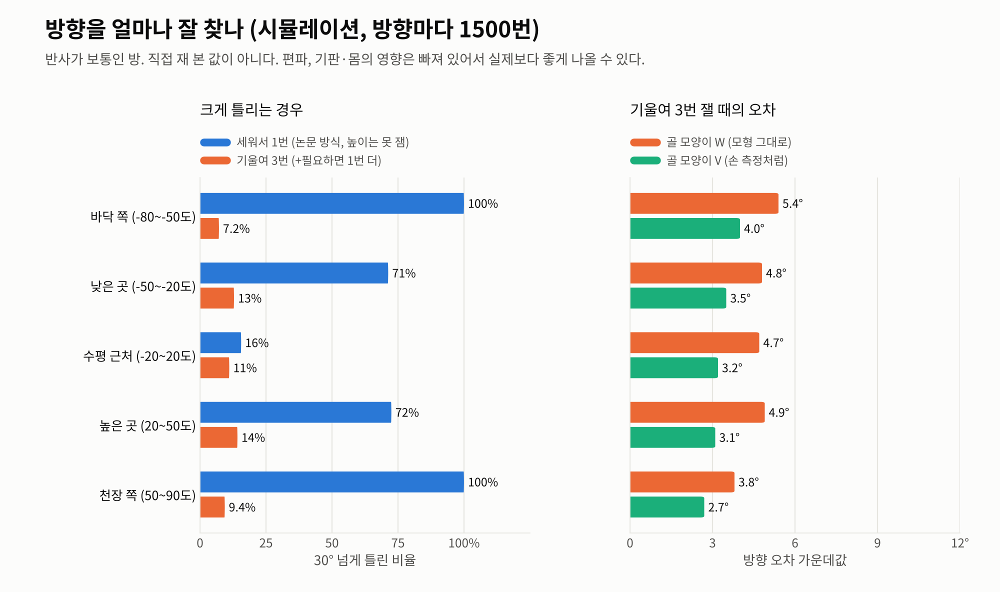
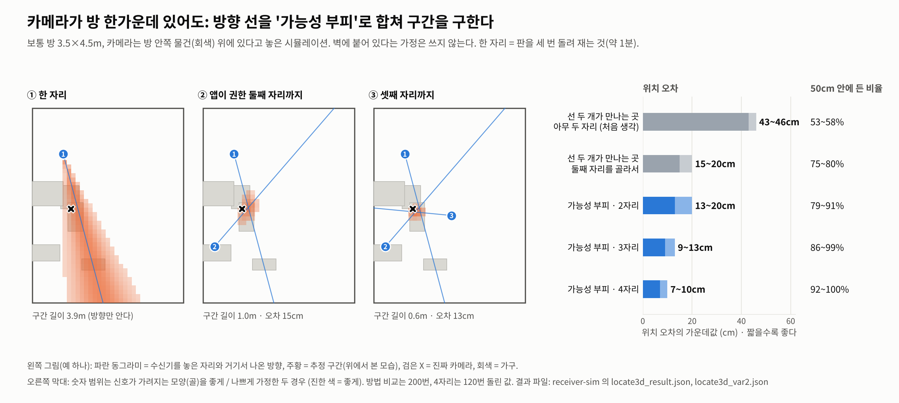
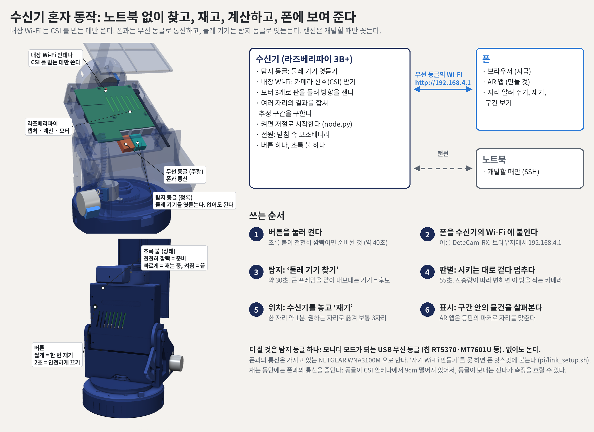
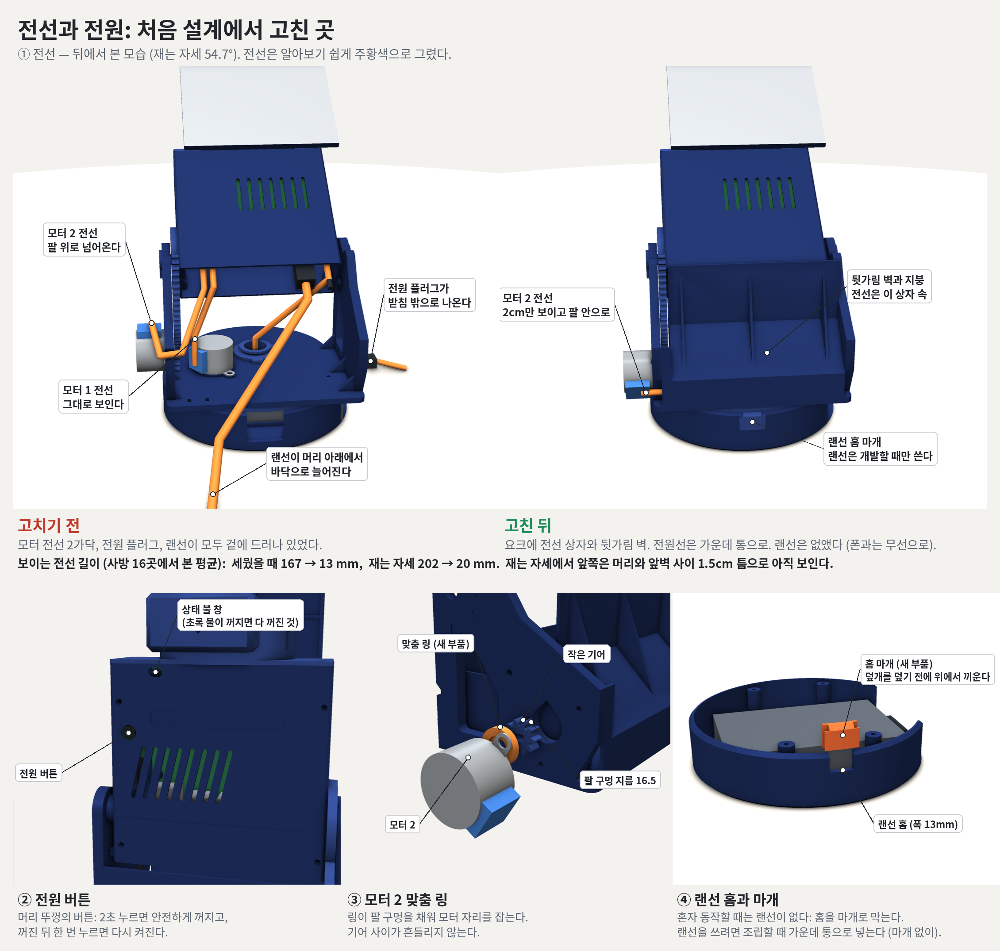

# 설계 검토: DeteCam 수신기 v2

2026-11-14 기준. 전부 모델 계산과 시뮬레이션으로 본 것이다. 실물로 확인해야 하는 것은 맨 아래에 모았다.

## 1. 한눈에

| 물은 것 | 답 |
|---|---|
| 탐지·판별·위치·표시 네 단계 | 이번 검토는 `네_단계_검토.md` 에 따로 적었다 (곳별 결과, 튼튼함, 출력 검증 포함) |
| 좁은 곳(화장실)에서도 되나 | 된다. 다만 타일·거울 반사로 크게 틀리는 일이 늘어서 '여섯 번 재기'를 쓴다 (2절) |
| 사람이 가로막으면 | 카메라와 수신기 사이에 서 있으면 못 잰다. 옆에 있는 것은 괜찮다 (2절) |
| 방 한가운데 있는 카메라 | 된다. 방향 선 대신 '가능성 부피'로 합치고, 둘째 자리를 앱이 정해 준다. 보통 3자리 (3절) |
| 폰 AR로 보여 주기 | 된다. 수신기가 구간(칸 목록과 상자)을 주고, 앱은 그리기만 한다 (3절) |
| 노트북 없이 혼자 | 된다. 파이가 캡처·계산을 다 하고, 폰과는 무선 동글로 통신한다 (4절) |
| WNA3100M | 폰과 통신하는 용도로 쓸 수 있다. 탐지용(다른 기기 엿듣기)으로는 못 쓴다. 탐지에는 모니터 모드 동글을 하나 더 꽂는다 (4절) |
| 전선이 겉으로 보이나 | 재는 자세에서 보이는 길이 202 → 20mm (5절) |
| 전원 스위치 | 버튼 2초 = 안전하게 끄기, 꺼진 뒤 한 번 = 켜기 (5절) |
| 모터 2가 버티나 | 버틴다. 재는 자세에서 모터 힘의 38%, 가장 깊이 숙여도 56% (6절) |
| 출력 | 다섯 판, 13시간 56분, 457g, 서포트 없음 (7절) |

## 2. 방향 찾기: 얼마나 맞나

한 자리에서 판을 여러 번 돌려 카메라의 **방향**(방위와 높이)을 찾는다. 시뮬레이션은 방 반사(벽·바닥·천장 3번까지), 가구, 패킷 흔들림, 모터 오차를 넣었다. 숫자 두 개는 신호가 가려지는 모양(골)을 좋게/나쁘게 가정한 두 경우다.

| 재는 방법 | 오차 가운데값 | 30° 넘게 틀림 | 시간 |
|---|---|---|---|
| 세 번 (기본) | 3.3~4.8° | 5~12% | 약 44~76초 |
| 여섯 번 | 2.6~4.5° | 3~5% | 약 105초 |
| 세 번, 반사가 심한 방 | 7.7~11.8° | 28~32% | |

세워서 한 번만 재는 논문 방식은 높이를 못 잰다. 그래서 54.7° 기울여 받침을 돌려 가며 잰다 (세 회전축이 서로 직각이 된다).

**방 크기와 사람** (세 번 재기, 방 모형을 따로 만들어 600번씩)

| 방 | 오차 가운데값 | 30° 넘게 틀림 | 사람이 옆에 | 사람이 움직임 | 사람이 가로막음 |
|---|---|---|---|---|---|
| 화장실 | 7~11° | 16~26% | 7~13° | 15~22° | 38~41° |
| 작은 방 | 4~6° | 6~15% | 5~7° | 10~14° | 26~29° |
| 보통 방 | 5~7° | 6~18% | 5~9° | 8~13° | 23° |

- 화장실(1.6×2.2m, 타일과 거울)은 반사가 세서 크게 틀리는 일이 는다. 여섯 번 재면 그 절반쯤으로 줄고, 틀렸을 때는 대부분 "스캔끼리 안 맞는다"는 경고가 뜬다.
- 사람이 카메라와 수신기 사이를 **가로막으면 쓸 수 없다**. 몸이 직접 오는 신호를 3dB 넘게 줄이면 판이 만드는 골이 반사에 묻힌다. 잴 때는 비켜선다.
- 틀린 결과의 대부분은 스캔끼리 맞는지 보는 점검에서 걸린다. 걸리면 자리를 옮겨 다시 잰다.

## 3. 위치 찾기: 카메라가 방 어디에 있어도

카메라는 벽에만 있지 않다 (방 한가운데 화분, 탁자 위 물건). 그래서 벽을 가정하지 않는 방법을 여러 개 견줬다 (`receiver-sim/locate3d.py`).

| 방법 (보통 방, 카메라는 방 안쪽 물건 위) | 위치 오차 가운데값 | 50cm 안 |
|---|---|---|
| 선 두 개가 만나는 곳, 아무 두 자리 (제안서의 처음 생각) | 43~46cm | 53~58% |
| 선 두 개, 둘째 자리를 골라서 | 15~20cm | 75~80% |
| 가능성 부피, 2자리 | 13~20cm | 79~91% |
| 가능성 부피, 3자리 | 9~13cm | 86~99% |
| 가능성 부피, 4자리 | 7~10cm | 92~100% |

**고른 방법**

1. **가능성 부피.** 방을 10cm 칸으로 나누고, 칸마다 "여기에 카메라가 있다면 각 자리의 측정이 얼마나 그럴듯한가"를 곱한다. 가장 그럴듯한 칸에 이어 붙은 덩어리가 **추정 구간**이다. 제안서의 "두 방향 선이 만나는 범위"를 계산으로 옮긴 것이다. 선은 공간에서 잘 안 만나지만 부피는 늘 겹친다.
2. **둘째 자리를 앱이 정한다.** 첫 방향 선을 옆에서 가르는 자리가 좋다. 아무 데나 놓는 것보다 오차가 절반 아래로 준다. 가장 효과가 컸다.
3. **구간이 1m보다 길면 한 번 더.** 2자리로 끝나는 것은 셋 중 하나쯤이고, 보통 3자리, 가끔 4자리다. 한 자리에서 여섯 번 재는 것(2자리 11~16cm)보다 자리를 하나 더 옮기는 쪽(3자리 9~13cm)이 낫다.
4. 한 자리의 측정이 통째로 틀렸을 때(가짜 골)를 대비해 칸마다 바닥값을 깔았다. 그러면 구간이 커지거나 믿음이 낮아져서 티가 난다.

**해 봤지만 안 쓰는 것**

- 두 자리에서 받은 세기의 비: 오차가 거의 안 준다 (20 → 18cm).
- AR이 아는 표면(벽, 가구 겉)만 남기기: 물건이 AR 지도에 있으면 조금 좋아지지만(20 → 15cm), 지도에 없는 물건이면 크게 틀린다(15~27 → 67~78cm). 그래서 계산에는 넣지 않고, 화면에서 "구간 안에 있는 물건"을 강조하는 데만 쓴다.

**구간을 얼마나 믿나.** 구간을 조금 넓게 잡는 설정(흔들림 1.5배)에 둘레 15cm 여유를 두면, 3자리에서 진짜 카메라가 구간 안에 드는 비율이 82~100%, 구간 길이는 0.8m다. 장치 코드(`receiver-firmware/core/locate.py`)는 이 설정을 쓴다. 실물에서 골 모양을 재 본 뒤 다시 맞춰야 한다.

**AR 앱과 나누는 일.** 폰은 머리 등판의 마커를 읽어 수신기가 놓인 자리와 향한 쪽을 알려 주고(마커가 안 읽히면 화면에서 찍는다. `네_단계_검토.md` 5절), 수신기는 구간(칸 목록, 상자, 가운데 점, 믿음, 다음에 놓을 자리)을 돌려준다. 앱은 그리기만 한다. 주소는 `GET /api/zone`.

## 4. 수신기 혼자 동작

- 파이의 내장 Wi-Fi는 CSI를 받는 동안 다른 통신을 못 한다. 그래서 폰과는 **USB 무선 동글**로 통신한다. 노트북 중계는 없앴다.
- 캡처, 방향 계산, 구간 계산을 모두 파이가 한다 (`pi/node.py`, 켜면 저절로 뜬다). 파이의 파이썬 3.7 + numpy 1.16.2 와 같은 환경에서 가짜 데이터로 끝까지 돌려 같은 값이 나오는 것을 확인했다. **실물에서는 아직 돌려 보지 못했다.**
- 랜선은 개발할 때만 쓴다.

**NETGEAR WNA3100M**

| 항목 | 내용 |
|---|---|
| 칩 | Realtek RTL8192CU, USB ID 0846:9021, 2.4GHz 전용 |
| 파이에서 잡히나 | 잡힌다. 쓰는 커널(5.4.51)에 들어 있는 `8192cu` 드라이버의 목록에 이 ID가 있다 |
| 폰 핫스팟·공유기에 붙기 | 된다 |
| 자기 Wi-Fi 만들기 (AP) | 드라이버에는 기능이 들어 있다. 실물에서 `link_setup.sh check` 로 확인해야 한다 |
| 다른 기기 엿듣기 (탐지 단계) | 안 된다. 탐지용 어댑터를 대신하지 못한다 |
| 크기와 자리 | 34×16×8mm. 파이 USB에 꽂으면 머리 치마 안에 숨는다. 모든 자세에서 요크와 10.7mm 넘게, 받침과 37mm 넘게 떨어진다 |

**알아 둘 점.** 동글은 CSI 안테나에서 약 9cm 떨어져 있다. 동글이 전파를 보내는 순간에는 CSI 수신이 흐려질 수 있다. 그래서 재는 동안에는 화면이 5초에 한 번만 상태를 묻는다. 얼마나 영향이 있는지는 실물에서 재 봐야 한다 (8절).

**동글이 안 될 때의 다른 길.** 파이의 내장 블루투스로 결과만 주고받는 방법이 있다 (부품 추가 없음). nexmon 과 같이 쓸 때 CSI가 흔들리는지 확인이 필요해서 지금은 넣지 않았다.

## 5. 전선과 전원

- 요크에 **전선 상자**와 **뒷가림 벽**을 만들었다. 모터 1과 모터 전선이 상자 속에 있다. 전원선은 가운데 통(구멍 20.5mm)으로 지나가서 받침을 돌려도 감기지 않는다.
- 보이는 전선 길이 (사방 16곳에서 본 평균): 세웠을 때 167 → 13mm, 재는 자세 202 → 20mm, 85° 219 → 33mm.
- 아직 보이는 곳: 재는 자세에서 머리와 앞벽 사이 1.5cm 틈(머리가 도는 길이라 막을 수 없다), 모터 2에서 팔 안으로 들어가는 2cm, 배터리 창 안쪽. 신경 쓰이면 검은 전선 덮개(슬리브)를 씌운다.
- **전원 버튼**(KY-004, 5번·6번 핀): `/boot/config.txt` 의 `dtoverlay=gpio-shutdown,gpio_pin=3,debounce=2000` 이 2초 누름을 안전한 끄기로 바꾼다. 꺼진 뒤 한 번 누르면 켜진다. 뚜껑의 작은 창으로 초록 불이 보인다.
- 랜선 없이 조립할 때는 받침 뒤 홈을 **마개**로 막는다.

## 6. 모터 하중

| | 값 |
|---|---|
| 머리 무게 (판, 파이, 모터 3, 드라이버, 동글 포함) | 357g |
| 끄덕임 축에 걸리는 힘: 세움 / 재는 자세 / 85° | -49 / 114 / 170 mN·m |
| 모터 2가 낼 수 있는 힘 (30mN·m × 11.2 × 효율 0.9) | 302 mN·m |
| 여유 | 재는 자세 2.6배, 85° 1.8배 (축 마찰까지 어림하면 약 2.4배, 1.6배) |
| 전원 없이 기어가 버티는 힘 | 661 mN·m 이상 |
| 받침 회전 마찰: 비비탄 / 양초 / 그냥 | 5 / 38 / 76 mN·m (모터 힘 108) |

- 모터 2 쪽이 불안해 보이는 것은 모터가 팔 바깥에 혼자 매달려 있어서다. 힘은 모자라지 않는다. 다만 팔 구멍을 넓히면서 모터 자리를 잡아 주는 턱이 없어졌던 것을 찾아, **맞춤 링**(`16`)을 넣어 고쳤다.
- 끄덕임 기어의 유격은 머리 각도로 0.38°, 받침은 0.95°다.
- 랜선을 꽂으면 머리가 14g 무거워지지만, 축 아래에 달려서 힘은 오히려 조금 준다.

## 7. 모델 검사와 출력

| 검사 | 결과 |
|---|---|
| 가만히 있을 때 겹침 (받침 S·L) | 없음 |
| 전 범위를 움직일 때 겹침 | 0건 |
| 머리와 받침 사이 가장 좁은 틈 | 10.1 mm |
| 나사 26개 (구멍, 물리는 길이, 드라이버 길) | 확인할 것 0개 |
| 조립 36단계 (밀어 넣는 길) | 확인할 것 0개 |
| 멈춤턱 | 끄덕임 -5.3° / 86.9°, 받침 ±175.4° |
| 판이 돌 때 요크·받침과의 가장 좁은 틈 (끄덕임 1°, 판 3° 간격으로 훑음) | 재는 자세 6.2mm, 85° 4.3mm, 멈춤턱(86.9°) 2.9mm |
| STL 27개 | 모두 닫힌 형상, 한 덩어리 |
| Bambu Studio 2.5.1 슬라이싱 | 다섯 판 모두 서포트 없음, 놓은 자리와 G코드가 맞음 |

출력 시간 13시간 56분, 필라멘트 457g. 판별 시간은 `조립_안내.md` 3절, 파일은 `슬라이스/`.

## 8. 실물에서 확인할 것 (순서대로)

1. **0판**을 뽑아 축 구멍, 핀, 나사 구멍의 맞춤을 고른다.
2. 파이 안테나 위치, 드라이버 보드, 배터리, 플러그 크기를 재서 모델 값과 견준다 (조립 안내 1절).
3. 무선 동글: `link_setup.sh check` 로 AP가 되는지. 안 되면 핫스팟 방식. 탐지 동글: `link_setup.sh mon` 으로 모니터 모드가 되는지.
4. **동글이 CSI를 흐리는지.** 동글을 꽂고 폰을 붙인 채로, 그리고 동글을 뺀 채로 같은 자리에서 한 번씩 재서 패킷 수와 골 깊이를 견준다. 차이가 크면 재는 동안 동글을 재운다.
5. 전압: 재는 동안 `vcgencmd get_throttled` 가 `0x0` 인지 (아니면 굵은 선, 큰 배터리).
6. 골 모양이 시뮬레이션의 어느 쪽에 가까운지 (좋은 쪽이면 3자리 9cm급, 나쁜 쪽이면 13cm급). 구간을 잡는 설정(`receiver-firmware/core/locate.py` 의 `SIG_SCALE`)을 실측에 맞춘다.
7. 모터 방향, 원점, 유격 (조립 안내 7절).

시뮬레이션에 없는 것: 전파의 편파, 파이 기판과 모터가 만드는 반사, 카메라 안테나가 쪽마다 다르게 내보내는 것. 그래서 숫자는 실제보다 좋게 나올 수 있다.
